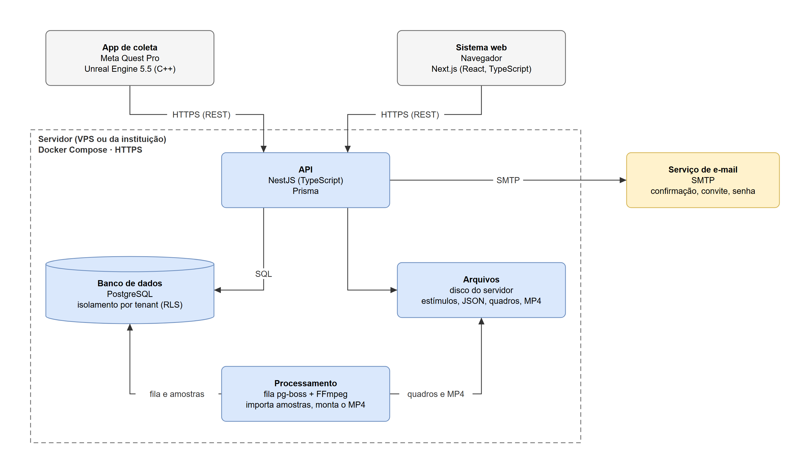

# 1 Contextualização

Versão de trabalho de 03/11/2026. Texto da seção "1 CONTEXTUALIZAÇÃO" da Especificação Técnica, no template do curso (`Referencias-e-modelos/Template Especificação Técnica TCC TADS UFPR.docx`): de 1 a 3 páginas, começando pela descrição macro do software e com pelo menos um parágrafo por apêndice, dizendo em qual apêndice cada diagrama está, e pelo menos três referências. As citações usam as mesmas chaves entre colchetes dos arquivos do artigo (`Texto-TCC/*.md`), de onde o script `montar-especificacao.pl` lê as referências completas e as numera na ordem de citação. A figura entra com a legenda no padrão "FIGURA n - Título" e "FONTE: Os autores (2026)".

---

## 1 CONTEXTUALIZAÇÃO

O NeuroSight é um sistema de apoio à pesquisa com pessoas com distúrbios da consciência (DoC, do inglês *disorders of consciousness*), condições em que a pessoa, após uma lesão cerebral grave, perde total ou parcialmente a capacidade de estar desperta e de perceber a si mesma e o ambiente. Nessas pessoas, a avaliação clínica depende de respostas comportamentais que muitas não conseguem produzir, e experimentos que registram o olhar e as expressões faciais diante de estímulos controlados ajudam a medir essas respostas. O NeuroSight reúne, em uma única ferramenta, as etapas desses experimentos em realidade virtual: o cadastro de pacientes e de estímulos, a configuração e o início das sessões, a coleta do olhar e das expressões faciais no Meta Quest Pro [META-MOVE], o armazenamento dos dados e a sua análise. O sistema não faz diagnóstico nem substitui a avaliação clínica: organiza a realização dos experimentos e o registro dos dados para que os pesquisadores possam analisá-los. O trabalho parte do protótipo de rastreamento ocular em realidade virtual desenvolvido por um dos autores em Iniciação Científica [IC], do qual reaproveita o aplicativo do óculos e a forma de gravação das sessões.

Como mostra a Figura 1, o sistema tem três partes: o aplicativo de coleta, executado no Meta Quest Pro, que baixa a sessão e os estímulos, apresenta-os ao paciente, registra o olhar e as expressões faciais, captura os quadros da cena e envia os dados; o sistema web, acessado pelo navegador, que é a interface dos pesquisadores e dos administradores; e o servidor, que reúne a API, o banco de dados, os arquivos e o processamento das sessões. Uma mesma instalação atende a vários grupos de pesquisa (*tenants*), com os dados de cada um isolados dos demais por filtro na API e por *Row-Level Security* no PostgreSQL [POSTGRES], controle de acesso por perfis cumulativos (pesquisador, administrador e proprietário) e registro de auditoria. Como os dados de saúde são dados pessoais sensíveis segundo a Lei Geral de Proteção de Dados Pessoais [LGPD], o sistema guarda apenas o necessário à pesquisa, identifica o paciente por um código e não captura imagens do rosto. O artigo que acompanha esta especificação apresenta a revisão de literatura, o método, as tecnologias e a arquitetura; este documento reúne os artefatos da modelagem, descritos a seguir.

**FIGURA 1** - Arquitetura do NeuroSight

FONTE: Os autores (2026)

Os requisitos do sistema estão no Apêndice G: 60 requisitos funcionais, agrupados em onze grupos (acesso e conta, usuários e permissões, óculos, pacientes, estímulos, modelos de sessão, sessões, execução no óculos, envio e processamento, consulta e análise e auditoria), 20 regras de negócio e 26 requisitos não funcionais de segurança e privacidade, confiabilidade, desempenho, compatibilidade, usabilidade e manutenibilidade. Cada requisito funcional tem prioridade essencial, importante ou desejável. Os requisitos foram levantados a partir da literatura, da experiência com o protótipo da IC e de reuniões com o orientador, e os onze grupos deram origem aos diagramas de casos de uso e aos épicos das histórias de usuário.

Os diagramas de casos de uso, na notação da *Unified Modeling Language* (UML) [UML], estão no Apêndice A: um diagrama com os atores e a hierarquia dos perfis e um para cada grupo de requisitos, em um total de doze diagramas e 60 casos de uso. Os atores são o visitante, o usuário (abstrato), o pesquisador, o administrador e o proprietário, ligados por generalização para representar os perfis cumulativos, e o paciente, ator secundário que usa o óculos durante a sessão, mas não acessa o sistema. Cada diagrama é acompanhado de uma tabela com o ator, as relações de inclusão e extensão e os requisitos de cada caso de uso, o que dá a rastreabilidade entre os requisitos e os casos de uso.

O diagrama de classes está no Apêndice B. É um modelo de domínio, com 18 classes e 8 enumerações, que mostra o que o sistema guarda e como as informações se relacionam: o *tenant* e seus usuários, óculos e pacientes; os estímulos, os modelos de sessão e as sessões, com a sequência de estímulos e os seus tempos; e os dados coletados em cada sessão, com os eventos de estímulo, as amostras de olhar e de expressão facial, a gravação e os registros de auditoria. Uma segunda página mostra as composições entre o *tenant* e as classes que pertencem a ele, e as regras de negócio que o diagrama não representa graficamente são listadas no mesmo apêndice. O comportamento da classe Sessao ao longo do tempo está no diagrama de máquina de estados do Apêndice H, com os nove estados por que uma sessão passa, do rascunho à conclusão ou à falha, e as doze transições, com os seus eventos e condições de guarda.

O Apêndice C traz, para cada caso de uso, a história de usuário, o protótipo de tela e o diagrama de sequência relacionados. Cada diagrama de casos de uso foi definido como um épico, desdobrado em histórias no formato "sendo, quero, para" [COHN], uma por caso de uso, com critérios de aceitação e prioridade: são 60 histórias, 35 essenciais, 19 importantes e 6 desejáveis, que formarão o *backlog* do desenvolvimento. Os protótipos são 19 telas de média fidelidade, 14 do sistema web e 5 do aplicativo do óculos, feitas em HTML e CSS de forma navegável, com dados fictícios coerentes entre si; os casos de uso que repetem padrões já mostrados não ganharam tela própria, e o apêndice indica qual tela os representa. Os diagramas de sequência cobrem os seis fluxos principais do sistema, do autocadastro do *tenant* à análise da sessão, e mostram a comunicação entre os atores e os componentes da arquitetura; os casos de uso de cadastro e consulta, cujas chamadas seguem o mesmo padrão, remetem ao diagrama que ilustra esse padrão.

O modelo lógico do banco de dados está no Apêndice D, na notação pé de galinha, em três páginas: experimento, dados coletados e acesso, óculos e auditoria. São 20 tabelas e 8 tipos enumerados, para o PostgreSQL 15 ou mais novo. Toda tabela com dados de um *tenant* tem a coluna `tenant_id`, e as chaves estrangeiras são compostas com o *tenant*, para que o próprio banco garanta que um registro só referencia registros do mesmo grupo; as políticas de *Row-Level Security* [POSTGRES] complementam o filtro feito na API. O apêndice traz ainda a correspondência entre as classes e as tabelas, as restrições e os índices, o comportamento das chaves estrangeiras na exclusão e o dicionário de dados de todas as tabelas.

A especificação das APIs está no Apêndice E. O sistema web e o aplicativo do óculos se comunicam apenas com a API, por HTTPS, no estilo REST; o sistema web usa um JSON Web Token com o *tenant* e o perfil do usuário, e o óculos usa um *token* próprio, obtido em um pareamento que simplifica o fluxo de autorização de dispositivos do OAuth 2.0 [RFC8628]. O apêndice lista as rotas usadas nos diagramas de sequência, com quem as chama, para quê e em qual diagrama aparecem, e as decisões de projeto que elas refletem, como a consulta periódica do óculos que serve de sinal de vida, entrega a sessão e transmite o comando de início. A lista completa das rotas será documentada em OpenAPI [OPENAPI] na etapa de desenvolvimento, como contrato entre o servidor e o aplicativo.

O Apêndice F, previsto no template para os modelos de inteligência artificial, não se aplica ao NeuroSight: o sistema não treina nem executa modelos de inteligência artificial. Os valores das expressões faciais, baseados no *Facial Action Coding System* [EKMAN], são fornecidos pelo kit de desenvolvimento da Meta [META-MOVE], e a análise das respostas do paciente cabe aos pesquisadores, a partir dos dados registrados. Por fim, o Apêndice I apresenta os processos de negócio em *Business Process Model and Notation* (BPMN) [BPMN]: o processo atual do experimento, sem o NeuroSight, montado a partir dos estudos revisados e do protótipo da IC, e o processo com o NeuroSight, do paciente incluído na pesquisa até a sessão analisada, com a correspondência entre as etapas e os casos de uso.

Os arquivos editáveis dos diagramas, feitos no draw.io [DRAWIO], e dos protótipos estão disponíveis em https://github.com/joaozanini/tcc1, na pasta Especificacao. Nas figuras e nas tabelas deste documento, a fonte "Os autores (2026)" indica elaboração própria.
