# ESPECIFICAÇÃO TÉCNICA DO SISTEMA NEUROSIGHT

Gerado em 10/11/2026 por montar-especificacao.pl a partir de Contextualizacao.md, Resumo-e-Abstract.md e da pasta Especificacao. Não edite aqui: mude a fonte e monte de novo. O arquivo gerar-especificacao-docx.ps1 lê este .md e preenche o template do curso no Word.

Autores: João Vitor Zanini Pedro, Lucas Sarnacki Guiraud

Orientador: Prof. Dr. Alessandro Brawerman

Ano: 2026

**Resumo:** Este documento é a Especificação Técnica do NeuroSight, um sistema de apoio à pesquisa com pessoas com distúrbios da consciência que reúne, em uma única ferramenta, as etapas dos experimentos com rastreamento ocular e expressões faciais em realidade virtual: o cadastro de pacientes e de estímulos, a configuração e o início das sessões pelo sistema web, a coleta do olhar e das expressões faciais no Meta Quest Pro, o armazenamento dos dados e a sua análise. O sistema é formado por um aplicativo para o óculos, em Unreal Engine, um sistema web, em Next.js, e um servidor, em NestJS com PostgreSQL, e uma mesma instalação atende a vários grupos de pesquisa, com os dados de cada um isolados dos demais, controle de acesso por perfis e registro de auditoria. A especificação apresenta os artefatos produzidos na etapa de modelagem do Trabalho de Conclusão de Curso: os requisitos funcionais, as regras de negócio e os requisitos não funcionais; os doze diagramas de casos de uso, com 60 casos de uso; o diagrama de classes e o diagrama de estados da sessão; as 60 histórias de usuário, com critérios de aceitação e prioridade, acompanhadas dos 19 protótipos de tela e dos seis diagramas de sequência dos fluxos principais; o modelo lógico do banco de dados, com 20 tabelas, as políticas de isolamento por tenant e o dicionário de dados; a especificação das rotas da API; e os processos de negócio do experimento, como é conduzido hoje e com o NeuroSight, em BPMN. Os diagramas seguem a notação UML, com exceção dos processos, em BPMN. O documento acompanha o artigo do TCC, que apresenta a revisão de literatura, o método, as tecnologias e a arquitetura do sistema, e serve de base para a etapa de desenvolvimento.

**Palavras-chave:** Distúrbios da consciência; Rastreamento ocular; Realidade virtual; Expressões faciais; Especificação de software.

**Abstract:** This document is the Technical Specification of NeuroSight, a research support system for people with disorders of consciousness that brings together, in a single tool, the steps of eye-tracking and facial-expression experiments in virtual reality: registering patients and stimuli, configuring and starting sessions from the web system, collecting gaze and facial expression data with the Meta Quest Pro, storing the data, and analyzing it. The system consists of a headset application, in Unreal Engine, a web system, in Next.js, and a server, in NestJS with PostgreSQL, and a single installation serves several research groups, with each group's data isolated from the others, role-based access control, and audit logging. The specification presents the artifacts produced in the modeling stage of the undergraduate thesis: the functional requirements, business rules, and non-functional requirements; the twelve use case diagrams, with 60 use cases; the class diagram and the session state diagram; the 60 user stories, with acceptance criteria and priority, accompanied by the 19 screen prototypes and the six sequence diagrams of the main flows; the logical database model, with 20 tables, the tenant isolation policies, and the data dictionary; the specification of the API routes; and the business processes of the experiment, as it is conducted today and with NeuroSight, in BPMN. The diagrams follow the UML notation, except for the processes, in BPMN. The document accompanies the thesis paper, which presents the literature review, the method, the technologies, and the system architecture, and serves as the basis for the development stage.

**Keywords:** Disorders of consciousness; Eye tracking; Virtual reality; Facial expressions; Software specification.

## CONTEXTUALIZAÇÃO

O NeuroSight é um sistema de apoio à pesquisa com pessoas com distúrbios da consciência (DoC, do inglês *disorders of consciousness*), condições em que a pessoa, após uma lesão cerebral grave, perde total ou parcialmente a capacidade de estar desperta e de perceber a si mesma e o ambiente. Nessas pessoas, a avaliação clínica depende de respostas comportamentais que muitas não conseguem produzir, e experimentos que registram o olhar e as expressões faciais diante de estímulos controlados ajudam a medir essas respostas. O NeuroSight reúne, em uma única ferramenta, as etapas desses experimentos em realidade virtual: o cadastro de pacientes e de estímulos, a configuração e o início das sessões, a coleta do olhar e das expressões faciais no Meta Quest Pro [1], o armazenamento dos dados e a sua análise. O sistema não faz diagnóstico nem substitui a avaliação clínica: organiza a realização dos experimentos e o registro dos dados para que os pesquisadores possam analisá-los. O trabalho parte do protótipo de rastreamento ocular em realidade virtual desenvolvido por um dos autores em Iniciação Científica [2], do qual reaproveita o aplicativo do óculos e a forma de gravação das sessões.

Como mostra a Figura 1, o sistema tem três partes: o aplicativo de coleta, executado no Meta Quest Pro, que baixa a sessão e os estímulos, apresenta-os ao paciente, registra o olhar e as expressões faciais, captura os quadros da cena e envia os dados; o sistema web, acessado pelo navegador, que é a interface dos pesquisadores e dos administradores; e o servidor, que reúne a API, o banco de dados, os arquivos e o processamento das sessões. Uma mesma instalação atende a vários grupos de pesquisa (*tenants*), com os dados de cada um isolados dos demais por filtro na API e por *Row-Level Security* no PostgreSQL [3], controle de acesso por perfis cumulativos (pesquisador, administrador e proprietário) e registro de auditoria. Como os dados de saúde são dados pessoais sensíveis segundo a Lei Geral de Proteção de Dados Pessoais [4], o sistema guarda apenas o necessário à pesquisa, identifica o paciente por um código e não captura imagens do rosto. O artigo que acompanha esta especificação apresenta a revisão de literatura, o método, as tecnologias e a arquitetura; este documento reúne os artefatos da modelagem, descritos a seguir.

**FIGURA 1** - Arquitetura do NeuroSight

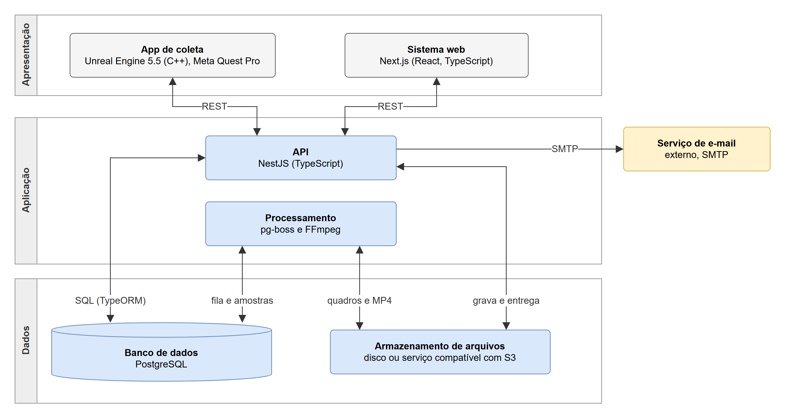

FONTE: Os autores (2026)

Os requisitos do sistema estão no Apêndice G: 60 requisitos funcionais, agrupados em onze grupos (acesso e conta, usuários e permissões, óculos, pacientes, estímulos, modelos de sessão, sessões, execução no óculos, envio e processamento, consulta e análise e auditoria), 20 regras de negócio e 26 requisitos não funcionais de segurança e privacidade, confiabilidade, desempenho, compatibilidade, usabilidade e manutenibilidade. Cada requisito funcional tem prioridade essencial, importante ou desejável. Os requisitos foram levantados a partir da literatura, da experiência com o protótipo da IC e de reuniões com o orientador, e os onze grupos deram origem aos diagramas de casos de uso e aos épicos das histórias de usuário.

Os diagramas de casos de uso, na notação da *Unified Modeling Language* (UML) [5], estão no Apêndice A: um diagrama com os atores e a hierarquia dos perfis e um para cada grupo de requisitos, em um total de doze diagramas e 60 casos de uso. Os atores são o visitante, o usuário (abstrato), o pesquisador, o administrador e o proprietário, ligados por generalização para representar os perfis cumulativos, e o paciente, ator secundário que usa o óculos durante a sessão, mas não acessa o sistema. Cada diagrama é acompanhado de uma tabela com o ator, as relações de inclusão e extensão e os requisitos de cada caso de uso, o que dá a rastreabilidade entre os requisitos e os casos de uso.

O diagrama de classes está no Apêndice B. É um modelo de domínio, com 18 classes e 8 enumerações, que mostra o que o sistema guarda e como as informações se relacionam: o *tenant* e seus usuários, óculos e pacientes; os estímulos, os modelos de sessão e as sessões, com a sequência de estímulos e os seus tempos; e os dados coletados em cada sessão, com os eventos de estímulo, as amostras de olhar e de expressão facial, a gravação e os registros de auditoria. Uma segunda página mostra as composições entre o *tenant* e as classes que pertencem a ele, e as regras de negócio que o diagrama não representa graficamente são listadas no mesmo apêndice. O comportamento da classe Sessao ao longo do tempo está no diagrama de máquina de estados do Apêndice H, com os nove estados por que uma sessão passa, do rascunho à conclusão ou à falha, e as doze transições, com os seus eventos e condições de guarda.

O Apêndice C traz, para cada caso de uso, a história de usuário, o protótipo de tela e o diagrama de sequência relacionados. Cada diagrama de casos de uso foi definido como um épico, desdobrado em histórias no formato "sendo, quero, para" [6], uma por caso de uso, com critérios de aceitação e prioridade: são 60 histórias, 35 essenciais, 19 importantes e 6 desejáveis, que formarão o *backlog* do desenvolvimento. Os protótipos são 19 telas de média fidelidade, 14 do sistema web e 5 do aplicativo do óculos, feitas em HTML e CSS de forma navegável, com dados fictícios coerentes entre si; os casos de uso que repetem padrões já mostrados não ganharam tela própria, e o apêndice indica qual tela os representa. Os diagramas de sequência cobrem os seis fluxos principais do sistema, do autocadastro do *tenant* à análise da sessão, e mostram a comunicação entre os atores e os componentes da arquitetura; os casos de uso de cadastro e consulta, cujas chamadas seguem o mesmo padrão, remetem ao diagrama que ilustra esse padrão.

O modelo lógico do banco de dados está no Apêndice D, na notação pé de galinha, em três páginas: experimento, dados coletados e acesso, óculos e auditoria. São 20 tabelas e 8 tipos enumerados, para o PostgreSQL 15 ou mais novo. Toda tabela com dados de um *tenant* tem a coluna `tenant_id`, e as chaves estrangeiras são compostas com o *tenant*, para que o próprio banco garanta que um registro só referencia registros do mesmo grupo; as políticas de *Row-Level Security* [3] complementam o filtro feito na API. O apêndice traz ainda a correspondência entre as classes e as tabelas, as restrições e os índices, o comportamento das chaves estrangeiras na exclusão e o dicionário de dados de todas as tabelas.

A especificação das APIs está no Apêndice E. O sistema web e o aplicativo do óculos se comunicam apenas com a API, por HTTPS, no estilo REST; o sistema web usa um JSON Web Token com o *tenant* e o perfil do usuário, e o óculos usa um *token* próprio, obtido em um pareamento que simplifica o fluxo de autorização de dispositivos do OAuth 2.0 [7]. O apêndice lista as rotas usadas nos diagramas de sequência, com quem as chama, para quê e em qual diagrama aparecem, e as decisões de projeto que elas refletem, como a consulta periódica do óculos que serve de sinal de vida, entrega a sessão e transmite o comando de início. A lista completa das rotas será documentada em OpenAPI [8] na etapa de desenvolvimento, como contrato entre o servidor e o aplicativo.

O Apêndice F, previsto no template para os modelos de inteligência artificial, não se aplica ao NeuroSight: o sistema não treina nem executa modelos de inteligência artificial. Os valores das expressões faciais, baseados no *Facial Action Coding System* [9], são fornecidos pelo kit de desenvolvimento da Meta [1], e a análise das respostas do paciente cabe aos pesquisadores, a partir dos dados registrados. Por fim, o Apêndice I apresenta os processos de negócio em *Business Process Model and Notation* (BPMN) [10]: o processo atual do experimento, sem o NeuroSight, montado a partir dos estudos revisados e do protótipo da IC, e o processo com o NeuroSight, do paciente incluído na pesquisa até a sessão analisada, com a correspondência entre as etapas e os casos de uso.

Os arquivos editáveis dos diagramas, feitos no draw.io [11], e dos protótipos estão disponíveis em https://github.com/joaozanini/tcc1, na pasta Especificacao. Nas figuras e nas tabelas deste documento, a fonte "Os autores (2026)" indica elaboração própria.

## REFERÊNCIAS

[1] META PLATFORMS. *Movement SDK for Unreal*. Meta Horizon OS Developers, 2026. Disponível em: https://developers.meta.com/vr/documentation/unreal/unreal-movement-overview/. Acesso em: 26 out. 2026.

[2] PEDRO, J. V. Z. *Desenvolvimento de um sistema de rastreamento ocular em realidade virtual para análise de atenção visual aplicada ao estudo da recepção comunicacional*. Relatório final de Iniciação Científica (Edital 2025) – Universidade Federal do Paraná, Curitiba, 2026. Orientador: Alessandro Brawerman. Disponível em: https://github.com/joaozanini/QuestPro-EyeTracking. Acesso em: 26 out. 2026.

[3] POSTGRESQL GLOBAL DEVELOPMENT GROUP. *PostgreSQL documentation: row security policies*. 2026. Disponível em: https://www.postgresql.org/docs/current/ddl-rowsecurity.html. Acesso em: 26 out. 2026.

[4] BRASIL. *Lei nº 13.709, de 14 de agosto de 2018*. Lei Geral de Proteção de Dados Pessoais (LGPD). Brasília, DF: Presidência da República, [2018]. Disponível em: https://www.planalto.gov.br/ccivil_03/_ato2015-2018/2018/lei/l13709compilado.htm. Acesso em: 26 out. 2026.

[5] OBJECT MANAGEMENT GROUP. *OMG Unified Modeling Language (OMG UML)*: version 2.5.1. Needham: OMG, 2017. Disponível em: https://www.omg.org/spec/UML/2.5.1/. Acesso em: 26 out. 2026.

[6] COHN, M. *User stories applied: for agile software development*. Boston: Addison-Wesley, 2004.

[7] DENNISS, W. *et al*. *OAuth 2.0 Device Authorization Grant*. RFC 8628. [S.l.]: IETF, 2019. Disponível em: https://www.rfc-editor.org/rfc/rfc8628. Acesso em: 26 out. 2026.

[8] OPENAPI INITIATIVE. *OpenAPI Specification*: version 3.2.1. 2026. Disponível em: https://spec.openapis.org/oas/v3.2.1.html. Acesso em: 26 out. 2026.

[9] EKMAN, P.; FRIESEN, W. V. *Facial Action Coding System: a technique for the measurement of facial movement*. Palo Alto: Consulting Psychologists Press, 1978.

[10] OBJECT MANAGEMENT GROUP. *Business Process Model and Notation (BPMN)*: version 2.0.2. Needham: OMG, 2013. Disponível em: https://www.omg.org/spec/BPMN/2.0.2/. Acesso em: 26 out. 2026.

[11] JGRAPH. *draw.io*. 2026. Disponível em: https://www.drawio.com/. Acesso em: 26 out. 2026.

## APÊNDICE A – DIAGRAMA DE CASOS DE USO

Este apêndice apresenta os doze diagramas de casos de uso do NeuroSight, na notação UML: um com os atores e a hierarquia dos perfis (UC00) e um para cada grupo de requisitos (UC01 a UC11), totalizando 60 casos de uso. Nos diagramas, os casos de uso com borda tracejada e fundo cinza pertencem a outro diagrama e aparecem apenas para mostrar as relações de inclusão e extensão. Nas tabelas, o ator "—" marca os casos de uso incluídos ou estendidos: quem interage neles é o ator do caso base, e a coluna Relações registra, nos casos estendidos, a condição e o ponto de extensão. A coluna Requisitos dá a rastreabilidade entre cada caso de uso e os requisitos do Apêndice G.

**TABELA 1** - Atores do NeuroSight

| Ator | Descrição | Herda de |
|---|---|---|
| Usuário | Abstrato: qualquer pessoa com conta no tenant | — |
| Pesquisador | Cadastra pacientes, estímulos, modelos e sessões; envia, inicia e analisa as sessões | Usuário |
| Administrador | Gerencia usuários, óculos, visibilidade das sessões e auditoria | Pesquisador |
| Proprietário | Criou o tenant; define quem é administrador | Administrador |
| Visitante | Pessoa sem conta; conhece o sistema e cria um tenant | — |
| Paciente | Não é usuário (RN06). Ator secundário: usa o óculos durante a execução da sessão (UC08.3) | — |

FONTE: Os autores (2026)

A herança entre os atores representa os perfis cumulativos (RN05): cada perfil faz tudo o que o perfil de quem herda faz. O aplicativo do óculos faz parte do NeuroSight, por isso não é ator. A Figura 2 reúne, numa visão geral, o diagrama das sessões (UC07), que concentra o fluxo principal do sistema, com a hierarquia dos perfis e o paciente.

**FIGURA 2** - Diagrama de casos de uso das sessões, com os perfis de usuário

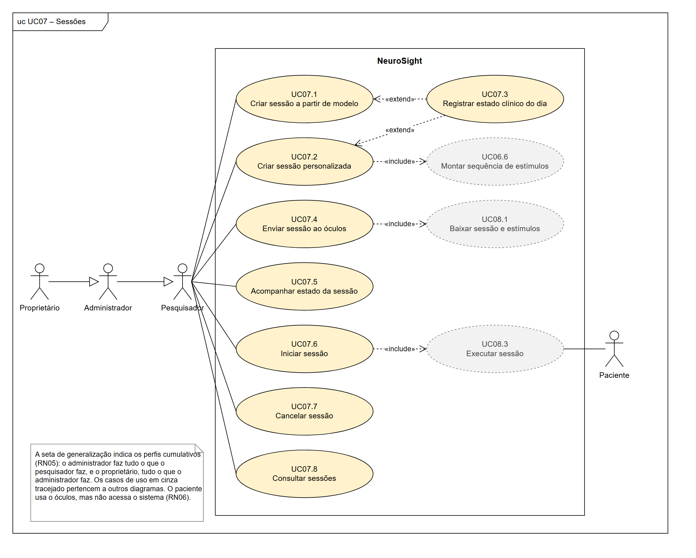

FONTE: Os autores (2026)

**TABELA 2** - Resumo dos diagramas de casos de uso e dos épicos

| Diagrama / épico | Grupo de requisitos | Atores | Casos de uso | Requisitos |
|---|---|---|---|---|
| UC01 / E01 – Acesso e conta | 2.1 | Visitante, Usuário, Proprietário | 8 | RF01–RF08 |
| UC02 / E02 – Usuários e permissões | 2.2 | Administrador, Proprietário | 6 | RF09–RF12 |
| UC03 / E03 – Óculos | 2.3 | Administrador | 4 | RF13–RF16 |
| UC04 / E04 – Pacientes | 2.4 | Pesquisador, Administrador | 5 | RF17–RF21 |
| UC05 / E05 – Estímulos | 2.5 | Pesquisador | 5 | RF22–RF26 |
| UC06 / E06 – Modelos de sessão | 2.6 | Pesquisador | 7 | RF27–RF29 |
| UC07 / E07 – Sessões | 2.7 | Pesquisador | 8 | RF30–RF37 |
| UC08 / E08 – Execução no óculos | 2.8 | Pesquisador, Paciente | 6 | RF38–RF47 |
| UC09 / E09 – Envio e processamento | 2.9 | Pesquisador | 2 | RF48–RF51 |
| UC10 / E10 – Consulta e análise | 2.10 | Pesquisador | 7 | RF52–RF58 |
| UC11 / E11 – Auditoria | 2.11 | Administrador | 2 | RF59–RF60 |

FONTE: Os autores (2026)

### UC00 – Atores e perfis

**FIGURA 3** - Diagrama de casos de uso UC00 – Atores e perfis

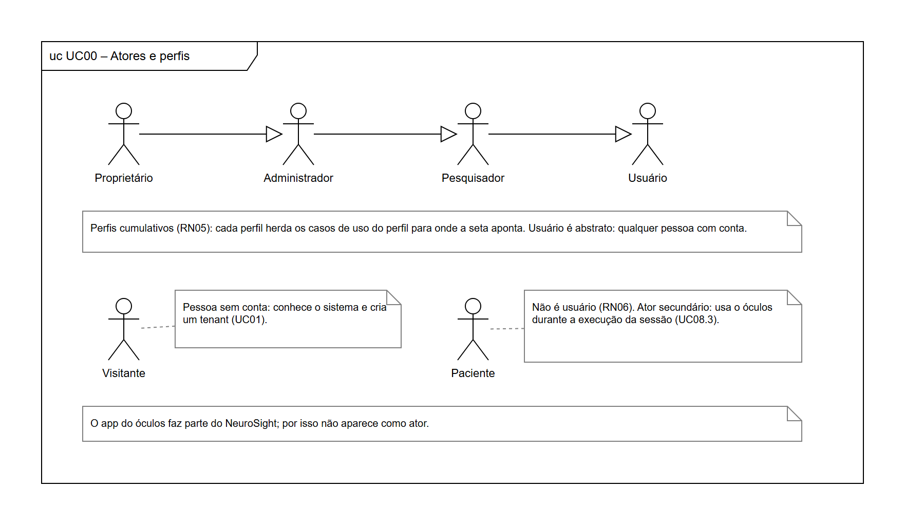

FONTE: Os autores (2026)

### UC01 – Acesso e conta

**FIGURA 4** - Diagrama de casos de uso UC01 – Acesso e conta

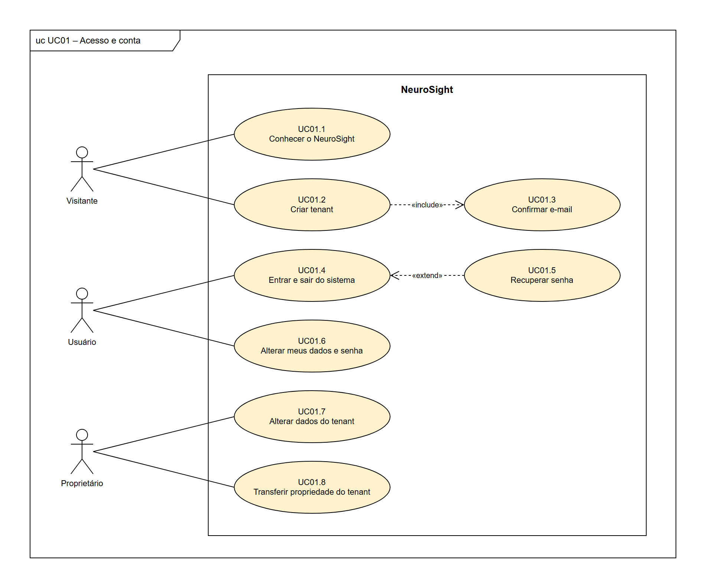

FONTE: Os autores (2026)

**TABELA 3** - Casos de uso do diagrama UC01 – Acesso e conta

| Caso de uso | Ator | Relações | Requisitos |
|---|---|---|---|
| UC01.1 Conhecer o NeuroSight | Visitante | — | RF01 |
| UC01.2 Criar tenant | Visitante | inclui UC01.3 | RF02 |
| UC01.3 Confirmar e-mail | — | incluído por UC01.2 | RF03 |
| UC01.4 Entrar e sair do sistema | Usuário | estendido por UC01.5 | RF04 |
| UC01.5 Recuperar senha | — | estende UC01.4 (condição: o usuário esqueceu a senha; ponto de extensão: tela de entrada) | RF05 |
| UC01.6 Alterar meus dados e senha | Usuário | — | RF06 |
| UC01.7 Alterar dados do tenant | Proprietário | — | RF07 |
| UC01.8 Transferir propriedade do tenant | Proprietário | — | RF08 |

FONTE: Os autores (2026)

### UC02 – Usuários e permissões

**FIGURA 5** - Diagrama de casos de uso UC02 – Usuários e permissões

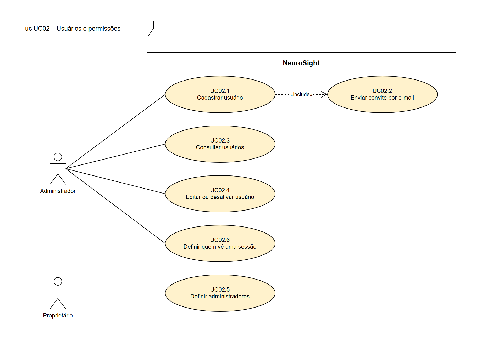

FONTE: Os autores (2026)

**TABELA 4** - Casos de uso do diagrama UC02 – Usuários e permissões

| Caso de uso | Ator | Relações | Requisitos |
|---|---|---|---|
| UC02.1 Cadastrar usuário | Administrador | inclui UC02.2 | RF09 |
| UC02.2 Enviar convite por e-mail | — | incluído por UC02.1 | RF09 |
| UC02.3 Consultar usuários | Administrador | — | RF10 |
| UC02.4 Editar ou desativar usuário | Administrador | — | RF10 |
| UC02.5 Definir administradores | Proprietário | — | RF11 |
| UC02.6 Definir quem vê uma sessão | Administrador | — | RF12 |

FONTE: Os autores (2026)

### UC03 – Óculos

**FIGURA 6** - Diagrama de casos de uso UC03 – Óculos

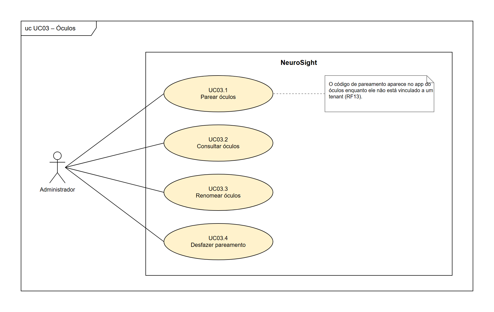

FONTE: Os autores (2026)

**TABELA 5** - Casos de uso do diagrama UC03 – Óculos

| Caso de uso | Ator | Relações | Requisitos |
|---|---|---|---|
| UC03.1 Parear óculos | Administrador | — | RF13, RF14 |
| UC03.2 Consultar óculos | Administrador | — | RF15 |
| UC03.3 Renomear óculos | Administrador | — | RF16 |
| UC03.4 Desfazer pareamento | Administrador | — | RF16 |

FONTE: Os autores (2026)

### UC04 – Pacientes

**FIGURA 7** - Diagrama de casos de uso UC04 – Pacientes

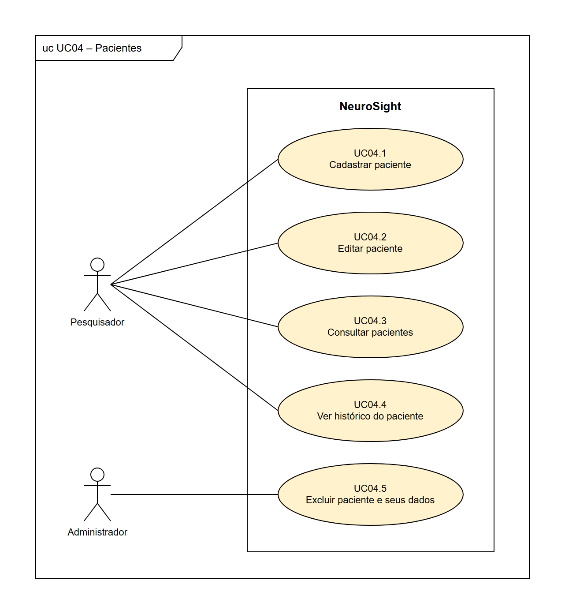

FONTE: Os autores (2026)

**TABELA 6** - Casos de uso do diagrama UC04 – Pacientes

| Caso de uso | Ator | Relações | Requisitos |
|---|---|---|---|
| UC04.1 Cadastrar paciente | Pesquisador | — | RF17 |
| UC04.2 Editar paciente | Pesquisador | — | RF18 |
| UC04.3 Consultar pacientes | Pesquisador | — | RF19 |
| UC04.4 Ver histórico do paciente | Pesquisador | — | RF20 |
| UC04.5 Excluir paciente e seus dados | Administrador | — | RF21 |

FONTE: Os autores (2026)

### UC05 – Estímulos

**FIGURA 8** - Diagrama de casos de uso UC05 – Estímulos

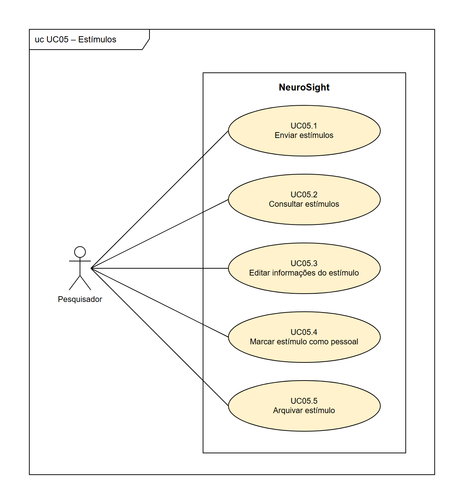

FONTE: Os autores (2026)

**TABELA 7** - Casos de uso do diagrama UC05 – Estímulos

| Caso de uso | Ator | Relações | Requisitos |
|---|---|---|---|
| UC05.1 Enviar estímulos | Pesquisador | — | RF22 |
| UC05.2 Consultar estímulos | Pesquisador | — | RF23 |
| UC05.3 Editar informações do estímulo | Pesquisador | — | RF24 |
| UC05.4 Marcar estímulo como pessoal | Pesquisador | — | RF25 |
| UC05.5 Arquivar estímulo | Pesquisador | — | RF26 |

FONTE: Os autores (2026)

### UC06 – Modelos de sessão

**FIGURA 9** - Diagrama de casos de uso UC06 – Modelos de sessão

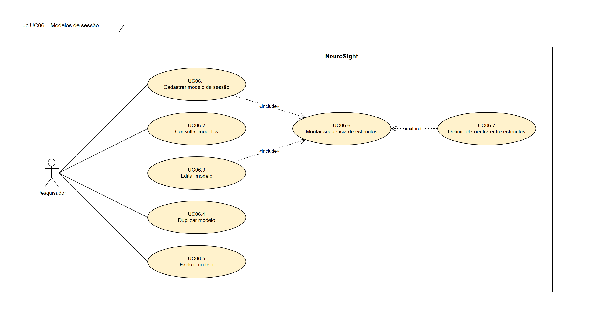

FONTE: Os autores (2026)

**TABELA 8** - Casos de uso do diagrama UC06 – Modelos de sessão

| Caso de uso | Ator | Relações | Requisitos |
|---|---|---|---|
| UC06.1 Cadastrar modelo de sessão | Pesquisador | inclui UC06.6 | RF27 |
| UC06.2 Consultar modelos | Pesquisador | — | RF28 |
| UC06.3 Editar modelo | Pesquisador | inclui UC06.6 | RF28 |
| UC06.4 Duplicar modelo | Pesquisador | — | RF28 |
| UC06.5 Excluir modelo | Pesquisador | — | RF28 |
| UC06.6 Montar sequência de estímulos | — | incluído por UC06.1, UC06.3 e UC07.2; estendido por UC06.7 | RF27, RF31 |
| UC06.7 Definir tela neutra entre estímulos | — | estende UC06.6 (condição: o pesquisador opta por inserir uma tela neutra; ponto de extensão: montagem da sequência) | RF29 |

FONTE: Os autores (2026)

### UC07 – Sessões

**FIGURA 10** - Diagrama de casos de uso UC07 – Sessões

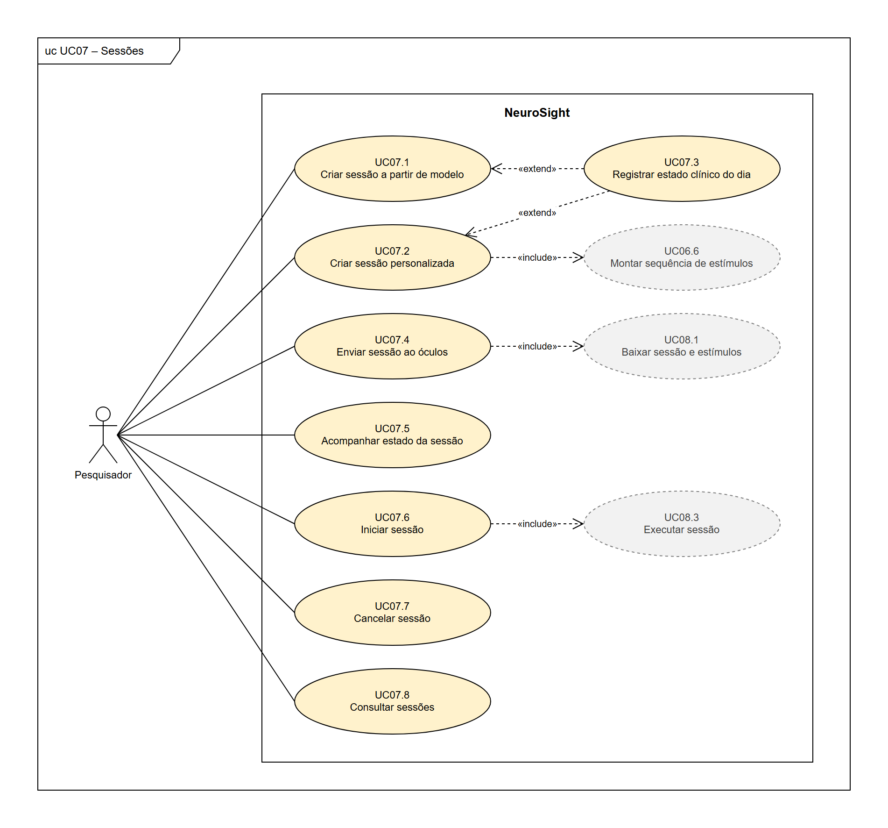

FONTE: Os autores (2026)

**TABELA 9** - Casos de uso do diagrama UC07 – Sessões

| Caso de uso | Ator | Relações | Requisitos |
|---|---|---|---|
| UC07.1 Criar sessão a partir de modelo | Pesquisador | estendido por UC07.3 | RF30 |
| UC07.2 Criar sessão personalizada | Pesquisador | inclui UC06.6; estendido por UC07.3 | RF31 |
| UC07.3 Registrar estado clínico do dia | — | estende UC07.1 e UC07.2 (condição: o pesquisador opta por registrar o estado clínico do dia, que é opcional; ponto de extensão: antes de salvar a sessão) | RF32 |
| UC07.4 Enviar sessão ao óculos | Pesquisador | inclui UC08.1 | RF33 |
| UC07.5 Acompanhar estado da sessão | Pesquisador | — | RF34 |
| UC07.6 Iniciar sessão | Pesquisador | inclui UC08.3 | RF35 |
| UC07.7 Cancelar sessão | Pesquisador | — | RF36 |
| UC07.8 Consultar sessões | Pesquisador | — | RF37 |

FONTE: Os autores (2026)

### UC08 – Execução no óculos

**FIGURA 11** - Diagrama de casos de uso UC08 – Execução no óculos

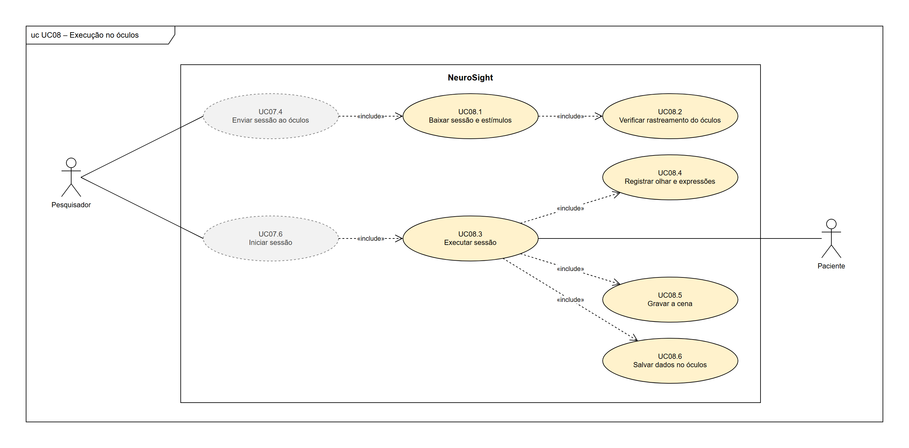

FONTE: Os autores (2026)

**TABELA 10** - Casos de uso do diagrama UC08 – Execução no óculos

| Caso de uso | Ator | Relações | Requisitos |
|---|---|---|---|
| UC08.1 Baixar sessão e estímulos | — | incluído por UC07.4; inclui UC08.2 | RF38, RF40 |
| UC08.2 Verificar rastreamento do óculos | — | incluído por UC08.1 | RF39 |
| UC08.3 Executar sessão | Paciente (secundário) | incluído por UC07.6; inclui UC08.4, UC08.5, UC08.6 e UC09.1 | RF41, RF42 |
| UC08.4 Registrar olhar e expressões | — | incluído por UC08.3 | RF43, RF44, RF45 |
| UC08.5 Gravar a cena | — | incluído por UC08.3 | RF46 |
| UC08.6 Salvar dados no óculos | — | incluído por UC08.3 | RF47 |

FONTE: Os autores (2026)

### UC09 – Envio e processamento

**FIGURA 12** - Diagrama de casos de uso UC09 – Envio e processamento

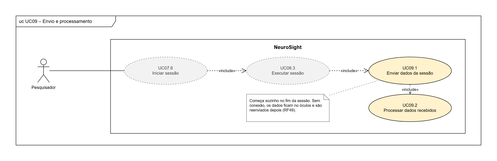

FONTE: Os autores (2026)

**TABELA 11** - Casos de uso do diagrama UC09 – Envio e processamento

| Caso de uso | Ator | Relações | Requisitos |
|---|---|---|---|
| UC09.1 Enviar dados da sessão | — | incluído por UC08.3; inclui UC09.2 | RF48, RF49 |
| UC09.2 Processar dados recebidos | — | incluído por UC09.1 | RF50, RF51 |

FONTE: Os autores (2026)

### UC10 – Consulta e análise

**FIGURA 13** - Diagrama de casos de uso UC10 – Consulta e análise

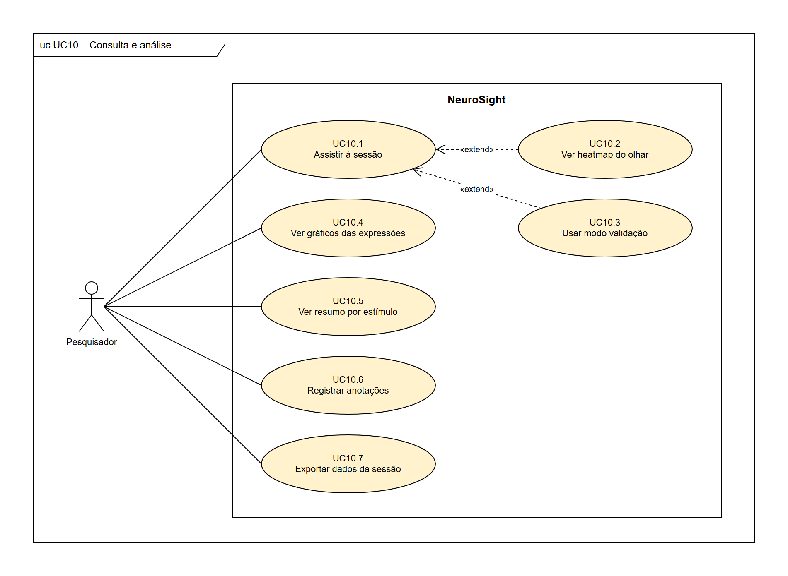

FONTE: Os autores (2026)

**TABELA 12** - Casos de uso do diagrama UC10 – Consulta e análise

| Caso de uso | Ator | Relações | Requisitos |
|---|---|---|---|
| UC10.1 Assistir à sessão | Pesquisador | estendido por UC10.2 e UC10.3 | RF52 |
| UC10.2 Ver heatmap do olhar | — | estende UC10.1 (condição: o pesquisador ativa o heatmap; ponto de extensão: reprodução do vídeo) | RF53 |
| UC10.3 Usar modo validação | — | estende UC10.1 (condição: o pesquisador ativa o modo validação; ponto de extensão: reprodução do vídeo) | RF54 |
| UC10.4 Ver gráficos das expressões | Pesquisador | — | RF55 |
| UC10.5 Ver resumo por estímulo | Pesquisador | — | RF56 |
| UC10.6 Registrar anotações | Pesquisador | — | RF57 |
| UC10.7 Exportar dados da sessão | Pesquisador | — | RF58 |

FONTE: Os autores (2026)

### UC11 – Auditoria

**FIGURA 14** - Diagrama de casos de uso UC11 – Auditoria

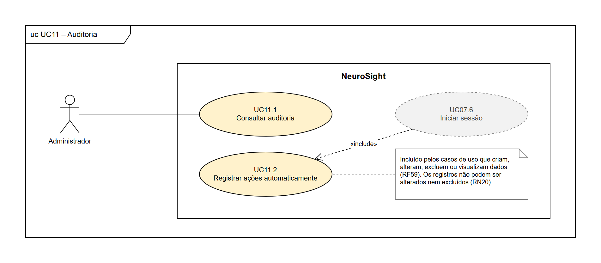

FONTE: Os autores (2026)

**TABELA 13** - Casos de uso do diagrama UC11 – Auditoria

| Caso de uso | Ator | Relações | Requisitos |
|---|---|---|---|
| UC11.1 Consultar auditoria | Administrador | — | RF60 |
| UC11.2 Registrar ações automaticamente | — | incluído pelos casos de uso que criam, alteram, excluem ou visualizam dados (no diagrama, UC07.6 aparece como exemplo) | RF59 |

FONTE: Os autores (2026)

## APÊNDICE B – DIAGRAMA DE CLASSES

O diagrama de classes é um modelo de domínio: mostra o que o sistema guarda e como as informações se relacionam. Tabelas, colunas e chaves ficam para o modelo lógico-relacional (Apêndice D). O diagrama tem duas páginas: a primeira com todas as classes, atributos, relações e enumerações (Figura 15) e a segunda com as composições entre o *tenant* e as classes que pertencem a ele (Figura 16). O comportamento da classe Sessao ao longo do tempo está no diagrama de estados do Apêndice H.

- **«tenant»:** a classe pertence a exatamente um tenant (RN01). As composições com o Tenant estão na página 2, para não cruzar o diagrama principal.
- **{abstrata}, nome em itálico:** SequenciaDeEstimulos não existe sozinha; ModeloDeSessao e Sessao herdam dela.
- **Losango preenchido (composição):** a parte não existe sem o todo, e excluir o todo exclui as partes.
- **Atributo com tipo de classe** (por exemplo, `autor: Usuario` ou `oculos: Dispositivo`): é uma associação mostrada como atributo, para não encher o diagrama de linhas até Usuario.
- **"/" antes do nome:** atributo derivado, calculado a partir de outros.
- **Tipos:** Texto, Inteiro, Decimal, Booleano, Data, DataHora, UUID e JSON. Vetor2 e Vetor3 são pares e trincas de Decimal; `Mapa<Texto, Decimal>` associa um nome a um valor.

**FIGURA 15** - Diagrama de classes do NeuroSight

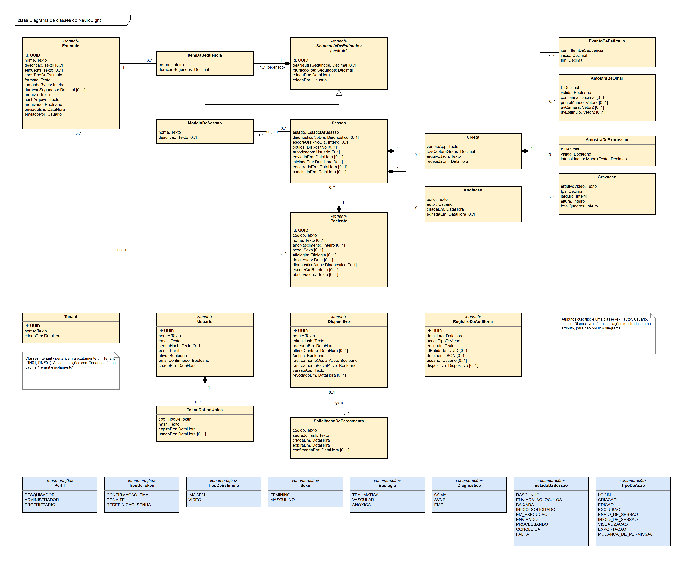

FONTE: Os autores (2026)

**FIGURA 16** - Diagrama de classes: tenant e isolamento

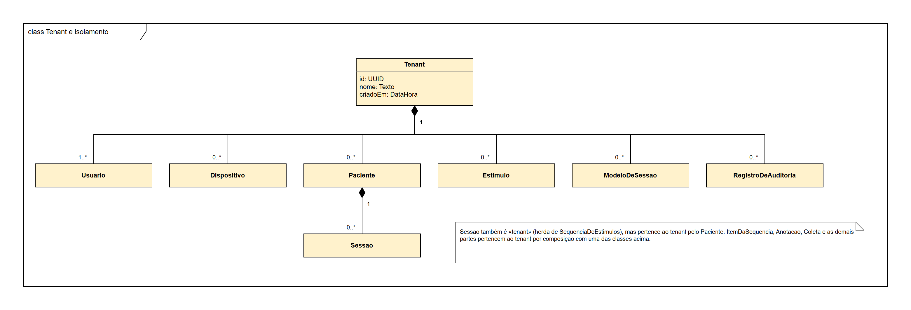

FONTE: Os autores (2026)

**TABELA 14** - Classes do NeuroSight

| Classe | O que representa | Requisitos |
|---|---|---|
| Tenant | Instituição ou grupo de pesquisa; isola os dados dos demais | RF02, RN01 |
| Usuario | Pessoa com conta no tenant, com um perfil | RF04–RF11 |
| TokenDeUsoUnico | Link de uso único e com prazo: confirmação de e-mail, convite e redefinição de senha | RF03, RF05, RF09 |
| Dispositivo | Óculos pareado ao tenant, com o próprio acesso e o estado do rastreamento | RF13–RF16, RF39 |
| SolicitacaoDePareamento | Código que o app mostra antes de o óculos ser pareado; existe antes de haver tenant | RF13, RF14 |
| Paciente | Pessoa que participa dos experimentos, identificada por código | RF17–RF21 |
| Estimulo | Imagem ou vídeo do acervo; pode ser pessoal de um paciente | RF22–RF26 |
| SequenciaDeEstimulos | Lista ordenada de estímulos, com tempos e tela neutra; base de modelos e sessões (UC06.6) | RF27, RF29, RF31 |
| ItemDaSequencia | Um estímulo dentro da sequência, com ordem e duração | RN08, RN10 |
| ModeloDeSessao | Protocolo reutilizável | RF27, RF28 |
| Sessao | Aplicação de uma sequência a um paciente, enviada a um óculos, com estado | RF30–RF37 |
| Anotacao | Observação do pesquisador sobre a sessão | RF57 |
| Coleta | Dados que o óculos envia no fim da sessão | RF48–RF51 |
| EventoDeEstimulo | Instante real de início e de fim de cada estímulo, medido no óculos | RF43 |
| AmostraDeOlhar | Uma leitura do olhar por quadro | RF44 |
| AmostraDeExpressao | Uma leitura das expressões faciais (FACS) | RF45 |
| Gravacao | Vídeo MP4 montado no servidor a partir dos quadros | RF46, RF50 |
| RegistroDeAuditoria | Quem fez o quê, quando e em qual registro | RF59, RF60 |

FONTE: Os autores (2026)

**TABELA 15** - Enumerações do diagrama de classes

| Enumeração | Valores |
|---|---|
| Perfil | PESQUISADOR, ADMINISTRADOR, PROPRIETARIO |
| TipoDeToken | CONFIRMACAO_EMAIL, CONVITE, REDEFINICAO_SENHA |
| TipoDeEstimulo | IMAGEM, VIDEO |
| Sexo | FEMININO, MASCULINO |
| Etiologia | TRAUMATICA, VASCULAR, ANOXICA |
| Diagnostico | COMA, SVNR, EMC |
| EstadoDaSessao | RASCUNHO, ENVIADA_AO_OCULOS, BAIXADA, INICIO_SOLICITADO, EM_EXECUCAO, ENVIANDO, PROCESSANDO, CONCLUIDA, FALHA |
| TipoDeAcao | LOGIN, CRIACAO, EDICAO, EXCLUSAO, ENVIO_DE_SESSAO, INICIO_DE_SESSAO, VISUALIZACAO, EXPORTACAO, MUDANCA_DE_PERMISSAO |

FONTE: Os autores (2026)

As regras de negócio que o diagrama não representa graficamente, e que serão garantidas na API ou no banco, são as seguintes.

- **RN06, RN07 e RN08** já aparecem no próprio diagrama: Paciente não tem conta nem perfil; toda Sessao pertence a um único Paciente (composição); e toda sessão é uma SequenciaDeEstimulos.
- **RN04:** só o PROPRIETARIO concede ou retira o perfil ADMINISTRADOR. É uma regra de permissão, verificada na API.
- **RN02:** `Usuario.email` é único em todo o sistema.
- **RN03:** cada Tenant tem exatamente um Usuario com perfil PROPRIETARIO.
- **RN05:** os perfis são cumulativos, na ordem PESQUISADOR < ADMINISTRADOR < PROPRIETARIO.
- **Unicidade:** `Paciente.codigo` e `Dispositivo.nome` são únicos dentro do tenant.
- **RN10:** `ItemDaSequencia.duracaoSegundos` é maior que zero.
- **Derivado:** `SequenciaDeEstimulos.duracaoTotalSegundos` é a soma das durações dos itens mais as telas neutras entre eles.
- **RN09 e RN12:** um item só usa estímulo do mesmo tenant e não arquivado. Um estímulo pessoal só entra em sessões do paciente dele e, por isso, não entra em modelos.
- **RN11:** a Sessao copia os itens do modelo; a associação "origem" é só uma referência.
- **RN13:** um estímulo usado em algum item não é excluído, só arquivado.
- **RN14:** um Dispositivo tem no máximo uma Sessao nos estados ENVIADA_AO_OCULOS, BAIXADA, INICIO_SOLICITADO ou EM_EXECUCAO.
- **RN15:** a sessão só passa para INICIO_SOLICITADO a partir de BAIXADA, com o dispositivo online.
- **RN16:** os itens da sessão só podem ser alterados em RASCUNHO.
- **RN17:** a Coleta e suas partes não podem ser alteradas. As anotações e os dados descritivos da sessão (`diagnosticoNoDia` e `escoreCrsRNoDia`) podem.
- **RN18:** veem a sessão quem a criou (`criadaPor`), o proprietário, os administradores e os usuários em `autorizados`.
- **RN19:** o app recebe só `Paciente.codigo`, nunca o nome.
- **RN20:** RegistroDeAuditoria só aceita inclusão.
- **RF21:** excluir um paciente exclui as sessões dele (composição) e também os estímulos pessoais dele, que não podem estar em sessões de outros pacientes (RN12).
- **Derivado:** `Dispositivo.online` é verdadeiro quando o último contato foi há poucos segundos. A "sessão atual" do óculos (RF15) também é derivada: é a sessão pendente ou em execução que tem esse óculos em `oculos`.
- **Quadros JPEG:** são temporários. Servem para montar a Gravacao e não fazem parte do modelo.
- **Tela neutra:** os intervalos de tela neutra não viram eventos; correspondem aos espaços entre um EventoDeEstimulo e o seguinte.

## APÊNDICE C – HISTÓRIAS DE USUÁRIO, PROTÓTIPOS DE TELA E DIAGRAMAS DE SEQUÊNCIA

Este apêndice apresenta, para cada caso de uso do Apêndice A, a história de usuário, o protótipo de tela e o diagrama de sequência relacionados. Cada diagrama de casos de uso corresponde a um épico, e cada caso de uso tem uma história de usuário com o mesmo número (UC07.6 e HU07.6, por exemplo), no formato "sendo, quero, para", com critérios de aceitação. A prioridade de cada história é a maior entre as dos requisitos ligados a ela: são 35 histórias essenciais, 19 importantes e 6 desejáveis. As histórias dos casos de uso incluídos ou estendidos são escritas do ponto de vista do ator do caso base.

Os protótipos são 19 telas de média fidelidade, 14 do sistema web (W01 a W14) e 5 do aplicativo do óculos (A1 a A5): mostram o conteúdo, a organização e as ações de cada tela, com dados fictícios coerentes entre si, e foram feitos em HTML e CSS, de forma navegável. O visual final pode mudar no desenvolvimento. Usuários diferentes aparecem logados nas telas do sistema web para mostrar os perfis: a pesquisadora não vê o grupo Administração no menu. O aplicativo não tem botões, porque o pesquisador não usa o controle em nenhuma etapa (RNF22); A1, A2, A3 e A5 são painéis no ambiente virtual, vistos por quem coloca o óculos, e A4 é a visão do paciente durante a sessão. Os casos de uso que repetem padrões já mostrados não ganharam tela própria, e a história indica qual tela os representa. Cada protótipo aparece uma vez, na primeira história que o usa, e as demais remetem à figura.

Os seis diagramas de sequência cobrem os fluxos principais do sistema, do autocadastro do *tenant* à análise da sessão, e mostram a comunicação entre os atores e os componentes da arquitetura: sistema web (Next.js), API (NestJS), banco de dados (PostgreSQL), armazenamento, aplicativo do óculos (Unreal Engine), processamento (fila e FFmpeg) e serviço de e-mail. A Tabela 16 mostra os casos de uso cobertos por cada um; os casos de uso de cadastro e consulta, cujas chamadas seguem o mesmo padrão, remetem ao diagrama que o ilustra. As rotas da API usadas nos diagramas estão no Apêndice E. Cada diagrama aparece na primeira história que o usa.

**TABELA 16** - Diagramas de sequência e casos de uso cobertos

| Diagrama | Fluxo | Casos de uso |
|---|---|---|
| SD01 | Autocadastro do tenant e confirmação do e-mail | UC01.2, UC01.3 |
| SD02 | Pareamento do óculos | UC03.1 |
| SD03 | Criação e envio da sessão até o óculos | UC07.1, UC07.2, UC07.4, UC08.1, UC08.2 |
| SD04 | Início e execução da sessão | UC07.6, UC08.3 a UC08.6 |
| SD05 | Envio dos dados e montagem do vídeo | UC09.1, UC09.2 |
| SD06 | Consulta e análise da sessão | UC10.1 a UC10.5 |

FONTE: Os autores (2026)

Para ler os diagramas de sequência:

- **Participantes:** atores (Visitante, Administrador, Pesquisador, Paciente) e os componentes da arquitetura: Sistema web (Next.js), API (NestJS), Banco (PostgreSQL), Armazenamento (disco), App do óculos (Unreal), Processamento (fila + FFmpeg) e Serviço de e-mail.
- **Seta cheia:** chamada. **Seta tracejada:** resposta. **Seta que volta para o próprio participante:** ação interna.
- **Mensagens numeradas:** as chamadas e as ações internas são numeradas na ordem; as respostas não.
- **Blocos `alt`, `loop` e `opt`:** caminhos alternativos (`alt`, separados pela linha tracejada), repetição (`loop`) e trecho opcional (`opt`). A condição aparece entre colchetes.
- **Notas:** registram regras que valem no trecho, como o uso do RLS ou do papel `neurosight_auth`.

### E01 – Acesso e conta (diagrama UC01)

#### HU01.1 – Conhecer o NeuroSight

**Sendo** visitante, **quero** conhecer o NeuroSight numa página de apresentação, **para** decidir se crio um tenant para o meu grupo.
*RF01 · Importante*
- A página explica o que o sistema faz e o que não faz (não faz diagnóstico).
- A página dá acesso ao autocadastro e ao login.

**Protótipo de tela:** W01 Página de apresentação (Figura 17).

**Diagrama de sequência:** Não tem diagrama de sequência: a página de apresentação é estática e não chama a API.

**FIGURA 17** - Protótipo da tela W01 Página de apresentação

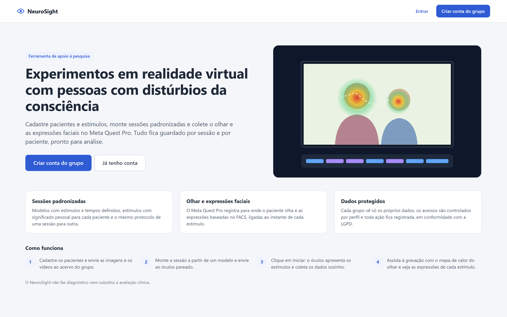

FONTE: Os autores (2026)

A tela W01 mostra: o que o sistema faz, o acesso ao autocadastro e ao login e o aviso de que o sistema não faz diagnóstico.

#### HU01.2 – Criar tenant

**Sendo** visitante, **quero** criar um tenant para a minha instituição ou grupo, **para** usar o sistema sem precisar de uma instalação própria.
*RF02 · Essencial*
- Informo o nome da instituição ou do grupo, meu nome, e-mail e senha.
- Ao concluir, sou o proprietário do tenant (RN03).
- O tenant começa vazio e isolado dos demais (RN01).

**Protótipo de tela:** W02 Criar a conta do grupo (Figura 18).

**Diagrama de sequência:** SD01 – Autocadastro do tenant (Figura 19).

**FIGURA 18** - Protótipo da tela W02 Criar a conta do grupo

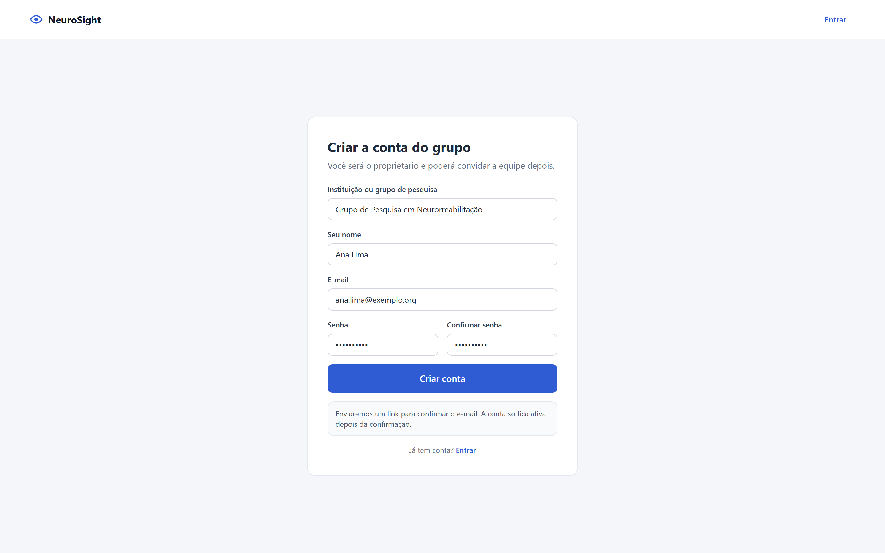

FONTE: Os autores (2026)

A tela W02 mostra: autocadastro do tenant: quem cria vira proprietário e precisa confirmar o e-mail.

**FIGURA 19** - Diagrama de sequência SD01 – Autocadastro do tenant

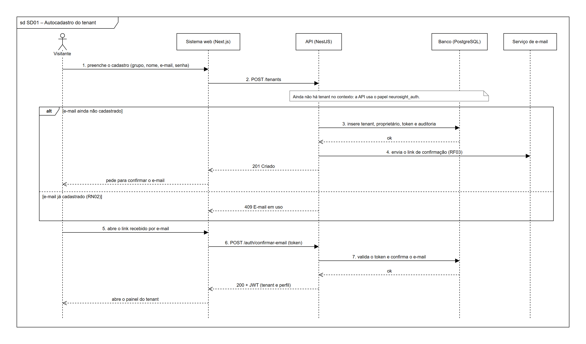

FONTE: Os autores (2026)

O diagrama SD01 mostra os seguintes pontos:

- Ainda não existe tenant no contexto, por isso a API usa o papel `neurosight_auth`.
- Tenant, proprietário, token de confirmação e registro de auditoria são criados numa única transação.
- Se o e-mail já estiver cadastrado, a API responde 409 (RN02).
- A confirmação do e-mail usa o token de uso único (RF03). Ao confirmar, o sistema web recebe o JWT, com o tenant e o perfil.

#### HU01.3 – Confirmar e-mail

**Sendo** visitante que criou um tenant, **quero** confirmar meu e-mail, **para** garantir que a conta é minha.
*RF03 · Importante*
- Recebo um link de confirmação, que expira depois de um prazo.
- Sem confirmar, não consigo entrar.

**Protótipo de tela:** W02 Criar a conta do grupo (Figura 18).

**Diagrama de sequência:** SD01 – Autocadastro do tenant (Figura 19).

#### HU01.4 – Entrar e sair do sistema

**Sendo** usuário, **quero** entrar com e-mail e senha e sair quando terminar, **para** acessar os dados do meu tenant com segurança.
*RF04 · Essencial*
- Com credenciais erradas, a mensagem não diz se o erro está no e-mail ou na senha.
- Depois de entrar, vejo apenas dados do meu tenant (RN01).
- Cada entrada fica registrada na auditoria (RF59).

**Protótipo de tela:** W03 Entrar (Figura 20).

**Diagrama de sequência:** Não tem diagrama de sequência próprio: o *login* segue o padrão do SD01, com o papel `neurosight_auth`, porque ainda não há *tenant* no contexto, e devolve o JWT com o *tenant* e o perfil do usuário.

**FIGURA 20** - Protótipo da tela W03 Entrar

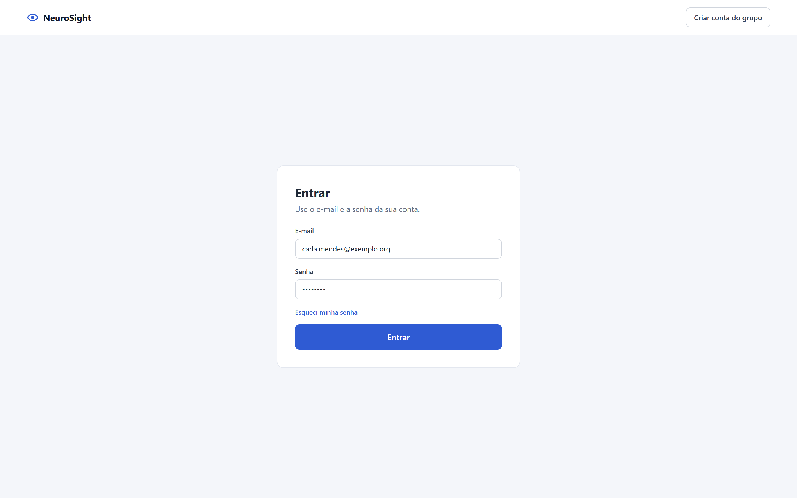

FONTE: Os autores (2026)

A tela W03 mostra: login e "Esqueci minha senha".

#### HU01.5 – Recuperar senha

**Sendo** usuário, **quero** recuperar minha senha por e-mail, **para** voltar a acessar o sistema se eu a esquecer.
*RF05 · Importante*
- Recebo um link de redefinição de uso único, com prazo.
- A mensagem exibida não revela se o e-mail tem conta.

**Protótipo de tela:** W03 Entrar (Figura 20).

**Diagrama de sequência:** Não tem diagrama de sequência próprio: a recuperação de senha segue o padrão do SD01, com um *token* de uso único enviado por e-mail.

#### HU01.6 – Alterar meus dados e senha

**Sendo** usuário, **quero** alterar meus dados e minha senha, **para** manter minha conta atualizada.
*RF06 · Desejável*
- Para trocar a senha, informo a senha atual.

**Protótipo de tela:** este caso de uso não tem tela própria: formulários simples, como o de W05.

**Diagrama de sequência:** Não tem diagrama de sequência próprio: é um caso de uso de cadastro ou consulta, cujas chamadas seguem o padrão mostrado no SD03 (sistema web → API → banco de dados, na transação com o *tenant* do usuário e com registro na auditoria).

#### HU01.7 – Alterar dados do tenant

**Sendo** proprietário, **quero** alterar os dados do tenant, **para** corrigir o nome da instituição ou do grupo.
*RF07 · Desejável*
- Só o proprietário vê essa opção.

**Protótipo de tela:** este caso de uso não tem tela própria: formulários simples, como o de W05.

**Diagrama de sequência:** Não tem diagrama de sequência próprio: é um caso de uso de cadastro ou consulta, cujas chamadas seguem o padrão mostrado no SD03 (sistema web → API → banco de dados, na transação com o *tenant* do usuário e com registro na auditoria).

#### HU01.8 – Transferir propriedade do tenant

**Sendo** proprietário, **quero** transferir a propriedade do tenant para um administrador, **para** que o grupo continue gerido se eu sair.
*RF08 · Desejável*
- Só um administrador do mesmo tenant pode receber a propriedade.
- Depois da transferência, passo a ser administrador, e o tenant continua com um único proprietário (RN03).

**Protótipo de tela:** W13 Usuários (Figura 21).

**Diagrama de sequência:** Não tem diagrama de sequência próprio: é um caso de uso de cadastro ou consulta, cujas chamadas seguem o padrão mostrado no SD03 (sistema web → API → banco de dados, na transação com o *tenant* do usuário e com registro na auditoria).

**FIGURA 21** - Protótipo da tela W13 Usuários

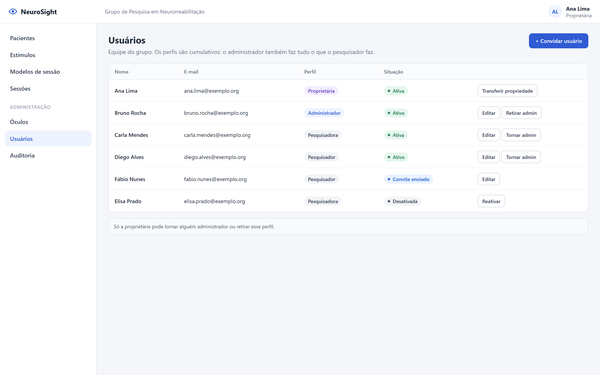

FONTE: Os autores (2026)

A tela W13 mostra: convite, edição, desativação, perfis e transferência de propriedade.

### E02 – Usuários e permissões (diagrama UC02)

#### HU02.1 – Cadastrar usuário

**Sendo** administrador, **quero** cadastrar pessoas da equipe com nome, e-mail e perfil, **para** que elas usem o sistema.
*RF09 · Essencial*
- O e-mail não pode estar em uso por outro usuário (RN02).
- Só o proprietário pode cadastrar alguém como administrador (RN04).
- O cadastro fica registrado na auditoria.

**Protótipo de tela:** W13 Usuários (Figura 21).

**Diagrama de sequência:** Não tem diagrama de sequência próprio: é um caso de uso de cadastro ou consulta, cujas chamadas seguem o padrão mostrado no SD03 (sistema web → API → banco de dados, na transação com o *tenant* do usuário e com registro na auditoria).

#### HU02.2 – Enviar convite por e-mail

**Sendo** pessoa cadastrada por um administrador, **quero** receber um convite por e-mail para definir minha senha, **para** não depender de uma senha criada por outra pessoa.
*RF09 · Essencial*
- O link do convite é de uso único e expira.

**Protótipo de tela:** W13 Usuários (Figura 21).

**Diagrama de sequência:** Não tem diagrama de sequência próprio: o convite segue o padrão do SD01, com um *token* de uso único enviado por e-mail para a definição da senha.

#### HU02.3 – Consultar usuários

**Sendo** administrador, **quero** ver a lista de usuários do tenant, com perfil e situação, **para** saber quem tem acesso.
*RF10 · Essencial*
- A lista mostra nome, e-mail, perfil e se o usuário está ativo.

**Protótipo de tela:** W13 Usuários (Figura 21).

**Diagrama de sequência:** Não tem diagrama de sequência próprio: é um caso de uso de cadastro ou consulta, cujas chamadas seguem o padrão mostrado no SD03 (sistema web → API → banco de dados, na transação com o *tenant* do usuário e com registro na auditoria).

#### HU02.4 – Editar ou desativar usuário

**Sendo** administrador, **quero** editar ou desativar um usuário, **para** manter os acessos corretos quando alguém muda de função ou sai do grupo.
*RF10 · Essencial*
- Um usuário desativado não consegue entrar, mas o histórico dele é mantido.
- O proprietário não pode ser desativado.

**Protótipo de tela:** W13 Usuários (Figura 21).

**Diagrama de sequência:** Não tem diagrama de sequência próprio: é um caso de uso de cadastro ou consulta, cujas chamadas seguem o padrão mostrado no SD03 (sistema web → API → banco de dados, na transação com o *tenant* do usuário e com registro na auditoria).

#### HU02.5 – Definir administradores

**Sendo** proprietário, **quero** conceder e retirar o perfil de administrador, **para** decidir quem gerencia o tenant.
*RF11 · Essencial*
- Só o proprietário faz isso (RN04).
- A mudança fica registrada na auditoria.

**Protótipo de tela:** W13 Usuários (Figura 21).

**Diagrama de sequência:** Não tem diagrama de sequência próprio: é um caso de uso de cadastro ou consulta, cujas chamadas seguem o padrão mostrado no SD03 (sistema web → API → banco de dados, na transação com o *tenant* do usuário e com registro na auditoria).

#### HU02.6 – Definir quem vê uma sessão

**Sendo** administrador, **quero** definir quais pesquisadores podem ver cada sessão, **para** restringir o acesso a dados de saúde.
*RF12 · Essencial*
- Por padrão, veem a sessão quem a criou, os administradores e o proprietário (RN18).
- Liberar e retirar o acesso fica registrado na auditoria.

**Protótipo de tela:** W10 Sessão pronta para iniciar (Figura 22).

**Diagrama de sequência:** Não tem diagrama de sequência próprio: é um caso de uso de cadastro ou consulta, cujas chamadas seguem o padrão mostrado no SD03 (sistema web → API → banco de dados, na transação com o *tenant* do usuário e com registro na auditoria).

**FIGURA 22** - Protótipo da tela W10 Sessão pronta para iniciar

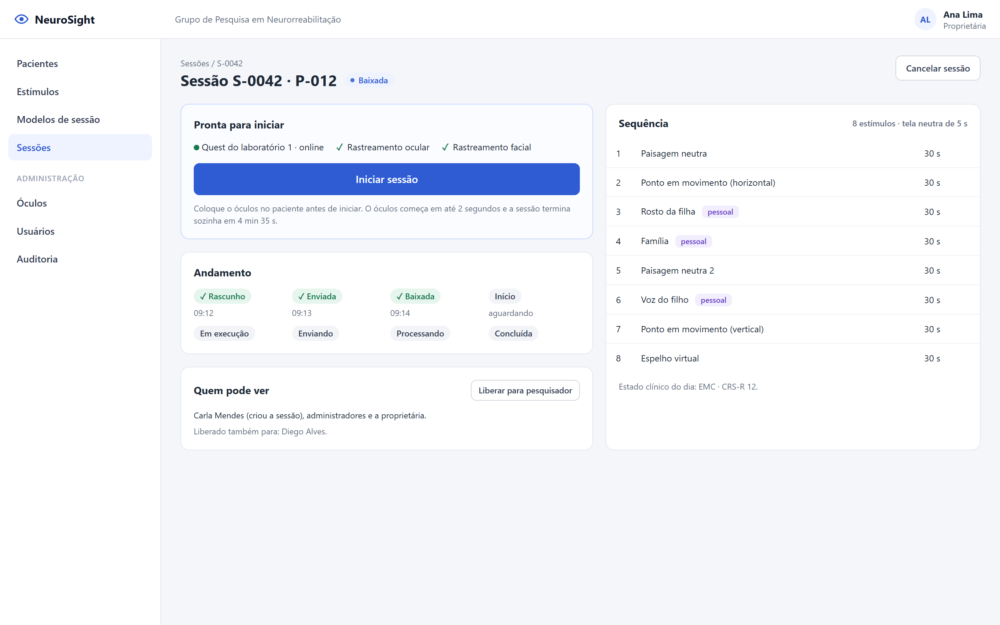

FONTE: Os autores (2026)

A tela W10 mostra: o botão "Iniciar sessão" (RN15), o andamento pelos estados, o cancelamento e quem pode ver a sessão.

### E03 – Óculos (diagrama UC03)

#### HU03.1 – Parear óculos

**Sendo** administrador, **quero** parear um óculos ao tenant digitando o código que aparece nele, **para** que o aparelho possa receber as sessões do grupo.
*RF13, RF14 · Essencial*
- O app mostra um código enquanto o óculos não está pareado (RF13); o código expira em poucos minutos.
- Ao parear, dou um nome ao aparelho, e ele recebe um acesso próprio (RNF04).

**Protótipo de tela:** W12 Óculos e pareamento (Figura 23); A1 Código de pareamento (Figura 24).

**Diagrama de sequência:** SD02 – Pareamento do óculos (Figura 25).

**FIGURA 23** - Protótipo da tela W12 Óculos e pareamento

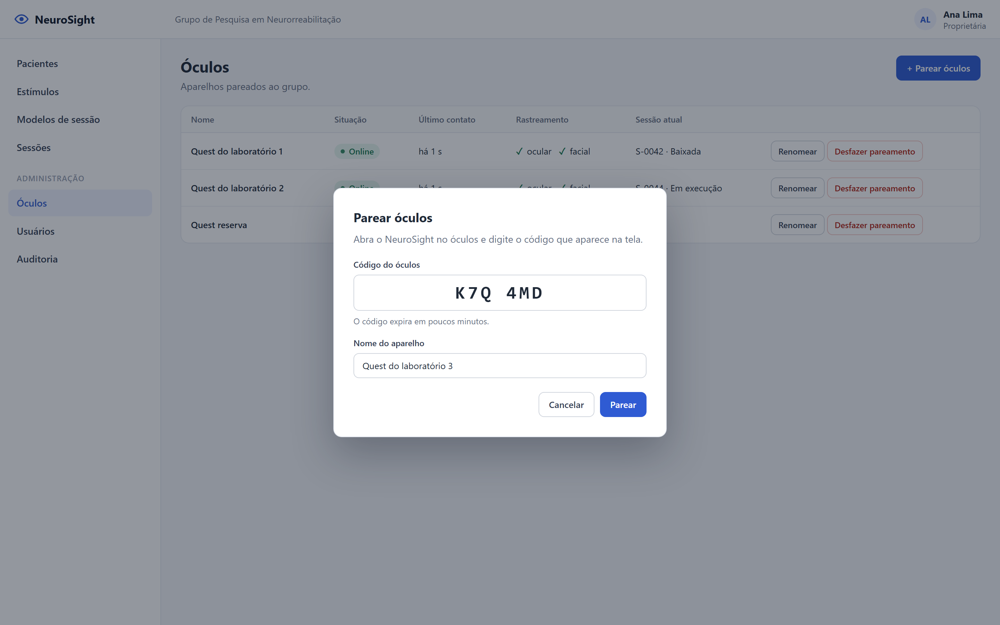

FONTE: Os autores (2026)

A tela W12 mostra: lista dos óculos (RF15) e a janela de pareamento, com o código que aparece no óculos (A1).

**FIGURA 24** - Protótipo da tela A1 Código de pareamento, do aplicativo do óculos

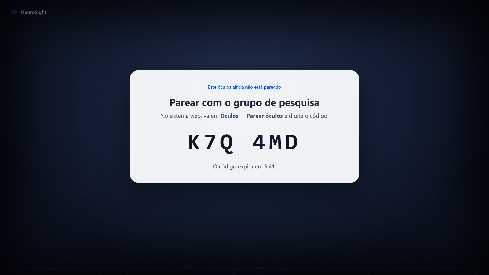

FONTE: Os autores (2026)

A tela A1 mostra: o código que o administrador digita na tela W12.

**FIGURA 25** - Diagrama de sequência SD02 – Pareamento do óculos

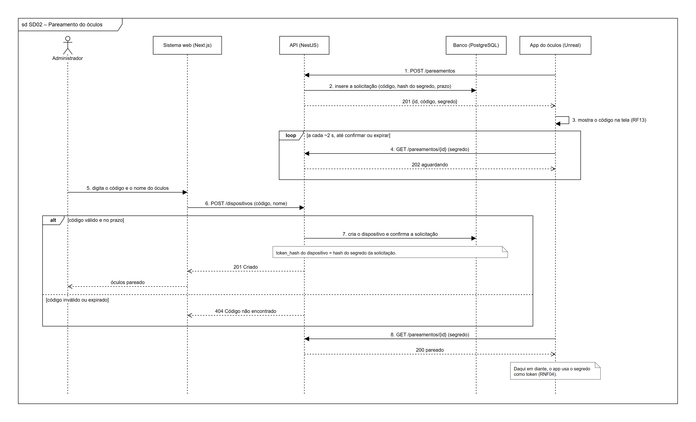

FONTE: Os autores (2026)

O diagrama SD02 mostra os seguintes pontos:

- O app pede um código sem estar autenticado e recebe o código e um **segredo**.
- Enquanto mostra o código, o app consulta o servidor a cada ~2 s.
- O administrador digita o código no sistema web, e a API cria o dispositivo no tenant dele. Código inválido ou vencido recebe 404.
- O `token_hash` do dispositivo é o hash do segredo. Na consulta seguinte, o app recebe "pareado" e passa a usar o segredo como token (RNF04).

#### HU03.2 – Consultar óculos

**Sendo** administrador, **quero** ver os óculos do tenant com situação e último contato, **para** saber quais estão prontos para uso.
*RF15 · Importante*
- "Online" significa contato com o servidor nos últimos segundos.
- A lista mostra a sessão atual de cada óculos, se houver.

**Protótipo de tela:** W12 Óculos e pareamento (Figura 23).

**Diagrama de sequência:** Não tem diagrama de sequência próprio: é um caso de uso de cadastro ou consulta, cujas chamadas seguem o padrão mostrado no SD03 (sistema web → API → banco de dados, na transação com o *tenant* do usuário e com registro na auditoria).

#### HU03.3 – Renomear óculos

**Sendo** administrador, **quero** renomear um óculos, **para** identificá-lo com facilidade (por exemplo, "Quest do laboratório 2").
*RF16 · Importante*
- O nome é único no tenant.

**Protótipo de tela:** W12 Óculos e pareamento (Figura 23).

**Diagrama de sequência:** Não tem diagrama de sequência próprio: é um caso de uso de cadastro ou consulta, cujas chamadas seguem o padrão mostrado no SD03 (sistema web → API → banco de dados, na transação com o *tenant* do usuário e com registro na auditoria).

#### HU03.4 – Desfazer pareamento

**Sendo** administrador, **quero** desfazer o pareamento de um óculos, **para** cortar o acesso de um aparelho perdido ou que saiu do grupo.
*RF16 · Importante*
- O acesso do aparelho é revogado na hora, e o app volta a mostrar um código de pareamento.
- Sessões enviadas a ele e ainda não iniciadas voltam a ser rascunho.

**Protótipo de tela:** W12 Óculos e pareamento (Figura 23).

**Diagrama de sequência:** Não tem diagrama de sequência próprio: é um caso de uso de cadastro ou consulta, cujas chamadas seguem o padrão mostrado no SD03 (sistema web → API → banco de dados, na transação com o *tenant* do usuário e com registro na auditoria).

### E04 – Pacientes (diagrama UC04)

#### HU04.1 – Cadastrar paciente

**Sendo** pesquisador, **quero** cadastrar um paciente com código e dados clínicos mínimos, **para** vincular a ele as sessões.
*RF17 · Essencial*
- O código é obrigatório e único no tenant; o nome é opcional.
- Os demais campos são os do RF17: ano de nascimento, sexo, etiologia, data da lesão, diagnóstico atual, escore CRS-R e observações.

**Protótipo de tela:** W05 Paciente (Figura 26).

**Diagrama de sequência:** Não tem diagrama de sequência próprio: é um caso de uso de cadastro ou consulta, cujas chamadas seguem o padrão mostrado no SD03 (sistema web → API → banco de dados, na transação com o *tenant* do usuário e com registro na auditoria).

**FIGURA 26** - Protótipo da tela W05 Paciente

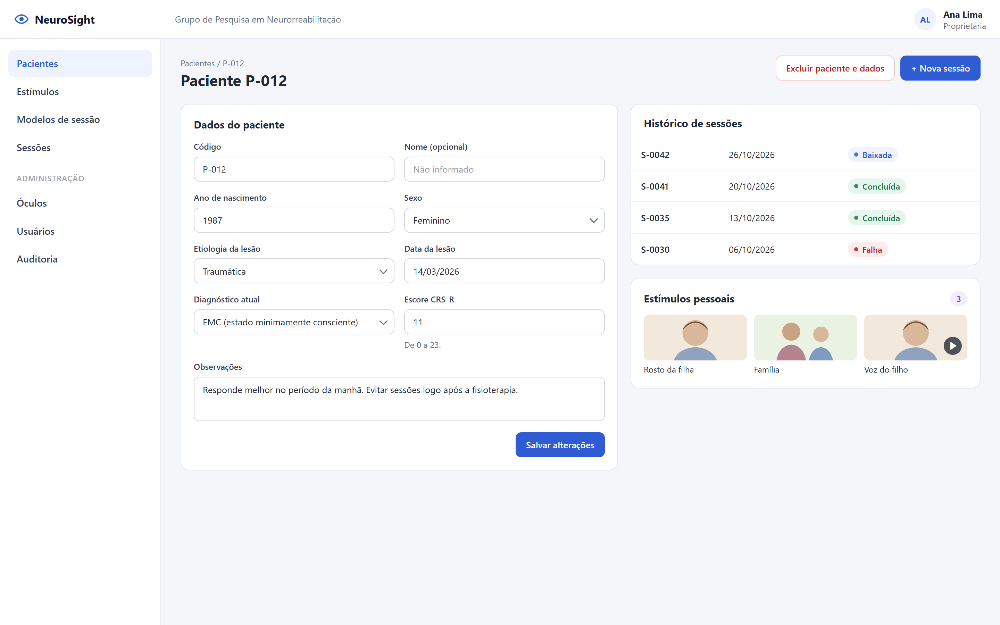

FONTE: Os autores (2026)

A tela W05 mostra: os campos do RF17, o histórico de sessões, os estímulos pessoais e a exclusão.

#### HU04.2 – Editar paciente

**Sendo** pesquisador, **quero** editar os dados de um paciente, **para** mantê-los atualizados (por exemplo, um novo diagnóstico ou escore CRS-R).
*RF18 · Essencial*
- A alteração fica registrada na auditoria.

**Protótipo de tela:** W05 Paciente (Figura 26).

**Diagrama de sequência:** Não tem diagrama de sequência próprio: é um caso de uso de cadastro ou consulta, cujas chamadas seguem o padrão mostrado no SD03 (sistema web → API → banco de dados, na transação com o *tenant* do usuário e com registro na auditoria).

#### HU04.3 – Consultar pacientes

**Sendo** pesquisador, **quero** listar os pacientes e buscá-los pelo código, **para** encontrar rapidamente quem vai participar da sessão.
*RF19 · Essencial*
- A busca encontra o paciente por parte do código.

**Protótipo de tela:** W04 Pacientes (Figura 27).

**Diagrama de sequência:** Não tem diagrama de sequência próprio: é um caso de uso de cadastro ou consulta, cujas chamadas seguem o padrão mostrado no SD03 (sistema web → API → banco de dados, na transação com o *tenant* do usuário e com registro na auditoria).

**FIGURA 27** - Protótipo da tela W04 Pacientes

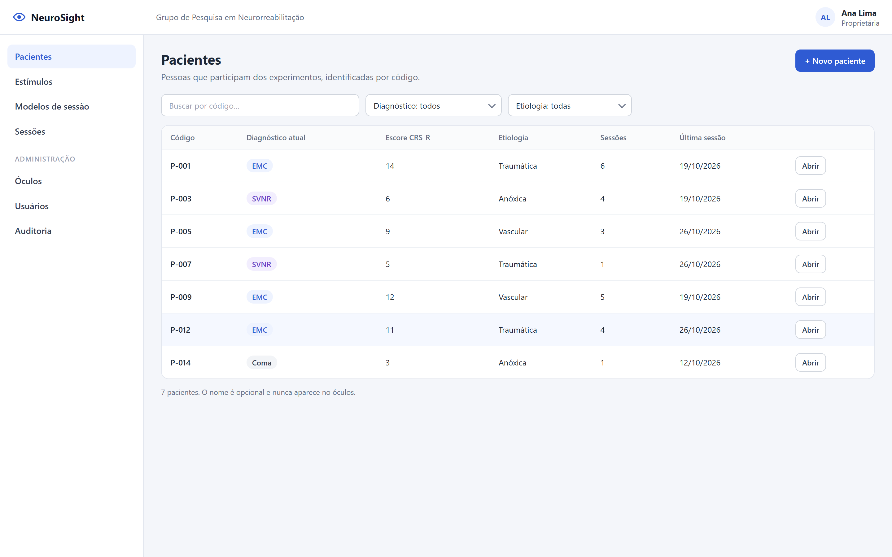

FONTE: Os autores (2026)

A tela W04 mostra: lista com busca por código e filtros por diagnóstico e etiologia.

#### HU04.4 – Ver histórico do paciente

**Sendo** pesquisador, **quero** ver o histórico de sessões de um paciente, **para** acompanhar os experimentos feitos com ele.
*RF20 · Essencial*
- Aparecem só as sessões que tenho permissão de ver (RN18).

**Protótipo de tela:** W05 Paciente (Figura 26).

**Diagrama de sequência:** Não tem diagrama de sequência próprio: é um caso de uso de cadastro ou consulta, cujas chamadas seguem o padrão mostrado no SD03 (sistema web → API → banco de dados, na transação com o *tenant* do usuário e com registro na auditoria).

#### HU04.5 – Excluir paciente e seus dados

**Sendo** administrador, **quero** excluir um paciente e os dados das suas sessões, **para** atender a um pedido de exclusão de dados.
*RF21 · Importante*
- O sistema pede confirmação antes de excluir.
- A exclusão fica registrada na auditoria, sem guardar os dados apagados.

**Protótipo de tela:** W05 Paciente (Figura 26).

**Diagrama de sequência:** Não tem diagrama de sequência próprio: é um caso de uso de cadastro ou consulta, cujas chamadas seguem o padrão mostrado no SD03 (sistema web → API → banco de dados, na transação com o *tenant* do usuário e com registro na auditoria).

### E05 – Estímulos (diagrama UC05)

#### HU05.1 – Enviar estímulos

**Sendo** pesquisador, **quero** enviar imagens e vídeos para o acervo do tenant, **para** usá-los como estímulos nas sessões.
*RF22 · Essencial*
- São aceitos JPEG, PNG e MP4 (H.264) até o tamanho máximo configurado (RNF19).
- Arquivos em outro formato são recusados com uma mensagem clara.

**Protótipo de tela:** W06 Estímulos (Figura 28).

**Diagrama de sequência:** Não tem diagrama de sequência próprio: é um caso de uso de cadastro ou consulta, cujas chamadas seguem o padrão mostrado no SD03 (sistema web → API → banco de dados, na transação com o *tenant* do usuário e com registro na auditoria).

**FIGURA 28** - Protótipo da tela W06 Estímulos

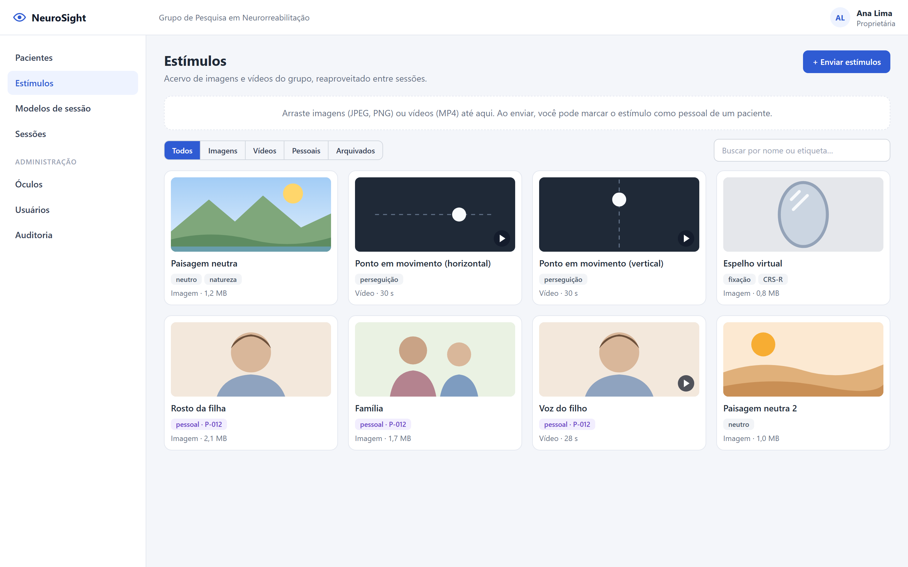

FONTE: Os autores (2026)

A tela W06 mostra: acervo com envio, etiquetas e filtros (pessoais e arquivados).

#### HU05.2 – Consultar estímulos

**Sendo** pesquisador, **quero** listar, buscar e pré-visualizar os estímulos, **para** escolher o que vou usar.
*RF23 · Essencial*
- A busca considera nome e etiquetas.
- Imagens e vídeos podem ser vistos sem baixar o arquivo.

**Protótipo de tela:** W06 Estímulos (Figura 28).

**Diagrama de sequência:** Não tem diagrama de sequência próprio: é um caso de uso de cadastro ou consulta, cujas chamadas seguem o padrão mostrado no SD03 (sistema web → API → banco de dados, na transação com o *tenant* do usuário e com registro na auditoria).

#### HU05.3 – Editar informações do estímulo

**Sendo** pesquisador, **quero** editar nome, descrição e etiquetas de um estímulo, **para** organizar o acervo.
*RF24 · Importante*
- O arquivo em si não pode ser trocado; para isso, envia-se um novo estímulo.

**Protótipo de tela:** W06 Estímulos (Figura 28).

**Diagrama de sequência:** Não tem diagrama de sequência próprio: é um caso de uso de cadastro ou consulta, cujas chamadas seguem o padrão mostrado no SD03 (sistema web → API → banco de dados, na transação com o *tenant* do usuário e com registro na auditoria).

#### HU05.4 – Marcar estímulo como pessoal

**Sendo** pesquisador, **quero** marcar um estímulo como pessoal de um paciente (por exemplo, a foto de um familiar), **para** usá-lo só nas sessões dele.
*RF25 · Importante*
- O estímulo pessoal só aparece na montagem de sessões desse paciente (RN12).

**Protótipo de tela:** W06 Estímulos (Figura 28).

**Diagrama de sequência:** Não tem diagrama de sequência próprio: é um caso de uso de cadastro ou consulta, cujas chamadas seguem o padrão mostrado no SD03 (sistema web → API → banco de dados, na transação com o *tenant* do usuário e com registro na auditoria).

#### HU05.5 – Arquivar estímulo

**Sendo** pesquisador, **quero** arquivar um estímulo, **para** tirá-lo das novas sessões sem perder o histórico.
*RF26 · Importante*
- Um estímulo já usado não pode ser excluído, só arquivado (RN13).
- Sessões antigas continuam mostrando o estímulo arquivado.

**Protótipo de tela:** W06 Estímulos (Figura 28).

**Diagrama de sequência:** Não tem diagrama de sequência próprio: é um caso de uso de cadastro ou consulta, cujas chamadas seguem o padrão mostrado no SD03 (sistema web → API → banco de dados, na transação com o *tenant* do usuário e com registro na auditoria).

### E06 – Modelos de sessão (diagrama UC06)

#### HU06.1 – Cadastrar modelo de sessão

**Sendo** pesquisador, **quero** cadastrar um modelo de sessão, **para** aplicar o mesmo protocolo a vários pacientes.
*RF27 · Essencial*
- O modelo tem nome e pelo menos um estímulo.

**Protótipo de tela:** W07 Modelo de sessão (Figura 29).

**Diagrama de sequência:** Não tem diagrama de sequência próprio: é um caso de uso de cadastro ou consulta, cujas chamadas seguem o padrão mostrado no SD03 (sistema web → API → banco de dados, na transação com o *tenant* do usuário e com registro na auditoria).

**FIGURA 29** - Protótipo da tela W07 Modelo de sessão

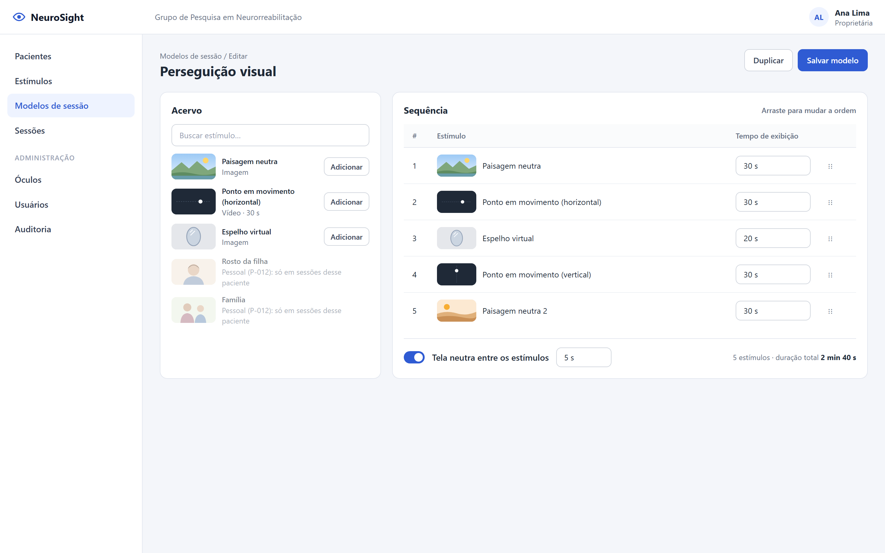

FONTE: Os autores (2026)

A tela W07 mostra: sequência com o tempo de cada estímulo, a tela neutra e a duração total. Os estímulos pessoais aparecem bloqueados (RN12).

#### HU06.2 – Consultar modelos

**Sendo** pesquisador, **quero** consultar os modelos do tenant, **para** escolher qual aplicar.
*RF28 · Importante*
- A lista mostra o número de estímulos e a duração total de cada modelo.

**Protótipo de tela:** este caso de uso não tem tela própria: lista no mesmo padrão de W09.

**Diagrama de sequência:** Não tem diagrama de sequência próprio: é um caso de uso de cadastro ou consulta, cujas chamadas seguem o padrão mostrado no SD03 (sistema web → API → banco de dados, na transação com o *tenant* do usuário e com registro na auditoria).

#### HU06.3 – Editar modelo

**Sendo** pesquisador, **quero** editar um modelo, **para** ajustar o protocolo.
*RF28 · Importante*
- As sessões já criadas a partir dele não mudam (RN11).

**Protótipo de tela:** W07 Modelo de sessão (Figura 29).

**Diagrama de sequência:** Não tem diagrama de sequência próprio: é um caso de uso de cadastro ou consulta, cujas chamadas seguem o padrão mostrado no SD03 (sistema web → API → banco de dados, na transação com o *tenant* do usuário e com registro na auditoria).

#### HU06.4 – Duplicar modelo

**Sendo** pesquisador, **quero** duplicar um modelo, **para** criar uma variação sem montar tudo de novo.
*RF28 · Importante*
- A cópia recebe um nome novo e pode ser editada à parte.

**Protótipo de tela:** W07 Modelo de sessão (Figura 29).

**Diagrama de sequência:** Não tem diagrama de sequência próprio: é um caso de uso de cadastro ou consulta, cujas chamadas seguem o padrão mostrado no SD03 (sistema web → API → banco de dados, na transação com o *tenant* do usuário e com registro na auditoria).

#### HU06.5 – Excluir modelo

**Sendo** pesquisador, **quero** excluir um modelo, **para** manter só os protocolos em uso.
*RF28 · Importante*
- As sessões já criadas a partir dele não são afetadas (RN11).

**Protótipo de tela:** este caso de uso não tem tela própria: lista no mesmo padrão de W09.

**Diagrama de sequência:** Não tem diagrama de sequência próprio: é um caso de uso de cadastro ou consulta, cujas chamadas seguem o padrão mostrado no SD03 (sistema web → API → banco de dados, na transação com o *tenant* do usuário e com registro na auditoria).

#### HU06.6 – Montar sequência de estímulos

**Sendo** pesquisador, **quero** montar a sequência de estímulos, escolhendo a ordem e o tempo de exibição de cada um, **para** definir exatamente o que o paciente vai ver.
*RF27, RF31 · Essencial*
- Só entram estímulos do acervo que não estejam arquivados (RN09).
- Todo tempo de exibição é maior que zero (RN10), e a duração total aparece na tela.
- Um estímulo pessoal só entra em sessões do paciente dele (RN12).

**Protótipo de tela:** W07 Modelo de sessão (Figura 29).

**Diagrama de sequência:** Não tem diagrama de sequência próprio: é um caso de uso de cadastro ou consulta, cujas chamadas seguem o padrão mostrado no SD03 (sistema web → API → banco de dados, na transação com o *tenant* do usuário e com registro na auditoria).

#### HU06.7 – Definir tela neutra entre estímulos

**Sendo** pesquisador, **quero** inserir uma tela neutra entre os estímulos, com duração configurável, **para** ter uma linha de base das expressões.
*RF29 · Desejável*
- A duração da tela neutra entra na duração total da sessão.

**Protótipo de tela:** W07 Modelo de sessão (Figura 29).

**Diagrama de sequência:** Não tem diagrama de sequência próprio: é um caso de uso de cadastro ou consulta, cujas chamadas seguem o padrão mostrado no SD03 (sistema web → API → banco de dados, na transação com o *tenant* do usuário e com registro na auditoria).

### E07 – Sessões (diagrama UC07)

#### HU07.1 – Criar sessão a partir de modelo

**Sendo** pesquisador, **quero** criar uma sessão para um paciente a partir de um modelo, podendo ajustá-la, **para** repetir um protocolo sem retrabalho.
*RF30 · Essencial*
- Toda sessão tem exatamente um paciente (RN07).
- Ajustar a sessão não altera o modelo (RN11).
- A sessão nasce como rascunho.

**Protótipo de tela:** W08 Nova sessão (Figura 30).

**Diagrama de sequência:** SD03 – Criação e envio da sessão (Figura 31).

**FIGURA 30** - Protótipo da tela W08 Nova sessão

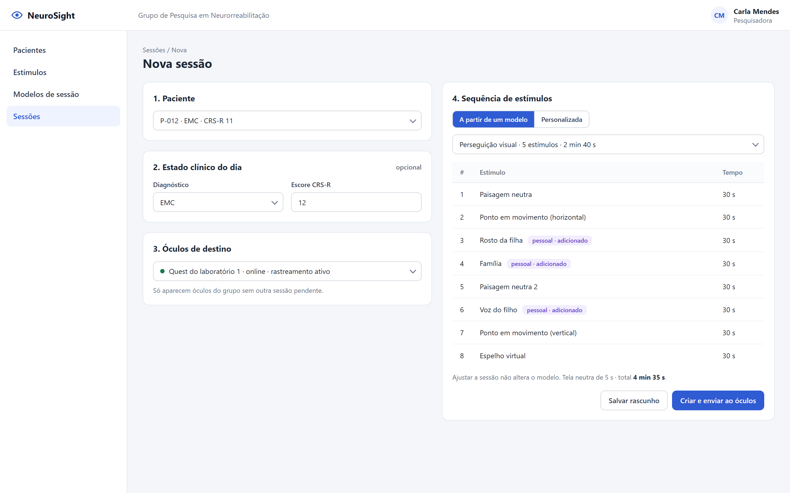

FONTE: Os autores (2026)

A tela W08 mostra: paciente, estado clínico do dia, óculos de destino e sequência ajustada a partir de um modelo.

**FIGURA 31** - Diagrama de sequência SD03 – Criação e envio da sessão

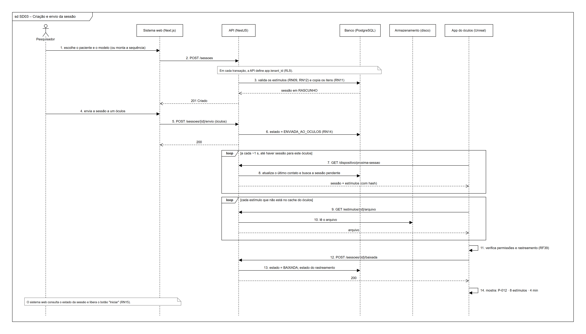

FONTE: Os autores (2026)

O diagrama SD03 mostra os seguintes pontos:

- Em cada transação, a API define `app.tenant_id` para o RLS.
- Ao criar a sessão, a API valida os estímulos (RN09, RN12) e copia os itens do modelo (RN11).
- O envio a um óculos passa pelo índice que impede duas sessões pendentes no mesmo aparelho (RN14).
- O óculos consulta `GET /dispositivo/proxima-sessao` a cada ~1 s. A mesma consulta atualiza o último contato (o "online") e entrega a sessão.
- O app baixa só os estímulos que ainda não tem, comparando pelo hash do arquivo. Depois verifica o rastreamento (RF39), avisa que a sessão está baixada e mostra o código do paciente (RN19).
- O sistema web acompanha o estado consultando a sessão e só então libera o botão "Iniciar" (RN15).

#### HU07.2 – Criar sessão personalizada

**Sendo** pesquisador, **quero** criar uma sessão personalizada, **para** montar na hora um protocolo específico para o paciente.
*RF31 · Essencial*
- A sequência é montada como em HU06.6.
- A sessão nasce como rascunho.

**Protótipo de tela:** W08 Nova sessão (Figura 30).

**Diagrama de sequência:** SD03 – Criação e envio da sessão (Figura 31).

#### HU07.3 – Registrar estado clínico do dia

**Sendo** pesquisador, **quero** registrar na sessão o estado clínico do paciente no dia, **para** relacionar as respostas com o estado dele naquele momento.
*RF32 · Desejável*
- Os campos são opcionais: diagnóstico e escore CRS-R.

**Protótipo de tela:** W08 Nova sessão (Figura 30).

**Diagrama de sequência:** Faz parte da criação da sessão mostrada no SD03: o estado clínico do dia é enviado junto com os dados da sessão.

#### HU07.4 – Enviar sessão ao óculos

**Sendo** pesquisador, **quero** enviar a sessão a um óculos pareado, **para** que ele a baixe antes da coleta.
*RF33 · Essencial*
- Só aparecem óculos do mesmo tenant sem outra sessão pendente (RN14).
- Depois do envio, a sessão não pode ser editada (RN16).

**Protótipo de tela:** W08 Nova sessão (Figura 30).

**Diagrama de sequência:** SD03 – Criação e envio da sessão (Figura 31).

#### HU07.5 – Acompanhar estado da sessão

**Sendo** pesquisador, **quero** acompanhar o estado da sessão e do óculos, **para** saber quando posso iniciar e quando os dados estão prontos.
*RF34 · Essencial*
- Os estados são: rascunho, enviada ao óculos, baixada, início solicitado, em execução, enviando, processando, concluída ou falha.
- A tela mostra se o óculos de destino está online.

**Protótipo de tela:** W10 Sessão pronta para iniciar (Figura 22).

**Diagrama de sequência:** Aparece no SD03 e no SD04 como a consulta periódica do sistema web ao estado da sessão (`GET /sessoes/{id}`).

#### HU07.6 – Iniciar sessão

**Sendo** pesquisador, **quero** iniciar a sessão por um botão no sistema web depois de colocar o óculos no paciente, **para** não precisar usar o controle.
*RF35 · Essencial*
- O botão só fica liberado com o óculos online e a sessão baixada (RN15).
- O óculos começa em até cerca de 2 s depois do clique (RNF13).
- Quem iniciou a sessão fica registrado na auditoria.

**Protótipo de tela:** W10 Sessão pronta para iniciar (Figura 22).

**Diagrama de sequência:** SD04 – Início e execução (Figura 32).

**FIGURA 32** - Diagrama de sequência SD04 – Início e execução

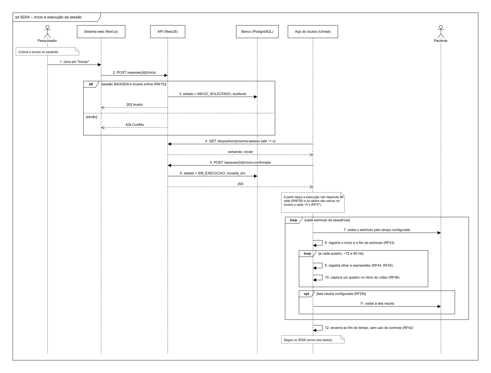

FONTE: Os autores (2026)

O diagrama SD04 mostra os seguintes pontos:

- O início só é aceito com a sessão baixada e o óculos online. Caso contrário, a API responde 409.
- O óculos recebe o comando na consulta seguinte (RNF13) e confirma o início.
- A partir daí, a execução não depende da rede (RNF09) e os dados são salvos no óculos a cada ~5 s (RF47).
- Para cada estímulo, o app registra o instante real de início e de fim (RF43). A cada quadro, registra o olhar e as expressões (RF44, RF45) e captura a cena (RF46). Quando configurada, exibe a tela neutra entre os estímulos (RF29).
- A sessão termina sozinha, sem uso do controle (RF42); não há interrupção (RN16).

#### HU07.7 – Cancelar sessão

**Sendo** pesquisador, **quero** cancelar uma sessão antes do início, **para** corrigi-la ou desistir da coleta.
*RF36 · Importante*
- Depois do início não é possível cancelar nem interromper (RN16).
- Se a sessão já estava no óculos, ele a descarta.

**Protótipo de tela:** W10 Sessão pronta para iniciar (Figura 22).

**Diagrama de sequência:** Não tem diagrama de sequência próprio: é um caso de uso de cadastro ou consulta, cujas chamadas seguem o padrão mostrado no SD03 (sistema web → API → banco de dados, na transação com o *tenant* do usuário e com registro na auditoria).

#### HU07.8 – Consultar sessões

**Sendo** pesquisador, **quero** listar as sessões que posso ver, filtrando por paciente, estado e período, **para** encontrar uma coleta.
*RF37 · Essencial*
- Aparecem só as sessões que tenho permissão de ver (RN18).

**Protótipo de tela:** W09 Sessões (Figura 33).

**Diagrama de sequência:** Não tem diagrama de sequência próprio: é um caso de uso de cadastro ou consulta, cujas chamadas seguem o padrão mostrado no SD03 (sistema web → API → banco de dados, na transação com o *tenant* do usuário e com registro na auditoria).

**FIGURA 33** - Protótipo da tela W09 Sessões

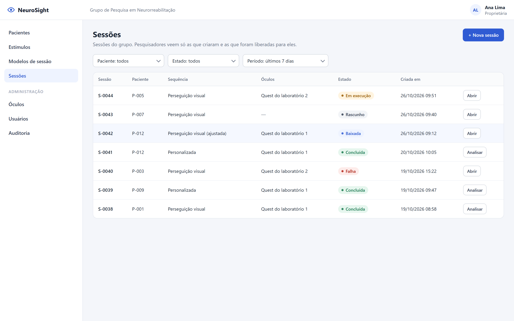

FONTE: Os autores (2026)

A tela W09 mostra: lista com filtros por paciente, estado e período (RF37).

### E08 – Execução no óculos (diagrama UC08)

#### HU08.1 – Baixar sessão e estímulos

**Sendo** pesquisador, **quero** que o óculos baixe sozinho a sessão enviada a ele, com todos os estímulos, **para** que a exibição não dependa da rede.
*RF38, RF40 · Essencial*
- Enquanto espera, o óculos consulta o servidor a cada ~1 s.
- Ao terminar o download, avisa o servidor e mostra o código do paciente, o número de estímulos e a duração (RF40).
- O paciente aparece só pelo código (RN19).

**Protótipo de tela:** A2 Aguardando sessão (Figura 34); A3 Sessão pronta (Figura 35).

**Diagrama de sequência:** SD03 – Criação e envio da sessão (Figura 31).

**FIGURA 34** - Protótipo da tela A2 Aguardando sessão, do aplicativo do óculos

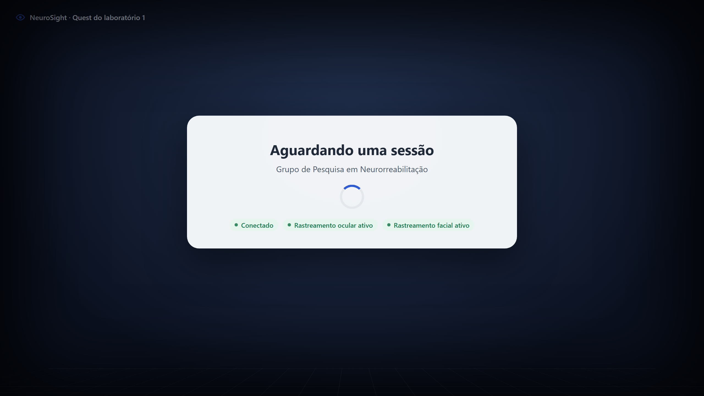

FONTE: Os autores (2026)

A tela A2 mostra: óculos pareado, consultando o servidor, com o estado do rastreamento (RF39).

**FIGURA 35** - Protótipo da tela A3 Sessão pronta, do aplicativo do óculos

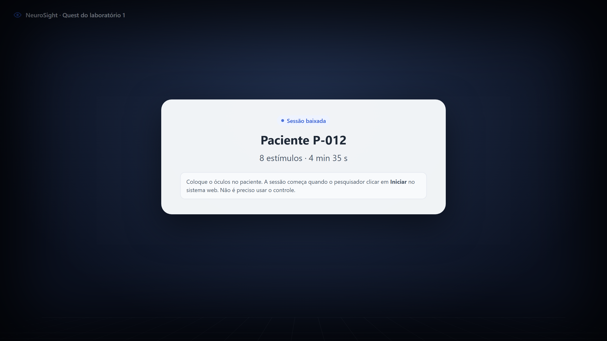

FONTE: Os autores (2026)

A tela A3 mostra: código do paciente, número de estímulos e duração, à espera do "Iniciar" no sistema web.

#### HU08.2 – Verificar rastreamento do óculos

**Sendo** pesquisador, **quero** ser avisado se o rastreamento ocular ou facial do óculos não estiver ativo, **para** corrigir isso antes de colocar o óculos no paciente.
*RF39 · Importante*
- O aviso aparece no sistema web, junto ao estado do óculos.

**Protótipo de tela:** A2 Aguardando sessão (Figura 34).

**Diagrama de sequência:** SD03 – Criação e envio da sessão (Figura 31).

#### HU08.3 – Executar sessão

**Sendo** pesquisador, **quero** que o óculos execute a sessão exatamente como configurada e termine sozinho, **para** que todos os pacientes passem pelo mesmo protocolo.
*RF41, RF42 · Essencial*
- O app começa ao receber o comando e confirma o início ao servidor (RF41).
- Exibe os estímulos na ordem e pelo tempo configurados (RN08) e termina sozinho, sem uso do controle (RNF22).
- Depois de iniciada, a sessão não depende da rede (RNF09) e não pode ser interrompida pelo sistema (RN16).

**Protótipo de tela:** A4 Execução (Figura 36).

**Diagrama de sequência:** SD04 – Início e execução (Figura 32).

**FIGURA 36** - Protótipo da tela A4 Execução, do aplicativo do óculos

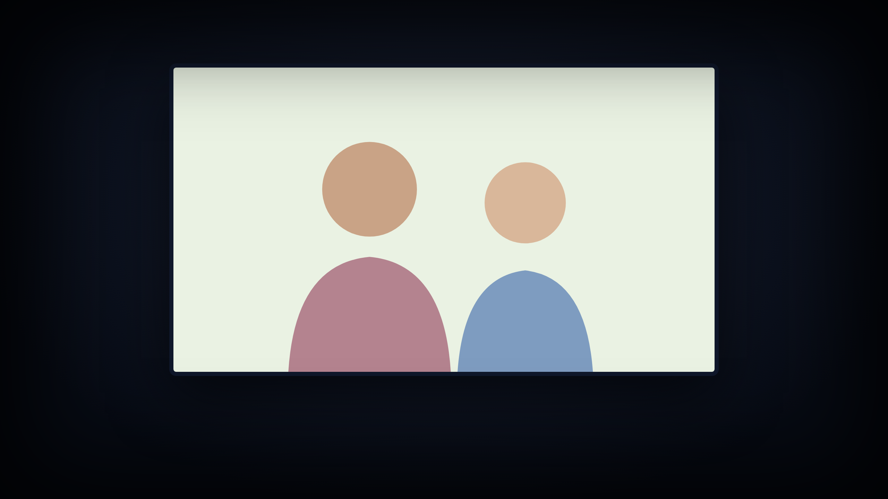

FONTE: Os autores (2026)

A tela A4 mostra: o que o paciente vê: só o estímulo, sem texto nem botão.

#### HU08.4 – Registrar olhar e expressões

**Sendo** pesquisador, **quero** que o olhar e as expressões faciais do paciente sejam registrados junto com o início e o fim de cada estímulo, **para** analisar as reações a cada um.
*RF43, RF44, RF45 · Essencial*
- O olhar é registrado a cada quadro (~72 a 90 Hz), com validade, confiança, ponto 3D e posições (u,v) (RNF14).
- As expressões baseadas no FACS são registradas com intensidade e validade.
- Tudo usa o mesmo relógio do óculos (RNF16), e nenhuma imagem do rosto é guardada (RNF06).

**Protótipo de tela:** A4 Execução (Figura 36).

**Diagrama de sequência:** SD04 – Início e execução (Figura 32).

#### HU08.5 – Gravar a cena

**Sendo** pesquisador, **quero** que a cena exibida ao paciente seja gravada, **para** rever depois o que ele viu.
*RF46 · Essencial*
- A taxa, a resolução e a qualidade da captura são configuráveis (RNF15).

**Protótipo de tela:** A4 Execução (Figura 36).

**Diagrama de sequência:** SD04 – Início e execução (Figura 32).

#### HU08.6 – Salvar dados no óculos

**Sendo** pesquisador, **quero** que os dados sejam salvos no óculos durante a sessão, **para** não perdê-los se o app fechar.
*RF47 · Essencial*
- Os dados são gravados em intervalos curtos (cerca de 5 s).

**Protótipo de tela:** A4 Execução (Figura 36).

**Diagrama de sequência:** SD04 – Início e execução (Figura 32).

### E09 – Envio e processamento (diagrama UC09)

#### HU09.1 – Enviar dados da sessão

**Sendo** pesquisador, **quero** que os dados e a gravação sejam enviados sozinhos ao servidor no fim da sessão, **para** não precisar transferir arquivos.
*RF48, RF49 · Essencial*
- O envio é feito em lotes, e os lotes que falharem são repetidos.
- Sem conexão, o óculos guarda a sessão e a reenvia depois (RF49).
- Os dados só saem do óculos depois que o servidor confirma o recebimento (RNF10), e reenviar um lote não duplica dados (RNF11).

**Protótipo de tela:** A5 Envio dos dados (Figura 37).

**Diagrama de sequência:** SD05 – Envio e processamento (Figura 38).

**FIGURA 37** - Protótipo da tela A5 Envio dos dados, do aplicativo do óculos

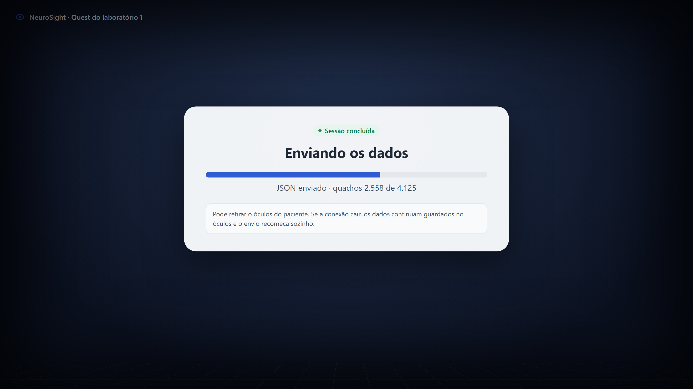

FONTE: Os autores (2026)

A tela A5 mostra: o progresso do envio; o pesquisador já pode retirar o óculos.

**FIGURA 38** - Diagrama de sequência SD05 – Envio e processamento

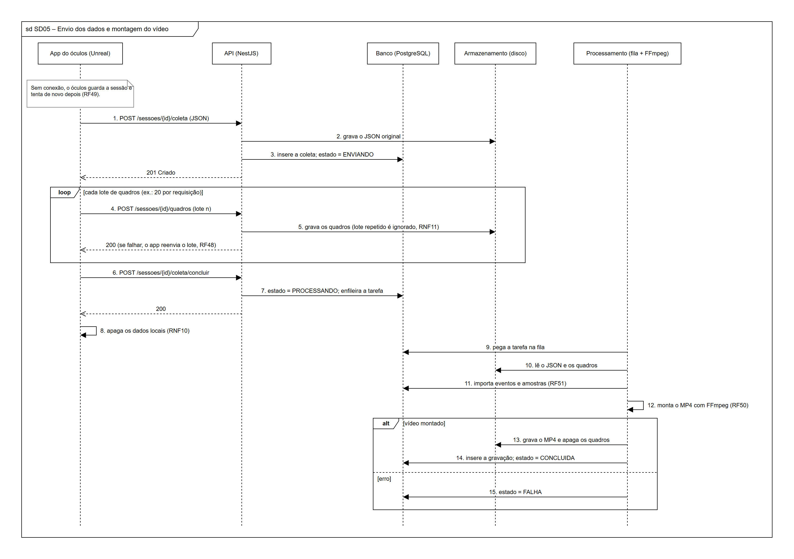

FONTE: Os autores (2026)

O diagrama SD05 mostra os seguintes pontos:

- O envio segue os três passos da IC: JSON, lotes de quadros e conclusão.
- Lote repetido é ignorado (RNF11) e lote que falha é reenviado (RF48). Sem conexão, o óculos guarda tudo e tenta de novo depois (RF49).
- Os dados só são apagados do óculos depois que o servidor confirma o recebimento (RNF10).
- Em segundo plano, o processamento pega a tarefa na fila, importa eventos e amostras para o banco (RF51) e monta o MP4 com FFmpeg (RF50).
- No fim, a sessão fica CONCLUIDA ou, se houver erro, FALHA.

#### HU09.2 – Processar dados recebidos

**Sendo** pesquisador, **quero** que o servidor monte o vídeo da sessão e associe tudo à sessão e ao paciente, **para** encontrar os dados prontos no sistema web.
*RF50, RF51 · Essencial*
- A montagem roda em segundo plano, com a sessão no estado "processando".
- Ao terminar, a sessão fica "concluída"; se der erro, fica "falha".

**Protótipo de tela:** este caso de uso não tem tela própria: roda no servidor. Aparece nos estados "Processando", "Concluída" e "Falha" de W09 e W10.

**Diagrama de sequência:** SD05 – Envio e processamento (Figura 38).

### E10 – Consulta e análise (diagrama UC10)

#### HU10.1 – Assistir à sessão

**Sendo** pesquisador, **quero** abrir uma sessão concluída e assistir ao vídeo, **para** rever o que o paciente viu.
*RF52 · Essencial*
- Só abre a sessão quem tem permissão de vê-la (RN18).
- A visualização fica registrada na auditoria (RF59).

**Protótipo de tela:** W11 Análise da sessão (Figura 39).

**Diagrama de sequência:** SD06 – Consulta e análise (Figura 40).

**FIGURA 39** - Protótipo da tela W11 Análise da sessão

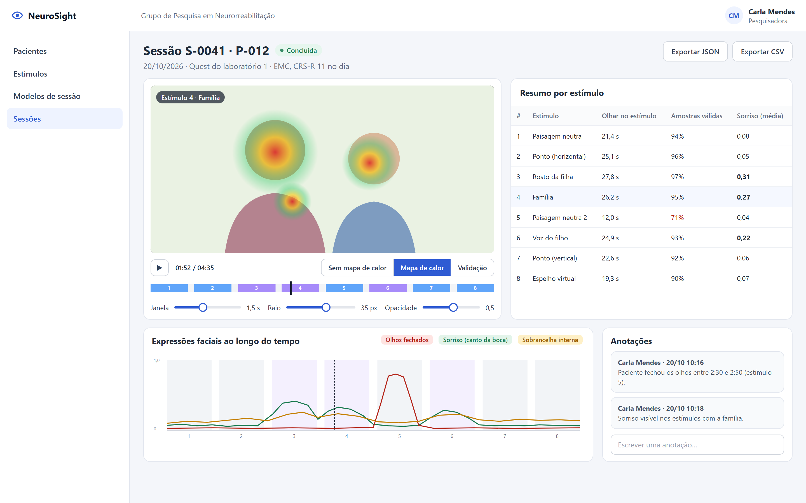

FONTE: Os autores (2026)

A tela W11 mostra: vídeo com heatmap e ajustes, modo validação, linha do tempo dos estímulos, resumo por estímulo, gráfico das expressões, anotações e exportação.

**FIGURA 40** - Diagrama de sequência SD06 – Consulta e análise

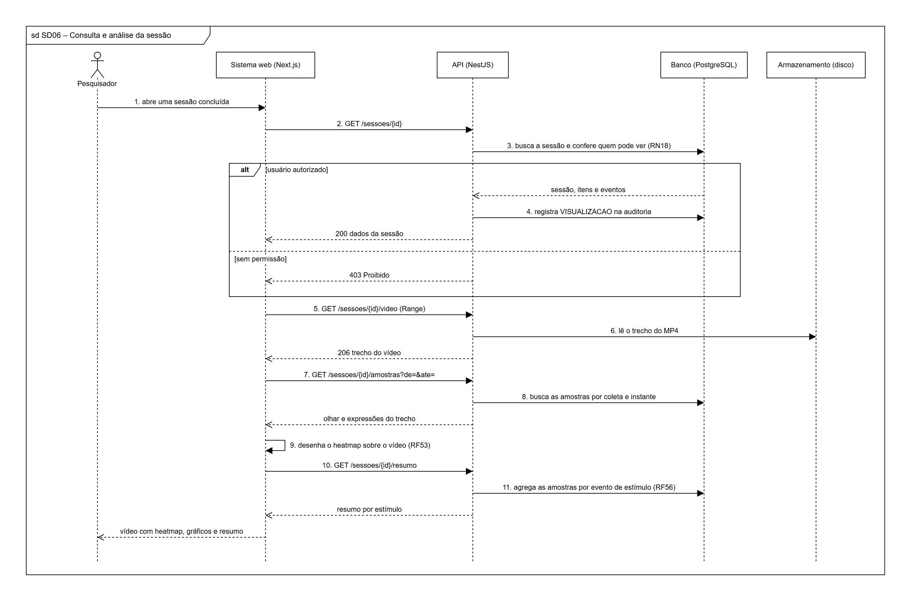

FONTE: Os autores (2026)

O diagrama SD06 mostra os seguintes pontos:

- A API confere quem pode ver a sessão (RN18). Só quando o acesso é permitido, registra a VISUALIZACAO na auditoria (RF59); sem permissão, responde 403.
- O vídeo é entregue em trechos (requisição com `Range`), o que permite avançar e voltar sem baixar o arquivo inteiro.
- O sistema web busca as amostras do trecho que está sendo exibido e desenha o heatmap (RF53).
- O resumo por estímulo é calculado no banco, cruzando as amostras com os eventos de estímulo (RF56).

#### HU10.2 – Ver heatmap do olhar

**Sendo** pesquisador, **quero** ver o heatmap do olhar sobre o vídeo, ajustando a janela temporal, o raio e a opacidade, **para** identificar para onde o paciente olhou.
*RF53 · Essencial*
- Os ajustes valem durante a reprodução, sem recarregar o vídeo.

**Protótipo de tela:** W11 Análise da sessão (Figura 39).

**Diagrama de sequência:** SD06 – Consulta e análise (Figura 40).

#### HU10.3 – Usar modo validação

**Sendo** pesquisador, **quero** ativar o modo validação, com o ponto do olhar desenhado sobre o vídeo, **para** conferir a qualidade do rastreamento.
*RF54 · Importante*
- O modo pode ser ligado e desligado durante a reprodução.

**Protótipo de tela:** W11 Análise da sessão (Figura 39).

**Diagrama de sequência:** SD06 – Consulta e análise (Figura 40).

#### HU10.4 – Ver gráficos das expressões

**Sendo** pesquisador, **quero** ver as expressões faciais ao longo do tempo, com a marcação de cada estímulo, **para** relacionar reações e estímulos.
*RF55 · Essencial*
- Dá para escolher quais expressões aparecem no gráfico.

**Protótipo de tela:** W11 Análise da sessão (Figura 39).

**Diagrama de sequência:** SD06 – Consulta e análise (Figura 40).

#### HU10.5 – Ver resumo por estímulo

**Sendo** pesquisador, **quero** um resumo por estímulo, com o tempo de olhar no estímulo, a porcentagem de amostras válidas e a intensidade média das expressões, **para** comparar as respostas entre estímulos.
*RF56 · Importante*
- O resumo usa os instantes reais de cada estímulo, registrados no óculos (RF43).

**Protótipo de tela:** W11 Análise da sessão (Figura 39).

**Diagrama de sequência:** SD06 – Consulta e análise (Figura 40).

#### HU10.6 – Registrar anotações

**Sendo** pesquisador, **quero** registrar anotações na sessão, **para** guardar observações da coleta (por exemplo, "o paciente fechou os olhos" ou "o óculos foi retirado").
*RF57 · Importante*
- Anotações e dados descritivos podem ser editados; os dados coletados, não (RN17).

**Protótipo de tela:** W11 Análise da sessão (Figura 39).

**Diagrama de sequência:** Não tem diagrama de sequência próprio: o registro de anotações segue o padrão do SD06, com a checagem de quem pode ver a sessão.

#### HU10.7 – Exportar dados da sessão

**Sendo** pesquisador, **quero** exportar os dados da sessão em JSON e CSV, **para** analisá-los em outras ferramentas.
*RF58 · Desejável*
- A exportação fica registrada na auditoria.

**Protótipo de tela:** W11 Análise da sessão (Figura 39).

**Diagrama de sequência:** Não tem diagrama de sequência próprio: a exportação segue o padrão do SD06, com a checagem de quem pode ver a sessão e o registro da exportação na auditoria.

### E11 – Auditoria (diagrama UC11)

#### HU11.1 – Consultar auditoria

**Sendo** administrador, **quero** consultar os registros de auditoria, filtrando por usuário, ação e período, **para** saber quem fez o quê e quando.
*RF60 · Essencial*
- Aparecem só os registros do meu tenant (RN01).

**Protótipo de tela:** W14 Auditoria (Figura 41).

**Diagrama de sequência:** Não tem diagrama de sequência próprio: a consulta à auditoria segue o padrão do SD03, com o filtro pelo *tenant* do administrador.

**FIGURA 41** - Protótipo da tela W14 Auditoria

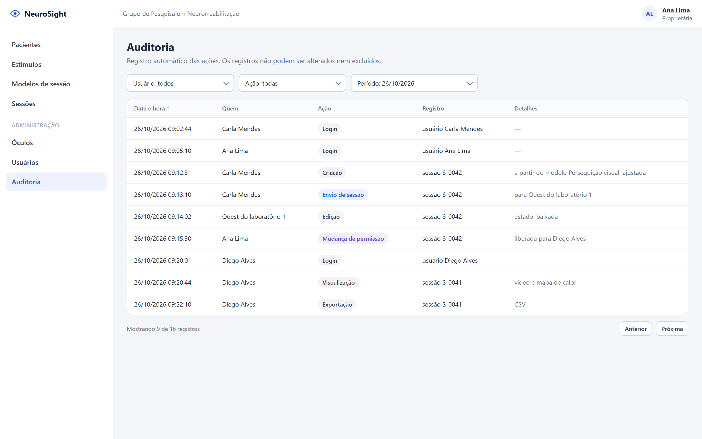

FONTE: Os autores (2026)

A tela W14 mostra: registros com filtros por usuário, ação e período, incluindo uma ação feita pelo óculos.

#### HU11.2 – Registrar ações automaticamente

**Sendo** administrador, **quero** que toda ação relevante seja registrada automaticamente, **para** responder por cada alteração e atender à LGPD.
*RF59 · Essencial*
- Cada registro guarda quem fez, quando, a ação e o registro afetado.
- Entram login, criação, edição, exclusão, envio e início de sessões, visualização de dados de sessão e mudanças de permissão.
- Os registros não podem ser alterados nem excluídos (RN20).

**Protótipo de tela:** W14 Auditoria (Figura 41).

**Diagrama de sequência:** O registro automático aparece como nota nos diagramas SD01, SD03, SD04 e SD06, nos pontos em que a API grava a auditoria.

## APÊNDICE D – DIAGRAMA LÓGICO DO BANCO DE DADOS

O modelo lógico-relacional do banco de dados (PostgreSQL 15 ou mais novo), na notação pé de galinha, tem 20 tabelas e 8 tipos enumerados, apresentados em três páginas, uma por assunto: experimento (estímulos, modelos, sessões, pacientes, autorizações e anotações), dados coletados (coleta, eventos, amostras de olhar e de expressão, e gravação) e acesso, óculos e auditoria (*tenant*, usuários, *tokens*, óculos, pareamento e auditoria). Os tipos enumerados correspondem às enumerações do diagrama de classes (Tabela 15).

- **Linhas com pé de galinha:** `||` é exatamente um; `o|` é zero ou um; `o<` é zero ou muitos; `|<` é um ou muitos.
- **PK** é chave primária, **FK** é chave estrangeira e **UK** é valor único.
- **Tipo em itálico:** a coluna aceita nulo.
- **Tabela em cinza tracejado:** está detalhada em outra página e aparece só para mostrar a ligação.
- **Ligações não desenhadas:** as FKs para `tenant` (coluna `tenant_id`) e para `usuario` nas colunas de autoria (`enviado_por`, `criado_por`, `criada_por`, `autor_id`) aparecem só nas colunas, para não cruzar o diagrama.

**FIGURA 42** - Modelo lógico-relacional: experimento

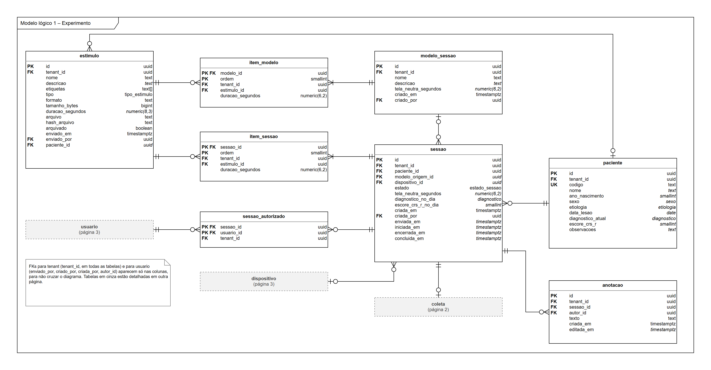

FONTE: Os autores (2026)

**FIGURA 43** - Modelo lógico-relacional: dados coletados

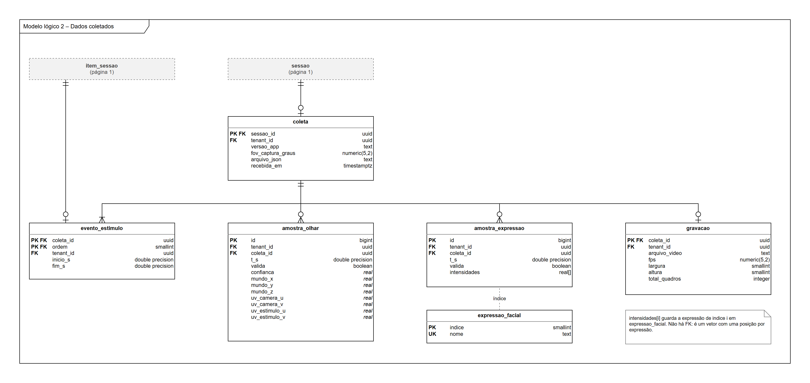

FONTE: Os autores (2026)

**FIGURA 44** - Modelo lógico-relacional: acesso, óculos e auditoria

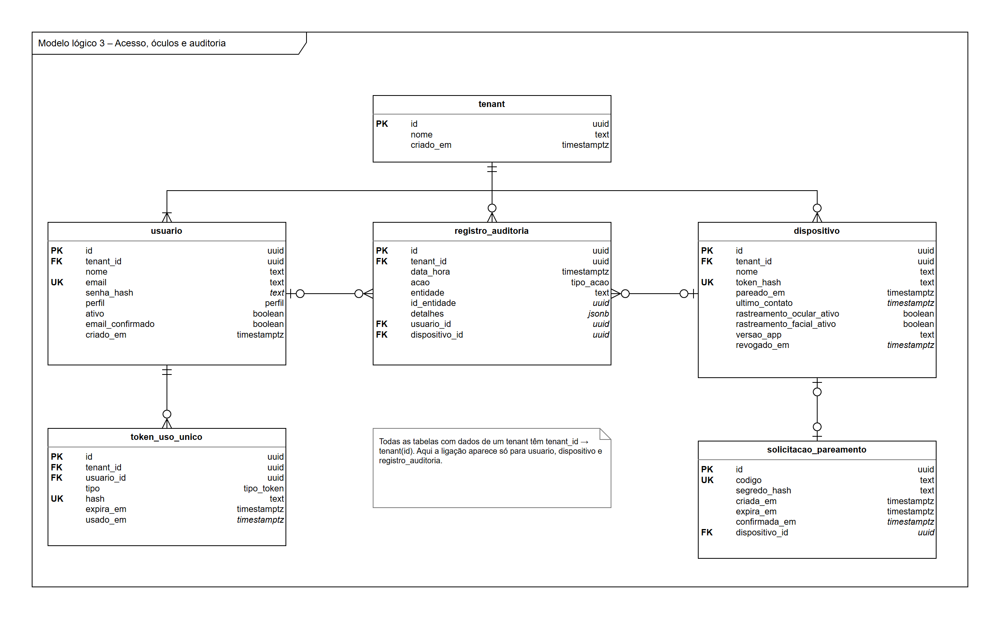

FONTE: Os autores (2026)

### Decisões de mapeamento

1. **`tenant_id` em todas as tabelas com dados de um tenant, inclusive as tabelas filhas.** O RLS fica simples, sem junções nas políticas.
2. **FKs compostas com o tenant:** por exemplo, `(tenant_id, paciente_id)` aponta para `paciente(tenant_id, id)`. No PostgreSQL, a checagem de FK ignora o RLS. Sem a FK composta, um id de outro tenant enviado por engano ou de propósito seria aceito como referência. Com ela, o próprio banco garante que filho e pai são do mesmo tenant.
3. **A classe abstrata SequenciaDeEstimulos não vira tabela.** Cada classe concreta tem as suas tabelas: `modelo_sessao` + `item_modelo` e `sessao` + `item_sessao`. Assim, a exclusão em cascata é direta (paciente → sessões → itens) e o mapeamento nas entidades do TypeORM fica simples.
4. **As amostras viram tabelas.** No processamento da sessão, o servidor importa o JSON para `amostra_olhar` e `amostra_expressao`, o que facilita os gráficos e o resumo por estímulo (RF55, RF56). O JSON original continua guardado como registro bruto (`coleta.arquivo_json`).
5. **As expressões faciais ficam num vetor** `real[]`, com uma posição por expressão. A ordem das posições fica na tabela `expressao_facial`.
6. **`Sessao.autorizados`** vira a tabela de ligação `sessao_autorizado`.
7. **Outras conversões:** Vetor2 e Vetor3 viram colunas separadas (`uv_camera_u`, `uv_camera_v`, `mundo_x`...); As enumerações viram tipos `ENUM` do PostgreSQL; As datas e horas usam `timestamptz`; Os ids são `uuid`, gerados com `gen_random_uuid()`. As amostras usam `bigint` sequencial, por causa do volume

**TABELA 17** - Correspondência entre as classes e as tabelas

| Classe | Tabela | Observação |
|---|---|---|
| Tenant | `tenant` | |
| Usuario | `usuario` | |
| TokenDeUsoUnico | `token_uso_unico` | |
| Dispositivo | `dispositivo` | `online` não é guardado: é calculado a partir de `ultimo_contato` |
| SolicitacaoDePareamento | `solicitacao_pareamento` | Sem `tenant_id`: existe antes do pareamento |
| Paciente | `paciente` | |
| Estimulo | `estimulo` | `etiquetas` é `text[]` |
| SequenciaDeEstimulos | — | Abstrata: as colunas aparecem em `modelo_sessao` e em `sessao` |
| ItemDaSequencia | `item_modelo` e `item_sessao` | |
| ModeloDeSessao | `modelo_sessao` | |
| Sessao | `sessao` e `sessao_autorizado` | `oculos` vira `dispositivo_id` e "origem" vira `modelo_origem_id` |
| Anotacao | `anotacao` | |
| Coleta | `coleta` | A chave primária é o próprio `sessao_id` (relação 1 para 0..1) |
| EventoDeEstimulo | `evento_estimulo` | `item` vira `(coleta_id, ordem)` → `item_sessao(sessao_id, ordem)` |
| AmostraDeOlhar | `amostra_olhar` | |
| AmostraDeExpressao | `amostra_expressao` e `expressao_facial` | `Mapa<Texto, Decimal>` vira `real[]` |
| Gravacao | `gravacao` | A chave primária é o próprio `coleta_id` |
| RegistroDeAuditoria | `registro_auditoria` | `detalhes` é `jsonb` |

FONTE: Os autores (2026)

### Isolamento por tenant

O banco tem três papéis:

- **`neurosight_owner`:** é o dono das tabelas e só roda as migrações.
- **`neurosight_api`:** é o papel usado pela API. Não é dono das tabelas nem tem `BYPASSRLS`.
- **`neurosight_auth`:** tem `BYPASSRLS` e é usado só no login, no autocadastro, nos tokens de uso único e no pareamento. Esses fluxos acontecem antes de existir tenant no contexto.

Em cada tabela com `tenant_id`, o RLS é ativado e forçado (`ENABLE` e `FORCE ROW LEVEL SECURITY`), e a política `isolamento_tenant` compara a coluna `tenant_id` com o valor de `current_setting('app.tenant_id')`, tanto na leitura (`USING`) quanto na escrita (`WITH CHECK`). As chaves estrangeiras compostas, como `sessao (tenant_id, paciente_id)` apontando para `paciente (tenant_id, id)`, garantem que o filho só referencia um pai do mesmo *tenant*.

- **Como a API informa o tenant:** em cada transação, a API executa `set_config('app.tenant_id', <tenant do token>, true)`. O valor vale só para a transação e não passa para outras conexões do pool. Sem ele, a política não devolve nenhuma linha.
- **Exceções à política:** `tenant` usa a política `id = current_setting('app.tenant_id', true)::uuid`; `solicitacao_pareamento` não tem `tenant_id` e só é acessada pelo papel `neurosight_auth`; `expressao_facial` é uma tabela de referência global, só de leitura
- **Permissões que garantem as regras de imutabilidade:** RN20: o papel `neurosight_api` não tem `UPDATE` nem `DELETE` em `registro_auditoria`; RN17: o papel `neurosight_api` não tem `UPDATE` em `coleta`, `evento_estimulo`, `amostra_olhar`, `amostra_expressao` e `gravacao`

### Restrições, índices e exclusões em cascata

**TABELA 18** - Restrições e índices do banco de dados

| Restrição ou índice | Regra |
|---|---|
| `UNIQUE INDEX ON usuario (lower(email))` | RN02: e-mail único no sistema, sem diferenciar maiúsculas |
| `UNIQUE INDEX ON usuario (tenant_id) WHERE perfil = 'PROPRIETARIO'` | RN03: no máximo um proprietário por tenant (o autocadastro cria exatamente um) |
| `UNIQUE (tenant_id, codigo)` em `paciente` | Código do paciente único no tenant |
| `UNIQUE (tenant_id, nome)` em `dispositivo` | Nome do óculos único no tenant |
| `UNIQUE INDEX ON sessao (dispositivo_id) WHERE estado IN ('ENVIADA_AO_OCULOS', 'BAIXADA', 'INICIO_SOLICITADO', 'EM_EXECUCAO')` | RN14: no máximo uma sessão pendente por óculos |
| `UNIQUE (tenant_id, id)` em `usuario`, `dispositivo`, `paciente`, `estimulo`, `modelo_sessao` e `sessao`; `UNIQUE (tenant_id, sessao_id)` em `coleta` | Necessários para as FKs compostas |
| `CHECK (duracao_segundos > 0)` e `CHECK (ordem >= 1)` em `item_modelo` e `item_sessao` | RN10 |
| `CHECK (tela_neutra_segundos >= 0)` em `modelo_sessao` e `sessao` | Tela neutra (RF29) |
| `CHECK (escore_crs_r BETWEEN 0 AND 23)` em `paciente`; idem para `escore_crs_r_no_dia` em `sessao` | Faixa da CRS-R |
| `CHECK (ano_nascimento BETWEEN 1900 AND 2100)` em `paciente` | Valor plausível |
| `CHECK (formato IN ('image/jpeg', 'image/png', 'video/mp4'))` e `CHECK (tamanho_bytes > 0)` em `estimulo` | RNF19 |
| `CHECK ((tipo = 'VIDEO') = (duracao_segundos IS NOT NULL))` em `estimulo` | Só vídeo tem duração |
| `CHECK (fim_s >= inicio_s)` em `evento_estimulo` | Intervalo válido |
| `CHECK (confianca BETWEEN 0 AND 1)` em `amostra_olhar` | Faixa da confiança |
| `CHECK (fps > 0 AND largura > 0 AND altura > 0 AND total_quadros >= 0)` em `gravacao` | Valores plausíveis |
| `CHECK (expira_em > criada_em)` em `solicitacao_pareamento` | Prazo válido |
| `UNIQUE (dispositivo_id)` em `solicitacao_pareamento` | Uma solicitação gera no máximo um óculos |
| `GIN (etiquetas)` em `estimulo` | Busca por etiqueta (RF23) |
| `INDEX (coleta_id, t_s)` em `amostra_olhar` e `amostra_expressao` | Leitura das amostras por trecho de tempo (heatmap, gráficos e resumo) |
| `INDEX (tenant_id, paciente_id)` e `INDEX (tenant_id, estado)` em `sessao` | Filtros da lista de sessões (RF37) |
| `INDEX (tenant_id, data_hora DESC)` em `registro_auditoria` | Consulta por período (RF60) |

FONTE: Os autores (2026)

Não há `CHECK` para o tamanho de `intensidades`, porque o número de expressões depende da versão do SDK da Meta. A importação confere se o vetor tem o mesmo tamanho que `expressao_facial`.

**TABELA 19** - Comportamento das chaves estrangeiras na exclusão

| FK | Ao excluir o pai |
|---|---|
| `sessao` → `paciente` | `CASCADE`: excluir o paciente exclui as sessões dele (RF21) |
| `estimulo.paciente_id` → `paciente` | `CASCADE`: os estímulos pessoais vão junto (RF21, RN12) |
| `item_modelo` → `modelo_sessao`; `item_sessao`, `sessao_autorizado`, `anotacao` e `coleta` → `sessao` | `CASCADE` |
| `evento_estimulo`, `amostra_olhar`, `amostra_expressao` e `gravacao` → `coleta` | `CASCADE` |
| `token_uso_unico` → `usuario`; `sessao_autorizado` → `usuario` | `CASCADE` |
| `sessao.modelo_origem_id` → `modelo_sessao` | `SET NULL (modelo_origem_id)`: a sessão continua com a própria cópia dos itens (RN11). A sintaxe com lista de colunas exige PostgreSQL 15 |
| `sessao.dispositivo_id` → `dispositivo`; `solicitacao_pareamento.dispositivo_id` → `dispositivo` | `SET NULL` (só da coluna do dispositivo) |
| `item_modelo` e `item_sessao` → `estimulo`; `evento_estimulo` → `item_sessao` | `NO ACTION`: um estímulo em uso não é excluído (RN13). `NO ACTION`, e não `RESTRICT`, porque a checagem acontece no fim do comando, depois das cascatas de RF21 |
| Colunas de autoria e de auditoria → `usuario` e `dispositivo`; todas as `tenant_id` → `tenant` | `NO ACTION`: usuários e óculos são desativados ou revogados, não excluídos |

FONTE: Os autores (2026)

### Dicionário de dados

Nas tabelas abaixo, "Nulo" indica se a coluna aceita nulo. Os valores padrão aparecem na descrição.

**TABELA 20** - Dicionário de dados: tabela `tenant`

| Coluna | Tipo | Nulo | Chave | Descrição |
|---|---|---|---|---|
| id | uuid | não | PK | Identificador |
| nome | text | não | | Nome da instituição ou do grupo |
| criado_em | timestamptz | não | | Data do autocadastro; padrão `now()` |

FONTE: Os autores (2026)

**TABELA 21** - Dicionário de dados: tabela `usuario`

| Coluna | Tipo | Nulo | Chave | Descrição |
|---|---|---|---|---|
| id | uuid | não | PK | Identificador |
| tenant_id | uuid | não | FK | Tenant do usuário (RN02) |
| nome | text | não | | Nome |
| email | text | não | UK | E-mail de login, único no sistema (RN02) |
| senha_hash | text | sim | | Hash Argon2 ou bcrypt (RNF03); nulo até o convidado definir a senha |
| perfil | perfil | não | | PESQUISADOR, ADMINISTRADOR ou PROPRIETARIO (RN05); padrão PESQUISADOR |
| ativo | boolean | não | | Falso quando desativado (HU02.4); padrão verdadeiro |
| email_confirmado | boolean | não | | Confirmação de e-mail (RF03); padrão falso |
| criado_em | timestamptz | não | | Data do cadastro; padrão `now()` |

FONTE: Os autores (2026)

**TABELA 22** - Dicionário de dados: tabela `token_uso_unico`

| Coluna | Tipo | Nulo | Chave | Descrição |
|---|---|---|---|---|
| id | uuid | não | PK | Identificador |
| tenant_id | uuid | não | FK | Tenant do usuário |
| usuario_id | uuid | não | FK | Dono do token |
| tipo | tipo_token | não | | Confirmação de e-mail, convite ou redefinição de senha |
| hash | text | não | UK | Hash do token enviado por e-mail; o token em si nunca é guardado |
| expira_em | timestamptz | não | | Prazo de validade |
| usado_em | timestamptz | sim | | Preenchido no uso; um token usado não vale mais |

FONTE: Os autores (2026)

**TABELA 23** - Dicionário de dados: tabela `dispositivo`

| Coluna | Tipo | Nulo | Chave | Descrição |
|---|---|---|---|---|
| id | uuid | não | PK | Identificador |
| tenant_id | uuid | não | FK | Tenant ao qual o óculos foi pareado |
| nome | text | não | | Nome dado pelo administrador, único no tenant |
| token_hash | text | não | UK | Hash do token de acesso do óculos (RNF04); é o hash do segredo da solicitação de pareamento (SD02) |
| pareado_em | timestamptz | não | | Data do pareamento; padrão `now()` |
| ultimo_contato | timestamptz | sim | | Última consulta do óculos ao servidor; base do "online" (RF15) |
| rastreamento_ocular_ativo | boolean | não | | Informado pelo app (RF39); padrão falso |
| rastreamento_facial_ativo | boolean | não | | Informado pelo app (RF39); padrão falso |
| versao_app | text | não | | Versão do app no óculos |
| revogado_em | timestamptz | sim | | Preenchido ao desfazer o pareamento (RF16) |

FONTE: Os autores (2026)

**TABELA 24** - Dicionário de dados: tabela `solicitacao_pareamento`

| Coluna | Tipo | Nulo | Chave | Descrição |
|---|---|---|---|---|
| id | uuid | não | PK | Identificador |
| codigo | text | não | UK | Código curto mostrado no óculos (RF13) |
| segredo_hash | text | não | | Hash do segredo entregue ao app na solicitação; depois da confirmação, o segredo passa a ser o token do óculos (SD02) |
| criada_em | timestamptz | não | | Padrão `now()` |
| expira_em | timestamptz | não | | Prazo do código (poucos minutos) |
| confirmada_em | timestamptz | sim | | Quando o administrador digitou o código |
| dispositivo_id | uuid | sim | FK | Óculos criado na confirmação; único |

FONTE: Os autores (2026)

**TABELA 25** - Dicionário de dados: tabela `paciente`

| Coluna | Tipo | Nulo | Chave | Descrição |
|---|---|---|---|---|
| id | uuid | não | PK | Identificador |
| tenant_id | uuid | não | FK | Tenant |
| codigo | text | não | UK | Código do paciente, único no tenant; é o único dado exibido no óculos (RN19) |
| nome | text | sim | | Opcional (RF17) |
| ano_nascimento | smallint | sim | | |
| sexo | sexo | sim | | |
| etiologia | etiologia | sim | | Traumática, vascular ou anóxica |
| data_lesao | date | sim | | |
| diagnostico_atual | diagnostico | sim | | Coma, SVNR ou EMC |
| escore_crs_r | smallint | sim | | 0 a 23 |
| observacoes | text | sim | | |

FONTE: Os autores (2026)

**TABELA 26** - Dicionário de dados: tabela `estimulo`

| Coluna | Tipo | Nulo | Chave | Descrição |
|---|---|---|---|---|
| id | uuid | não | PK | Identificador |
| tenant_id | uuid | não | FK | Tenant |
| nome | text | não | | |
| descricao | text | sim | | |
| etiquetas | text[] | não | | Etiquetas de busca; padrão vazio |
| tipo | tipo_estimulo | não | | Imagem ou vídeo |
| formato | text | não | | `image/jpeg`, `image/png` ou `video/mp4` (RNF19) |
| tamanho_bytes | bigint | não | | Tamanho do arquivo |
| duracao_segundos | numeric(8,3) | sim | | Só para vídeo |
| arquivo | text | não | | Caminho do arquivo no armazenamento (`/dados/<tenant_id>/...`) |
| hash_arquivo | text | não | | SHA-256 do arquivo; o óculos usa para não baixar de novo |
| arquivado | boolean | não | | Arquivado sai das novas sessões (RF26); padrão falso |
| enviado_em | timestamptz | não | | Padrão `now()` |
| enviado_por | uuid | não | FK | Usuário que enviou |
| paciente_id | uuid | sim | FK | Preenchido quando o estímulo é pessoal (RF25, RN12) |

FONTE: Os autores (2026)

**TABELA 27** - Dicionário de dados: tabela `modelo_sessao`

| Coluna | Tipo | Nulo | Chave | Descrição |
|---|---|---|---|---|
| id | uuid | não | PK | Identificador |
| tenant_id | uuid | não | FK | Tenant |
| nome | text | não | | |
| descricao | text | sim | | |
| tela_neutra_segundos | numeric(6,2) | sim | | Tela neutra entre estímulos (RF29) |
| criado_em | timestamptz | não | | Padrão `now()` |
| criado_por | uuid | não | FK | Usuário que criou |

FONTE: Os autores (2026)

**TABELA 28** - Dicionário de dados: tabela `item_modelo`

| Coluna | Tipo | Nulo | Chave | Descrição |
|---|---|---|---|---|
| modelo_id | uuid | não | PK FK | Modelo |
| ordem | smallint | não | PK | Posição na sequência, a partir de 1 |
| tenant_id | uuid | não | FK | Tenant |
| estimulo_id | uuid | não | FK | Estímulo exibido; não pode ser pessoal |
| duracao_segundos | numeric(6,2) | não | | Tempo de exibição, maior que zero (RN10) |

FONTE: Os autores (2026)

**TABELA 29** - Dicionário de dados: tabela `sessao`

| Coluna | Tipo | Nulo | Chave | Descrição |
|---|---|---|---|---|
| id | uuid | não | PK | Identificador |
| tenant_id | uuid | não | FK | Tenant |
| paciente_id | uuid | não | FK | Paciente da sessão (RN07) |
| modelo_origem_id | uuid | sim | FK | Modelo de origem, só como referência (RN11) |
| dispositivo_id | uuid | sim | FK | Óculos de destino |
| estado | estado_sessao | não | | Estado da sessão (RF34); padrão RASCUNHO |
| tela_neutra_segundos | numeric(6,2) | sim | | Copiada do modelo ou definida na hora |
| diagnostico_no_dia | diagnostico | sim | | Estado clínico do dia (RF32) |
| escore_crs_r_no_dia | smallint | sim | | 0 a 23 (RF32) |
| criada_em | timestamptz | não | | Padrão `now()` |
| criada_por | uuid | não | FK | Quem criou; vê a sessão por padrão (RN18) |
| enviada_em | timestamptz | sim | | Envio ao óculos |
| iniciada_em | timestamptz | sim | | Confirmação do início pelo óculos |
| encerrada_em | timestamptz | sim | | Fim da execução |
| concluida_em | timestamptz | sim | | Fim do processamento |

FONTE: Os autores (2026)

**TABELA 30** - Dicionário de dados: tabela `item_sessao`

| Coluna | Tipo | Nulo | Chave | Descrição |
|---|---|---|---|---|
| sessao_id | uuid | não | PK FK | Sessão |
| ordem | smallint | não | PK | Posição na sequência, a partir de 1 |
| tenant_id | uuid | não | FK | Tenant |
| estimulo_id | uuid | não | FK | Estímulo exibido (RN09, RN12) |
| duracao_segundos | numeric(6,2) | não | | Tempo de exibição, maior que zero (RN10) |

FONTE: Os autores (2026)

**TABELA 31** - Dicionário de dados: tabela `sessao_autorizado`

| Coluna | Tipo | Nulo | Chave | Descrição |
|---|---|---|---|---|
| sessao_id | uuid | não | PK FK | Sessão |
| usuario_id | uuid | não | PK FK | Usuário liberado pelo administrador (RF12, RN18) |
| tenant_id | uuid | não | FK | Tenant |

FONTE: Os autores (2026)

**TABELA 32** - Dicionário de dados: tabela `anotacao`

| Coluna | Tipo | Nulo | Chave | Descrição |
|---|---|---|---|---|
| id | uuid | não | PK | Identificador |
| tenant_id | uuid | não | FK | Tenant |
| sessao_id | uuid | não | FK | Sessão |
| autor_id | uuid | não | FK | Autor da anotação |
| texto | text | não | | Conteúdo (RF57) |
| criada_em | timestamptz | não | | Padrão `now()` |
| editada_em | timestamptz | sim | | Última edição |

FONTE: Os autores (2026)

**TABELA 33** - Dicionário de dados: tabela `coleta`

| Coluna | Tipo | Nulo | Chave | Descrição |
|---|---|---|---|---|
| sessao_id | uuid | não | PK FK | Sessão de origem (relação 1 para 0..1) |
| tenant_id | uuid | não | FK | Tenant |
| versao_app | text | não | | Versão do app que coletou |
| fov_captura_graus | numeric(5,2) | não | | Campo de visão da câmera de captura |
| arquivo_json | text | não | | Caminho do JSON original, guardado sem alteração (RN17) |
| recebida_em | timestamptz | não | | Fim do envio; padrão `now()` |

FONTE: Os autores (2026)

**TABELA 34** - Dicionário de dados: tabela `evento_estimulo`

| Coluna | Tipo | Nulo | Chave | Descrição |
|---|---|---|---|---|
| coleta_id | uuid | não | PK FK | Coleta; com `ordem`, aponta para `item_sessao` |
| ordem | smallint | não | PK FK | Item exibido |
| tenant_id | uuid | não | FK | Tenant |
| inicio_s | double precision | não | | Início real, em segundos desde o começo da sessão (RF43) |
| fim_s | double precision | não | | Fim real, em segundos |

FONTE: Os autores (2026)

**TABELA 35** - Dicionário de dados: tabela `amostra_olhar`

| Coluna | Tipo | Nulo | Chave | Descrição |
|---|---|---|---|---|
| id | bigint | não | PK | Sequencial |
| tenant_id | uuid | não | FK | Tenant |
| coleta_id | uuid | não | FK | Coleta |
| t_s | double precision | não | | Instante da amostra, em segundos (RNF16) |
| valida | boolean | não | | Falso em piscadas ou sem dado válido |
| confianca | real | sim | | 0 a 1 |
| mundo_x, mundo_y, mundo_z | real | sim | | Ponto 3D olhado |
| uv_camera_u, uv_camera_v | real | sim | | Posição na câmera de captura, de 0 a 1 |
| uv_estimulo_u, uv_estimulo_v | real | sim | | Posição no estímulo, de 0 a 1; nulo com o olhar fora do estímulo |

FONTE: Os autores (2026)

**TABELA 36** - Dicionário de dados: tabela `amostra_expressao`

| Coluna | Tipo | Nulo | Chave | Descrição |
|---|---|---|---|---|
| id | bigint | não | PK | Sequencial |
| tenant_id | uuid | não | FK | Tenant |
| coleta_id | uuid | não | FK | Coleta |
| t_s | double precision | não | | Instante da amostra, em segundos (RNF16) |
| valida | boolean | não | | Validade informada pelo SDK |
| intensidades | real[] | não | | Uma intensidade (0 a 1) por expressão, na ordem de `expressao_facial.indice` |

FONTE: Os autores (2026)

**TABELA 37** - Dicionário de dados: tabela `expressao_facial`

| Coluna | Tipo | Nulo | Chave | Descrição |
|---|---|---|---|---|
| indice | smallint | não | PK | Posição no vetor `intensidades` |
| nome | text | não | UK | Nome da expressão FACS (ex.: `EYES_CLOSED_L`) |

FONTE: Os autores (2026)

**TABELA 38** - Dicionário de dados: tabela `gravacao`

| Coluna | Tipo | Nulo | Chave | Descrição |
|---|---|---|---|---|
| coleta_id | uuid | não | PK FK | Coleta (relação 1 para 0..1) |
| tenant_id | uuid | não | FK | Tenant |
| arquivo_video | text | não | | Caminho do MP4 montado no servidor (RF50) |
| fps | numeric(5,2) | não | | Quadros por segundo |
| largura | smallint | não | | Em pixels |
| altura | smallint | não | | Em pixels |
| total_quadros | integer | não | | Quadros recebidos |

FONTE: Os autores (2026)

**TABELA 39** - Dicionário de dados: tabela `registro_auditoria`

| Coluna | Tipo | Nulo | Chave | Descrição |
|---|---|---|---|---|
| id | uuid | não | PK | Identificador |
| tenant_id | uuid | não | FK | Tenant |
| data_hora | timestamptz | não | | Padrão `now()` |
| acao | tipo_acao | não | | Tipo de ação (RF59) |
| entidade | text | não | | Tabela afetada (ex.: `sessao`) |
| id_entidade | uuid | sim | | Registro afetado; sem FK, para o registro sobreviver à exclusão |
| detalhes | jsonb | sim | | Dados extras (ex.: perfil antigo e novo) |
| usuario_id | uuid | sim | FK | Quem fez, quando foi um usuário |
| dispositivo_id | uuid | sim | FK | Quem fez, quando foi o óculos |

FONTE: Os autores (2026)

## APÊNDICE E – ESPECIFICAÇÃO DE APPLICATION PROGRAMMING INTERFACES (APIS)

O sistema web e o aplicativo do óculos se comunicam apenas com a API do servidor, por HTTPS, no estilo REST. As rotas do aplicativo usam o *token* do óculos, obtido no pareamento; as do sistema web usam o JWT do usuário, com o *tenant* e o perfil, exceto as do autocadastro e da confirmação de e-mail, que acontecem antes de existir um usuário autenticado. A Tabela 40 lista as rotas usadas nos diagramas de sequência do Apêndice C, com quem as chama, para quê e em qual diagrama aparecem. A lista completa das rotas, com os parâmetros e as respostas de cada uma, será documentada em OpenAPI na etapa de desenvolvimento (RNF23), como contrato entre o servidor e o aplicativo.

**TABELA 40** - Rotas da API usadas nos diagramas de sequência

| Método e rota | Quem chama | Para quê | Diagrama |
|---|---|---|---|
| `POST /tenants` | Sistema web | Autocadastro: cria tenant, proprietário e token de confirmação | SD01 |
| `POST /auth/confirmar-email` | Sistema web | Confirma o e-mail com o token de uso único | SD01 |
| `POST /pareamentos` | App | Pede um código de pareamento (sem autenticação) | SD02 |
| `GET /pareamentos/{id}` | App | Consulta se o código já foi confirmado (envia o segredo) | SD02 |
| `POST /dispositivos` | Sistema web | O administrador confirma o código e cria o óculos | SD02 |
| `POST /sessoes` | Sistema web | Cria a sessão, a partir de um modelo ou personalizada | SD03 |
| `POST /sessoes/{id}/envio` | Sistema web | Envia a sessão a um óculos | SD03 |
| `GET /dispositivo/proxima-sessao` | App | Consulta periódica: sinal de vida, sessão pendente e comando de início | SD03, SD04 |
| `GET /estimulos/{id}/arquivo` | App | Baixa um estímulo | SD03 |
| `POST /sessoes/{id}/baixada` | App | Avisa que a sessão está pronta e informa o estado do rastreamento | SD03 |
| `GET /sessoes/{id}` | Sistema web | Estado e dados da sessão | SD03 (só como nota), SD06 |
| `POST /sessoes/{id}/inicio` | Sistema web | Pede o início (botão "Iniciar") | SD04 |
| `POST /sessoes/{id}/inicio-confirmado` | App | Confirma que a execução começou | SD04 |
| `POST /sessoes/{id}/coleta` | App | Envia o JSON da coleta | SD05 |
| `POST /sessoes/{id}/quadros` | App | Envia um lote de quadros | SD05 |
| `POST /sessoes/{id}/coleta/concluir` | App | Fecha o envio e dispara o processamento | SD05 |
| `GET /sessoes/{id}/video` | Sistema web | Trecho do vídeo (requisição com `Range`) | SD06 |
| `GET /sessoes/{id}/amostras` | Sistema web | Amostras de olhar e de expressão de um trecho | SD06 |
| `GET /sessoes/{id}/resumo` | Sistema web | Resumo por estímulo | SD06 |

FONTE: Os autores (2026)

As decisões de projeto que aparecem nas rotas e nos diagramas são as seguintes.

- **O segredo do pareamento vira o token do óculos.** É uma simplificação do OAuth 2.0 Device Authorization Grant (RFC 8628): em vez de emitir um token novo no fim, o servidor ativa o segredo que o app já recebeu.
- **Uma única consulta periódica do óculos** (`GET /dispositivo/proxima-sessao`) serve de sinal de vida, entrega a sessão e transmite o comando de início. Assim, não é preciso WebSocket.
- **O sistema web acompanha o estado consultando a sessão periodicamente**, também sem WebSocket.
- **Os estímulos ficam em cache no óculos**, identificados pelo hash do arquivo, e só são baixados de novo quando mudam.

## APÊNDICE F – MODELOS DE INTELIGÊNCIA ARTIFICIAL

Este apêndice não se aplica ao NeuroSight. O sistema não treina nem executa modelos de inteligência artificial: os valores das expressões faciais, baseados no *Facial Action Coding System*, são fornecidos pelo kit de desenvolvimento da Meta, que os calcula no próprio óculos a partir das câmeras internas e descarta as imagens, e o olhar é lido pelo padrão OpenXR. O sistema registra esses valores, junto com os instantes de cada estímulo, e os apresenta ao pesquisador em gráficos, mapas de calor e resumos por estímulo; a interpretação das respostas do paciente cabe aos pesquisadores. O uso de modelos de aprendizado de máquina sobre os dados coletados, se vier a ser considerado, fica para trabalhos futuros, fora do escopo deste projeto.

## APÊNDICE G – REQUISITOS DO SISTEMA

Este apêndice reúne os requisitos levantados na etapa de modelagem: os requisitos funcionais, agrupados pelos mesmos onze grupos que deram origem aos diagramas de casos de uso (Apêndice A) e aos épicos das histórias de usuário (Apêndice C), as regras de negócio e os requisitos não funcionais. A prioridade de cada requisito funcional segue três níveis: essencial (sem ele o sistema não cumpre o objetivo), importante (deve entrar, mas o sistema funciona sem ele) e desejável (entra se houver tempo). Os atores citados nos requisitos estão descritos na Tabela 1 do Apêndice A.

**TABELA 41** - Requisitos funcionais: Tenant, acesso e conta

| ID | Requisito | Prioridade |
| --- | --- | --- |
| RF01 | O sistema deve exibir uma landing page que apresente o NeuroSight e dê acesso ao autocadastro e ao login. | Importante |
| RF02 | O sistema deve permitir que um visitante crie um tenant, informando o nome da instituição ou do grupo e os próprios dados de acesso; quem cria passa a ser o proprietário. | Essencial |
| RF03 | O sistema deve confirmar o e-mail de quem cria o tenant antes de liberar o acesso. | Importante |
| RF04 | O sistema deve permitir que o usuário entre com e-mail e senha e saia do sistema. | Essencial |
| RF05 | O sistema deve permitir que o usuário recupere a senha por e-mail. | Importante |
| RF06 | O sistema deve permitir que o usuário altere a própria senha e os próprios dados. | Desejável |
| RF07 | O sistema deve permitir que o proprietário altere os dados do tenant. | Desejável |
| RF08 | O sistema deve permitir que o proprietário transfira a propriedade do tenant para um administrador. | Desejável |

FONTE: Os autores (2026)

**TABELA 42** - Requisitos funcionais: Usuários e permissões

| ID | Requisito | Prioridade |
| --- | --- | --- |
| RF09 | O sistema deve permitir que o administrador cadastre usuários no tenant, com nome, e-mail e perfil; o usuário recebe um convite por e-mail para definir a senha. | Essencial |
| RF10 | O sistema deve permitir que o administrador liste, edite e desative os usuários do tenant. | Essencial |
| RF11 | O sistema deve permitir que o proprietário conceda e retire o perfil de administrador. | Essencial |
| RF12 | O sistema deve permitir que o administrador defina quais usuários podem visualizar cada sessão. | Essencial |

FONTE: Os autores (2026)

**TABELA 43** - Requisitos funcionais: Óculos (dispositivos)

| ID | Requisito | Prioridade |
| --- | --- | --- |
| RF13 | O app deve exibir um código de pareamento enquanto o óculos não estiver vinculado a um tenant. | Essencial |
| RF14 | O sistema deve permitir que o administrador pareie um óculos ao tenant digitando esse código e dando um nome ao aparelho. | Essencial |
| RF15 | O sistema deve listar os óculos do tenant, com nome, situação (online ou offline), último contato e sessão atual. | Importante |
| RF16 | O sistema deve permitir que o administrador renomeie um óculos e desfaça o pareamento, revogando o acesso do aparelho. | Importante |

FONTE: Os autores (2026)

**TABELA 44** - Requisitos funcionais: Pacientes

| ID | Requisito | Prioridade |
| --- | --- | --- |
| RF17 | O sistema deve permitir que o pesquisador cadastre pacientes com: código de identificação (obrigatório); nome (opcional, nunca exibido no óculos); ano de nascimento; sexo; etiologia da lesão (traumática, vascular ou anóxica); data da lesão; diagnóstico atual (coma, SVNR ou EMC); escore CRS-R; e observações. | Essencial |
| RF18 | O sistema deve permitir que o pesquisador edite os dados de um paciente. | Essencial |
| RF19 | O sistema deve permitir que o pesquisador liste os pacientes e os busque pelo código. | Essencial |
| RF20 | O sistema deve exibir o histórico de sessões de um paciente. | Essencial |
| RF21 | O sistema deve permitir que o administrador exclua um paciente e os dados das suas sessões, registrando a exclusão na auditoria. | Importante |

FONTE: Os autores (2026)

**TABELA 45** - Requisitos funcionais: Estímulos

| ID | Requisito | Prioridade |
| --- | --- | --- |
| RF22 | O sistema deve permitir que o pesquisador envie imagens e vídeos para o acervo de estímulos do tenant. | Essencial |
| RF23 | O sistema deve permitir que o pesquisador liste, busque e pré-visualize os estímulos. | Essencial |
| RF24 | O sistema deve permitir que o pesquisador edite o nome, a descrição e as etiquetas de um estímulo. | Importante |
| RF25 | O sistema deve permitir marcar um estímulo como pessoal de um paciente (por exemplo, a foto de um familiar), restringindo seu uso às sessões desse paciente. | Importante |
| RF26 | O sistema deve permitir que o pesquisador arquive um estímulo, retirando-o das novas sessões. | Importante |

FONTE: Os autores (2026)

**TABELA 46** - Requisitos funcionais: Modelos de sessão

| ID | Requisito | Prioridade |
| --- | --- | --- |
| RF27 | O sistema deve permitir que o pesquisador cadastre modelos de sessão, com nome, a lista ordenada de estímulos e o tempo de exibição de cada um. | Essencial |
| RF28 | O sistema deve permitir que o pesquisador liste, edite, duplique e exclua modelos de sessão. | Importante |
| RF29 | O sistema deve permitir definir uma tela neutra entre os estímulos, com duração configurável, que sirva de linha de base para as expressões. | Desejável |

FONTE: Os autores (2026)

**TABELA 47** - Requisitos funcionais: Sessões (sistema web)

| ID | Requisito | Prioridade |
| --- | --- | --- |
| RF30 | O sistema deve permitir que o pesquisador crie uma sessão para um paciente a partir de um modelo, podendo ajustá-la antes do envio sem alterar o modelo. | Essencial |
| RF31 | O sistema deve permitir que o pesquisador crie uma sessão personalizada, escolhendo os estímulos, a ordem e o tempo de exibição de cada um. | Essencial |
| RF32 | O sistema deve permitir registrar na sessão o estado clínico do paciente no dia (diagnóstico e escore CRS-R, se houver). | Desejável |
| RF33 | O sistema deve permitir que o pesquisador envie a sessão a um óculos pareado. | Essencial |
| RF34 | O sistema deve mostrar o estado da sessão (rascunho, enviada ao óculos, baixada, início solicitado, em execução, enviando, processando, concluída ou falha) e se o óculos de destino está online. | Essencial |
| RF35 | O sistema deve permitir que o pesquisador inicie a sessão pelo botão "Iniciar", liberado só quando o óculos está online e já baixou a sessão. | Essencial |
| RF36 | O sistema deve permitir que o pesquisador cancele uma sessão antes do início. | Importante |
| RF37 | O sistema deve listar as sessões que o usuário pode ver, com filtros por paciente, estado e período. | Essencial |

FONTE: Os autores (2026)

**TABELA 48** - Requisitos funcionais: Execução no óculos (app)

| ID | Requisito | Prioridade |
| --- | --- | --- |
| RF38 | O app deve consultar o servidor periodicamente enquanto aguarda e baixar a sessão enviada a ele, com todos os estímulos. | Essencial |
| RF39 | O app deve verificar se as permissões e o rastreamento ocular e facial estão ativos e avisar o servidor se não estiverem. | Importante |
| RF40 | O app deve avisar o servidor quando a sessão estiver baixada e mostrar, na espera, o código do paciente, o número de estímulos e a duração. | Essencial |
| RF41 | O app deve iniciar a sessão ao receber o comando de início e confirmar o início ao servidor. | Essencial |
| RF42 | O app deve apresentar os estímulos na ordem e pelo tempo configurados e encerrar a sessão sozinho ao fim do tempo. | Essencial |
| RF43 | O app deve registrar o instante real de início e de fim de cada estímulo. | Essencial |
| RF44 | O app deve registrar o olhar a cada quadro: validade, confiança, ponto 3D, posição (u,v) na câmera de captura e posição (u,v) no estímulo olhado. | Essencial |
| RF45 | O app deve registrar as expressões faciais baseadas no FACS, com intensidade e validade. | Essencial |
| RF46 | O app deve capturar quadros da cena exibida ao paciente para a gravação da sessão. | Essencial |
| RF47 | O app deve gravar os dados no armazenamento do óculos durante a sessão, em intervalos curtos, para não perdê-los se o app fechar. | Essencial |

FONTE: Os autores (2026)

**TABELA 49** - Requisitos funcionais: Envio e processamento

| ID | Requisito | Prioridade |
| --- | --- | --- |
| RF48 | Ao fim da sessão, o app deve enviar automaticamente o JSON e os quadros ao servidor, em lotes, repetindo os lotes que falharem. | Essencial |
| RF49 | Sem conexão, o app deve guardar a sessão e reenviá-la quando a conexão voltar. | Essencial |
| RF50 | O servidor deve montar o vídeo MP4 da sessão a partir dos quadros, em segundo plano. | Essencial |
| RF51 | O servidor deve associar os dados e o vídeo à sessão e ao paciente. | Essencial |

FONTE: Os autores (2026)

**TABELA 50** - Requisitos funcionais: Consulta e análise

| ID | Requisito | Prioridade |
| --- | --- | --- |
| RF52 | O sistema deve permitir que o usuário autorizado abra uma sessão concluída e assista ao vídeo. | Essencial |
| RF53 | O sistema deve exibir o heatmap do olhar sobre o vídeo, com janela temporal, raio e opacidade ajustáveis. | Essencial |
| RF54 | O sistema deve oferecer um modo validação, com o ponto do olhar gravado desenhado sobre o vídeo. | Importante |
| RF55 | O sistema deve exibir gráficos das expressões faciais ao longo do tempo, com a marcação de cada estímulo. | Essencial |
| RF56 | O sistema deve exibir um resumo por estímulo: tempo com o olhar dentro do estímulo, porcentagem de amostras válidas e intensidade média das expressões. | Importante |
| RF57 | O sistema deve permitir que o pesquisador registre e edite anotações e os dados descritivos da sessão; os dados coletados não podem ser editados (RN17). | Importante |
| RF58 | O sistema deve permitir exportar os dados de uma sessão em JSON e CSV. | Desejável |

FONTE: Os autores (2026)

**TABELA 51** - Requisitos funcionais: Auditoria

| ID | Requisito | Prioridade |
| --- | --- | --- |
| RF59 | O sistema deve registrar automaticamente quem fez cada ação, quando e em qual registro: login, criação, edição e exclusão de dados, envio e início de sessões, visualização e exportação de dados de sessão e mudanças de permissão. | Essencial |
| RF60 | O sistema deve permitir que o administrador consulte os registros de auditoria, filtrando por usuário, ação e período. | Essencial |

FONTE: Os autores (2026)

**TABELA 52** - Regras de negócio

| ID | Regra |
| --- | --- |
| RN01 | Todo usuário, paciente, estímulo, modelo, sessão, óculos e registro de auditoria pertence a um único tenant, e nenhum usuário acessa dados de outro tenant. |
| RN02 | Cada usuário pertence a um único tenant. |
| RN03 | Cada tenant tem um único proprietário: quem o criou, até uma eventual transferência (RF08). |
| RN04 | Só o proprietário concede ou retira o perfil de administrador. |
| RN05 | Os perfis são cumulativos: o proprietário pode tudo o que o administrador pode, e o administrador pode tudo o que o pesquisador pode. |
| RN06 | O paciente não é usuário e não acessa o sistema. |
| RN07 | Toda sessão pertence a exatamente um paciente. |
| RN08 | Toda sessão é um fluxo de imagens e vídeos exibidos em sequência, cada um pelo tempo definido na configuração. |
| RN09 | Uma sessão só usa estímulos que já estão no acervo do tenant. |
| RN10 | Todo estímulo de um modelo ou de uma sessão tem tempo de exibição maior que zero. |
| RN11 | Alterar um modelo não altera as sessões já criadas a partir dele. |
| RN12 | Um estímulo pessoal só pode ser usado em sessões do paciente ao qual pertence. |
| RN13 | Um estímulo já usado em alguma sessão não pode ser excluído, só arquivado. |
| RN14 | Uma sessão só pode ser enviada a um óculos pareado ao mesmo tenant, e cada óculos tem no máximo uma sessão pendente por vez. |
| RN15 | O botão "Iniciar" só fica liberado quando o óculos de destino está online e já baixou a sessão. |
| RN16 | Depois do envio ao óculos, a sessão não pode mais ser editada (para mudar, é preciso cancelar). Depois do início, ela sempre vai até o fim do tempo configurado: não há interrupção pelo sistema. |
| RN17 | Os dados coletados (olhar, expressões, quadros e vídeo) não podem ser alterados; o pesquisador só registra anotações e dados descritivos. |
| RN18 | Os dados de uma sessão só ficam visíveis para quem a criou, para o proprietário, para os administradores e para quem o administrador autorizar. |
| RN19 | No óculos, o paciente é identificado só pelo código. |
| RN20 | Registros de auditoria não podem ser alterados nem excluídos. |

FONTE: Os autores (2026)

**TABELA 53** - Requisitos não funcionais: Segurança e privacidade

| ID | Requisito |
| --- | --- |
| RNF01 | Os dados de cada tenant devem ficar isolados em duas camadas: filtro na API e Row-Level Security no PostgreSQL. |
| RNF02 | Toda comunicação entre óculos, navegador e servidor deve usar HTTPS. |
| RNF03 | As senhas devem ser guardadas apenas como hash (Argon2 ou bcrypt). |
| RNF04 | Toda chamada à API deve exigir token: JWT com tenant e perfil para usuários; token próprio e revogável para cada óculos, obtido no pareamento. |
| RNF05 | Estímulos, quadros, vídeos e JSON só devem ser entregues pela API, depois da checagem de permissão; nenhum arquivo fica em endereço público. |
| RNF06 | O app não deve capturar nem enviar imagens do rosto do paciente, só os valores das expressões. A gravação mostra apenas o que o paciente viu. |
| RNF07 | O cadastro do paciente deve guardar só os dados necessários à pesquisa (minimização da LGPD), listados em RF17. |
| RNF08 | O tratamento dos dados deve seguir a LGPD, considerando os dados de saúde como dados pessoais sensíveis. |

FONTE: Os autores (2026)

**TABELA 54** - Requisitos não funcionais: Confiabilidade

| ID | Requisito |
| --- | --- |
| RNF09 | Depois do início, a execução não pode depender da rede: uma queda de conexão não interrompe a sessão. |
| RNF10 | Os dados de uma sessão só podem ser apagados do óculos depois que o servidor confirmar o recebimento completo. |
| RNF11 | O recebimento dos lotes deve ser idempotente: reenviar um lote não duplica dados. |
| RNF12 | O banco e os arquivos devem ter cópia de segurança diária. |

FONTE: Os autores (2026)

**TABELA 55** - Requisitos não funcionais: Desempenho

| ID | Requisito |
| --- | --- |
| RNF13 | O óculos deve começar a sessão em até cerca de 2 s depois do clique em "Iniciar" (consulta ao servidor a cada ~1 s). |
| RNF14 | O olhar deve ser amostrado a cada quadro de renderização (~72 a 90 Hz). |
| RNF15 | O registro de dados e a captura de quadros não podem causar engasgos perceptíveis na exibição dos estímulos; taxa, resolução e qualidade da captura devem ser configuráveis. |
| RNF16 | Os instantes dos estímulos e as amostras de olhar e de expressões devem usar o mesmo relógio do óculos. |

FONTE: Os autores (2026)

**TABELA 56** - Requisitos não funcionais: Compatibilidade

| ID | Requisito |
| --- | --- |
| RNF17 | O app deve rodar sozinho no Meta Quest Pro (standalone), sem cabo nem computador. |
| RNF18 | O sistema web deve funcionar nas versões atuais de Chrome, Edge, Firefox e Safari, em computador. |
| RNF19 | Os estímulos aceitos são imagens JPEG e PNG e vídeos MP4 (H.264), com tamanho máximo por arquivo configurável. |
| RNF20 | O óculos e o computador do pesquisador não precisam estar na mesma rede; basta acesso à internet. |

FONTE: Os autores (2026)

**TABELA 57** - Requisitos não funcionais: Usabilidade

| ID | Requisito |
| --- | --- |
| RNF21 | A interface web deve estar em português do Brasil. |
| RNF22 | O pesquisador não deve precisar usar o controle do óculos em nenhuma etapa da sessão. |

FONTE: Os autores (2026)

**TABELA 58** - Requisitos não funcionais: Manutenibilidade e implantação

| ID | Requisito |
| --- | --- |
| RNF23 | A API deve ser documentada em OpenAPI, que serve de contrato com o app do óculos. |
| RNF24 | O armazenamento de arquivos deve ficar atrás de uma interface que permita trocar o disco por um serviço compatível com S3 sem mudar o resto do sistema. |
| RNF25 | Uma única instalação deve atender vários tenants. |
| RNF26 | O servidor deve ser implantado com Docker Compose, de preferência em região no Brasil. |

FONTE: Os autores (2026)

Ficaram fora do escopo do NeuroSight:

- Diagnóstico: o NeuroSight não faz diagnóstico nem substitui a avaliação clínica.
- Acompanhamento ao vivo: o pesquisador não vê o que o paciente vê durante a sessão.
- Interrupção de uma sessão em andamento.
- Registro e controle do consentimento do responsável legal.

## APÊNDICE H – DIAGRAMA DE ESTADOS DA SESSÃO

O diagrama de máquina de estados, na notação UML, mostra os estados por que uma sessão passa, da criação até a conclusão ou a falha, e o que a faz mudar de estado. Os nove estados são os valores da enumeração EstadoDaSessao do diagrama de classes (Tabela 15) e do tipo `estado_sessao` do banco de dados.

- **Círculo preto:** pseudoestado inicial. A sessão nasce em RASCUNHO.
- **Retângulos arredondados:** os estados.
- **Setas:** transições, com o rótulo no formato `evento [condição de guarda]`. Entre parênteses, o caso de uso ou o requisito indicado na tabela.
- **Círculo com anel:** estado final. CONCLUIDA e FALHA não têm saída.
- **Nota:** RN16, ligada a EM_EXECUCAO.

**FIGURA 45** - Diagrama de estados da sessão

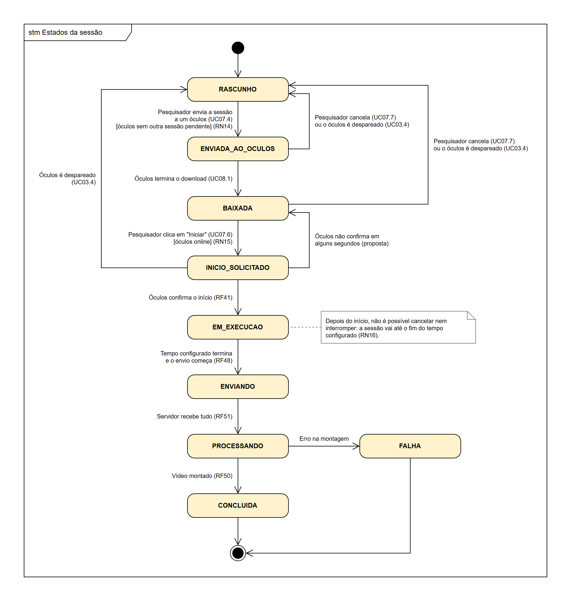

FONTE: Os autores (2026)

**TABELA 59** - Transições do diagrama de estados da sessão

| De | Evento [guarda] | Para |
|---|---|---|
| RASCUNHO | Pesquisador envia a sessão a um óculos (UC07.4) [óculos sem outra sessão pendente] (RN14) | ENVIADA_AO_OCULOS |
| ENVIADA_AO_OCULOS | Óculos termina o download (UC08.1) | BAIXADA |
| BAIXADA | Pesquisador clica em "Iniciar" (UC07.6) [óculos online] (RN15) | INICIO_SOLICITADO |
| INICIO_SOLICITADO | Óculos confirma o início (RF41) | EM_EXECUCAO |
| INICIO_SOLICITADO | Óculos não confirma em alguns segundos (proposta) | BAIXADA |
| EM_EXECUCAO | Tempo configurado termina e o envio começa (RF48) | ENVIANDO |
| ENVIANDO | Servidor recebe tudo (RF51) | PROCESSANDO |
| PROCESSANDO | Vídeo montado (RF50) | CONCLUIDA |
| PROCESSANDO | Erro na montagem | FALHA |
| ENVIADA_AO_OCULOS | Pesquisador cancela (UC07.7) ou o óculos é despareado (UC03.4) | RASCUNHO |
| BAIXADA | Pesquisador cancela (UC07.7) ou o óculos é despareado (UC03.4) | RASCUNHO |
| INICIO_SOLICITADO | Óculos é despareado (UC03.4) | RASCUNHO |

FONTE: Os autores (2026)

## APÊNDICE I – PROCESSOS DE NEGÓCIO

Os dois diagramas de processo de negócio, em BPMN, mostram como o experimento é conduzido hoje, sem o NeuroSight (processo atual), e como passa a ser conduzido com o sistema (processo proposto), do paciente incluído na pesquisa até a sessão analisada.

### Processo atual, sem o NeuroSight

O diagrama junta os dois fluxos descritos na revisão de literatura do artigo: o dos estudos com rastreamento ocular em pacientes com distúrbios da consciência e o do protótipo da Iniciação Científica.

- **Uma piscina e duas raias**, com as cores do BPMN com o NeuroSight: **Pesquisador**, com as tarefas feitas por pessoas, em branco; **Equipamento (rastreador ou óculos)**, em cinza
- **Gateways:** o losango com X é a decisão "Há rede?"; o segundo losango junta os dois caminhos.
- **Anotações:** os colchetes registram duas faltas que o texto aponta.

**FIGURA 46** - Processo atual do experimento, sem o NeuroSight (BPMN)

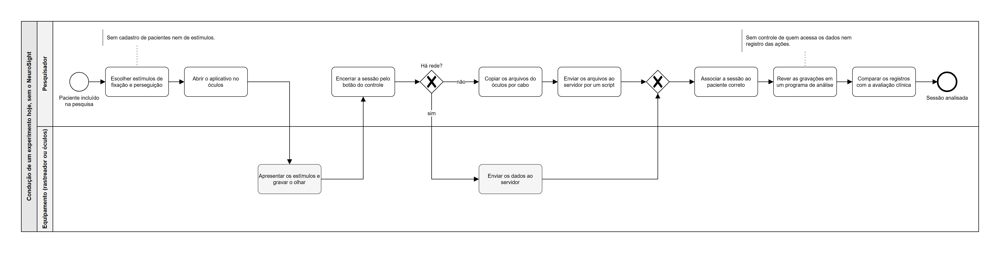

FONTE: Os autores (2026)

**TABELA 60** - Origem de cada elemento do processo atual

| Elemento | Raia | Trecho do texto (os tópicos são os da antiga Subseção II.E, hoje na Introdução) |
|---|---|---|
| Paciente incluído na pesquisa (início) | Pesquisador | Não vem do texto: é o mesmo início do BPMN com o NeuroSight, para facilitar a comparação |
| Escolher estímulos de fixação e perseguição | Pesquisador | 1º tópico: o pesquisador escolhe estímulos que testam a fixação e a perseguição visual, muitas vezes inspirados nos itens da CRS-R |
| Anotação "Sem cadastro de pacientes nem de estímulos" | — | Parágrafo da IC: "Não havia cadastro de pacientes nem de estímulos" |
| Abrir o aplicativo no óculos | Pesquisador | Parágrafo da IC: o pesquisador abria o aplicativo no óculos |
| Apresentar os estímulos e gravar o olhar | Equipamento | 2º e 3º tópicos: os estímulos aparecem em um monitor, com objetos reais ou em um aplicativo de RV, e o rastreador grava o olhar |
| Encerrar a sessão pelo botão do controle | Pesquisador | Parágrafo da IC: o pesquisador encerrava a sessão por um botão do controle |
| Há rede? → sim → Enviar os dados ao servidor | Equipamento | Parágrafo da IC: o botão enviava os dados ao servidor |
| Há rede? → não → Copiar os arquivos do óculos por cabo → Enviar os arquivos ao servidor por um script | Pesquisador | Parágrafo da IC: sem rede, os arquivos eram copiados do óculos por cabo e enviados depois por um *script* |
| Associar a sessão ao paciente correto | Pesquisador | Parágrafo da IC: associar cada sessão ao paciente correto ficava a cargo do pesquisador |
| Rever as gravações em um programa de análise | Pesquisador | 3º tópico: as gravações são revistas em um programa de análise, como o do fabricante do rastreador |
| Anotação "Sem controle de quem acessa os dados nem registro das ações" | — | Última frase do parágrafo da IC |
| Comparar os registros com a avaliação clínica | Pesquisador | 4º tópico: a análise é feita depois, em geral comparando os registros com a avaliação clínica |
| Sessão analisada (fim) | Pesquisador | Fim do 4º tópico |

FONTE: Os autores (2026)

- **"Há rede?" e servidor:** vêm só do protótipo da IC. Os tópicos dos estudos não falam em rede nem em servidor.
- **Apresentação dos estímulos:** fica na raia do equipamento, como no aplicativo de RV e no protótipo da IC. No estudo com objetos reais, os itens da CRS-R são aplicados pelo examinador (Subseção II.B), e o equipamento só grava o olhar.
- **Associação ao paciente:** o texto não diz em que momento ela acontece. O diagrama a coloca depois que os dados chegam ao servidor e antes da análise.
- **Passos manuais:** a cópia por cabo, o envio por *script* e a associação ao paciente aparecem como tarefas do pesquisador. É o que o texto chama de etapas que dependem de programas diferentes e de transferências manuais.

### Processo com o NeuroSight

- **Uma piscina e três raias:** **Pesquisador**, com as tarefas feitas por pessoas, em branco; **NeuroSight (web e servidor)**, com tarefas automáticas, em azul; **App do óculos**, também com tarefas automáticas, em cinza
- **Eventos:** início (círculo fino); fim (círculo grosso); fim com falha (círculo grosso com disco preenchido): evento de término, que encerra o processo inteiro, inclusive o ramo paralelo do pesquisador
- **Gateways:** losango com X é decisão exclusiva (só um caminho segue); losango com + divide o fluxo em caminhos paralelos e depois espera os dois
- **Anotação:** o colchete no início lista as pré-condições.

**FIGURA 47** - Processo do experimento com o NeuroSight (BPMN)

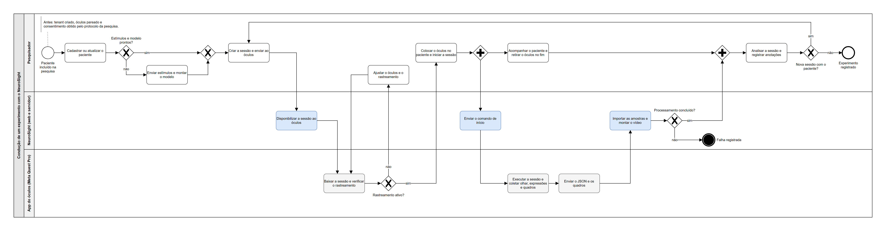

FONTE: Os autores (2026)

**TABELA 61** - Etapas do processo com o NeuroSight e casos de uso correspondentes

| Etapa | Raia | Caso de uso / diagrama |
|---|---|---|
| Paciente incluído na pesquisa (início) | Pesquisador | Pré-condições: tenant criado (SD01), óculos pareado (SD02) e consentimento obtido pelo protocolo da pesquisa |
| Cadastrar ou atualizar o paciente | Pesquisador | UC04.1, UC04.2 |
| Estímulos e modelo prontos? → Enviar estímulos e montar o modelo | Pesquisador | UC05.1, UC06.1, UC06.6 |
| Criar a sessão e enviar ao óculos | Pesquisador | UC07.1 ou UC07.2, UC07.4 |
| Disponibilizar a sessão ao óculos | NeuroSight | SD03 |
| Baixar a sessão e verificar o rastreamento | App | UC08.1, UC08.2 |
| Rastreamento ativo? → Ajustar o óculos e o rastreamento | App → Pesquisador | HU08.2 (o aviso aparece no sistema web) |
| Colocar o óculos no paciente e iniciar a sessão | Pesquisador | UC07.6 |
| Enviar o comando de início | NeuroSight → App | SD04: o app recebe o comando na consulta seguinte ao servidor |
| Executar a sessão e coletar olhar, expressões e quadros | App | UC08.3 a UC08.6 |
| Acompanhar o paciente e retirar o óculos no fim | Pesquisador | Tarefa manual, em paralelo com a execução |
| Enviar o JSON e os quadros | App | UC09.1 |
| Importar as amostras e montar o vídeo | NeuroSight | UC09.2 |
| Processamento concluído? → Falha registrada | NeuroSight | Estado FALHA da sessão; evento de término |
| Analisar a sessão e registrar anotações | Pesquisador | UC10.1 a UC10.6 |
| Nova sessão com o paciente? | Pesquisador | Volta para "Criar a sessão" ou termina |

FONTE: Os autores (2026)

- **Execução em paralelo:** o pesquisador acompanha o paciente enquanto o óculos executa a sessão. As duas linhas se juntam no gateway paralelo antes da análise: a análise só começa quando o processamento termina.
- **Falha no processamento:** o fim "Falha registrada" é um evento de término. Sem ele, o ramo do pesquisador ficaria preso no gateway paralelo de junção quando o processamento falha.
- **Sem interrupção:** não há caminho para interromper a sessão (RN16). Se for preciso tirar o óculos antes do fim, o pesquisador registra o ocorrido nas anotações.
- **Laço de ajuste:** se o rastreamento não estiver ativo, o pesquisador ajusta o óculos e o app verifica de novo antes de liberar o início.
- **Repetição com o mesmo paciente:** o último gateway volta para "Criar a sessão e enviar ao óculos". Assim, o cadastro do paciente e a preparação dos estímulos não se repetem.

