# Apêndices

Gerado por montar-apendices.pl a partir da pasta Especificacao. Não edite aqui: mude o artefato na especificação e monte o artigo de novo.

## APÊNDICE A – DIAGRAMAS DE CASOS DE USO

Este apêndice apresenta os doze diagramas de casos de uso do NeuroSight: um com os atores e a hierarquia dos perfis e um para cada grupo de requisitos, totalizando 60 casos de uso. A Figura 1, no corpo do artigo, é o diagrama das sessões (UC07) redesenhado com a hierarquia dos perfis e o paciente. Nos diagramas, os casos de uso com borda tracejada e fundo cinza pertencem a outro diagrama e aparecem apenas para mostrar as relações de inclusão e extensão. Nas tabelas, o ator "—" marca os casos de uso incluídos ou estendidos: quem interage neles é o ator do caso base, e a coluna Relações registra, nos casos estendidos, a condição e o ponto de extensão.

**TABELA 3** - Atores do NeuroSight.

| Ator | Descrição | Herda de |
|---|---|---|
| Usuário | Abstrato: qualquer pessoa com conta no tenant | — |
| Pesquisador | Cadastra pacientes, estímulos, modelos e sessões; envia, inicia e analisa as sessões | Usuário |
| Administrador | Gerencia usuários, óculos, visibilidade das sessões e auditoria | Pesquisador |
| Proprietário | Criou o tenant; define quem é administrador | Administrador |
| Visitante | Pessoa sem conta; conhece o sistema e cria um tenant | — |
| Paciente | Não é usuário (RN06). Ator secundário: usa o óculos durante a execução da sessão (UC08.3) | — |

FONTE: Os autores (2026).

**TABELA 4** - Resumo dos diagramas de casos de uso e dos épicos.

| Diagrama / épico | Grupo de requisitos | Atores | Casos de uso | Requisitos |
|---|---|---|---|---|
| UC01 / E01 – Acesso e conta | 2.1 | Visitante, Usuário, Proprietário | 8 | RF01–RF08 |
| UC02 / E02 – Usuários e permissões | 2.2 | Administrador, Proprietário | 6 | RF09–RF12 |
| UC03 / E03 – Óculos | 2.3 | Administrador | 4 | RF13–RF16 |
| UC04 / E04 – Pacientes | 2.4 | Pesquisador, Administrador | 5 | RF17–RF21 |
| UC05 / E05 – Estímulos | 2.5 | Pesquisador | 5 | RF22–RF26 |
| UC06 / E06 – Modelos de sessão | 2.6 | Pesquisador | 7 | RF27–RF29 |
| UC07 / E07 – Sessões | 2.7 | Pesquisador | 8 | RF30–RF37 |
| UC08 / E08 – Execução no óculos | 2.8 | Pesquisador, Paciente | 6 | RF38–RF47 |
| UC09 / E09 – Envio e processamento | 2.9 | Pesquisador | 2 | RF48–RF51 |
| UC10 / E10 – Consulta e análise | 2.10 | Pesquisador | 7 | RF52–RF58 |
| UC11 / E11 – Auditoria | 2.11 | Administrador | 2 | RF59–RF60 |

FONTE: Os autores (2026).

### UC00 – Atores e perfis

**FIGURA 4** - Diagrama de casos de uso UC00 – Atores e perfis.

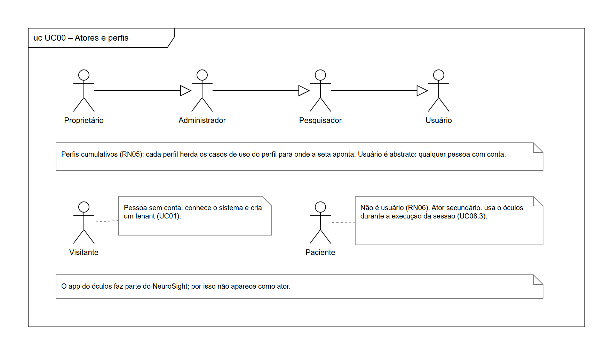

FONTE: Os autores (2026).

### UC01 – Acesso e conta

**FIGURA 5** - Diagrama de casos de uso UC01 – Acesso e conta.

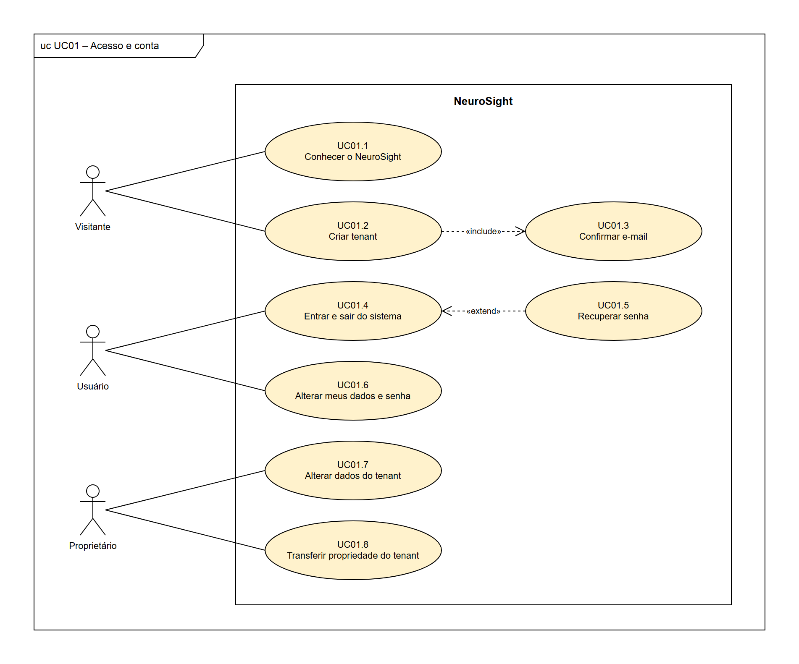

FONTE: Os autores (2026).

**TABELA 5** - Casos de uso do diagrama UC01 – Acesso e conta.

| Caso de uso | Ator | Relações | Requisitos |
|---|---|---|---|
| UC01.1 Conhecer o NeuroSight | Visitante | — | RF01 |
| UC01.2 Criar tenant | Visitante | inclui UC01.3 | RF02 |
| UC01.3 Confirmar e-mail | — | incluído por UC01.2 | RF03 |
| UC01.4 Entrar e sair do sistema | Usuário | estendido por UC01.5 | RF04 |
| UC01.5 Recuperar senha | — | estende UC01.4 (condição: o usuário esqueceu a senha; ponto de extensão: tela de entrada) | RF05 |
| UC01.6 Alterar meus dados e senha | Usuário | — | RF06 |
| UC01.7 Alterar dados do tenant | Proprietário | — | RF07 |
| UC01.8 Transferir propriedade do tenant | Proprietário | — | RF08 |

FONTE: Os autores (2026).

### UC02 – Usuários e permissões

**FIGURA 6** - Diagrama de casos de uso UC02 – Usuários e permissões.

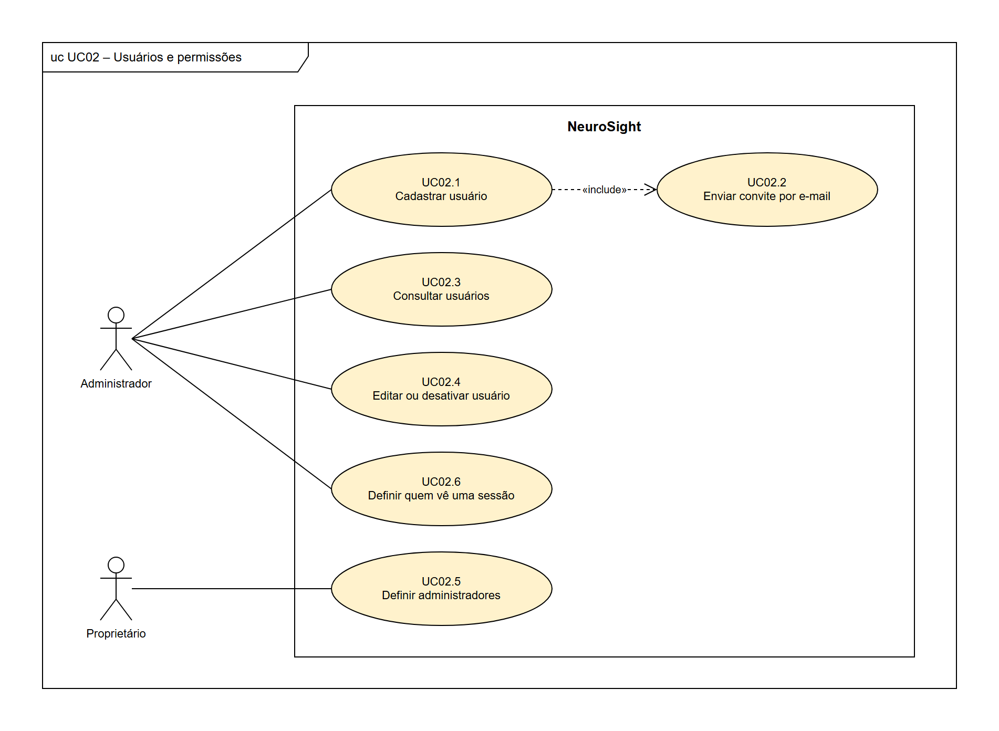

FONTE: Os autores (2026).

**TABELA 6** - Casos de uso do diagrama UC02 – Usuários e permissões.

| Caso de uso | Ator | Relações | Requisitos |
|---|---|---|---|
| UC02.1 Cadastrar usuário | Administrador | inclui UC02.2 | RF09 |
| UC02.2 Enviar convite por e-mail | — | incluído por UC02.1 | RF09 |
| UC02.3 Consultar usuários | Administrador | — | RF10 |
| UC02.4 Editar ou desativar usuário | Administrador | — | RF10 |
| UC02.5 Definir administradores | Proprietário | — | RF11 |
| UC02.6 Definir quem vê uma sessão | Administrador | — | RF12 |

FONTE: Os autores (2026).

### UC03 – Óculos

**FIGURA 7** - Diagrama de casos de uso UC03 – Óculos.

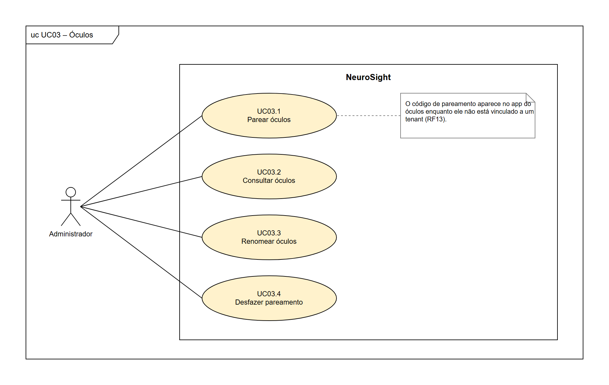

FONTE: Os autores (2026).

**TABELA 7** - Casos de uso do diagrama UC03 – Óculos.

| Caso de uso | Ator | Relações | Requisitos |
|---|---|---|---|
| UC03.1 Parear óculos | Administrador | — | RF13, RF14 |
| UC03.2 Consultar óculos | Administrador | — | RF15 |
| UC03.3 Renomear óculos | Administrador | — | RF16 |
| UC03.4 Desfazer pareamento | Administrador | — | RF16 |

FONTE: Os autores (2026).

### UC04 – Pacientes

**FIGURA 8** - Diagrama de casos de uso UC04 – Pacientes.

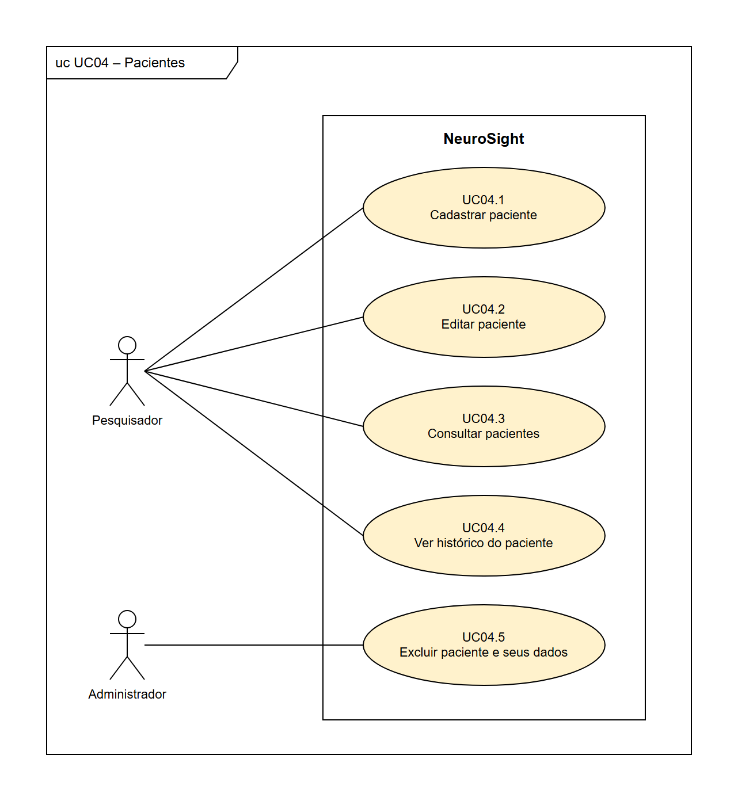

FONTE: Os autores (2026).

**TABELA 8** - Casos de uso do diagrama UC04 – Pacientes.

| Caso de uso | Ator | Relações | Requisitos |
|---|---|---|---|
| UC04.1 Cadastrar paciente | Pesquisador | — | RF17 |
| UC04.2 Editar paciente | Pesquisador | — | RF18 |
| UC04.3 Consultar pacientes | Pesquisador | — | RF19 |
| UC04.4 Ver histórico do paciente | Pesquisador | — | RF20 |
| UC04.5 Excluir paciente e seus dados | Administrador | — | RF21 |

FONTE: Os autores (2026).

### UC05 – Estímulos

**FIGURA 9** - Diagrama de casos de uso UC05 – Estímulos.

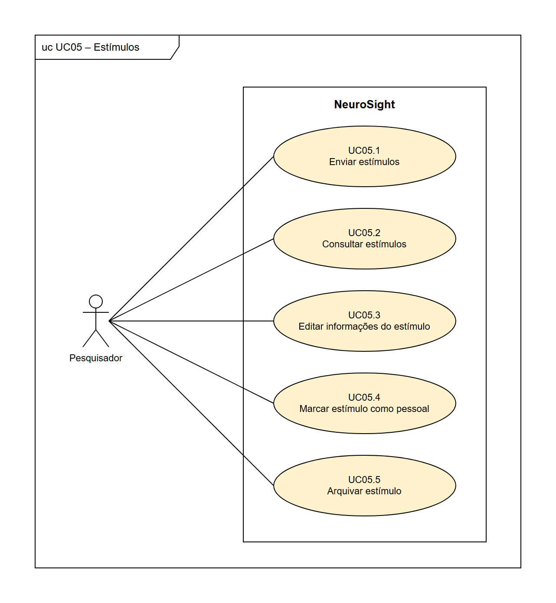

FONTE: Os autores (2026).

**TABELA 9** - Casos de uso do diagrama UC05 – Estímulos.

| Caso de uso | Ator | Relações | Requisitos |
|---|---|---|---|
| UC05.1 Enviar estímulos | Pesquisador | — | RF22 |
| UC05.2 Consultar estímulos | Pesquisador | — | RF23 |
| UC05.3 Editar informações do estímulo | Pesquisador | — | RF24 |
| UC05.4 Marcar estímulo como pessoal | Pesquisador | — | RF25 |
| UC05.5 Arquivar estímulo | Pesquisador | — | RF26 |

FONTE: Os autores (2026).

### UC06 – Modelos de sessão

**FIGURA 10** - Diagrama de casos de uso UC06 – Modelos de sessão.

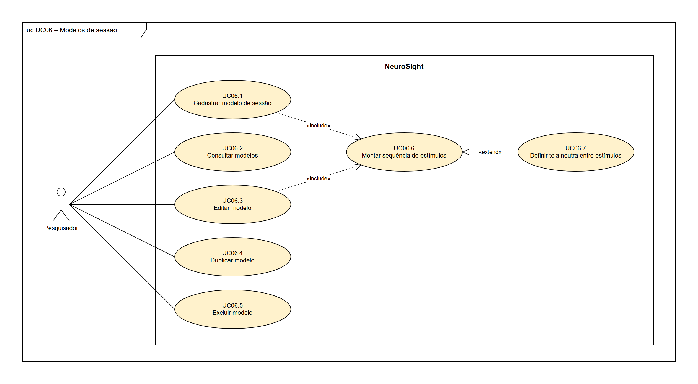

FONTE: Os autores (2026).

**TABELA 10** - Casos de uso do diagrama UC06 – Modelos de sessão.

| Caso de uso | Ator | Relações | Requisitos |
|---|---|---|---|
| UC06.1 Cadastrar modelo de sessão | Pesquisador | inclui UC06.6 | RF27 |
| UC06.2 Consultar modelos | Pesquisador | — | RF28 |
| UC06.3 Editar modelo | Pesquisador | inclui UC06.6 | RF28 |
| UC06.4 Duplicar modelo | Pesquisador | — | RF28 |
| UC06.5 Excluir modelo | Pesquisador | — | RF28 |
| UC06.6 Montar sequência de estímulos | — | incluído por UC06.1, UC06.3 e UC07.2; estendido por UC06.7 | RF27, RF31 |
| UC06.7 Definir tela neutra entre estímulos | — | estende UC06.6 (condição: o pesquisador opta por inserir uma tela neutra; ponto de extensão: montagem da sequência) | RF29 |

FONTE: Os autores (2026).

### UC07 – Sessões

**FIGURA 11** - Diagrama de casos de uso UC07 – Sessões.

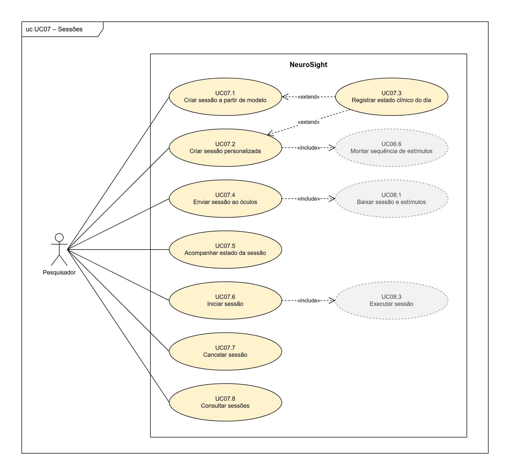

FONTE: Os autores (2026).

**TABELA 11** - Casos de uso do diagrama UC07 – Sessões.

| Caso de uso | Ator | Relações | Requisitos |
|---|---|---|---|
| UC07.1 Criar sessão a partir de modelo | Pesquisador | estendido por UC07.3 | RF30 |
| UC07.2 Criar sessão personalizada | Pesquisador | inclui UC06.6; estendido por UC07.3 | RF31 |
| UC07.3 Registrar estado clínico do dia | — | estende UC07.1 e UC07.2 (condição: o pesquisador opta por registrar o estado clínico do dia, que é opcional; ponto de extensão: antes de salvar a sessão) | RF32 |
| UC07.4 Enviar sessão ao óculos | Pesquisador | inclui UC08.1 | RF33 |
| UC07.5 Acompanhar estado da sessão | Pesquisador | — | RF34 |
| UC07.6 Iniciar sessão | Pesquisador | inclui UC08.3 | RF35 |
| UC07.7 Cancelar sessão | Pesquisador | — | RF36 |
| UC07.8 Consultar sessões | Pesquisador | — | RF37 |

FONTE: Os autores (2026).

### UC08 – Execução no óculos

**FIGURA 12** - Diagrama de casos de uso UC08 – Execução no óculos.

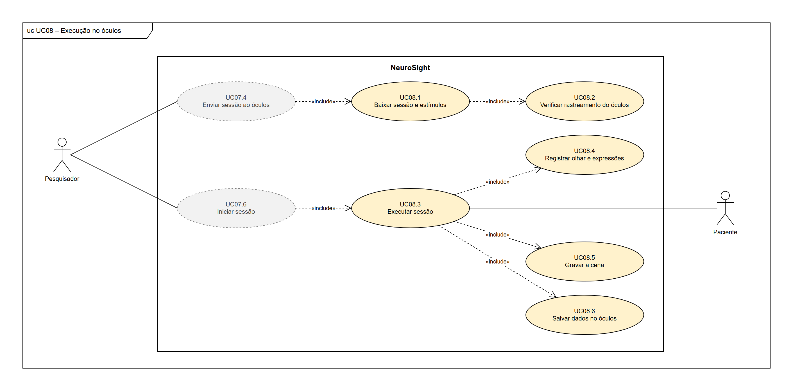

FONTE: Os autores (2026).

**TABELA 12** - Casos de uso do diagrama UC08 – Execução no óculos.

| Caso de uso | Ator | Relações | Requisitos |
|---|---|---|---|
| UC08.1 Baixar sessão e estímulos | — | incluído por UC07.4; inclui UC08.2 | RF38, RF40 |
| UC08.2 Verificar rastreamento do óculos | — | incluído por UC08.1 | RF39 |
| UC08.3 Executar sessão | Paciente (secundário) | incluído por UC07.6; inclui UC08.4, UC08.5, UC08.6 e UC09.1 | RF41, RF42 |
| UC08.4 Registrar olhar e expressões | — | incluído por UC08.3 | RF43, RF44, RF45 |
| UC08.5 Gravar a cena | — | incluído por UC08.3 | RF46 |
| UC08.6 Salvar dados no óculos | — | incluído por UC08.3 | RF47 |

FONTE: Os autores (2026).

### UC09 – Envio e processamento

**FIGURA 13** - Diagrama de casos de uso UC09 – Envio e processamento.

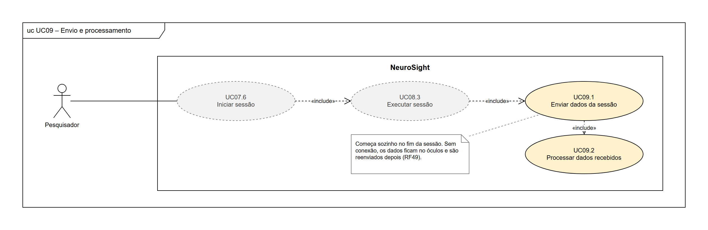

FONTE: Os autores (2026).

**TABELA 13** - Casos de uso do diagrama UC09 – Envio e processamento.

| Caso de uso | Ator | Relações | Requisitos |
|---|---|---|---|
| UC09.1 Enviar dados da sessão | — | incluído por UC08.3; inclui UC09.2 | RF48, RF49 |
| UC09.2 Processar dados recebidos | — | incluído por UC09.1 | RF50, RF51 |

FONTE: Os autores (2026).

### UC10 – Consulta e análise

**FIGURA 14** - Diagrama de casos de uso UC10 – Consulta e análise.

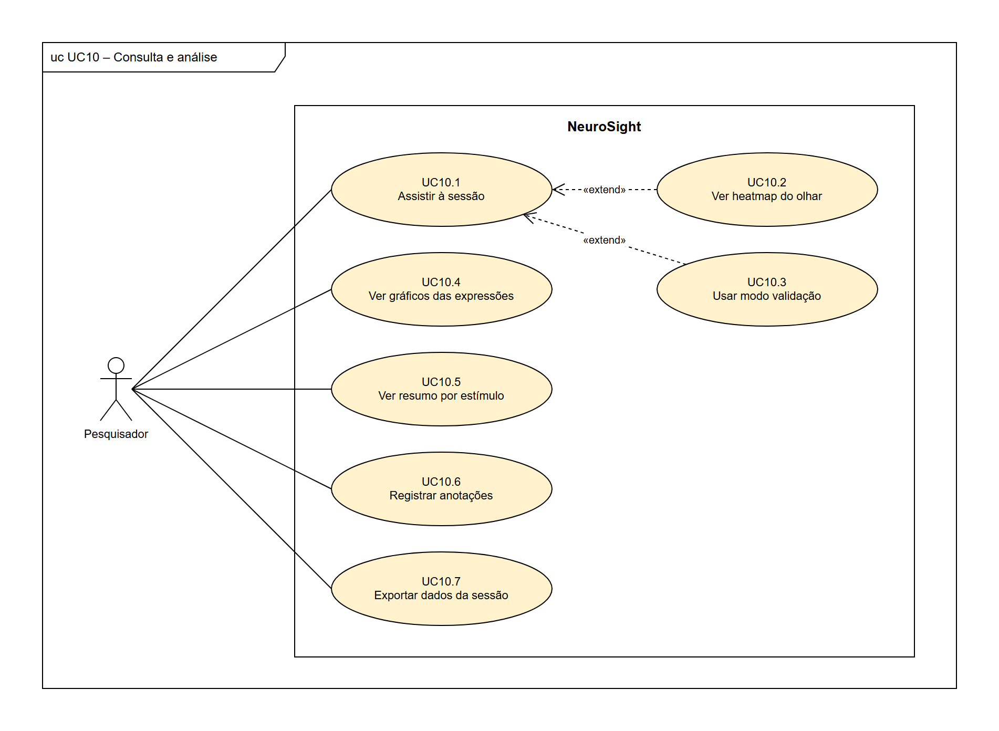

FONTE: Os autores (2026).

**TABELA 14** - Casos de uso do diagrama UC10 – Consulta e análise.

| Caso de uso | Ator | Relações | Requisitos |
|---|---|---|---|
| UC10.1 Assistir à sessão | Pesquisador | estendido por UC10.2 e UC10.3 | RF52 |
| UC10.2 Ver heatmap do olhar | — | estende UC10.1 (condição: o pesquisador ativa o heatmap; ponto de extensão: reprodução do vídeo) | RF53 |
| UC10.3 Usar modo validação | — | estende UC10.1 (condição: o pesquisador ativa o modo validação; ponto de extensão: reprodução do vídeo) | RF54 |
| UC10.4 Ver gráficos das expressões | Pesquisador | — | RF55 |
| UC10.5 Ver resumo por estímulo | Pesquisador | — | RF56 |
| UC10.6 Registrar anotações | Pesquisador | — | RF57 |
| UC10.7 Exportar dados da sessão | Pesquisador | — | RF58 |

FONTE: Os autores (2026).

### UC11 – Auditoria

**FIGURA 15** - Diagrama de casos de uso UC11 – Auditoria.

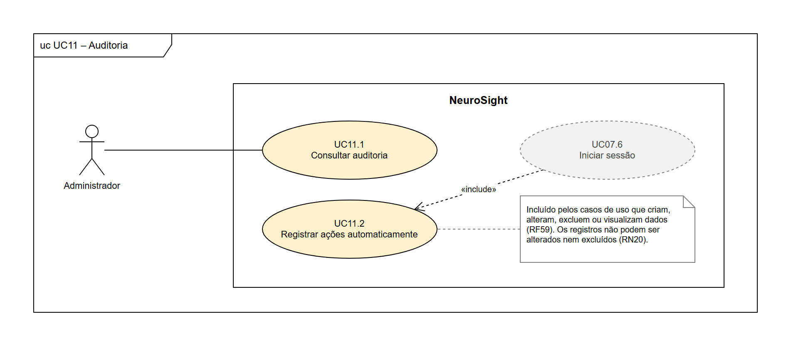

FONTE: Os autores (2026).

**TABELA 15** - Casos de uso do diagrama UC11 – Auditoria.

| Caso de uso | Ator | Relações | Requisitos |
|---|---|---|---|
| UC11.1 Consultar auditoria | Administrador | — | RF60 |
| UC11.2 Registrar ações automaticamente | — | incluído pelos casos de uso que criam, alteram, excluem ou visualizam dados (no diagrama, UC07.6 aparece como exemplo) | RF59 |

FONTE: Os autores (2026).

## APÊNDICE B – HISTÓRIAS DE USUÁRIO

Cada diagrama de casos de uso corresponde a um épico, e cada caso de uso tem uma história de usuário com o mesmo número (UC07.6 e HU07.6, por exemplo), no formato "sendo, quero, para", com critérios de aceitação. A prioridade de cada história é a maior entre as dos requisitos ligados a ela: são 35 histórias essenciais, 19 importantes e 6 desejáveis. As histórias dos casos de uso incluídos ou estendidos são escritas do ponto de vista do ator do caso base.

### E01 – Acesso e conta

#### HU01.1 – Conhecer o NeuroSight
**Sendo** visitante, **quero** conhecer o NeuroSight numa página de apresentação, **para** decidir se crio um tenant para o meu grupo.
*RF01 · Importante*
- A página explica o que o sistema faz e o que não faz (não faz diagnóstico).
- A página dá acesso ao autocadastro e ao login.

#### HU01.2 – Criar tenant
**Sendo** visitante, **quero** criar um tenant para a minha instituição ou grupo, **para** usar o sistema sem precisar de uma instalação própria.
*RF02 · Essencial*
- Informo o nome da instituição ou do grupo, meu nome, e-mail e senha.
- Ao concluir, sou o proprietário do tenant (RN03).
- O tenant começa vazio e isolado dos demais (RN01).

#### HU01.3 – Confirmar e-mail
**Sendo** visitante que criou um tenant, **quero** confirmar meu e-mail, **para** garantir que a conta é minha.
*RF03 · Importante*
- Recebo um link de confirmação, que expira depois de um prazo.
- Sem confirmar, não consigo entrar.

#### HU01.4 – Entrar e sair do sistema
**Sendo** usuário, **quero** entrar com e-mail e senha e sair quando terminar, **para** acessar os dados do meu tenant com segurança.
*RF04 · Essencial*
- Com credenciais erradas, a mensagem não diz se o erro está no e-mail ou na senha.
- Depois de entrar, vejo apenas dados do meu tenant (RN01).
- Cada entrada fica registrada na auditoria (RF59).

#### HU01.5 – Recuperar senha
**Sendo** usuário, **quero** recuperar minha senha por e-mail, **para** voltar a acessar o sistema se eu a esquecer.
*RF05 · Importante*
- Recebo um link de redefinição de uso único, com prazo.
- A mensagem exibida não revela se o e-mail tem conta.

#### HU01.6 – Alterar meus dados e senha
**Sendo** usuário, **quero** alterar meus dados e minha senha, **para** manter minha conta atualizada.
*RF06 · Desejável*
- Para trocar a senha, informo a senha atual.

#### HU01.7 – Alterar dados do tenant
**Sendo** proprietário, **quero** alterar os dados do tenant, **para** corrigir o nome da instituição ou do grupo.
*RF07 · Desejável*
- Só o proprietário vê essa opção.

#### HU01.8 – Transferir propriedade do tenant
**Sendo** proprietário, **quero** transferir a propriedade do tenant para um administrador, **para** que o grupo continue gerido se eu sair.
*RF08 · Desejável*
- Só um administrador do mesmo tenant pode receber a propriedade.
- Depois da transferência, passo a ser administrador, e o tenant continua com um único proprietário (RN03).

### E02 – Usuários e permissões

#### HU02.1 – Cadastrar usuário
**Sendo** administrador, **quero** cadastrar pessoas da equipe com nome, e-mail e perfil, **para** que elas usem o sistema.
*RF09 · Essencial*
- O e-mail não pode estar em uso por outro usuário (RN02).
- Só o proprietário pode cadastrar alguém como administrador (RN04).
- O cadastro fica registrado na auditoria.

#### HU02.2 – Enviar convite por e-mail
**Sendo** pessoa cadastrada por um administrador, **quero** receber um convite por e-mail para definir minha senha, **para** não depender de uma senha criada por outra pessoa.
*RF09 · Essencial*
- O link do convite é de uso único e expira.

#### HU02.3 – Consultar usuários
**Sendo** administrador, **quero** ver a lista de usuários do tenant, com perfil e situação, **para** saber quem tem acesso.
*RF10 · Essencial*
- A lista mostra nome, e-mail, perfil e se o usuário está ativo.

#### HU02.4 – Editar ou desativar usuário
**Sendo** administrador, **quero** editar ou desativar um usuário, **para** manter os acessos corretos quando alguém muda de função ou sai do grupo.
*RF10 · Essencial*
- Um usuário desativado não consegue entrar, mas o histórico dele é mantido.
- O proprietário não pode ser desativado.

#### HU02.5 – Definir administradores
**Sendo** proprietário, **quero** conceder e retirar o perfil de administrador, **para** decidir quem gerencia o tenant.
*RF11 · Essencial*
- Só o proprietário faz isso (RN04).
- A mudança fica registrada na auditoria.

#### HU02.6 – Definir quem vê uma sessão
**Sendo** administrador, **quero** definir quais pesquisadores podem ver cada sessão, **para** restringir o acesso a dados de saúde.
*RF12 · Essencial*
- Por padrão, veem a sessão quem a criou, os administradores e o proprietário (RN18).
- Liberar e retirar o acesso fica registrado na auditoria.

### E03 – Óculos

#### HU03.1 – Parear óculos
**Sendo** administrador, **quero** parear um óculos ao tenant digitando o código que aparece nele, **para** que o aparelho possa receber as sessões do grupo.
*RF13, RF14 · Essencial*
- O app mostra um código enquanto o óculos não está pareado (RF13); o código expira em poucos minutos.
- Ao parear, dou um nome ao aparelho, e ele recebe um acesso próprio (RNF04).

#### HU03.2 – Consultar óculos
**Sendo** administrador, **quero** ver os óculos do tenant com situação e último contato, **para** saber quais estão prontos para uso.
*RF15 · Importante*
- "Online" significa contato com o servidor nos últimos segundos.
- A lista mostra a sessão atual de cada óculos, se houver.

#### HU03.3 – Renomear óculos
**Sendo** administrador, **quero** renomear um óculos, **para** identificá-lo com facilidade (por exemplo, "Quest do laboratório 2").
*RF16 · Importante*
- O nome é único no tenant.

#### HU03.4 – Desfazer pareamento
**Sendo** administrador, **quero** desfazer o pareamento de um óculos, **para** cortar o acesso de um aparelho perdido ou que saiu do grupo.
*RF16 · Importante*
- O acesso do aparelho é revogado na hora, e o app volta a mostrar um código de pareamento.
- Sessões enviadas a ele e ainda não iniciadas voltam a ser rascunho.

### E04 – Pacientes

#### HU04.1 – Cadastrar paciente
**Sendo** pesquisador, **quero** cadastrar um paciente com código e dados clínicos mínimos, **para** vincular a ele as sessões.
*RF17 · Essencial*
- O código é obrigatório e único no tenant; o nome é opcional.
- Os demais campos são os do RF17: ano de nascimento, sexo, etiologia, data da lesão, diagnóstico atual, escore CRS-R e observações.

#### HU04.2 – Editar paciente
**Sendo** pesquisador, **quero** editar os dados de um paciente, **para** mantê-los atualizados (por exemplo, um novo diagnóstico ou escore CRS-R).
*RF18 · Essencial*
- A alteração fica registrada na auditoria.

#### HU04.3 – Consultar pacientes
**Sendo** pesquisador, **quero** listar os pacientes e buscá-los pelo código, **para** encontrar rapidamente quem vai participar da sessão.
*RF19 · Essencial*
- A busca encontra o paciente por parte do código.

#### HU04.4 – Ver histórico do paciente
**Sendo** pesquisador, **quero** ver o histórico de sessões de um paciente, **para** acompanhar os experimentos feitos com ele.
*RF20 · Essencial*
- Aparecem só as sessões que tenho permissão de ver (RN18).

#### HU04.5 – Excluir paciente e seus dados
**Sendo** administrador, **quero** excluir um paciente e os dados das suas sessões, **para** atender a um pedido de exclusão de dados.
*RF21 · Importante*
- O sistema pede confirmação antes de excluir.
- A exclusão fica registrada na auditoria, sem guardar os dados apagados.

### E05 – Estímulos

#### HU05.1 – Enviar estímulos
**Sendo** pesquisador, **quero** enviar imagens e vídeos para o acervo do tenant, **para** usá-los como estímulos nas sessões.
*RF22 · Essencial*
- São aceitos JPEG, PNG e MP4 (H.264) até o tamanho máximo configurado (RNF19).
- Arquivos em outro formato são recusados com uma mensagem clara.

#### HU05.2 – Consultar estímulos
**Sendo** pesquisador, **quero** listar, buscar e pré-visualizar os estímulos, **para** escolher o que vou usar.
*RF23 · Essencial*
- A busca considera nome e etiquetas.
- Imagens e vídeos podem ser vistos sem baixar o arquivo.

#### HU05.3 – Editar informações do estímulo
**Sendo** pesquisador, **quero** editar nome, descrição e etiquetas de um estímulo, **para** organizar o acervo.
*RF24 · Importante*
- O arquivo em si não pode ser trocado; para isso, envia-se um novo estímulo.

#### HU05.4 – Marcar estímulo como pessoal
**Sendo** pesquisador, **quero** marcar um estímulo como pessoal de um paciente (por exemplo, a foto de um familiar), **para** usá-lo só nas sessões dele.
*RF25 · Importante*
- O estímulo pessoal só aparece na montagem de sessões desse paciente (RN12).

#### HU05.5 – Arquivar estímulo
**Sendo** pesquisador, **quero** arquivar um estímulo, **para** tirá-lo das novas sessões sem perder o histórico.
*RF26 · Importante*
- Um estímulo já usado não pode ser excluído, só arquivado (RN13).
- Sessões antigas continuam mostrando o estímulo arquivado.

### E06 – Modelos de sessão

#### HU06.1 – Cadastrar modelo de sessão
**Sendo** pesquisador, **quero** cadastrar um modelo de sessão, **para** aplicar o mesmo protocolo a vários pacientes.
*RF27 · Essencial*
- O modelo tem nome e pelo menos um estímulo.

#### HU06.2 – Consultar modelos
**Sendo** pesquisador, **quero** consultar os modelos do tenant, **para** escolher qual aplicar.
*RF28 · Importante*
- A lista mostra o número de estímulos e a duração total de cada modelo.

#### HU06.3 – Editar modelo
**Sendo** pesquisador, **quero** editar um modelo, **para** ajustar o protocolo.
*RF28 · Importante*
- As sessões já criadas a partir dele não mudam (RN11).

#### HU06.4 – Duplicar modelo
**Sendo** pesquisador, **quero** duplicar um modelo, **para** criar uma variação sem montar tudo de novo.
*RF28 · Importante*
- A cópia recebe um nome novo e pode ser editada à parte.

#### HU06.5 – Excluir modelo
**Sendo** pesquisador, **quero** excluir um modelo, **para** manter só os protocolos em uso.
*RF28 · Importante*
- As sessões já criadas a partir dele não são afetadas (RN11).

#### HU06.6 – Montar sequência de estímulos
**Sendo** pesquisador, **quero** montar a sequência de estímulos, escolhendo a ordem e o tempo de exibição de cada um, **para** definir exatamente o que o paciente vai ver.
*RF27, RF31 · Essencial*
- Só entram estímulos do acervo que não estejam arquivados (RN09).
- Todo tempo de exibição é maior que zero (RN10), e a duração total aparece na tela.
- Um estímulo pessoal só entra em sessões do paciente dele (RN12).

#### HU06.7 – Definir tela neutra entre estímulos
**Sendo** pesquisador, **quero** inserir uma tela neutra entre os estímulos, com duração configurável, **para** ter uma linha de base das expressões.
*RF29 · Desejável*
- A duração da tela neutra entra na duração total da sessão.

### E07 – Sessões

#### HU07.1 – Criar sessão a partir de modelo
**Sendo** pesquisador, **quero** criar uma sessão para um paciente a partir de um modelo, podendo ajustá-la, **para** repetir um protocolo sem retrabalho.
*RF30 · Essencial*
- Toda sessão tem exatamente um paciente (RN07).
- Ajustar a sessão não altera o modelo (RN11).
- A sessão nasce como rascunho.

#### HU07.2 – Criar sessão personalizada
**Sendo** pesquisador, **quero** criar uma sessão personalizada, **para** montar na hora um protocolo específico para o paciente.
*RF31 · Essencial*
- A sequência é montada como em HU06.6.
- A sessão nasce como rascunho.

#### HU07.3 – Registrar estado clínico do dia
**Sendo** pesquisador, **quero** registrar na sessão o estado clínico do paciente no dia, **para** relacionar as respostas com o estado dele naquele momento.
*RF32 · Desejável*
- Os campos são opcionais: diagnóstico e escore CRS-R.

#### HU07.4 – Enviar sessão ao óculos
**Sendo** pesquisador, **quero** enviar a sessão a um óculos pareado, **para** que ele a baixe antes da coleta.
*RF33 · Essencial*
- Só aparecem óculos do mesmo tenant sem outra sessão pendente (RN14).
- Depois do envio, a sessão não pode ser editada (RN16).

#### HU07.5 – Acompanhar estado da sessão
**Sendo** pesquisador, **quero** acompanhar o estado da sessão e do óculos, **para** saber quando posso iniciar e quando os dados estão prontos.
*RF34 · Essencial*
- Os estados são: rascunho, enviada ao óculos, baixada, início solicitado, em execução, enviando, processando, concluída ou falha.
- A tela mostra se o óculos de destino está online.

#### HU07.6 – Iniciar sessão
**Sendo** pesquisador, **quero** iniciar a sessão por um botão no sistema web depois de colocar o óculos no paciente, **para** não precisar usar o controle.
*RF35 · Essencial*
- O botão só fica liberado com o óculos online e a sessão baixada (RN15).
- O óculos começa em até cerca de 2 s depois do clique (RNF13).
- Quem iniciou a sessão fica registrado na auditoria.

#### HU07.7 – Cancelar sessão
**Sendo** pesquisador, **quero** cancelar uma sessão antes do início, **para** corrigi-la ou desistir da coleta.
*RF36 · Importante*
- Depois do início não é possível cancelar nem interromper (RN16).
- Se a sessão já estava no óculos, ele a descarta.

#### HU07.8 – Consultar sessões
**Sendo** pesquisador, **quero** listar as sessões que posso ver, filtrando por paciente, estado e período, **para** encontrar uma coleta.
*RF37 · Essencial*
- Aparecem só as sessões que tenho permissão de ver (RN18).

### E08 – Execução no óculos

#### HU08.1 – Baixar sessão e estímulos
**Sendo** pesquisador, **quero** que o óculos baixe sozinho a sessão enviada a ele, com todos os estímulos, **para** que a exibição não dependa da rede.
*RF38, RF40 · Essencial*
- Enquanto espera, o óculos consulta o servidor a cada ~1 s.
- Ao terminar o download, avisa o servidor e mostra o código do paciente, o número de estímulos e a duração (RF40).
- O paciente aparece só pelo código (RN19).

#### HU08.2 – Verificar rastreamento do óculos
**Sendo** pesquisador, **quero** ser avisado se o rastreamento ocular ou facial do óculos não estiver ativo, **para** corrigir isso antes de colocar o óculos no paciente.
*RF39 · Importante*
- O aviso aparece no sistema web, junto ao estado do óculos.

#### HU08.3 – Executar sessão
**Sendo** pesquisador, **quero** que o óculos execute a sessão exatamente como configurada e termine sozinho, **para** que todos os pacientes passem pelo mesmo protocolo.
*RF41, RF42 · Essencial*
- O app começa ao receber o comando e confirma o início ao servidor (RF41).
- Exibe os estímulos na ordem e pelo tempo configurados (RN08) e termina sozinho, sem uso do controle (RNF22).
- Depois de iniciada, a sessão não depende da rede (RNF09) e não pode ser interrompida pelo sistema (RN16).

#### HU08.4 – Registrar olhar e expressões
**Sendo** pesquisador, **quero** que o olhar e as expressões faciais do paciente sejam registrados junto com o início e o fim de cada estímulo, **para** analisar as reações a cada um.
*RF43, RF44, RF45 · Essencial*
- O olhar é registrado a cada quadro (~72 a 90 Hz), com validade, confiança, ponto 3D e posições (u,v) (RNF14).
- As expressões baseadas no FACS são registradas com intensidade e validade.
- Tudo usa o mesmo relógio do óculos (RNF16), e nenhuma imagem do rosto é guardada (RNF06).

#### HU08.5 – Gravar a cena
**Sendo** pesquisador, **quero** que a cena exibida ao paciente seja gravada, **para** rever depois o que ele viu.
*RF46 · Essencial*
- A taxa, a resolução e a qualidade da captura são configuráveis (RNF15).

#### HU08.6 – Salvar dados no óculos
**Sendo** pesquisador, **quero** que os dados sejam salvos no óculos durante a sessão, **para** não perdê-los se o app fechar.
*RF47 · Essencial*
- Os dados são gravados em intervalos curtos (cerca de 5 s).

### E09 – Envio e processamento

#### HU09.1 – Enviar dados da sessão
**Sendo** pesquisador, **quero** que os dados e a gravação sejam enviados sozinhos ao servidor no fim da sessão, **para** não precisar transferir arquivos.
*RF48, RF49 · Essencial*
- O envio é feito em lotes, e os lotes que falharem são repetidos.
- Sem conexão, o óculos guarda a sessão e a reenvia depois (RF49).
- Os dados só saem do óculos depois que o servidor confirma o recebimento (RNF10), e reenviar um lote não duplica dados (RNF11).

#### HU09.2 – Processar dados recebidos
**Sendo** pesquisador, **quero** que o servidor monte o vídeo da sessão e associe tudo à sessão e ao paciente, **para** encontrar os dados prontos no sistema web.
*RF50, RF51 · Essencial*
- A montagem roda em segundo plano, com a sessão no estado "processando".
- Ao terminar, a sessão fica "concluída"; se der erro, fica "falha".

### E10 – Consulta e análise

#### HU10.1 – Assistir à sessão
**Sendo** pesquisador, **quero** abrir uma sessão concluída e assistir ao vídeo, **para** rever o que o paciente viu.
*RF52 · Essencial*
- Só abre a sessão quem tem permissão de vê-la (RN18).
- A visualização fica registrada na auditoria (RF59).

#### HU10.2 – Ver heatmap do olhar
**Sendo** pesquisador, **quero** ver o heatmap do olhar sobre o vídeo, ajustando a janela temporal, o raio e a opacidade, **para** identificar para onde o paciente olhou.
*RF53 · Essencial*
- Os ajustes valem durante a reprodução, sem recarregar o vídeo.

#### HU10.3 – Usar modo validação
**Sendo** pesquisador, **quero** ativar o modo validação, com o ponto do olhar desenhado sobre o vídeo, **para** conferir a qualidade do rastreamento.
*RF54 · Importante*
- O modo pode ser ligado e desligado durante a reprodução.

#### HU10.4 – Ver gráficos das expressões
**Sendo** pesquisador, **quero** ver as expressões faciais ao longo do tempo, com a marcação de cada estímulo, **para** relacionar reações e estímulos.
*RF55 · Essencial*
- Dá para escolher quais expressões aparecem no gráfico.

#### HU10.5 – Ver resumo por estímulo
**Sendo** pesquisador, **quero** um resumo por estímulo, com o tempo de olhar no estímulo, a porcentagem de amostras válidas e a intensidade média das expressões, **para** comparar as respostas entre estímulos.
*RF56 · Importante*
- O resumo usa os instantes reais de cada estímulo, registrados no óculos (RF43).

#### HU10.6 – Registrar anotações
**Sendo** pesquisador, **quero** registrar anotações na sessão, **para** guardar observações da coleta (por exemplo, "o paciente fechou os olhos" ou "o óculos foi retirado").
*RF57 · Importante*
- Anotações e dados descritivos podem ser editados; os dados coletados, não (RN17).

#### HU10.7 – Exportar dados da sessão
**Sendo** pesquisador, **quero** exportar os dados da sessão em JSON e CSV, **para** analisá-los em outras ferramentas.
*RF58 · Desejável*
- A exportação fica registrada na auditoria.

### E11 – Auditoria

#### HU11.1 – Consultar auditoria
**Sendo** administrador, **quero** consultar os registros de auditoria, filtrando por usuário, ação e período, **para** saber quem fez o quê e quando.
*RF60 · Essencial*
- Aparecem só os registros do meu tenant (RN01).

#### HU11.2 – Registrar ações automaticamente
**Sendo** administrador, **quero** que toda ação relevante seja registrada automaticamente, **para** responder por cada alteração e atender à LGPD.
*RF59 · Essencial*
- Cada registro guarda quem fez, quando, a ação e o registro afetado.
- Entram login, criação, edição, exclusão, envio e início de sessões, visualização de dados de sessão e mudanças de permissão.
- Os registros não podem ser alterados nem excluídos (RN20).

