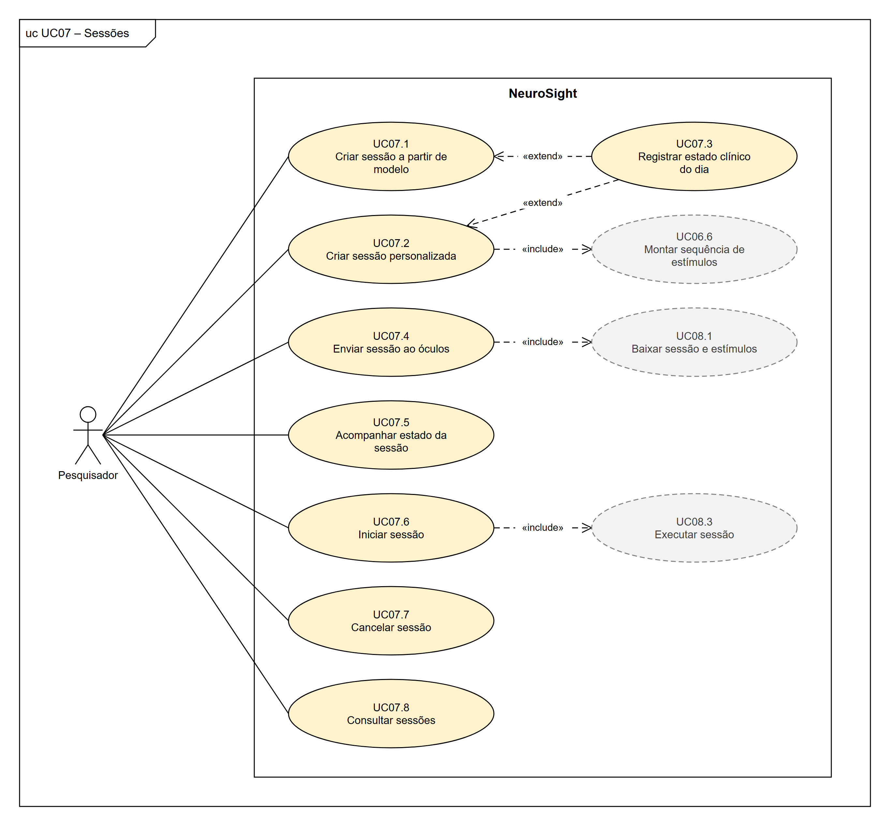
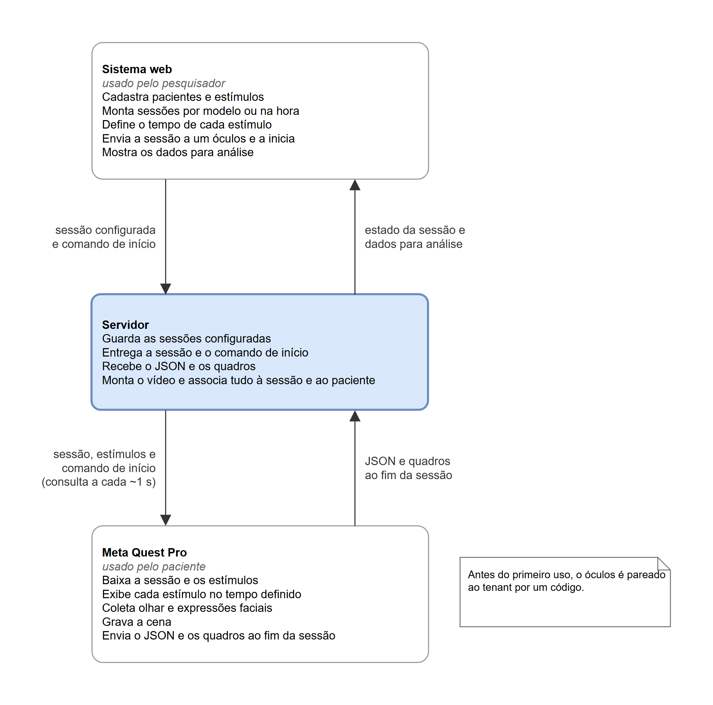

# Artigo do TCC1 – NeuroSight (versão montada)

Versão de trabalho de 02/11/2026, montada a partir dos arquivos das Seções I a IV.A desta pasta. As citações já estão com a numeração final, e a lista de referências está no fim. Para mudar o texto, edite o arquivo da seção e monte de novo com `perl Texto-TCC/montar-artigo.pl`, no Git Bash, a partir da pasta do TCC. Para atualizar a versão de entrega, no modelo LaTeX do curso, rode em seguida `perl Texto-TCC/gerar-latex.pl --pdf` (grava a pasta Texto-TCC/LaTeX, o .zip para o Overleaf e o PDF compilado); para a versão em Word, `powershell -ExecutionPolicy Bypass -File .\Texto-TCC\gerar-docx.ps1`.

As Seções IV.B, V e VI ficam para o TCC2.

---

# NeuroSight: sistema de rastreamento ocular e emocional em realidade virtual para estudo e apoio ao diagnóstico de pessoas com distúrbios da consciência

João Vitor Zanini Pedro

Setor de Educação Profissional e Tecnológica, Universidade Federal do Paraná

**Resumo:** O diagnóstico do nível de consciência em pessoas com distúrbios da consciência depende da observação de respostas comportamentais que muitos pacientes não conseguem produzir. Experimentos que registram o olhar e as expressões faciais desses pacientes diante de estímulos controlados ajudam a medir essas respostas, mas costumam depender de ferramentas isoladas e de transferência manual de arquivos. O objetivo deste trabalho é modelar e desenvolver o NeuroSight, um sistema de apoio à pesquisa que reúne as etapas desses experimentos em realidade virtual: o cadastro de pacientes e de estímulos, a configuração e o início das sessões, a coleta do olhar e das expressões faciais no Meta Quest Pro, o armazenamento dos dados e a sua análise. O trabalho parte de um protótipo de rastreamento ocular desenvolvido em Iniciação Científica e segue o Scrum adaptado ao trabalho individual. Nesta primeira etapa, foram levantados os requisitos e elaborados os modelos em UML e BPMN, os protótipos das telas e a arquitetura do sistema, formada por um aplicativo em Unreal Engine, um servidor em NestJS, um sistema web em Next.js e um banco de dados PostgreSQL compartilhado por vários grupos de pesquisa, com isolamento dos dados, controle de acesso e auditoria. O sistema não faz diagnóstico: organiza os experimentos e o registro dos dados para a análise dos pesquisadores.

**Palavras-chave:** Distúrbios da consciência; Rastreamento ocular; Realidade virtual; Expressões faciais.

**Abstract:** The diagnosis of the level of consciousness in people with disorders of consciousness depends on observing behavioral responses that many patients cannot produce. Experiments that record these patients' gaze and facial expressions in response to controlled stimuli help to measure such responses, but they usually rely on isolated tools and manual file transfers. The objective of this work is to model and develop NeuroSight, a research support system that brings together the steps of these virtual reality experiments: registering patients and stimuli, configuring and starting sessions, collecting gaze and facial expression data with the Meta Quest Pro, storing the data, and analyzing it. The work builds on an eye-tracking prototype developed in an undergraduate research project and follows Scrum adapted to individual work. In this first stage, the requirements were gathered, and the UML and BPMN models, the screen prototypes, and the system architecture were produced. The architecture consists of an Unreal Engine application, a NestJS server, a Next.js web system, and a PostgreSQL database shared by multiple research groups, with data isolation, access control, and auditing. The system does not perform diagnosis: it organizes the experiments and the data recording for the researchers' analysis.

**Keywords:** Disorders of consciousness; Eye tracking; Virtual reality; Facial expressions.

## I. INTRODUÇÃO

Os distúrbios da consciência (DoC, do inglês *disorders of consciousness*) são condições em que a pessoa, após uma lesão cerebral grave, perde total ou parcialmente a capacidade de estar desperta e de perceber a si mesma e o ambiente. O grupo inclui o coma, a síndrome da vigília não responsiva (SVNR), antes chamada de estado vegetativo, e o estado minimamente consciente (EMC) [1], [2]. Na prática clínica, a distinção entre esses estados depende da observação de respostas comportamentais à beira do leito, feita com escalas padronizadas como a *Coma Recovery Scale-Revised* (CRS-R) [3]. Muitos pacientes, porém, não conseguem produzir essas respostas por motivos alheios à consciência, como paralisia ou déficits sensoriais, e o erro de diagnóstico é frequente: em um estudo com 103 pacientes, 41% dos que haviam sido classificados em estado vegetativo pelo consenso da equipe médica estavam, na verdade, em EMC [4]. Há ainda pacientes sem nenhuma resposta comportamental que conseguem executar tarefas mentais quando solicitados, o que só foi detectado com exames de alto custo, como a ressonância magnética funcional e a eletroencefalografia [5].

O comportamento visual tem peso particular nessa avaliação: a fixação sustentada e a perseguição visual estão entre os sinais que caracterizam o EMC [2], mas, à beira do leito, são julgadas a olho nu e não deixam registro que possa ser revisto. O rastreamento ocular (*eye tracking*) permite medir esses comportamentos de forma objetiva [6]. As expressões faciais, por sua vez, podem ser descritas pelo *Facial Action Coding System* (FACS) [7] e ajudam a observar a reação do paciente a estímulos com significado pessoal, como rostos e vozes de familiares, que tendem a provocar mais respostas do que estímulos neutros [8]. A realidade virtual oferece um meio controlado e reproduzível para apresentar esses estímulos [9], e óculos como o Meta Quest Pro reúnem no mesmo equipamento a exibição das imagens e o rastreamento do olhar e das expressões faciais [10].

O equipamento, porém, resolve apenas parte da questão. Para conduzir esses experimentos, o pesquisador precisa preparar os estímulos de cada paciente, controlar o momento em que cada um é exibido, associar os dados do olhar e das expressões ao estímulo apresentado em cada instante e guardar tudo vinculado ao paciente e à sessão corretos. Sem uma ferramenta que integre essas etapas, o trabalho se divide entre aplicativos isolados, *scripts* e transferência manual de arquivos, situação observada também no desenvolvimento do protótipo que deu origem a este trabalho, em que as sessões ficavam como arquivos locais, sem catalogação [11]. Isso aumenta o risco de perda ou troca de dados, dificulta a repetição do mesmo protocolo entre sessões e pacientes e torna a análise mais demorada. Há também a questão da proteção dos dados: informações de saúde são dados pessoais sensíveis segundo a Lei Geral de Proteção de Dados Pessoais (LGPD) [12], e os participantes desses estudos, pela própria condição, não conseguem consentir nem acompanhar o uso das suas informações. Por isso, o acesso às sessões precisa ser controlado, e as ações realizadas no sistema, registradas.

Diante desse cenário, o objetivo deste trabalho é modelar e desenvolver o NeuroSight, um sistema de apoio à pesquisa que reúne em uma única ferramenta as etapas de experimentos em realidade virtual com pessoas com DoC: o cadastro dos pacientes, a preparação dos estímulos, a configuração e o início das sessões, a coleta do olhar e das expressões faciais no Meta Quest Pro, o armazenamento dos dados e a sua análise. O sistema é formado por um aplicativo para o óculos, um sistema web e um servidor, e uma mesma instalação atende a diferentes grupos de pesquisa, com os dados de cada um isolados dos demais. O trabalho parte do protótipo de rastreamento ocular em realidade virtual desenvolvido pelo autor em seu projeto de Iniciação Científica (IC) [11]. O NeuroSight não faz diagnóstico nem substitui a avaliação clínica: ele organiza a realização dos experimentos e o registro dos dados para que os pesquisadores possam analisá-los.

Este documento apresenta a primeira etapa do trabalho, dedicada à modelagem do sistema; a implementação será realizada na segunda etapa. A Seção II apresenta a revisão de literatura e os trabalhos semelhantes ao proposto, a Seção III descreve o método de trabalho e as tecnologias escolhidas e a Seção IV apresenta a arquitetura proposta para o sistema.

## II. REVISÃO DE LITERATURA

Esta seção reúne os conceitos e os estudos que fundamentam o NeuroSight. As subseções tratam da avaliação clínica dos distúrbios da consciência, do uso do rastreamento ocular e das expressões faciais, da realidade virtual, da proteção dos dados, da forma como esses experimentos são conduzidos hoje e dos trabalhos semelhantes ao proposto.

### A. Distúrbios da consciência e avaliação clínica

Os DoC surgem após uma lesão cerebral grave, de origem traumática, vascular ou anóxica. No coma, o paciente não abre os olhos e não tem ciclo de sono e vigília. Na SVNR, os olhos se abrem e esse ciclo retorna, mas não há sinais de percepção de si ou do ambiente [1]. No EMC, surgem sinais de consciência mínimos e flutuantes, porém reproduzíveis, como acompanhar um objeto com os olhos ou cumprir uma ordem simples [2].

A distinção entre esses estados é feita pela observação do paciente à beira do leito. A CRS-R, um dos instrumentos padronizados mais utilizados, examina seis domínios: audição, visão, motricidade, funções oromotoras e verbais, comunicação e nível de alerta [3]. Mesmo com uma escala padronizada, o resultado depende da interpretação do examinador e de respostas que podem não aparecer por motivos alheios à consciência, como paralisia, espasticidade, déficits sensoriais ou oscilações do nível de alerta. Schnakers et al. [4] acompanharam 103 pacientes e verificaram que, dos 44 classificados em estado vegetativo pelo consenso da equipe médica, 18 (41%) estavam em EMC quando avaliados com a CRS-R; os autores alertam que esse erro pode ter consequências graves, principalmente em decisões de fim de vida. Em um estudo com 353 adultos de seis centros, Bodien et al. [5] identificaram a dissociação cognitivo-motora, em que o paciente executa tarefas mentais sem nenhuma resposta comportamental, em 60 dos 241 participantes (25%) sem resposta observável a comandos. A detecção dependeu de ressonância magnética funcional e de eletroencefalografia com tarefas, recursos de alto custo que, segundo os autores, ainda não estão amplamente disponíveis na avaliação clínica.

### B. Rastreamento ocular e expressões faciais

O comportamento visual tem peso particular nessa avaliação. A fixação sustentada e a perseguição visual em resposta a estímulos em movimento ou relevantes estão entre os comportamentos que caracterizam o EMC [2]. À beira do leito, porém, esses comportamentos são julgados a olho nu: o examinador move um objeto ou um espelho diante do paciente e decide se os olhos o acompanharam. Movimentos pequenos, lentos ou inconsistentes podem passar despercebidos, e o exame não gera um registro que possa ser revisto depois.

O rastreamento ocular permite medir esses comportamentos de forma objetiva e deixa um registro do exame. Trojano et al. [6] apresentaram estímulos em movimento lento em um monitor e registraram o olhar com um rastreador infravermelho em 9 pacientes em estado vegetativo, 9 em EMC e 11 controles: a proporção de fixações sobre o alvo ficou no nível do acaso, ou abaixo dele, em todos os pacientes em estado vegetativo e acima do acaso em 7 dos 9 pacientes em EMC. Johansson et al. [13] registraram, com um rastreador vestível, os movimentos oculares de 12 pacientes com DoC prolongado durante a aplicação de quatro itens da CRS-R. A análise dos registros classificou como resposta 46,2% das tentativas, contra 18,1% na avaliação clínica feita ao mesmo tempo, com a diferença concentrada nos itens de perseguição e de fixação. Uma revisão sistemática recente, com 15 estudos publicados entre 2012 e 2025, concluiu que o rastreamento ocular detecta mais respostas do que a observação clínica, mas que a certeza da evidência ainda é baixa, e o recomendou como complemento à CRS-R, e não como substituto [14]. Na mesma linha, uma revisão de escopo apontou a fixação e a perseguição como indicadores sensíveis, porém dependentes do contexto [15].

O tipo de estímulo também interfere na resposta. Na revisão sistemática de Magliacano et al. [8], a maior parte dos estudos indicou que estímulos com significado pessoal, como o rosto do próprio paciente, rostos e vozes de familiares e o próprio nome, tendem a provocar mais respostas comportamentais e eletrofisiológicas do que imagens ou sons neutros, embora a qualidade geral das evidências seja baixa. Esse resultado reforça o interesse em observar, além do olhar, a reação emocional do paciente ao que é apresentado. As expressões faciais podem ser descritas de forma objetiva pelo FACS, que decompõe o rosto em unidades de ação associadas aos músculos faciais [7], e o reconhecimento de estados emocionais por sistemas computacionais é um dos temas da computação afetiva [16].

### C. Realidade virtual e Meta Quest Pro

A realidade virtual (RV) oferece um meio controlado para apresentar esses estímulos. Em óculos de RV, a imagem acompanha os movimentos da cabeça e permanece à mesma distância dos olhos, e o ambiente ao redor deixa de ser visto; como a cena é gerada por computador, ela é conhecida e pode ser reproduzida da mesma forma entre participantes, o que ajuda a padronizar as condições de cada sessão [9]. Hyun et al. [17] já empregaram RV combinada a rastreamento ocular na avaliação de 5 pacientes crônicos em estado vegetativo, em um estudo experimental de caso único: com três estímulos voltados à fixação, à perseguição e ao sobressalto visual, o sistema detectou fixação em três pacientes, o que a avaliação clínica não havia verificado.

Equipamentos como o Meta Quest Pro reúnem no mesmo dispositivo a exibição dos estímulos, o rastreamento ocular e o rastreamento das expressões faciais por câmeras internas [10]. O rastreamento facial converte os movimentos do rosto em valores de expressões baseadas no FACS, cada um indicando uma intensidade. O aplicativo recebe apenas esses valores: as imagens das câmeras são processadas no próprio óculos e descartadas [18].

### D. Proteção de dados e ética em pesquisa

Informações de saúde são dados pessoais sensíveis segundo a LGPD (art. 5º, II) [12]. O tratamento desses dados só pode ocorrer nas hipóteses do art. 11, entre elas o consentimento do titular ou de seu responsável legal e, sem consentimento, a realização de estudos por órgão de pesquisa, garantida, sempre que possível, a anonimização dos dados. Para estudos em saúde pública, o art. 13 determina que os dados sejam tratados em ambiente controlado e seguro, com anonimização ou pseudonimização sempre que possível. A pseudonimização é o tratamento pelo qual o dado perde a possibilidade de associação a um indivíduo, senão pelo uso de informação adicional mantida separadamente pelo controlador [12].

A pesquisa com seres humanos segue, ainda, a Resolução nº 466/2012 do Conselho Nacional de Saúde [19]. Quando o participante tem a capacidade de decisão substancialmente diminuída, como ocorre com pacientes com DoC, o consentimento é dado por seus representantes legais, e o protocolo precisa justificar essa escolha e ser aprovado pelo Comitê de Ética em Pesquisa (CEP) antes do início do estudo (itens IV.6 e XI.2). O fabricante do equipamento também impõe regras: no Meta Quest Pro, o rastreamento ocular e o facial são permissões que o aplicativo precisa pedir, e o desenvolvedor deve informar o usuário e obter o seu consentimento antes da coleta [20], [21]. O uso desses dados é limitado, ainda, pela política de uso de dados da Meta para desenvolvedores [22].

Assim, o consentimento para a participação fica a cargo do protocolo de cada pesquisa, por meio do termo assinado pelo representante legal, e não é tratado pelo sistema. Cabe ao sistema reduzir os dados ao necessário, identificar o paciente por um código, o que corresponde à pseudonimização, controlar o acesso às sessões e registrar as ações realizadas.

### E. Como os experimentos são conduzidos hoje

Nos estudos citados, os experimentos com rastreamento ocular em pacientes com DoC seguem, em linhas gerais, o seguinte fluxo:

- o pesquisador escolhe estímulos que testam a fixação e a perseguição visual, muitas vezes inspirados nos itens da CRS-R [13], [17];
- os estímulos são apresentados em um monitor diante do paciente [6], com objetos reais enquanto o paciente usa um rastreador vestível [13] ou em um aplicativo de RV próprio [17];
- o rastreador grava o olhar, e as gravações são revistas em um programa de análise, como o do fabricante do rastreador [13];
- a análise é feita depois, em geral comparando os registros com a avaliação clínica [6], [13].

No protótipo da IC [11], o fluxo era parecido, mas já reunia parte das etapas: o pesquisador abria o aplicativo no óculos e encerrava a sessão por um botão do controle, que enviava os dados ao servidor; sem rede, os arquivos eram copiados do óculos por cabo e enviados depois por um *script*. Não havia cadastro de pacientes nem de estímulos, e associar cada sessão ao paciente correto ficava a cargo do pesquisador. Nesse fluxo, as etapas dependem de programas diferentes e de transferências manuais, e não há controle de quem acessa os dados nem registro das ações.

### F. Trabalhos semelhantes

Os estudos apresentados na Subseção B usaram instrumentos montados para cada pesquisa, sem uma ferramenta que organizasse o experimento do cadastro do paciente à análise. Entre as ferramentas disponíveis para pesquisas com rastreamento ocular, foram analisadas cinco, escolhidas por apresentarem estímulos, registrarem o olhar ou trabalharem com RV: iMotions, Tobii Pro Lab, SightLab VR Pro, Cognitive3D e PsychoPy. A análise foi feita a partir da documentação oficial de cada uma, consultada em outubro de 2026.

O iMotions é uma plataforma comercial [23] que analisa expressões faciais pela *webcam* ou por vídeo, com os algoritmos AFFDEX e Realeyes [24], e permite definir a ordem e a duração dos estímulos [25]. O Meta Quest Pro passou a ser aceito em 2026, mas apenas pela importação de arquivos gravados no óculos, sem menção ao rastreamento facial do equipamento [26]. Os dados ficam no computador do experimento, e o cumprimento do regulamento europeu de proteção de dados (GDPR) cabe ao cliente [27]. O Tobii Pro Lab, do fabricante de rastreadores Tobii, é um programa comercial para gravar e analisar o olhar, com mapas de calor, áreas de interesse e estímulos organizados em uma linha do tempo, e os projetos ficam no computador local [28]. Foi o programa usado por Johansson et al. para rever as gravações dos pacientes [13], mas não foram encontrados suporte atual a óculos de RV nem análise de expressões faciais.

O SightLab VR Pro, da WorldViz, é um complemento comercial do ambiente Vizard para experimentos em RV [29], [30]. É a ferramenta mais próxima do NeuroSight no óculos: lê o olhar e os parâmetros de expressão facial do Meta Quest Pro [31], apresenta sequências de imagens e vídeos com troca por tempo [32] e gera mapas de calor e reproduções das sessões [29]. Os dados, porém, ficam no computador do experimento, e não foram encontrados recursos de contas por grupo de pesquisa nem de proteção de dados. O Cognitive3D é uma plataforma de análise para aplicações de RV, vendida como serviço por assinatura [33]. Reproduz as sessões em 3D, com o trajeto do olhar e mapas de calor, e organiza os dados em organizações, projetos e participantes, com papéis de acesso [34]. Lê o olhar do Meta Quest Pro, mas a documentação lista o aparelho entre os dispositivos em fim de vida, que o fabricante deixou de vender e que podem não ter sido testados recentemente [35]. Também declara conformidade com o GDPR [36] e oferece registro de auditoria no plano mais caro [33], mas não foram encontrados recursos para montar a sequência de estímulos nem suporte às expressões faciais.

O PsychoPy é um programa gratuito e de código aberto para experimentos de psicologia [37], que define o início e a duração de cada estímulo [38] e se comunica com rastreadores oculares [39]. O suporte a RV, contudo, limita-se ao Oculus Rift [40], e a análise de expressões faciais só existe nos experimentos on-line, pela *webcam* [41]. Esses experimentos ficam em projetos da plataforma Pavlovia, privados por padrão e compartilhados com outros usuários ou grupos por convite, com os papéis de acesso do GitLab [42]. A Tabela 1 resume a comparação.

**TABELA 1** - Comparação entre o NeuroSight e ferramentas semelhantes.

| Ferramenta | Licença | Olhar no Meta Quest Pro | Expressões faciais | Sequência de estímulos com tempo | Dados de vários grupos, com papéis | Registro de auditoria |
|---|---|---|---|---|---|---|
| iMotions | Comercial | Só por importação | Pela *webcam* | Sim | Não (dados locais) | Não encontrado |
| Tobii Pro Lab | Comercial | Não encontrado | Não encontrado | Sim | Não (dados locais) | Não encontrado |
| SightLab VR Pro | Comercial | Sim | Valores do óculos | Sim | Não (dados locais) | Não encontrado |
| Cognitive3D | Assinatura | Sim (em fim de vida) | Não encontrado | Não encontrado | Sim | Só no plano Enterprise |
| PsychoPy | Gratuita | Não (só Oculus Rift) | Pela *webcam*, só on-line | Sim | Parcial (projetos no Pavlovia) | Não encontrado |
| NeuroSight | A definir | Sim | Valores do óculos | Sim | Sim | Sim |

FONTE: O autor (2026), com base na documentação das ferramentas.

Como mostra a Tabela 1, nenhuma das ferramentas analisadas reúne, ao mesmo tempo, a coleta do olhar e das expressões faciais no Meta Quest Pro, a apresentação de uma sequência de estímulos com tempo definido e o armazenamento centralizado dos dados de vários grupos de pesquisa, com controle de acesso e auditoria. O SightLab VR Pro é o mais próximo no que se refere ao óculos, mas guarda os dados localmente; o Cognitive3D é o mais próximo na gestão dos dados, mas não apresenta estímulos nem lê as expressões faciais. Também não foram encontrados, em nenhuma delas, recursos voltados a pacientes com DoC, como estímulos pessoais vinculados a cada paciente. Essa lacuna motiva o desenvolvimento do NeuroSight.

## III. MÉTODO E TECNOLOGIAS

Para desenvolver este trabalho, estudou-se como são conduzidos os experimentos com pessoas com distúrbios da consciência e o que a literatura relata sobre o uso do rastreamento ocular, das expressões faciais e da realidade virtual nesse contexto, conforme apresentado na Seção II. Com base nesse estudo, em reuniões com o orientador[^1] e na experiência com o protótipo descrito a seguir, foram levantados os requisitos do sistema: 60 requisitos funcionais, 20 regras de negócio e 26 requisitos não funcionais. Os requisitos funcionais foram classificados por prioridade (essencial, importante ou desejável) e organizados em onze grupos: acesso e conta, usuários e permissões, óculos, pacientes, estímulos, modelos de sessão, sessões, execução no óculos, envio e processamento dos dados, consulta e análise e, por fim, auditoria.

O ponto de partida técnico foi o sistema desenvolvido pelo autor em seu projeto de Iniciação Científica [11], voltado ao estudo da recepção comunicacional. Esse sistema tem três partes: um aplicativo em Unreal Engine para o Meta Quest Pro, que registra o olhar e grava a cena exibida, com o olhar já alinhado ao vídeo; um serviço que recebe as sessões enviadas pelo próprio óculos e monta o vídeo; e uma plataforma web que reproduz cada sessão com mapa de calor. O alinhamento entre o olhar e o vídeo foi verificado em dispositivo real, em testes feitos pelo próprio autor, sem participantes externos [11]. O NeuroSight reaproveita o aplicativo e a forma de gravação das sessões e acrescenta o que o protótipo não tinha: a coleta das expressões faciais, o cadastro de pacientes e de estímulos, a configuração e o início das sessões pelo sistema web, o isolamento dos dados entre grupos de pesquisa e o controle de acesso.

O modelo de processo escolhido para conduzir o trabalho foi o Scrum [43], adaptado ao trabalho individual: o autor acumula os papéis previstos no Scrum, e o orientador acompanha o andamento nas revisões. Cada *sprint* dura duas semanas. A reunião de planejamento abre a *sprint* e define quais itens do *backlog* serão feitos; ao final, a revisão com o orientador avalia o que foi produzido, e a retrospectiva registra o que deve mudar no processo. A reunião diária, que serve para alinhar uma equipe, perde o sentido com um único desenvolvedor e foi substituída pela atualização do quadro de tarefas. Complementarmente ao Scrum, adotou-se a abordagem Kanban [44] para organizar e acompanhar as tarefas, em um quadro do GitHub Projects [45].

O desenvolvimento do projeto foi dividido em duas etapas: modelagem, realizada na primeira parte do Trabalho de Conclusão de Curso (TCC1) e apresentada neste documento, e desenvolvimento, prevista para a segunda parte (TCC2). Na etapa de modelagem, houve a elicitação dos requisitos e a elaboração dos diagramas de casos de uso, das histórias de usuário, do diagrama de classes, do diagrama de estados da sessão, do diagrama lógico-relacional do banco de dados, dos diagramas de sequência dos seis fluxos principais, dos diagramas de processo de negócio do experimento, como é conduzido hoje e com o NeuroSight, do diagrama macro do fluxo de uma sessão, do diagrama de arquitetura e dos protótipos de tela: 14 do sistema web e 5 do aplicativo do óculos. A notação dos modelos foi a definida pela *Unified Modeling Language* (UML) [46], com exceção dos processos de negócio, descritos em *Business Process Model and Notation* (BPMN) [47]. Os diagramas foram feitos no draw.io [48], e os protótipos, em HTML (*HyperText Markup Language*) e CSS (*Cascading Style Sheets*).

A Figura 1 apresenta, como exemplo, o diagrama de casos de uso das sessões, que reúne o fluxo principal do sistema: o pesquisador cria a sessão, a partir de um modelo ou de forma personalizada, envia-a ao óculos, acompanha o seu estado e a inicia. Ao todo, foram elaborados doze diagramas, com 60 casos de uso: um diagrama com os atores e um para cada grupo de requisitos. Os atores principais são os três perfis de usuário, que são cumulativos: o pesquisador, que cadastra pacientes, estímulos, modelos e sessões, inicia as sessões e analisa os dados; o administrador, que, além disso, gerencia os usuários, os óculos, a visibilidade das sessões e a auditoria; e o proprietário, que criou o *tenant* e define quem é administrador. Completam o modelo o visitante, que conhece o sistema e cria um *tenant*, e o paciente, ator secundário que usa o óculos durante a sessão, mas não acessa o sistema. A documentação completa está disponível on-line[^2].

**FIGURA 1** - Exemplo de diagrama de casos de uso - Sessões.

FONTE: O autor (2026).

A documentação do sistema contempla, também, as histórias de usuário. Cada diagrama de casos de uso foi definido como um épico, que se desdobrou em um conjunto de histórias de usuário no formato \<SENDO\>\<QUERO\>\<PARA\> [49], uma para cada caso de uso, com critérios de aceitação e prioridade. Ao todo, são 60 histórias: 35 essenciais, 19 importantes e 6 desejáveis. Na etapa de desenvolvimento, elas formarão o *backlog* das *sprints*, na ordem de prioridade.

Na etapa de desenvolvimento, as tecnologias descritas a seguir serão empregadas para implementar as funcionalidades definidas na modelagem, conforme a arquitetura apresentada na Seção IV. A escolha seguiu dois critérios: reaproveitar o protótipo da IC e usar uma só linguagem no servidor e no sistema web. O aplicativo do óculos continuará em Unreal Engine, em C++, e passará a ler também as expressões faciais, leitura que ainda depende de uma prova de conceito, discutida na Seção IV. O servidor e o sistema web serão escritos em TypeScript, com NestJS no *backend* e Next.js no *frontend*. Como o Next.js é baseado em React, a mesma biblioteca da plataforma web da IC, o reprodutor com mapa de calor poderá ser reaproveitado. O banco de dados será o PostgreSQL, cujo recurso de *Row-Level Security* reforça o isolamento dos dados de cada grupo de pesquisa. A Tabela 2 detalha e descreve brevemente as tecnologias empregadas.

**TABELA 2** - Tecnologias utilizadas.

| Tecnologia | Utilização |
|---|---|
| Meta Quest Pro | Óculos de realidade virtual com rastreamento ocular e facial [10] |
| Unreal Engine 5.5 | Desenvolvimento do aplicativo do óculos, em C++ [50] |
| OpenXR e Meta XR | Acesso ao rastreamento ocular e facial no Unreal [51], [52] |
| TypeScript | Linguagem do *backend* e do *frontend* [53] |
| NestJS | *Framework* de *backend* [54] |
| Prisma | Acesso ao banco de dados e migrações [55] |
| PostgreSQL | Banco de dados, com isolamento por *Row-Level Security* [56] |
| Next.js | *Framework* de *frontend* [57] |
| FFmpeg | Montagem do vídeo das sessões [58] |
| Docker Compose | Implantação dos serviços no servidor [59] |
| Git e GitHub | Controle de versão e quadro Kanban [60], [45] |

FONTE: O autor (2026).

[^1]: BRAWERMAN, A. Levantamento de requisitos do NeuroSight. Curitiba, 2026. Informação verbal – Reuniões de orientação.

[^2]: Disponível em: https://github.com/joaozanini/tcc1 (pasta Especificacao). Acesso em: 2 nov. 2026.

## IV. RESULTADOS

Esta seção apresenta o resultado da etapa de modelagem: a arquitetura proposta para o NeuroSight, com os seus componentes, a comunicação entre eles, os dados coletados em cada sessão e os mecanismos de segurança. A apresentação do sistema implementado e das suas funcionalidades será feita na etapa de desenvolvimento (TCC2); os protótipos das telas, que antecipam essa apresentação, fazem parte da documentação completa.

### A. Arquitetura do Sistema

A arquitetura geral do sistema é representada pela Figura 2. Conforme apresentado na Tabela 2, ela se baseia em tecnologias atuais e amplamente utilizadas, como Unreal Engine, NestJS, Next.js e PostgreSQL. O sistema tem três partes: o aplicativo de coleta, executado no Meta Quest Pro; o sistema web, acessado pelo navegador; e o servidor, que reúne a interface de programação de aplicações (API, do inglês *Application Programming Interface*), o banco de dados, os arquivos e o processamento das sessões.

**FIGURA 2** - Arquitetura do NeuroSight.

FONTE: O autor (2026).

Na Figura 2, observa-se o aplicativo de coleta, desenvolvido a partir do protótipo da IC, que baixa a sessão e os estímulos, apresenta os estímulos ao paciente, coleta o olhar e as expressões faciais, captura os quadros da cena e envia os dados ao servidor. O sistema web é a interface dos pesquisadores e dos administradores e não contém regras de negócio. Essas regras ficam na API, que também é responsável pela autenticação, pelo isolamento entre os grupos de pesquisa, pelo registro de auditoria e pela entrega dos arquivos. A API acessa o banco de dados por meio do Prisma e guarda os arquivos (estímulos, dados brutos das sessões, quadros e vídeos) no disco do servidor, atrás de uma interface que permite trocar o disco por um serviço de armazenamento compatível com o Amazon S3 sem alterar o restante do sistema. O processamento é executado em segundo plano, a partir de uma fila de tarefas mantida no próprio banco pela biblioteca pg-boss [61]: ele importa as amostras de cada sessão para o banco e monta o vídeo com o FFmpeg. Por fim, um serviço externo de e-mail envia as mensagens de confirmação de cadastro, de convite e de redefinição de senha.

Os componentes do servidor rodam em contêineres, orquestrados pelo Docker Compose, com um *proxy* reverso responsável pela conexão segura (HTTPS, do inglês *Hypertext Transfer Protocol Secure*). Assim, o sistema pode ser instalado em um servidor virtual privado (VPS, do inglês *Virtual Private Server*) contratado, de preferência hospedado no Brasil, ou em um servidor da própria instituição de pesquisa. A escolha cabe ao protocolo de cada pesquisa, aprovado pelo CEP, já que o art. 13 da LGPD prevê que os dados de estudos em saúde pública sejam tratados dentro do órgão de pesquisa [12]. O banco de dados e os arquivos terão cópia de segurança diária. Não há comunicação direta entre o sistema web e o óculos: as duas partes falam apenas com a API, como detalhado a seguir.

*1) Multi-tenant:* Cada instituição ou grupo de pesquisa cadastrado no NeuroSight corresponde a um *tenant*, e uma única instalação atende a todos. Os dados ficam em um banco único, em que toda tabela com dados de um *tenant* tem a coluna `tenant_id`. O isolamento é feito em duas camadas. Na primeira, a API filtra cada consulta pelo *tenant* do usuário, informado no *token* de acesso. Na segunda, o PostgreSQL aplica em cada tabela uma política de *Row-Level Security* (RLS) [56], que só devolve as linhas do *tenant* definido para a transação em curso. Assim, um filtro esquecido no código não expõe dados de outro grupo. Como a checagem de chaves estrangeiras não passa pelo RLS, as relações entre as tabelas usam chaves compostas com o *tenant*, o que impede, por exemplo, que uma sessão aponte para o paciente de outro grupo. A API acessa o banco com um papel que não pode ignorar o RLS; um segundo papel, que pode, é usado apenas nas operações feitas antes de existir um *tenant* no contexto, como o autocadastro, o *login* e o pareamento dos óculos. Os arquivos também são separados em pastas por *tenant* e só são entregues pela API, depois da checagem de permissão.

*2) Comunicação entre sistema web, servidor e óculos:* O sistema web e o aplicativo do óculos se comunicam apenas com a API, por HTTPS, no estilo REST (*Representational State Transfer*). A API será documentada em OpenAPI [62], que serve de contrato entre o servidor e o aplicativo. A Figura 3 resume o fluxo de uma sessão.

**FIGURA 3** - Fluxo de uma sessão no NeuroSight.

FONTE: O autor (2026).

Antes do primeiro uso, cada óculos é pareado ao *tenant*. O aplicativo pede ao servidor um código curto, que exibe na tela, e recebe também um segredo. Um administrador digita o código no sistema web e, a partir daí, o segredo passa a valer como *token* de acesso do aparelho, que pode ser revogado a qualquer momento. O mecanismo simplifica o fluxo de autorização de dispositivos do OAuth 2.0 [63] e dispensa digitar senhas no óculos.

Para executar uma sessão, o pesquisador a configura no sistema web e a envia a um óculos pareado. Enquanto aguarda, o aplicativo consulta o servidor a cada segundo, aproximadamente. Essa mesma consulta indica que o aparelho está ligado, entrega a sessão e transmite o comando de início. Ao receber a sessão, o aplicativo baixa os estímulos que ainda não tem, verifica se o rastreamento ocular e o facial estão ativos e avisa o servidor de que está pronto; só então o sistema web libera o botão "Iniciar". Com o óculos já posicionado no paciente, o pesquisador clica em "Iniciar", e o aplicativo começa a sessão na consulta seguinte, em até cerca de 2 segundos. Daí em diante, a execução não depende da rede: a sessão segue até o fim do tempo configurado, sem interrupção, e os dados são gravados no próprio óculos. Ao longo do processo, a sessão passa pelos estados rascunho, enviada ao óculos, baixada, início solicitado, em execução, enviando, processando e concluída, ou falha, que o sistema web exibe ao pesquisador.

Optou-se por não espelhar no sistema web a imagem vista pelo paciente: o pesquisador acompanha o estado da sessão e analisa os dados depois que ela termina. Com isso, a comunicação dispensa conexões permanentes, como as de WebSocket, e o óculos e o computador do pesquisador não precisam estar na mesma rede, bastando acesso à internet. Em contrapartida, o óculos precisa estar conectado no momento do início.

*3) Dados coletados e gravação:* Durante a sessão, o aplicativo registra três tipos de dado, todos marcados pelo mesmo relógio do óculos. O primeiro são os eventos de estímulo, com o instante real em que cada estímulo começou e terminou de ser exibido, que pode diferir do tempo configurado, por exemplo, enquanto um vídeo carrega. O segundo é o olhar, amostrado a cada quadro de renderização, com a validade, a confiança, o ponto observado na cena e a sua posição tanto na imagem gravada quanto no próprio estímulo. O terceiro são as expressões faciais: cerca de 70 expressões baseadas no FACS [7], fornecidas pelo kit de desenvolvimento (SDK, do inglês *Software Development Kit*) da Meta [10], cada uma com intensidade de 0 a 1 e indicação de validade. Esses dados formam um arquivo JSON (*JavaScript Object Notation*), gravado em intervalos curtos para não se perderem caso o aplicativo seja fechado. Como na IC, o aplicativo também captura quadros da cena exibida ao paciente, em JPEG, que servem para montar o vídeo da sessão.

Ao fim da sessão, o aplicativo envia primeiro o JSON e depois os quadros, em lotes. Um lote que falha é reenviado, e um lote repetido não duplica dados. Sem conexão, os dados ficam guardados no óculos, que tenta o envio de novo mais tarde, e só são apagados do aparelho depois que o servidor confirma o recebimento. No servidor, o processamento importa os eventos e as amostras do JSON para tabelas do banco, o que facilita os gráficos e o resumo por estímulo, e monta o vídeo MP4, em H.264, com o FFmpeg. O JSON original é guardado sem alterações, e os dados coletados não podem ser modificados: o pesquisador registra apenas anotações e dados descritivos da sessão. Na IC, cada minuto de gravação, a cerca de 22 quadros por segundo, gerou aproximadamente 88 MB [11]. Com base nessa medição, estima-se que uma sessão de 5 minutos, com quadros de 1024 × 1024 pixels capturados a 15 quadros por segundo, gere cerca de 300 MB, valor que será medido no NeuroSight.

*4) Segurança e auditoria:* Toda comunicação usa HTTPS, e toda chamada à API exige um *token*: um JSON Web Token (JWT) [64], que identifica o usuário, o *tenant* e o perfil, ou o *token* próprio de cada óculos. As senhas são guardadas apenas na forma de *hash*. Os perfis são cumulativos: o administrador pode tudo o que o pesquisador pode, e o proprietário, tudo o que o administrador pode. Os dados de uma sessão só ficam visíveis para quem a criou, para o proprietário, para os administradores e para os usuários que um administrador autorizar. O sistema registra automaticamente quem fez cada ação, quando e em qual registro, abrangendo *login*, criação, edição e exclusão de dados, envio e início de sessões, visualização e exportação dos dados de uma sessão e mudanças de permissão. Os registros de auditoria não podem ser alterados nem excluídos, restrição garantida no próprio banco, pois o papel usado pela API não tem permissão para isso.

Os dados de saúde são dados pessoais sensíveis segundo a LGPD [12], e o sistema foi modelado para guardar apenas o necessário à pesquisa. O paciente é identificado por um código; o nome é opcional e nunca chega ao óculos, que exibe só o código. O aplicativo não captura imagens do rosto do paciente, apenas os valores das expressões, e a gravação mostra somente o que o paciente viu. O consentimento para a participação fica a cargo do protocolo de cada pesquisa, discutido na Seção II, e não é tratado pelo sistema.

*5) Riscos e limitações:* Três pontos da arquitetura ainda dependem de verificação. O primeiro é a leitura das expressões faciais no Unreal Engine. O protótipo da IC lê apenas o olhar, pelo padrão OpenXR, e as opções de rastreamento da Meta, que fornecem as expressões, exigem outra integração do motor, incompatível com a usada no protótipo [11]. Por isso, a primeira tarefa do desenvolvimento será uma prova de conceito que leia o olhar e as expressões ao mesmo tempo e meça a taxa de amostragem obtida com a captura de quadros ativa, que na IC ficou em 22 Hz [11]. Se a prova de conceito falhar, a alternativa é desenvolver o aplicativo em Unity, em que o olhar e as expressões vêm do mesmo SDK. O segundo ponto é o equipamento: o Meta Quest Pro saiu de linha em janeiro de 2025 [65]. O grupo de pesquisa dispõe do aparelho usado na IC, mas a reposição, em caso de defeito, seria difícil. O terceiro é a dependência de internet no momento do início, já que o comando sai do sistema web e chega ao óculos pelo servidor; por isso, a rede do local da coleta precisa ser testada antes dos experimentos.

## REFERÊNCIAS

[1] LAUREYS, S. *et al*. Unresponsive wakefulness syndrome: a new name for the vegetative state or apallic syndrome. *BMC Medicine*, v. 8, art. 68, 2010. DOI: 10.1186/1741-7015-8-68.

[2] GIACINO, J. T. *et al*. The minimally conscious state: definition and diagnostic criteria. *Neurology*, v. 58, n. 3, p. 349-353, 2002. DOI: 10.1212/WNL.58.3.349.

[3] GIACINO, J. T.; KALMAR, K.; WHYTE, J. The JFK Coma Recovery Scale-Revised: measurement characteristics and diagnostic utility. *Archives of Physical Medicine and Rehabilitation*, v. 85, n. 12, p. 2020-2029, 2004. DOI: 10.1016/j.apmr.2004.02.033.

[4] SCHNAKERS, C. *et al*. Diagnostic accuracy of the vegetative and minimally conscious state: clinical consensus versus standardized neurobehavioral assessment. *BMC Neurology*, v. 9, art. 35, 2009. DOI: 10.1186/1471-2377-9-35.

[5] BODIEN, Y. G. *et al*. Cognitive motor dissociation in disorders of consciousness. *New England Journal of Medicine*, v. 391, n. 7, p. 598-608, 2024. DOI: 10.1056/NEJMoa2400645.

[6] TROJANO, L. *et al*. Quantitative assessment of visual behavior in disorders of consciousness. *Journal of Neurology*, v. 259, n. 9, p. 1888-1895, 2012. DOI: 10.1007/s00415-012-6435-4.

[7] EKMAN, P.; FRIESEN, W. V. *Facial Action Coding System: a technique for the measurement of facial movement*. Palo Alto: Consulting Psychologists Press, 1978.

[8] MAGLIACANO, A. *et al*. Can salient stimuli enhance responses in disorders of consciousness? A systematic review. *Current Neurology and Neuroscience Reports*, v. 19, n. 12, art. 98, 2019. DOI: 10.1007/s11910-019-1018-8.

[9] CLAY, V.; KÖNIG, P.; KÖNIG, S. U. Eye tracking in virtual reality. *Journal of Eye Movement Research*, v. 12, n. 1, 2019. DOI: 10.16910/jemr.12.1.3.

[10] META PLATFORMS. *Movement SDK for Unreal*. Meta Horizon OS Developers, 2026. Disponível em: https://developers.meta.com/vr/documentation/unreal/unreal-movement-overview/. Acesso em: 26 out. 2026.

[11] PEDRO, J. V. Z. *Desenvolvimento de um sistema de rastreamento ocular em realidade virtual para análise de atenção visual aplicada ao estudo da recepção comunicacional*. Relatório final de Iniciação Científica (Edital 2025) – Universidade Federal do Paraná, Curitiba, 2026. Orientador: Alessandro Brawerman. Disponível em: https://github.com/joaozanini/QuestPro-EyeTracking. Acesso em: 26 out. 2026.

[12] BRASIL. *Lei nº 13.709, de 14 de agosto de 2018*. Lei Geral de Proteção de Dados Pessoais (LGPD). Brasília, DF: Presidência da República, [2018]. Disponível em: https://www.planalto.gov.br/ccivil_03/_ato2015-2018/2018/lei/l13709compilado.htm. Acesso em: 26 out. 2026.

[13] JOHANSSON, J. *et al*. Eye tracking to support assessment of patients with prolonged disorder of consciousness: a case series. *Journal of Rehabilitation Medicine*, v. 57, art. jrm41324, 2025. DOI: 10.2340/jrm.v57.41324.

[14] ESTRANEO, A. *et al*. Eye-tracking assessment in patients with disorders of consciousness: a systematic review. *Brain Sciences*, v. 16, n. 6, art. 590, 2026. DOI: 10.3390/brainsci16060590.

[15] BAGNATO, S.; BOCCAGNI, C.; BONAVITA, J. Eye movements as indicators of awareness in prolonged disorders of consciousness: a scoping review of behavioral and neural evidence. *Neurological Sciences*, v. 47, n. 3, art. 317, 2026. DOI: 10.1007/s10072-026-08932-6.

[16] PICARD, R. W. *Affective computing*. Cambridge: MIT Press, 1997. DOI: 10.7551/mitpress/1140.001.0001.

[17] HYUN, C. *et al*. Quantitative evaluation of the consciousness level of patients in a vegetative state using virtual reality and an eye-tracking system: a single-case experimental design study. *Neuropsychological Rehabilitation*, v. 32, n. 10, p. 2628-2645, 2022. DOI: 10.1080/09602011.2021.1974496.

[18] META PLATFORMS. *Natural Facial Expressions Privacy Notice*. 5 set. 2025. Disponível em: https://www.meta.com/legal/quest/natural-facial-expressions-privacy-notice/. Acesso em: 26 out. 2026.

[19] BRASIL. Conselho Nacional de Saúde. *Resolução nº 466, de 12 de dezembro de 2012*. Aprova as diretrizes e normas regulamentadoras de pesquisas envolvendo seres humanos. Diário Oficial da União: seção 1, Brasília, DF, p. 59, 13 jun. 2013. Disponível em: https://www.gov.br/conselho-nacional-de-saude/pt-br/atos-normativos/resolucoes/2012/resolucao-no-466.pdf. Acesso em: 26 out. 2026.

[20] META PLATFORMS. *Eye Tracking in Movement SDK for OpenXR*. 2026. Disponível em: https://developers.meta.com/horizon/documentation/native/android/move-eye-tracking/. Acesso em: 26 out. 2026.

[21] META PLATFORMS. *Face Tracking in Movement SDK for OpenXR*. 2026. Disponível em: https://developers.meta.com/horizon/documentation/native/android/move-face-tracking/. Acesso em: 26 out. 2026.

[22] META PLATFORMS. *Developer Data Use Policy*. 2 jul. 2026. Disponível em: https://developers.meta.com/horizon/policy/data-use/. Acesso em: 26 out. 2026.

[23] IMOTIONS. *iMotions Lab Pricing*. Disponível em: https://imotions.com/products/pricing/. Acesso em: 26 out. 2026.

[24] IMOTIONS. *Facial Expression Analysis*: emotion detection software. Disponível em: https://imotions.com/products/imotions-lab/modules/fea-facial-expression-analysis/. Acesso em: 26 out. 2026.

[25] IMOTIONS. *Study Builder*. Disponível em: https://imotions.com/products/imotions-lab/features/study-builder/. Acesso em: 26 out. 2026.

[26] IMOTIONS. *iMotions Product & Feature News*: February 2026. 2026. Disponível em: https://imotions.com/about-us/news/imotions-product-feature-news-february-2026/. Acesso em: 26 out. 2026.

[27] IMOTIONS. *Terms of Service*. Disponível em: https://imotions.com/terms-of-service/. Acesso em: 26 out. 2026.

[28] TOBII. *Tobii Pro Lab*: eye tracking software for behavior research. Disponível em: https://www.tobii.com/products/software/behavior-research-software/tobii-pro-lab. Acesso em: 26 out. 2026.

[29] WORLDVIZ. *What is SightLab VR Pro and how does it work?* 2025. Disponível em: https://www.worldviz.com/post/what-is-sightlab-vr-pro-and-how-does-it-work. Acesso em: 26 out. 2026.

[30] WORLDVIZ. *2026 WorldViz VR budgeting guidelines for scientific VR labs*. 2026. Disponível em: https://www.worldviz.com/post/worldviz-vr-budgeting-guidelines-for-scientific-vr-labs. Acesso em: 26 out. 2026.

[31] WORLDVIZ. *Face Tracking*: SightLab documentation. Disponível em: https://help.worldviz.com/sightlab/face-tracking. Acesso em: 26 out. 2026.

[32] WORLDVIZ. *Media Viewer*: SightLab documentation. Disponível em: https://help.worldviz.com/sightlab/media-viewer/. Acesso em: 26 out. 2026.

[33] COGNITIVE3D. *XR Analytics Platform Pricing*. Disponível em: https://cognitive3d.com/pricing/. Acesso em: 26 out. 2026.

[34] COGNITIVE3D. *Concepts*: Cognitive3D documentation. Disponível em: https://docs.cognitive3d.com/dashboard/concepts/. Acesso em: 26 out. 2026.

[35] COGNITIVE3D. *Supported Hardware*: Cognitive3D documentation. Disponível em: https://docs.cognitive3d.com/hardware/. Acesso em: 2 nov. 2026.

[36] COGNITIVE3D. *Data Processing Addendum*. Disponível em: https://cognitive3d.com/dpa/. Acesso em: 26 out. 2026.

[37] PSYCHOPY. *About PsychoPy*. Disponível em: https://psychopy.org/about/index.html. Acesso em: 26 out. 2026.

[38] PSYCHOPY. *Defining the onset/duration of components*. Disponível em: https://psychopy.org/builder/startStop.html. Acesso em: 26 out. 2026.

[39] PSYCHOPY. *Communicating with an eyetracker*. Disponível em: https://psychopy.org/hardware/eyeTracking.html. Acesso em: 26 out. 2026.

[40] PSYCHOPY. *psychopy.visual.Rift*. Disponível em: https://psychopy.org/api/visual/rift.html. Acesso em: 26 out. 2026.

[41] PSYCHOPY. *Advanced features for online experiments*. Disponível em: https://psychopy.org/online/advanced-features-online.html. Acesso em: 26 out. 2026.

[42] PSYCHOPY. *Create a Pavlovia project*. Disponível em: https://psychopy.org/online/create-pavlovia-project.html. Acesso em: 2 nov. 2026.

[43] SCHWABER, K.; SUTHERLAND, J. *The Scrum Guide*. [S.l.]: Scrum.org, 2020. E-book. Disponível em: https://scrumguides.org/docs/scrumguide/v2020/2020-Scrum-Guide-US.pdf. Acesso em: 26 out. 2026.

[44] ANDERSON, D. J. *Kanban: successful evolutionary change for your technology business*. Sequim: Blue Hole Press, 2010.

[45] GITHUB. *Planning and tracking with Projects*. 2026. Disponível em: https://docs.github.com/en/issues/planning-and-tracking-with-projects. Acesso em: 26 out. 2026.

[46] OBJECT MANAGEMENT GROUP. *OMG Unified Modeling Language (OMG UML)*: version 2.5.1. Needham: OMG, 2017. Disponível em: https://www.omg.org/spec/UML/2.5.1/. Acesso em: 26 out. 2026.

[47] OBJECT MANAGEMENT GROUP. *Business Process Model and Notation (BPMN)*: version 2.0.2. Needham: OMG, 2013. Disponível em: https://www.omg.org/spec/BPMN/2.0.2/. Acesso em: 26 out. 2026.

[48] JGRAPH. *draw.io*. 2026. Disponível em: https://www.drawio.com/. Acesso em: 26 out. 2026.

[49] COHN, M. *User stories applied: for agile software development*. Boston: Addison-Wesley, 2004.

[50] EPIC GAMES. *Unreal Engine 5.5 documentation*. 2025. Disponível em: https://dev.epicgames.com/documentation/en-us/unreal-engine/unreal-engine-5-5-documentation. Acesso em: 26 out. 2026.

[51] KHRONOS GROUP. *OpenXR registry*. 2026. Disponível em: https://registry.khronos.org/OpenXR/. Acesso em: 26 out. 2026.

[52] META PLATFORMS. *Unreal integration: settings and tools*. Meta Horizon OS Developers, 2026. Disponível em: https://developers.meta.com/vr/documentation/unreal/. Acesso em: 26 out. 2026.

[53] MICROSOFT. *TypeScript documentation*. 2026. Disponível em: https://www.typescriptlang.org/docs/. Acesso em: 26 out. 2026.

[54] NESTJS. *NestJS documentation*. 2026. Disponível em: https://docs.nestjs.com/. Acesso em: 26 out. 2026.

[55] PRISMA DATA. *Prisma documentation*. 2026. Disponível em: https://www.prisma.io/docs. Acesso em: 26 out. 2026.

[56] POSTGRESQL GLOBAL DEVELOPMENT GROUP. *PostgreSQL documentation: row security policies*. 2026. Disponível em: https://www.postgresql.org/docs/current/ddl-rowsecurity.html. Acesso em: 26 out. 2026.

[57] VERCEL. *Next.js documentation*. 2026. Disponível em: https://nextjs.org/docs. Acesso em: 26 out. 2026.

[58] FFMPEG. *FFmpeg documentation*. 2026. Disponível em: https://ffmpeg.org/documentation.html. Acesso em: 26 out. 2026.

[59] DOCKER. *Docker Compose documentation*. 2026. Disponível em: https://docs.docker.com/compose/. Acesso em: 26 out. 2026.

[60] GIT. *Git SCM*. 2026. Disponível em: https://git-scm.com/. Acesso em: 26 out. 2026.

[61] PG-BOSS. *pg-boss: queueing jobs in Postgres from Node.js*. GitHub, 2026. Disponível em: https://github.com/timgit/pg-boss. Acesso em: 26 out. 2026.

[62] OPENAPI INITIATIVE. *OpenAPI Specification*: version 3.2.1. 2026. Disponível em: https://spec.openapis.org/oas/v3.2.1.html. Acesso em: 26 out. 2026.

[63] DENNISS, W. *et al*. *OAuth 2.0 Device Authorization Grant*. RFC 8628. [S.l.]: IETF, 2019. Disponível em: https://www.rfc-editor.org/rfc/rfc8628. Acesso em: 26 out. 2026.

[64] JONES, M.; BRADLEY, J.; SAKIMURA, N. *JSON Web Token (JWT)*. RFC 7519. [S.l.]: IETF, 2015. Disponível em: https://www.rfc-editor.org/rfc/rfc7519. Acesso em: 26 out. 2026.

[65] HAYDEN, S. Meta officially discontinues Quest Pro, its first (and most expensive) mixed reality headset. *Road to VR*, 6 jan. 2025. Disponível em: https://roadtovr.com/meta-discontinues-quest-pro/. Acesso em: 26 out. 2026.
