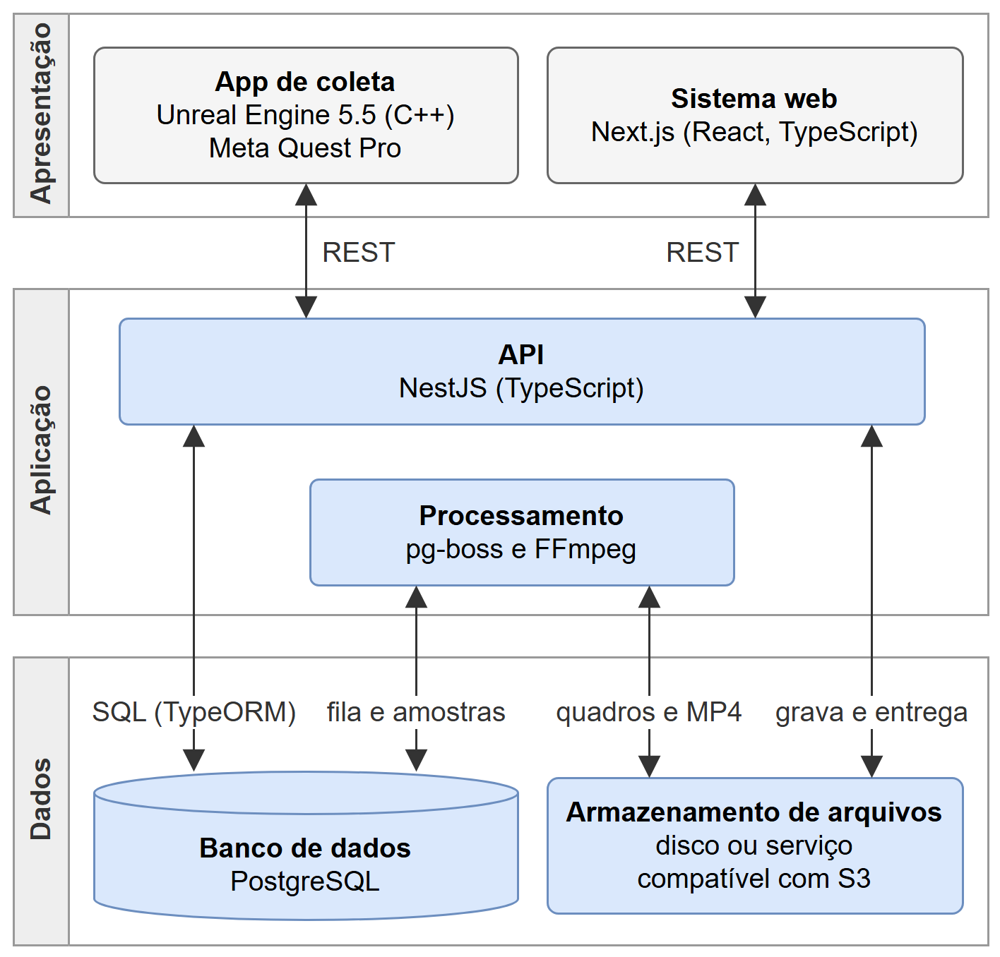
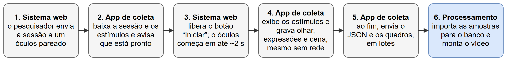

# Artigo do TCC1 – NeuroSight (versão montada)

Versão de trabalho de 12/11/2026, montada a partir dos arquivos das Seções I a IV desta pasta, no formato do modelo do curso (Referencias-e-modelos/TCC_Artigo_Modelo_2026.pdf). As citações já estão com a numeração final, e a lista de referências vem no fim. Para mudar o texto, edite o arquivo da seção e monte de novo com `perl Texto-TCC/montar-artigo.pl`, no Git Bash, a partir da pasta do TCC. Para atualizar a versão de entrega, no modelo LaTeX do curso, rode em seguida `perl Texto-TCC/gerar-latex.pl --pdf` (grava a pasta Texto-TCC/LaTeX, o .zip para o Overleaf e o PDF compilado); para a versão em Word, `powershell -ExecutionPolicy Bypass -File .\Texto-TCC\gerar-docx.ps1`.

Os artefatos de modelagem não entram no artigo: estão na Especificação Técnica (pasta Especificacao-Tecnica). O desenvolvimento do sistema fica para o TCC2.

---

# NeuroSight: sistema de rastreamento ocular e emocional em realidade virtual para estudo e apoio ao diagnóstico de pessoas com distúrbios da consciência

João Vitor Zanini Pedro, Lucas Sarnacki Guiraud

Setor de Educação Profissional e Tecnológica, Universidade Federal do Paraná

**Resumo:** O diagnóstico do nível de consciência em pessoas com distúrbios da consciência depende de respostas comportamentais que muitos pacientes não conseguem produzir. Experimentos que registram o olhar e as expressões faciais desses pacientes diante de estímulos controlados ajudam a medir essas respostas, mas dependem de ferramentas isoladas e de transferências manuais de arquivos. O objetivo deste trabalho é modelar e desenvolver o NeuroSight, um sistema de apoio à pesquisa que reúne as etapas desses experimentos em realidade virtual, do cadastro de pacientes e de estímulos à coleta no Meta Quest Pro e à análise dos dados. Nesta primeira etapa, conduzida com o Scrum, foram levantados os requisitos, elaborados os modelos em UML e BPMN e os protótipos de tela e definida a arquitetura: um aplicativo em Unreal Engine, um servidor em NestJS, um sistema web em Next.js e um banco PostgreSQL compartilhado por vários grupos de pesquisa, com isolamento dos dados, controle de acesso e auditoria.

**Palavras-chave:** Distúrbios da consciência; Rastreamento ocular; Expressões faciais; Realidade virtual; Meta Quest Pro.

**Abstract:** The diagnosis of the level of consciousness in people with disorders of consciousness depends on behavioral responses that many patients cannot produce. Experiments that record these patients' gaze and facial expressions in response to controlled stimuli help to measure such responses, but they rely on isolated tools and manual file transfers. The objective of this work is to model and develop NeuroSight, a research support system that brings together the steps of these virtual reality experiments, from registering patients and stimuli to data collection with the Meta Quest Pro and data analysis. In this first stage, carried out with Scrum, the requirements were gathered, the UML and BPMN models and the screen prototypes were produced, and the architecture was defined: an Unreal Engine application, a NestJS server, a Next.js web system, and a PostgreSQL database shared by multiple research groups, with data isolation, access control, and auditing.

**Keywords:** Disorders of consciousness; Eye tracking; Facial expressions; Virtual reality; Meta Quest Pro.

## I. INTRODUÇÃO

Os distúrbios da consciência (DoC, do inglês *disorders of consciousness*) são condições em que a pessoa, após uma lesão cerebral grave, perde total ou parcialmente a capacidade de estar desperta e de perceber a si mesma e o ambiente. O grupo inclui o coma, a síndrome da vigília não responsiva (SVNR), antes chamada de estado vegetativo, e o estado minimamente consciente (EMC) [1], [2], distinguidos pela observação de respostas comportamentais à beira do leito, com escalas padronizadas como a *Coma Recovery Scale-Revised* (CRS-R) [3]. Muitos pacientes, porém, não conseguem produzir essas respostas por motivos alheios à consciência, como paralisia ou déficits sensoriais, e o erro de diagnóstico é frequente: em um estudo, 41% dos pacientes classificados em estado vegetativo pela equipe médica estavam em EMC [4].

O comportamento visual tem peso particular nessa avaliação: a fixação sustentada e a perseguição visual estão entre os sinais que caracterizam o EMC [2], mas são julgadas a olho nu e não deixam registro. O rastreamento ocular (*eye tracking*) mede esses comportamentos de forma objetiva [5], e as expressões faciais, descritas pelo *Facial Action Coding System* (FACS) [6], ajudam a observar a reação a estímulos com significado pessoal, que tendem a provocar mais respostas do que estímulos neutros [7]. Óculos de realidade virtual como o Meta Quest Pro apresentam esses estímulos de forma controlada e reproduzível [8] e rastreiam, no mesmo equipamento, o olhar e as expressões faciais [9].

O equipamento, porém, resolve apenas parte da questão. Nos estudos com esses pacientes, o pesquisador escolhe estímulos que testam a fixação e a perseguição visual, muitas vezes inspirados nos itens da CRS-R [10], [11]; apresenta-os em um monitor [5], com objetos reais e um rastreador vestível [10] ou em um aplicativo de realidade virtual feito para o estudo [11]; e revê as gravações do olhar depois, em outro programa [5], [10]. No protótipo de rastreamento ocular em realidade virtual desenvolvido por um dos autores em seu projeto de Iniciação Científica (IC), que deu origem a este trabalho, a sessão era aberta e encerrada no próprio óculos, os dados seguiam para o servidor pela rede ou, sem ela, por cabo, e não havia cadastro de pacientes nem de estímulos [12].

Nos dois casos, as etapas dependem de programas diferentes e de transferências manuais de arquivos, e cabe ao pesquisador preparar os estímulos, controlar a exibição, associar os dados ao estímulo de cada instante e guardar tudo vinculado ao paciente e à sessão corretos, o que aumenta o risco de perda ou troca de dados e dificulta a repetição do protocolo. Além disso, dados de saúde são dados pessoais sensíveis segundo a Lei Geral de Proteção de Dados Pessoais (LGPD) [13], e esses participantes não conseguem consentir nem acompanhar o uso das suas informações, o que exige controle de acesso e registro das ações.

Diante desse cenário, o objetivo deste trabalho é modelar e desenvolver o NeuroSight, um sistema de apoio à pesquisa que reúne em uma única ferramenta as etapas de experimentos em realidade virtual com pessoas com DoC, do cadastro dos pacientes e dos estímulos à coleta do olhar e das expressões faciais no Meta Quest Pro e à análise dos dados. O sistema é formado por um aplicativo para o óculos, um sistema web e um servidor que atende a vários grupos de pesquisa, com os dados de cada um isolados. O NeuroSight não faz diagnóstico nem substitui a avaliação clínica.

Este artigo apresenta a primeira etapa do trabalho, dedicada à modelagem; a implementação será realizada na segunda. Os artefatos da modelagem, como os diagramas, as histórias de usuário e os protótipos de tela, estão na Especificação Técnica que acompanha este artigo.

## II. REVISÃO DE LITERATURA

Esta seção reúne os conceitos e os estudos que fundamentam o NeuroSight e os trabalhos semelhantes ao proposto.

### A. Distúrbios da Consciência e Avaliação Clínica

Na SVNR, o ciclo de sono e vigília retorna, mas não há sinais de percepção de si ou do ambiente [1]; no EMC, surgem sinais de consciência mínimos e flutuantes, porém reproduzíveis, como acompanhar um objeto com os olhos ou cumprir uma ordem simples [2].

A CRS-R, um dos instrumentos padronizados mais utilizados para distinguir esses estados, examina a audição, a visão, a motricidade, as funções oromotoras e verbais, a comunicação e o nível de alerta [3]. O resultado, porém, depende da interpretação do examinador e de respostas que podem faltar por paralisia, espasticidade, déficits sensoriais ou oscilações do alerta. Schnakers et al. [4] verificaram que 18 dos 44 pacientes (41%) classificados em estado vegetativo pelo consenso da equipe médica estavam em EMC segundo a CRS-R, erro que, segundo os autores, pode ter consequências graves em decisões de fim de vida. Bodien et al. [14] identificaram a dissociação cognitivo-motora, em que o paciente executa tarefas mentais sem nenhuma resposta comportamental, em 25% dos 241 participantes sem resposta a comandos, com ressonância magnética funcional e eletroencefalografia, exames de alto custo e ainda pouco disponíveis.

### B. Rastreamento Ocular e Expressões Faciais

À beira do leito, o examinador move um objeto diante do paciente e decide, a olho nu, se os olhos o acompanharam, e movimentos pequenos, lentos ou inconsistentes podem passar despercebidos. Com rastreamento ocular e estímulos em movimento lento em um monitor, Trojano et al. [5] registraram fixações sobre o alvo no nível do acaso, ou abaixo dele, nos 9 pacientes em estado vegetativo e acima do acaso em 7 dos 9 pacientes em EMC. Com um rastreador vestível em 12 pacientes com DoC prolongado, Johansson et al. [10] classificaram como resposta 46,2% das tentativas em quatro itens da CRS-R, contra 18,1% na avaliação clínica feita ao mesmo tempo. Uma revisão sistemática com 15 estudos concluiu que o rastreamento ocular detecta mais respostas do que a observação clínica, embora a certeza da evidência ainda seja baixa, e o recomendou como complemento à CRS-R [15].

O tipo de estímulo também interfere na resposta: na revisão sistemática de Magliacano et al. [7], a maior parte dos estudos indicou que estímulos com significado pessoal, como rostos e vozes de familiares e o próprio nome, tendem a provocar mais respostas comportamentais e eletrofisiológicas do que estímulos neutros, embora a qualidade das evidências seja baixa. Isso reforça o interesse em observar também a reação emocional do paciente, que o FACS descreve de forma objetiva ao decompor o rosto em unidades de ação associadas aos músculos faciais [6].

### C. Realidade Virtual e Meta Quest Pro

A realidade virtual (RV) oferece um meio controlado para apresentar esses estímulos: nos óculos, a cena, gerada por computador, ocupa o campo de visão e se repete da mesma forma entre participantes, o que ajuda a padronizar as sessões [8]. Hyun et al. [11] combinaram RV e rastreamento ocular na avaliação de 5 pacientes crônicos em estado vegetativo e detectaram fixação em três deles, o que a avaliação clínica não havia verificado.

No Meta Quest Pro, câmeras internas convertem os movimentos do rosto em valores de expressões baseadas no FACS [9]; as imagens são processadas no próprio óculos e descartadas, e o aplicativo recebe apenas esses valores [16].

### D. Trabalhos Semelhantes

Os estudos da Subseção B usaram instrumentos montados para cada pesquisa, sem uma ferramenta que organizasse o experimento do cadastro do paciente à análise. Entre as ferramentas para pesquisas com rastreamento ocular, foram analisadas, pela documentação oficial consultada em outubro de 2026, as três mais próximas do sistema proposto: o iMotions, o SightLab VR Pro e o Cognitive3D.

**TABELA 1** - Comparação entre as ferramentas semelhantes e o NeuroSight

| Ferramenta | Licença | Olhar no Meta Quest Pro | Expressões faciais | Sequência de estímulos com tempo | Dados de vários grupos, com papéis | Registro de auditoria |
|---|---|---|---|---|---|---|
| iMotions | Comercial | Só por importação | Pela *webcam* | Sim | Não (dados locais) | Não encontrado |
| SightLab VR Pro | Comercial | Sim | Valores do óculos | Sim | Não (dados locais) | Não encontrado |
| Cognitive3D | Assinatura | Sim (em fim de vida) | Não encontrado | Não encontrado | Sim | Só no plano Enterprise |
| NeuroSight | A definir | Sim | Valores do óculos | Sim | Sim | Sim |

FONTE: Os autores (2026), com base na documentação das ferramentas

O iMotions é uma plataforma comercial [17] que analisa expressões faciais pela *webcam* ou por vídeo [18] e permite definir a ordem e a duração dos estímulos [19]. Desde 2026, aceita o Meta Quest Pro, mas apenas pela importação de arquivos gravados no óculos, sem menção ao rastreamento facial do equipamento [20]. Os dados ficam no computador do experimento, e o cumprimento do regulamento europeu de proteção de dados (GDPR) cabe ao cliente [21].

O SightLab VR Pro, da WorldViz, é um complemento comercial do ambiente Vizard para experimentos em RV [22], [23] e a ferramenta mais próxima do NeuroSight no óculos: lê o olhar e os parâmetros de expressão facial do Meta Quest Pro [24], apresenta sequências de imagens e vídeos com troca por tempo [25] e gera mapas de calor e reproduções das sessões [22]. Os dados, porém, ficam no computador do experimento, e não foram encontrados recursos de contas por grupo de pesquisa nem de proteção de dados. O Cognitive3D, plataforma de análise para RV vendida por assinatura [26], reproduz as sessões em 3D, com o trajeto do olhar e mapas de calor, e organiza os dados em organizações, projetos e participantes, com papéis de acesso [27]. Lê o olhar do Meta Quest Pro, embora a documentação liste o aparelho entre os dispositivos em fim de vida [28], e oferece registro de auditoria no plano mais caro [26], mas não foram encontrados recursos para montar a sequência de estímulos nem suporte às expressões faciais. A Tabela 1 resume a comparação.

Nenhuma das ferramentas reúne todos esses recursos, e não foram encontradas funções voltadas a pacientes com DoC, como estímulos pessoais vinculados a cada paciente; essa lacuna motiva o desenvolvimento do NeuroSight.

## III. MÉTODO, TECNOLOGIAS E ARQUITETURA

Com base no estudo dos experimentos com pessoas com DoC, apresentado nas Seções I e II, em reuniões com o orientador[^1] e na experiência com o protótipo descrito a seguir, foram levantados 60 requisitos funcionais, classificados por prioridade e organizados em onze grupos, 20 regras de negócio e 26 requisitos não funcionais.

### A. Processo de Desenvolvimento

O ponto de partida técnico foi o sistema desenvolvido por um dos autores na IC [12]: um aplicativo em Unreal Engine para o Meta Quest Pro, que registra o olhar e grava a cena exibida, com o olhar alinhado ao vídeo; um serviço que recebe as sessões e monta o vídeo; e uma plataforma web que reproduz cada sessão com mapa de calor. O NeuroSight reaproveita o aplicativo e a forma de gravação e acrescenta a coleta das expressões faciais, os cadastros de pacientes e de estímulos, o início das sessões pelo sistema web, o isolamento dos dados entre grupos de pesquisa e o controle de acesso.

O modelo de processo escolhido foi o Scrum [29], adaptado a uma dupla: os autores dividem entre si os papéis, e o orientador acompanha o andamento nas revisões. Cada *sprint* dura duas semanas, com o planejamento no início e, ao final, a revisão com o orientador e a retrospectiva; no lugar da reunião diária, os autores acompanham o quadro de tarefas, organizado segundo o Kanban [30].

O projeto tem duas etapas: a modelagem, apresentada neste artigo, e o desenvolvimento, previsto para a segunda parte do Trabalho de Conclusão de Curso. Na modelagem, além dos requisitos, foram elaborados os diagramas de casos de uso, de classes, de estados da sessão e de sequência dos seis fluxos principais, as histórias de usuário, o modelo lógico do banco de dados, os processos de negócio do experimento, sem e com o NeuroSight, e 19 protótipos de tela. Os modelos seguem a *Unified Modeling Language* (UML) [31], e os processos, a *Business Process Model and Notation* (BPMN) [32]; estão na Especificação Técnica que acompanha este artigo, e os arquivos editáveis, on-line[^2].

São 60 casos de uso, em doze diagramas: um com os atores e um para cada grupo de requisitos. Os atores são o visitante, que cadastra o seu grupo de pesquisa, e três perfis cumulativos, o pesquisador, o administrador e o proprietário; o paciente é ator secundário, pois usa o óculos, mas não acessa o sistema. Cada diagrama é um épico, desdobrado em uma história de usuário por caso de uso, no formato \<SENDO\>\<QUERO\>\<PARA\> [33], com critérios de aceitação e prioridade: 35 essenciais, 19 importantes e 6 desejáveis.

### B. Tecnologias Utilizadas

**TABELA 2** - Tecnologias utilizadas no sistema

| Tecnologia | Utilização |
|---|---|
| Meta Quest Pro | Óculos de realidade virtual com rastreamento ocular e facial [9] |
| Unreal Engine 5.5 | Aplicativo do óculos, em C++, com os *plugins* OpenXR e Meta XR [34], [35] |
| NestJS | *Framework* de *backend*, em TypeScript [36] |
| TypeORM | Mapeamento objeto-relacional (ORM), acesso ao banco de dados e migrações [37] |
| PostgreSQL | Banco de dados, com isolamento por *Row-Level Security* [38] |
| Next.js | *Framework* de *frontend*, em TypeScript [39] |
| FFmpeg | Montagem do vídeo das sessões [40] |

FONTE: Os autores (2026)

A Tabela 2 lista as tecnologias do desenvolvimento, escolhidas para reaproveitar o protótipo da IC e usar uma só linguagem, o TypeScript, no servidor e no sistema web. Como o Next.js é baseado em React, a mesma biblioteca da plataforma web da IC, o reprodutor com mapa de calor poderá ser reaproveitado.

### C. Arquitetura do Sistema

A arquitetura do sistema, representada na Figura 1, tem três partes. O aplicativo de coleta, no Meta Quest Pro, baixa a sessão e os estímulos, apresenta-os ao paciente, coleta o olhar e as expressões faciais, captura os quadros da cena e envia os dados ao servidor. O sistema web é a interface dos pesquisadores e dos administradores, sem regras de negócio. O servidor reúne a interface de programação de aplicações (API, do inglês *Application Programming Interface*), o processamento das sessões, o banco de dados e os arquivos.

**FIGURA 1** - Arquitetura do NeuroSight

FONTE: Os autores (2026)

As regras de negócio ficam na API, também responsável pela autenticação, pelo isolamento entre os grupos de pesquisa, pela auditoria, pela entrega dos arquivos e pelo envio de e-mails, por um serviço externo. A API acessa o banco de dados por meio do TypeORM e guarda os arquivos no disco do servidor, atrás de uma interface que permite trocá-lo por um serviço compatível com o Amazon S3. O processamento das sessões roda em segundo plano, a partir de uma fila de tarefas mantida no próprio banco pela biblioteca pg-boss [41].

Os componentes do servidor rodam em contêineres, orquestrados pelo Docker Compose, com um *proxy* reverso responsável pela conexão segura (HTTPS, do inglês *Hypertext Transfer Protocol Secure*). O sistema pode ser instalado em um servidor virtual privado contratado, de preferência no Brasil, ou em um servidor da instituição, conforme o protocolo de cada pesquisa, aprovado pelo Comitê de Ética em Pesquisa (CEP), já que o art. 13 da LGPD prevê que os dados de estudos em saúde pública sejam tratados dentro do órgão de pesquisa [13].

Cada instituição ou grupo de pesquisa corresponde a um *tenant*, e uma única instalação atende a todos, com os dados em um banco único, em que toda tabela com dados de um *tenant* tem a coluna `tenant_id`. O isolamento tem duas camadas: a API filtra cada consulta pelo *tenant* do usuário, informado no *token* de acesso, e o PostgreSQL aplica em cada tabela uma política de *Row-Level Security* (RLS) [38], que só devolve as linhas do *tenant* da transação em curso; assim, um filtro esquecido no código não expõe dados de outro grupo. Como a checagem de chaves estrangeiras não passa pelo RLS, as relações usam chaves compostas com o *tenant*, o que impede, por exemplo, que uma sessão aponte para o paciente de outro grupo. A API usa um papel do banco que não pode ignorar o RLS; outro, que pode, serve só antes de existir um *tenant* no contexto, como no autocadastro e no *login*. Os arquivos ficam em pastas por *tenant* e só são entregues pela API.

O sistema web e o aplicativo do óculos não se comunicam diretamente: ambos falam apenas com a API, por HTTPS, no estilo REST (*Representational State Transfer*). A Figura 2 resume o fluxo de uma sessão.

**FIGURA 2** - Fluxo de uma sessão no NeuroSight

FONTE: Os autores (2026)

Antes do primeiro uso, cada óculos é pareado ao *tenant* por um código curto, que um administrador digita no sistema web. Para executar uma sessão, o pesquisador a envia a um óculos pareado, cujo aplicativo consulta o servidor a cada segundo, aproximadamente, para receber a sessão e o comando de início. O aplicativo baixa os estímulos, verifica o rastreamento ocular e o facial e avisa que está pronto; só então o sistema web libera o botão "Iniciar", e, com o óculos já no paciente, a sessão começa na consulta seguinte, em até cerca de 2 segundos. Daí em diante, a execução não depende da rede: a sessão segue até o fim do tempo configurado, com os dados gravados no óculos. Optou-se por não espelhar no sistema web a imagem vista pelo paciente, apenas o estado da sessão; assim, a comunicação dispensa conexões permanentes, como as de WebSocket, e o óculos e o computador do pesquisador não precisam estar na mesma rede.

Toda chamada à API exige um *token*: um JSON Web Token (JWT) [42], que identifica o usuário, o *tenant* e o perfil, ou o *token* do óculos. As senhas são guardadas apenas como *hash*, e a API valida o *token* em cada requisição e usa o perfil para autorizar ou negar o acesso a cada rota, em um controle de acesso baseado em papéis.

### D. Regras de Negócio e Processamento dos Dados

As principais regras de negócio são descritas a seguir; as 20 regras estão na Especificação Técnica.

Toda sessão pertence a um paciente e é uma sequência de imagens e vídeos, cada um exibido pelo tempo definido; pode partir de um modelo reutilizável ou ser montada de forma personalizada, e alterar um modelo não altera as sessões já criadas. Um estímulo pessoal, como a foto de um familiar, só pode ser usado em sessões do seu paciente, e um estímulo já usado não pode ser excluído, apenas arquivado. Uma sessão só pode ser enviada a um óculos do mesmo *tenant*, e cada óculos tem no máximo uma sessão pendente. A sessão passa pelos estados rascunho, enviada ao óculos, baixada, início solicitado, em execução, enviando, processando e concluída, ou falha; depois do envio, só pode ser cancelada, o que a devolve a rascunho. Depois do início, não há interrupção pelo sistema: se for preciso retirar o óculos antes do fim, o pesquisador registra o ocorrido nas anotações.

Durante a sessão, o aplicativo registra, com o mesmo relógio do óculos, os eventos de estímulo, com o instante real de início e de fim de cada exibição; o olhar, a cada quadro de renderização, com a validade, a confiança, o ponto observado na cena e a posição na imagem gravada e no estímulo; e cerca de 70 expressões faciais baseadas no FACS [6], fornecidas pelo kit de desenvolvimento (SDK, do inglês *Software Development Kit*) da Meta [9], cada uma com intensidade de 0 a 1 e validade. Esses dados formam um arquivo JSON (*JavaScript Object Notation*), gravado em intervalos curtos para não se perder se o aplicativo for fechado, e o aplicativo também captura quadros da cena exibida, usados para montar o vídeo.

Ao fim da sessão, o aplicativo envia o JSON e depois os quadros, em lotes; um lote que falha é reenviado, e um lote repetido não duplica dados. Sem conexão, os dados ficam no óculos, que só os apaga depois que o servidor confirma o recebimento. No servidor, o processamento importa os eventos e as amostras para tabelas do banco e monta o vídeo MP4 com o FFmpeg. O JSON original é guardado sem alterações, e os dados coletados não podem ser modificados: o pesquisador registra apenas anotações.

Com a sessão concluída, o sistema web reproduz o vídeo com o mapa de calor do olhar, exibe os gráficos das expressões faciais, com a marcação de cada estímulo, e calcula um resumo por estímulo, com o tempo de olhar, a porcentagem de amostras válidas e a intensidade média das expressões. Os dados de uma sessão só ficam visíveis para quem a criou, o proprietário, os administradores e os usuários autorizados. O sistema registra quem fez cada ação, quando e em qual registro, do *login* à exportação dos dados, e o papel usado pela API no banco não tem permissão para alterar nem excluir esses registros de auditoria.

Como os dados de saúde são dados pessoais sensíveis segundo a LGPD [13], o sistema guarda apenas o necessário à pesquisa: o paciente é identificado por um código, e o nome, opcional, nunca chega ao óculos; o aplicativo não captura imagens do rosto, apenas os valores das expressões, e a gravação mostra somente o que o paciente viu. O consentimento, dado pelo representante legal do paciente, fica a cargo do protocolo de cada pesquisa, aprovado pelo CEP.

[^1]: BRAWERMAN, A. Levantamento de requisitos do NeuroSight. Curitiba, 2026. Informação verbal – Reuniões de orientação.

[^2]: Disponível em: https://github.com/joaozanini/tcc1 (pasta Especificacao). Acesso em: 2 nov. 2026.

## IV. CONSIDERAÇÕES FINAIS

Este trabalho apresentou a modelagem do NeuroSight, que reúne em uma única ferramenta as etapas de experimentos com rastreamento ocular e expressões faciais em realidade virtual com pessoas com DoC. A revisão de literatura confirmou o potencial do rastreamento ocular nesses pacientes e mostrou que nenhuma das ferramentas analisadas reúne a coleta no Meta Quest Pro, a sequência de estímulos com tempo definido e o armazenamento centralizado dos dados de vários grupos de pesquisa, com controle de acesso e auditoria.

A modelagem produziu os requisitos, os diagramas em UML, os processos em BPMN, as 60 histórias de usuário, o modelo lógico do banco de dados e 19 protótipos de tela, reunidos na Especificação Técnica, e definiu uma arquitetura com isolamento por *Row-Level Security*, controle de acesso e auditoria, que atende aos requisitos de proteção dos dados de saúde; o Scrum, com as reuniões de orientação, permitiu validar as decisões ao longo do trabalho.

A implementação fica para a etapa seguinte, em que três pontos precisam ser verificados. O primeiro é a leitura das expressões faciais no Unreal Engine: o protótipo da IC lê apenas o olhar, pelo OpenXR, e as expressões exigem outra integração do motor, incompatível com a do protótipo [12]; por isso, a primeira tarefa será uma prova de conceito que leia o olhar e as expressões ao mesmo tempo e meça a taxa de amostragem com a captura de quadros, que na IC foi de 22 Hz, tendo o Unity como alternativa. O segundo é o equipamento: o Meta Quest Pro saiu de linha em janeiro de 2025 [43], e a reposição do aparelho seria difícil. O terceiro é a dependência de internet no início da sessão, que exige testar a rede do local da coleta.

As etapas seguintes são a prova de conceito, o desenvolvimento e os testes com o óculos; o uso com pacientes depende da aprovação de um protocolo de pesquisa pelo CEP e da escolha da hospedagem conforme esse protocolo. Sem fazer diagnóstico, o NeuroSight pode facilitar a pesquisa sobre as respostas visuais e emocionais dessas pessoas e contribuir, no futuro, para o apoio ao diagnóstico.

## REFERÊNCIAS

[1] LAUREYS, S. *et al*. Unresponsive wakefulness syndrome: a new name for the vegetative state or apallic syndrome. *BMC Medicine*, v. 8, art. 68, 2010. DOI: 10.1186/1741-7015-8-68.

[2] GIACINO, J. T. *et al*. The minimally conscious state: definition and diagnostic criteria. *Neurology*, v. 58, n. 3, p. 349-353, 2002. DOI: 10.1212/WNL.58.3.349.

[3] GIACINO, J. T.; KALMAR, K.; WHYTE, J. The JFK Coma Recovery Scale-Revised: measurement characteristics and diagnostic utility. *Archives of Physical Medicine and Rehabilitation*, v. 85, n. 12, p. 2020-2029, 2004. DOI: 10.1016/j.apmr.2004.02.033.

[4] SCHNAKERS, C. *et al*. Diagnostic accuracy of the vegetative and minimally conscious state: clinical consensus versus standardized neurobehavioral assessment. *BMC Neurology*, v. 9, art. 35, 2009. DOI: 10.1186/1471-2377-9-35.

[5] TROJANO, L. *et al*. Quantitative assessment of visual behavior in disorders of consciousness. *Journal of Neurology*, v. 259, n. 9, p. 1888-1895, 2012. DOI: 10.1007/s00415-012-6435-4.

[6] EKMAN, P.; FRIESEN, W. V. *Facial Action Coding System: a technique for the measurement of facial movement*. Palo Alto: Consulting Psychologists Press, 1978.

[7] MAGLIACANO, A. *et al*. Can salient stimuli enhance responses in disorders of consciousness? A systematic review. *Current Neurology and Neuroscience Reports*, v. 19, n. 12, art. 98, 2019. DOI: 10.1007/s11910-019-1018-8.

[8] CLAY, V.; KÖNIG, P.; KÖNIG, S. U. Eye tracking in virtual reality. *Journal of Eye Movement Research*, v. 12, n. 1, 2019. DOI: 10.16910/jemr.12.1.3.

[9] META PLATFORMS. *Movement SDK for Unreal*. Meta Horizon OS Developers, 2026. Disponível em: https://developers.meta.com/vr/documentation/unreal/unreal-movement-overview/. Acesso em: 26 out. 2026.

[10] JOHANSSON, J. *et al*. Eye tracking to support assessment of patients with prolonged disorder of consciousness: a case series. *Journal of Rehabilitation Medicine*, v. 57, art. jrm41324, 2025. DOI: 10.2340/jrm.v57.41324.

[11] HYUN, C. *et al*. Quantitative evaluation of the consciousness level of patients in a vegetative state using virtual reality and an eye-tracking system: a single-case experimental design study. *Neuropsychological Rehabilitation*, v. 32, n. 10, p. 2628-2645, 2022. DOI: 10.1080/09602011.2021.1974496.

[12] PEDRO, J. V. Z. *Desenvolvimento de um sistema de rastreamento ocular em realidade virtual para análise de atenção visual aplicada ao estudo da recepção comunicacional*. Relatório final de Iniciação Científica (Edital 2025) – Universidade Federal do Paraná, Curitiba, 2026. Orientador: Alessandro Brawerman. Disponível em: https://github.com/joaozanini/QuestPro-EyeTracking. Acesso em: 26 out. 2026.

[13] BRASIL. *Lei nº 13.709, de 14 de agosto de 2018*. Lei Geral de Proteção de Dados Pessoais (LGPD). Brasília, DF: Presidência da República, [2018]. Disponível em: https://www.planalto.gov.br/ccivil_03/_ato2015-2018/2018/lei/l13709compilado.htm. Acesso em: 26 out. 2026.

[14] BODIEN, Y. G. *et al*. Cognitive motor dissociation in disorders of consciousness. *New England Journal of Medicine*, v. 391, n. 7, p. 598-608, 2024. DOI: 10.1056/NEJMoa2400645.

[15] ESTRANEO, A. *et al*. Eye-tracking assessment in patients with disorders of consciousness: a systematic review. *Brain Sciences*, v. 16, n. 6, art. 590, 2026. DOI: 10.3390/brainsci16060590.

[16] META PLATFORMS. *Natural Facial Expressions Privacy Notice*. 5 set. 2025. Disponível em: https://www.meta.com/legal/quest/natural-facial-expressions-privacy-notice/. Acesso em: 26 out. 2026.

[17] IMOTIONS. *iMotions Lab Pricing*. Disponível em: https://imotions.com/products/pricing/. Acesso em: 26 out. 2026.

[18] IMOTIONS. *Facial Expression Analysis*: emotion detection software. Disponível em: https://imotions.com/products/imotions-lab/modules/fea-facial-expression-analysis/. Acesso em: 26 out. 2026.

[19] IMOTIONS. *Study Builder*. Disponível em: https://imotions.com/products/imotions-lab/features/study-builder/. Acesso em: 26 out. 2026.

[20] IMOTIONS. *iMotions Product & Feature News*: February 2026. 2026. Disponível em: https://imotions.com/about-us/news/imotions-product-feature-news-february-2026/. Acesso em: 26 out. 2026.

[21] IMOTIONS. *Terms of Service*. Disponível em: https://imotions.com/terms-of-service/. Acesso em: 26 out. 2026.

[22] WORLDVIZ. *What is SightLab VR Pro and how does it work?* 2025. Disponível em: https://www.worldviz.com/post/what-is-sightlab-vr-pro-and-how-does-it-work. Acesso em: 26 out. 2026.

[23] WORLDVIZ. *2026 WorldViz VR budgeting guidelines for scientific VR labs*. 2026. Disponível em: https://www.worldviz.com/post/worldviz-vr-budgeting-guidelines-for-scientific-vr-labs. Acesso em: 26 out. 2026.

[24] WORLDVIZ. *Face Tracking*: SightLab documentation. Disponível em: https://help.worldviz.com/sightlab/face-tracking. Acesso em: 26 out. 2026.

[25] WORLDVIZ. *Media Viewer*: SightLab documentation. Disponível em: https://help.worldviz.com/sightlab/media-viewer/. Acesso em: 26 out. 2026.

[26] COGNITIVE3D. *XR Analytics Platform Pricing*. Disponível em: https://cognitive3d.com/pricing/. Acesso em: 26 out. 2026.

[27] COGNITIVE3D. *Concepts*: Cognitive3D documentation. Disponível em: https://docs.cognitive3d.com/dashboard/concepts/. Acesso em: 26 out. 2026.

[28] COGNITIVE3D. *Supported Hardware*: Cognitive3D documentation. Disponível em: https://docs.cognitive3d.com/hardware/. Acesso em: 2 nov. 2026.

[29] SCHWABER, K.; SUTHERLAND, J. *The Scrum Guide*. [S.l.]: Scrum.org, 2020. E-book. Disponível em: https://scrumguides.org/docs/scrumguide/v2020/2020-Scrum-Guide-US.pdf. Acesso em: 26 out. 2026.

[30] ANDERSON, D. J. *Kanban: successful evolutionary change for your technology business*. Sequim: Blue Hole Press, 2010.

[31] OBJECT MANAGEMENT GROUP. *OMG Unified Modeling Language (OMG UML)*: version 2.5.1. Needham: OMG, 2017. Disponível em: https://www.omg.org/spec/UML/2.5.1/. Acesso em: 26 out. 2026.

[32] OBJECT MANAGEMENT GROUP. *Business Process Model and Notation (BPMN)*: version 2.0.2. Needham: OMG, 2013. Disponível em: https://www.omg.org/spec/BPMN/2.0.2/. Acesso em: 26 out. 2026.

[33] COHN, M. *User stories applied: for agile software development*. Boston: Addison-Wesley, 2004.

[34] EPIC GAMES. *Unreal Engine 5.5 documentation*. 2025. Disponível em: https://dev.epicgames.com/documentation/en-us/unreal-engine/unreal-engine-5-5-documentation. Acesso em: 26 out. 2026.

[35] META PLATFORMS. *Unreal integration: settings and tools*. Meta Horizon OS Developers, 2026. Disponível em: https://developers.meta.com/vr/documentation/unreal/. Acesso em: 26 out. 2026.

[36] NESTJS. *NestJS documentation*. 2026. Disponível em: https://docs.nestjs.com/. Acesso em: 26 out. 2026.

[37] TYPEORM. *TypeORM documentation*. 2026. Disponível em: https://typeorm.io/docs/getting-started. Acesso em: 26 out. 2026.

[38] POSTGRESQL GLOBAL DEVELOPMENT GROUP. *PostgreSQL documentation: row security policies*. 2026. Disponível em: https://www.postgresql.org/docs/current/ddl-rowsecurity.html. Acesso em: 26 out. 2026.

[39] VERCEL. *Next.js documentation*. 2026. Disponível em: https://nextjs.org/docs. Acesso em: 26 out. 2026.

[40] FFMPEG. *FFmpeg documentation*. 2026. Disponível em: https://ffmpeg.org/documentation.html. Acesso em: 26 out. 2026.

[41] PG-BOSS. *pg-boss: queueing jobs in Postgres from Node.js*. GitHub, 2026. Disponível em: https://github.com/timgit/pg-boss. Acesso em: 26 out. 2026.

[42] JONES, M.; BRADLEY, J.; SAKIMURA, N. *JSON Web Token (JWT)*. RFC 7519. [S.l.]: IETF, 2015. Disponível em: https://www.rfc-editor.org/rfc/rfc7519. Acesso em: 26 out. 2026.

[43] HAYDEN, S. Meta officially discontinues Quest Pro, its first (and most expensive) mixed reality headset. *Road to VR*, 6 jan. 2025. Disponível em: https://roadtovr.com/meta-discontinues-quest-pro/. Acesso em: 26 out. 2026.
