# Artigo do TCC1 – NeuroSight (versão montada)

Versão de trabalho de 03/11/2026, montada a partir dos arquivos das Seções I a IV.A desta pasta e dos apêndices gerados da pasta Especificacao por montar-apendices.pl. As citações já estão com a numeração final, e a lista de referências vem antes dos apêndices. Para mudar o texto, edite o arquivo da seção (ou o artefato da especificação, no caso dos apêndices) e monte de novo com `perl Texto-TCC/montar-artigo.pl`, no Git Bash, a partir da pasta do TCC. Para atualizar a versão de entrega, no modelo LaTeX do curso, rode em seguida `perl Texto-TCC/gerar-latex.pl --pdf` (grava a pasta Texto-TCC/LaTeX, o .zip para o Overleaf e o PDF compilado); para a versão em Word, `powershell -ExecutionPolicy Bypass -File .\Texto-TCC\gerar-docx.ps1`.

As Seções IV.B, V e VI ficam para o TCC2.

---

# NeuroSight: sistema de rastreamento ocular e emocional em realidade virtual para estudo e apoio ao diagnóstico de pessoas com distúrbios da consciência

João Vitor Zanini Pedro, Lucas Sarnacki Guiraud

Setor de Educação Profissional e Tecnológica, Universidade Federal do Paraná

**Resumo:** O diagnóstico do nível de consciência em pessoas com distúrbios da consciência depende da observação de respostas comportamentais que muitos pacientes não conseguem produzir. Experimentos que registram o olhar e as expressões faciais desses pacientes diante de estímulos controlados ajudam a medir essas respostas, mas costumam depender de ferramentas isoladas e de transferência manual de arquivos. O objetivo deste trabalho é modelar e desenvolver o NeuroSight, um sistema de apoio à pesquisa que reúne as etapas desses experimentos em realidade virtual: o cadastro de pacientes e de estímulos, a configuração e o início das sessões, a coleta do olhar e das expressões faciais no Meta Quest Pro, o armazenamento dos dados e a sua análise. O trabalho parte de um protótipo de rastreamento ocular desenvolvido em Iniciação Científica e segue o Scrum adaptado a uma equipe de dois integrantes. Nesta primeira etapa, foram levantados os requisitos e elaborados os modelos em UML e BPMN, os protótipos das telas e a arquitetura do sistema, formada por um aplicativo em Unreal Engine, um servidor em NestJS, um sistema web em Next.js e um banco de dados PostgreSQL compartilhado por vários grupos de pesquisa, com isolamento dos dados, controle de acesso e auditoria. O sistema não faz diagnóstico: organiza os experimentos e o registro dos dados para a análise dos pesquisadores.

**Palavras-chave:** Distúrbios da consciência; Rastreamento ocular; Realidade virtual; Expressões faciais.

**Abstract:** The diagnosis of the level of consciousness in people with disorders of consciousness depends on observing behavioral responses that many patients cannot produce. Experiments that record these patients' gaze and facial expressions in response to controlled stimuli help to measure such responses, but they usually rely on isolated tools and manual file transfers. The objective of this work is to model and develop NeuroSight, a research support system that brings together the steps of these virtual reality experiments: registering patients and stimuli, configuring and starting sessions, collecting gaze and facial expression data with the Meta Quest Pro, storing the data, and analyzing it. The work builds on an eye-tracking prototype developed in an undergraduate research project and follows Scrum adapted to a two-person team. In this first stage, the requirements were gathered, and the UML and BPMN models, the screen prototypes, and the system architecture were produced. The architecture consists of an Unreal Engine application, a NestJS server, a Next.js web system, and a PostgreSQL database shared by multiple research groups, with data isolation, access control, and auditing. The system does not perform diagnosis: it organizes the experiments and the data recording for the researchers' analysis.

**Keywords:** Disorders of consciousness; Eye tracking; Virtual reality; Facial expressions.

## I. INTRODUÇÃO

Os distúrbios da consciência (DoC, do inglês *disorders of consciousness*) são condições em que a pessoa, após uma lesão cerebral grave, perde total ou parcialmente a capacidade de estar desperta e de perceber a si mesma e o ambiente. O grupo inclui o coma, a síndrome da vigília não responsiva (SVNR), antes chamada de estado vegetativo, e o estado minimamente consciente (EMC) [1], [2]. Na prática clínica, a distinção entre esses estados depende da observação de respostas comportamentais à beira do leito, feita com escalas padronizadas como a *Coma Recovery Scale-Revised* (CRS-R) [3]. Muitos pacientes, porém, não conseguem produzir essas respostas por motivos alheios à consciência, como paralisia ou déficits sensoriais, e o erro de diagnóstico é frequente: em um estudo com 103 pacientes, 41% dos que haviam sido classificados em estado vegetativo pelo consenso da equipe médica estavam, na verdade, em EMC [4]. Há ainda pacientes sem nenhuma resposta comportamental que conseguem executar tarefas mentais quando solicitados, o que só foi detectado com exames de alto custo, como a ressonância magnética funcional e a eletroencefalografia [5].

O comportamento visual tem peso particular nessa avaliação: a fixação sustentada e a perseguição visual estão entre os sinais que caracterizam o EMC [2], mas, à beira do leito, são julgadas a olho nu e não deixam registro que possa ser revisto. O rastreamento ocular (*eye tracking*) permite medir esses comportamentos de forma objetiva [6]. As expressões faciais, por sua vez, podem ser descritas pelo *Facial Action Coding System* (FACS) [7] e ajudam a observar a reação do paciente a estímulos com significado pessoal, como rostos e vozes de familiares, que tendem a provocar mais respostas do que estímulos neutros [8]. A realidade virtual oferece um meio controlado e reproduzível para apresentar esses estímulos [9], e óculos como o Meta Quest Pro reúnem no mesmo equipamento a exibição das imagens e o rastreamento do olhar e das expressões faciais [10].

O equipamento, porém, resolve apenas parte da questão. Para conduzir esses experimentos, o pesquisador precisa preparar os estímulos de cada paciente, controlar o momento em que cada um é exibido, associar os dados do olhar e das expressões ao estímulo apresentado em cada instante e guardar tudo vinculado ao paciente e à sessão corretos. Sem uma ferramenta que integre essas etapas, o trabalho se divide entre aplicativos isolados, *scripts* e transferência manual de arquivos, situação observada também no desenvolvimento do protótipo que deu origem a este trabalho, em que as sessões ficavam como arquivos locais, sem catalogação [11]. Isso aumenta o risco de perda ou troca de dados, dificulta a repetição do mesmo protocolo entre sessões e pacientes e torna a análise mais demorada. Há também a questão da proteção dos dados: informações de saúde são dados pessoais sensíveis segundo a Lei Geral de Proteção de Dados Pessoais (LGPD) [12], e os participantes desses estudos, pela própria condição, não conseguem consentir nem acompanhar o uso das suas informações. Por isso, o acesso às sessões precisa ser controlado, e as ações realizadas no sistema, registradas.

Diante desse cenário, o objetivo deste trabalho é modelar e desenvolver o NeuroSight, um sistema de apoio à pesquisa que reúne em uma única ferramenta as etapas de experimentos em realidade virtual com pessoas com DoC: o cadastro dos pacientes, a preparação dos estímulos, a configuração e o início das sessões, a coleta do olhar e das expressões faciais no Meta Quest Pro, o armazenamento dos dados e a sua análise. O sistema é formado por um aplicativo para o óculos, um sistema web e um servidor, e uma mesma instalação atende a diferentes grupos de pesquisa, com os dados de cada um isolados dos demais. O trabalho parte do protótipo de rastreamento ocular em realidade virtual desenvolvido por um dos autores em seu projeto de Iniciação Científica (IC) [11]. O NeuroSight não faz diagnóstico nem substitui a avaliação clínica: ele organiza a realização dos experimentos e o registro dos dados para que os pesquisadores possam analisá-los.

Este documento apresenta a primeira etapa do trabalho, dedicada à modelagem do sistema; a implementação será realizada na segunda etapa. A Seção II apresenta a revisão de literatura e os trabalhos semelhantes ao proposto, a Seção III descreve o método de trabalho e as tecnologias escolhidas e a Seção IV apresenta a arquitetura proposta para o sistema. Os apêndices reúnem os doze diagramas de casos de uso e as histórias de usuário.

## II. REVISÃO DE LITERATURA

Esta seção reúne os conceitos e os estudos que fundamentam o NeuroSight. As subseções tratam da avaliação clínica dos distúrbios da consciência, do uso do rastreamento ocular e das expressões faciais, da realidade virtual, da proteção dos dados, da forma como esses experimentos são conduzidos hoje e dos trabalhos semelhantes ao proposto.

### A. Distúrbios da consciência e avaliação clínica

Os DoC surgem após uma lesão cerebral grave, de origem traumática, vascular ou anóxica. No coma, o paciente não abre os olhos e não tem ciclo de sono e vigília. Na SVNR, os olhos se abrem e esse ciclo retorna, mas não há sinais de percepção de si ou do ambiente [1]. No EMC, surgem sinais de consciência mínimos e flutuantes, porém reproduzíveis, como acompanhar um objeto com os olhos ou cumprir uma ordem simples [2].

A distinção entre esses estados é feita pela observação do paciente à beira do leito. A CRS-R, um dos instrumentos padronizados mais utilizados, examina seis domínios: audição, visão, motricidade, funções oromotoras e verbais, comunicação e nível de alerta [3]. Mesmo com uma escala padronizada, o resultado depende da interpretação do examinador e de respostas que podem não aparecer por motivos alheios à consciência, como paralisia, espasticidade, déficits sensoriais ou oscilações do nível de alerta. Schnakers et al. [4] acompanharam 103 pacientes e verificaram que, dos 44 classificados em estado vegetativo pelo consenso da equipe médica, 18 (41%) estavam em EMC quando avaliados com a CRS-R; os autores alertam que esse erro pode ter consequências graves, principalmente em decisões de fim de vida. Em um estudo com 353 adultos de seis centros, Bodien et al. [5] identificaram a dissociação cognitivo-motora, em que o paciente executa tarefas mentais sem nenhuma resposta comportamental, em 60 dos 241 participantes (25%) sem resposta observável a comandos. A detecção dependeu de ressonância magnética funcional e de eletroencefalografia com tarefas, recursos de alto custo que, segundo os autores, ainda não estão amplamente disponíveis na avaliação clínica.

### B. Rastreamento ocular e expressões faciais

O comportamento visual tem peso particular nessa avaliação. A fixação sustentada e a perseguição visual em resposta a estímulos em movimento ou relevantes estão entre os comportamentos que caracterizam o EMC [2]. À beira do leito, porém, esses comportamentos são julgados a olho nu: o examinador move um objeto ou um espelho diante do paciente e decide se os olhos o acompanharam. Movimentos pequenos, lentos ou inconsistentes podem passar despercebidos, e o exame não gera um registro que possa ser revisto depois.

O rastreamento ocular permite medir esses comportamentos de forma objetiva e deixa um registro do exame. Trojano et al. [6] apresentaram estímulos em movimento lento em um monitor e registraram o olhar com um rastreador infravermelho em 9 pacientes em estado vegetativo, 9 em EMC e 11 controles: a proporção de fixações sobre o alvo ficou no nível do acaso, ou abaixo dele, em todos os pacientes em estado vegetativo e acima do acaso em 7 dos 9 pacientes em EMC. Johansson et al. [13] registraram, com um rastreador vestível, os movimentos oculares de 12 pacientes com DoC prolongado durante a aplicação de quatro itens da CRS-R. A análise dos registros classificou como resposta 46,2% das tentativas, contra 18,1% na avaliação clínica feita ao mesmo tempo, com a diferença concentrada nos itens de perseguição e de fixação. Uma revisão sistemática recente, com 15 estudos publicados entre 2012 e 2025, concluiu que o rastreamento ocular detecta mais respostas do que a observação clínica, mas que a certeza da evidência ainda é baixa, e o recomendou como complemento à CRS-R, e não como substituto [14]. Na mesma linha, uma revisão de escopo apontou a fixação e a perseguição como indicadores sensíveis, porém dependentes do contexto [15].

O tipo de estímulo também interfere na resposta. Na revisão sistemática de Magliacano et al. [8], a maior parte dos estudos indicou que estímulos com significado pessoal, como o rosto do próprio paciente, rostos e vozes de familiares e o próprio nome, tendem a provocar mais respostas comportamentais e eletrofisiológicas do que imagens ou sons neutros, embora a qualidade geral das evidências seja baixa. Esse resultado reforça o interesse em observar, além do olhar, a reação emocional do paciente ao que é apresentado. As expressões faciais podem ser descritas de forma objetiva pelo FACS, que decompõe o rosto em unidades de ação associadas aos músculos faciais [7], e o reconhecimento de estados emocionais por sistemas computacionais é um dos temas da computação afetiva [16].

### C. Realidade virtual e Meta Quest Pro

A realidade virtual (RV) oferece um meio controlado para apresentar esses estímulos. Em óculos de RV, a imagem acompanha os movimentos da cabeça e permanece à mesma distância dos olhos, e o ambiente ao redor deixa de ser visto; como a cena é gerada por computador, ela é conhecida e pode ser reproduzida da mesma forma entre participantes, o que ajuda a padronizar as condições de cada sessão [9]. Hyun et al. [17] já empregaram RV combinada a rastreamento ocular na avaliação de 5 pacientes crônicos em estado vegetativo, em um estudo experimental de caso único: com três estímulos voltados à fixação, à perseguição e ao sobressalto visual, o sistema detectou fixação em três pacientes, o que a avaliação clínica não havia verificado.

Equipamentos como o Meta Quest Pro reúnem no mesmo dispositivo a exibição dos estímulos, o rastreamento ocular e o rastreamento das expressões faciais por câmeras internas [10]. O rastreamento facial converte os movimentos do rosto em valores de expressões baseadas no FACS, cada um indicando uma intensidade. O aplicativo recebe apenas esses valores: as imagens das câmeras são processadas no próprio óculos e descartadas [18].

### D. Proteção de dados e ética em pesquisa

Informações de saúde são dados pessoais sensíveis segundo a LGPD (art. 5º, II) [12]. O tratamento desses dados só pode ocorrer nas hipóteses do art. 11, entre elas o consentimento do titular ou de seu responsável legal e, sem consentimento, a realização de estudos por órgão de pesquisa, garantida, sempre que possível, a anonimização dos dados. Para estudos em saúde pública, o art. 13 determina que os dados sejam tratados em ambiente controlado e seguro, com anonimização ou pseudonimização sempre que possível. A pseudonimização é o tratamento pelo qual o dado perde a possibilidade de associação a um indivíduo, senão pelo uso de informação adicional mantida separadamente pelo controlador [12].

A pesquisa com seres humanos segue, ainda, a Resolução nº 466/2012 do Conselho Nacional de Saúde [19]. Quando o participante tem a capacidade de decisão substancialmente diminuída, como ocorre com pacientes com DoC, o consentimento é dado por seus representantes legais, e o protocolo precisa justificar essa escolha e ser aprovado pelo Comitê de Ética em Pesquisa (CEP) antes do início do estudo (itens IV.6 e XI.2). O fabricante do equipamento também impõe regras: no Meta Quest Pro, o rastreamento ocular e o facial são permissões que o aplicativo precisa pedir, e o desenvolvedor deve informar o usuário e obter o seu consentimento antes da coleta [20], [21]. O uso desses dados é limitado, ainda, pela política de uso de dados da Meta para desenvolvedores [22].

Assim, o consentimento para a participação fica a cargo do protocolo de cada pesquisa, por meio do termo assinado pelo representante legal, e não é tratado pelo sistema. Cabe ao sistema reduzir os dados ao necessário, identificar o paciente por um código, o que corresponde à pseudonimização, controlar o acesso às sessões e registrar as ações realizadas.

### E. Como os experimentos são conduzidos hoje

Nos estudos citados, os experimentos com rastreamento ocular em pacientes com DoC seguem, em linhas gerais, o seguinte fluxo:

- o pesquisador escolhe estímulos que testam a fixação e a perseguição visual, muitas vezes inspirados nos itens da CRS-R [13], [17];
- os estímulos são apresentados em um monitor diante do paciente [6], com objetos reais enquanto o paciente usa um rastreador vestível [13] ou em um aplicativo de RV próprio [17];
- o rastreador grava o olhar, e as gravações são revistas em um programa de análise, como o do fabricante do rastreador [13];
- a análise é feita depois, em geral comparando os registros com a avaliação clínica [6], [13].

No protótipo da IC [11], o fluxo era parecido, mas já reunia parte das etapas: o pesquisador abria o aplicativo no óculos e encerrava a sessão por um botão do controle, que enviava os dados ao servidor; sem rede, os arquivos eram copiados do óculos por cabo e enviados depois por um *script*. Não havia cadastro de pacientes nem de estímulos, e associar cada sessão ao paciente correto ficava a cargo do pesquisador. Nesse fluxo, as etapas dependem de programas diferentes e de transferências manuais, e não há controle de quem acessa os dados nem registro das ações.

### F. Trabalhos semelhantes

Os estudos apresentados na Subseção B usaram instrumentos montados para cada pesquisa, sem uma ferramenta que organizasse o experimento do cadastro do paciente à análise. Entre as ferramentas disponíveis para pesquisas com rastreamento ocular, foram analisadas cinco, escolhidas por apresentarem estímulos, registrarem o olhar ou trabalharem com RV: iMotions, Tobii Pro Lab, SightLab VR Pro, Cognitive3D e PsychoPy. A análise foi feita a partir da documentação oficial de cada uma, consultada em outubro de 2026.

O iMotions é uma plataforma comercial [23] que analisa expressões faciais pela *webcam* ou por vídeo, com os algoritmos AFFDEX e Realeyes [24], e permite definir a ordem e a duração dos estímulos [25]. O Meta Quest Pro passou a ser aceito em 2026, mas apenas pela importação de arquivos gravados no óculos, sem menção ao rastreamento facial do equipamento [26]. Os dados ficam no computador do experimento, e o cumprimento do regulamento europeu de proteção de dados (GDPR) cabe ao cliente [27]. O Tobii Pro Lab, do fabricante de rastreadores Tobii, é um programa comercial para gravar e analisar o olhar, com mapas de calor, áreas de interesse e estímulos organizados em uma linha do tempo, e os projetos ficam no computador local [28]. Foi o programa usado por Johansson et al. para rever as gravações dos pacientes [13], mas não foram encontrados suporte atual a óculos de RV nem análise de expressões faciais.

O SightLab VR Pro, da WorldViz, é um complemento comercial do ambiente Vizard para experimentos em RV [29], [30]. É a ferramenta mais próxima do NeuroSight no óculos: lê o olhar e os parâmetros de expressão facial do Meta Quest Pro [31], apresenta sequências de imagens e vídeos com troca por tempo [32] e gera mapas de calor e reproduções das sessões [29]. Os dados, porém, ficam no computador do experimento, e não foram encontrados recursos de contas por grupo de pesquisa nem de proteção de dados. O Cognitive3D é uma plataforma de análise para aplicações de RV, vendida como serviço por assinatura [33]. Reproduz as sessões em 3D, com o trajeto do olhar e mapas de calor, e organiza os dados em organizações, projetos e participantes, com papéis de acesso [34]. Lê o olhar do Meta Quest Pro, mas a documentação lista o aparelho entre os dispositivos em fim de vida, que o fabricante deixou de vender e que podem não ter sido testados recentemente [35]. Também declara conformidade com o GDPR [36] e oferece registro de auditoria no plano mais caro [33], mas não foram encontrados recursos para montar a sequência de estímulos nem suporte às expressões faciais.

O PsychoPy é um programa gratuito e de código aberto para experimentos de psicologia [37], que define o início e a duração de cada estímulo [38] e se comunica com rastreadores oculares [39]. O suporte a RV, contudo, limita-se ao Oculus Rift [40], e a análise de expressões faciais só existe nos experimentos on-line, pela *webcam* [41]. Esses experimentos ficam em projetos da plataforma Pavlovia, privados por padrão e compartilhados com outros usuários ou grupos por convite, com os papéis de acesso do GitLab [42]. A Tabela 1 resume a comparação.

**TABELA 1** - Comparação entre o NeuroSight e ferramentas semelhantes.

| Ferramenta | Licença | Olhar no Meta Quest Pro | Expressões faciais | Sequência de estímulos com tempo | Dados de vários grupos, com papéis | Registro de auditoria |
|---|---|---|---|---|---|---|
| iMotions | Comercial | Só por importação | Pela *webcam* | Sim | Não (dados locais) | Não encontrado |
| Tobii Pro Lab | Comercial | Não encontrado | Não encontrado | Sim | Não (dados locais) | Não encontrado |
| SightLab VR Pro | Comercial | Sim | Valores do óculos | Sim | Não (dados locais) | Não encontrado |
| Cognitive3D | Assinatura | Sim (em fim de vida) | Não encontrado | Não encontrado | Sim | Só no plano Enterprise |
| PsychoPy | Gratuita | Não (só Oculus Rift) | Pela *webcam*, só on-line | Sim | Parcial (projetos no Pavlovia) | Não encontrado |
| NeuroSight | A definir | Sim | Valores do óculos | Sim | Sim | Sim |

FONTE: Os autores (2026), com base na documentação das ferramentas.

Como mostra a Tabela 1, nenhuma das ferramentas analisadas reúne, ao mesmo tempo, a coleta do olhar e das expressões faciais no Meta Quest Pro, a apresentação de uma sequência de estímulos com tempo definido e o armazenamento centralizado dos dados de vários grupos de pesquisa, com controle de acesso e auditoria. O SightLab VR Pro é o mais próximo no que se refere ao óculos, mas guarda os dados localmente; o Cognitive3D é o mais próximo na gestão dos dados, mas não apresenta estímulos nem lê as expressões faciais. Também não foram encontrados, em nenhuma delas, recursos voltados a pacientes com DoC, como estímulos pessoais vinculados a cada paciente. Essa lacuna motiva o desenvolvimento do NeuroSight.

## III. MÉTODO E TECNOLOGIAS

Para desenvolver este trabalho, estudou-se como são conduzidos os experimentos com pessoas com distúrbios da consciência e o que a literatura relata sobre o uso do rastreamento ocular, das expressões faciais e da realidade virtual nesse contexto, conforme apresentado na Seção II. Com base nesse estudo, em reuniões com o orientador[^1] e na experiência com o protótipo descrito a seguir, foram levantados os requisitos do sistema: 60 requisitos funcionais, 20 regras de negócio e 26 requisitos não funcionais. Os requisitos funcionais foram classificados por prioridade (essencial, importante ou desejável) e organizados em onze grupos: acesso e conta, usuários e permissões, óculos, pacientes, estímulos, modelos de sessão, sessões, execução no óculos, envio e processamento dos dados, consulta e análise e, por fim, auditoria.

O ponto de partida técnico foi o sistema desenvolvido por um dos autores em seu projeto de Iniciação Científica [11], voltado ao estudo da recepção comunicacional. Esse sistema tem três partes: um aplicativo em Unreal Engine para o Meta Quest Pro, que registra o olhar e grava a cena exibida, com o olhar já alinhado ao vídeo; um serviço que recebe as sessões enviadas pelo próprio óculos e monta o vídeo; e uma plataforma web que reproduz cada sessão com mapa de calor. O alinhamento entre o olhar e o vídeo foi verificado em dispositivo real, em testes feitos pelo próprio autor do protótipo, sem participantes externos [11]. O NeuroSight reaproveita o aplicativo e a forma de gravação das sessões e acrescenta o que o protótipo não tinha: a coleta das expressões faciais, o cadastro de pacientes e de estímulos, a configuração e o início das sessões pelo sistema web, o isolamento dos dados entre grupos de pesquisa e o controle de acesso.

O modelo de processo escolhido para conduzir o trabalho foi o Scrum [43], adaptado a uma equipe de dois integrantes: os autores dividem entre si os papéis previstos no Scrum, e o orientador acompanha o andamento nas revisões. Cada *sprint* dura duas semanas. A reunião de planejamento abre a *sprint* e define quais itens do *backlog* serão feitos; ao final, a revisão com o orientador avalia o que foi produzido, e a retrospectiva registra o que deve mudar no processo. Em vez da reunião diária, os dois autores se mantêm a par do andamento pela atualização do quadro de tarefas. Complementarmente ao Scrum, adotou-se a abordagem Kanban [44] para organizar e acompanhar as tarefas, em um quadro do GitHub Projects [45].

O desenvolvimento do projeto foi dividido em duas etapas: modelagem, realizada na primeira parte do Trabalho de Conclusão de Curso (TCC1) e apresentada neste documento, e desenvolvimento, prevista para a segunda parte (TCC2). Na etapa de modelagem, houve a elicitação dos requisitos e a elaboração dos diagramas de casos de uso, das histórias de usuário, do diagrama de classes, do diagrama de estados da sessão, do diagrama lógico-relacional do banco de dados, dos diagramas de sequência dos seis fluxos principais, dos diagramas de processo de negócio do experimento, como é conduzido hoje e com o NeuroSight, do diagrama macro do fluxo de uma sessão, do diagrama de arquitetura e dos protótipos de tela: 14 do sistema web e 5 do aplicativo do óculos. A notação dos modelos foi a definida pela *Unified Modeling Language* (UML) [46], com exceção dos processos de negócio, descritos em *Business Process Model and Notation* (BPMN) [47]. Os diagramas foram feitos no draw.io [48], e os protótipos, em HTML (*HyperText Markup Language*) e CSS (*Cascading Style Sheets*).

Ao todo, foram elaborados doze diagramas de casos de uso, com 60 casos de uso: um diagrama com os atores e um para cada grupo de requisitos. A Figura 1 apresenta o diagrama de casos de uso das sessões, que reúne o fluxo principal do sistema e os perfis de usuário: o pesquisador cria a sessão, a partir de um modelo ou de forma personalizada, envia-a ao óculos, acompanha o seu estado e a inicia; e o paciente, ator secundário, usa o óculos durante a sessão, mas não acessa o sistema. A generalização entre os atores representa os perfis cumulativos: o administrador tem também os casos de uso do pesquisador e, além deles, gerencia os usuários, os óculos, a visibilidade das sessões e a auditoria; o proprietário, que criou o *tenant* e define quem é administrador, tem todos os casos de uso do administrador. Completam o modelo o usuário, ator abstrato que representa qualquer pessoa com conta e do qual herda o pesquisador, e o visitante, que conhece o sistema e cria um *tenant*. O aplicativo do óculos faz parte do NeuroSight e, por isso, não aparece como ator. Os casos de uso em cinza tracejado pertencem a outros diagramas e aparecem apenas para mostrar as relações de inclusão e extensão. Os doze diagramas, com os 60 casos de uso, estão no Apêndice A, e as histórias de usuário, no Apêndice B. A documentação completa, com os arquivos editáveis dos diagramas e dos protótipos, está disponível on-line[^2].

**FIGURA 1** - Diagrama de casos de uso das sessões, com os perfis de usuário.

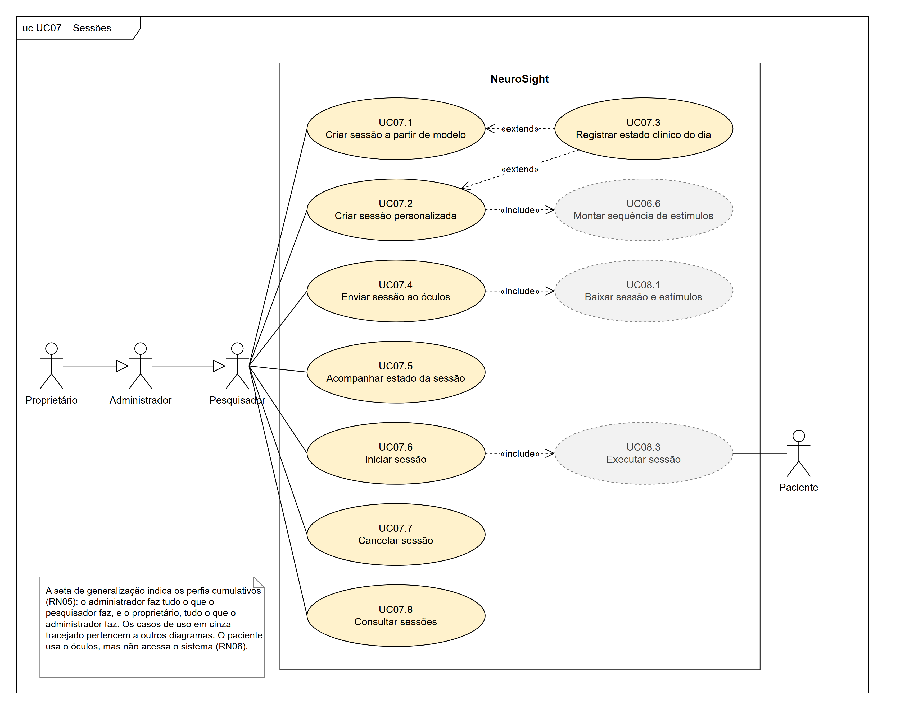

FONTE: Os autores (2026).

A documentação do sistema contempla, também, as histórias de usuário. Cada diagrama de casos de uso foi definido como um épico, que se desdobrou em um conjunto de histórias de usuário no formato \<SENDO\>\<QUERO\>\<PARA\> [49], uma para cada caso de uso, com critérios de aceitação e prioridade. Ao todo, são 60 histórias: 35 essenciais, 19 importantes e 6 desejáveis. Na etapa de desenvolvimento, elas formarão o *backlog* das *sprints*, na ordem de prioridade.

Na etapa de desenvolvimento, as tecnologias descritas a seguir serão empregadas para implementar as funcionalidades definidas na modelagem, conforme a arquitetura apresentada na Seção IV. A escolha seguiu dois critérios: reaproveitar o protótipo da IC e usar uma só linguagem no servidor e no sistema web. O aplicativo do óculos continuará em Unreal Engine, em C++, e passará a ler também as expressões faciais, leitura que ainda depende de uma prova de conceito, discutida na Seção IV. O servidor e o sistema web serão escritos em TypeScript, com NestJS no *backend* e Next.js no *frontend*. Como o Next.js é baseado em React, a mesma biblioteca da plataforma web da IC, o reprodutor com mapa de calor poderá ser reaproveitado. O banco de dados será o PostgreSQL, cujo recurso de *Row-Level Security* reforça o isolamento dos dados de cada grupo de pesquisa. A Tabela 2 detalha e descreve brevemente as tecnologias empregadas.

**TABELA 2** - Tecnologias utilizadas.

| Tecnologia | Utilização |
|---|---|
| Meta Quest Pro | Óculos de realidade virtual com rastreamento ocular e facial [10] |
| Unreal Engine 5.5 | Desenvolvimento do aplicativo do óculos, em C++ [50] |
| OpenXR e Meta XR | Acesso ao rastreamento ocular e facial no Unreal [51], [52] |
| TypeScript | Linguagem do *backend* e do *frontend* [53] |
| NestJS | *Framework* de *backend* [54] |
| Prisma | Acesso ao banco de dados e migrações [55] |
| PostgreSQL | Banco de dados, com isolamento por *Row-Level Security* [56] |
| Next.js | *Framework* de *frontend* [57] |
| FFmpeg | Montagem do vídeo das sessões [58] |
| Docker Compose | Implantação dos serviços no servidor [59] |
| Git e GitHub | Controle de versão e quadro Kanban [60], [45] |

FONTE: Os autores (2026).

[^1]: BRAWERMAN, A. Levantamento de requisitos do NeuroSight. Curitiba, 2026. Informação verbal – Reuniões de orientação.

[^2]: Disponível em: https://github.com/joaozanini/tcc1 (pasta Especificacao). Acesso em: 2 nov. 2026.

## IV. RESULTADOS

Esta seção apresenta o resultado da etapa de modelagem: a arquitetura proposta para o NeuroSight, com os seus componentes, a comunicação entre eles, os dados coletados em cada sessão e os mecanismos de segurança. A apresentação do sistema implementado e das suas funcionalidades será feita na etapa de desenvolvimento (TCC2); os protótipos das telas, que antecipam essa apresentação, fazem parte da documentação completa.

### A. Arquitetura do Sistema

A arquitetura geral do sistema é representada pela Figura 2. Conforme apresentado na Tabela 2, ela se baseia em tecnologias atuais e amplamente utilizadas, como Unreal Engine, NestJS, Next.js e PostgreSQL. O sistema tem três partes: o aplicativo de coleta, executado no Meta Quest Pro; o sistema web, acessado pelo navegador; e o servidor, que reúne a interface de programação de aplicações (API, do inglês *Application Programming Interface*), o banco de dados, os arquivos e o processamento das sessões.

**FIGURA 2** - Arquitetura do NeuroSight.

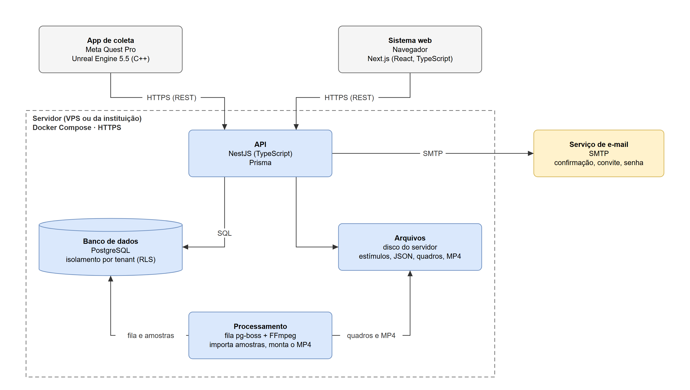

FONTE: Os autores (2026).

Na Figura 2, observa-se o aplicativo de coleta, desenvolvido a partir do protótipo da IC, que baixa a sessão e os estímulos, apresenta os estímulos ao paciente, coleta o olhar e as expressões faciais, captura os quadros da cena e envia os dados ao servidor. O sistema web é a interface dos pesquisadores e dos administradores e não contém regras de negócio. Essas regras ficam na API, que também é responsável pela autenticação, pelo isolamento entre os grupos de pesquisa, pelo registro de auditoria e pela entrega dos arquivos. A API acessa o banco de dados por meio do Prisma e guarda os arquivos (estímulos, dados brutos das sessões, quadros e vídeos) no disco do servidor, atrás de uma interface que permite trocar o disco por um serviço de armazenamento compatível com o Amazon S3 sem alterar o restante do sistema. O processamento é executado em segundo plano, a partir de uma fila de tarefas mantida no próprio banco pela biblioteca pg-boss [61]: ele importa as amostras de cada sessão para o banco e monta o vídeo com o FFmpeg. Por fim, um serviço externo de e-mail envia as mensagens de confirmação de cadastro, de convite e de redefinição de senha.

Os componentes do servidor rodam em contêineres, orquestrados pelo Docker Compose, com um *proxy* reverso responsável pela conexão segura (HTTPS, do inglês *Hypertext Transfer Protocol Secure*). Assim, o sistema pode ser instalado em um servidor virtual privado (VPS, do inglês *Virtual Private Server*) contratado, de preferência hospedado no Brasil, ou em um servidor da própria instituição de pesquisa. A escolha cabe ao protocolo de cada pesquisa, aprovado pelo CEP, já que o art. 13 da LGPD prevê que os dados de estudos em saúde pública sejam tratados dentro do órgão de pesquisa [12]. O banco de dados e os arquivos terão cópia de segurança diária. Não há comunicação direta entre o sistema web e o óculos: as duas partes falam apenas com a API, como detalhado a seguir.

*1) Multi-tenant:* Cada instituição ou grupo de pesquisa cadastrado no NeuroSight corresponde a um *tenant*, e uma única instalação atende a todos. Os dados ficam em um banco único, em que toda tabela com dados de um *tenant* tem a coluna `tenant_id`. O isolamento é feito em duas camadas. Na primeira, a API filtra cada consulta pelo *tenant* do usuário, informado no *token* de acesso. Na segunda, o PostgreSQL aplica em cada tabela uma política de *Row-Level Security* (RLS) [56], que só devolve as linhas do *tenant* definido para a transação em curso. Assim, um filtro esquecido no código não expõe dados de outro grupo. Como a checagem de chaves estrangeiras não passa pelo RLS, as relações entre as tabelas usam chaves compostas com o *tenant*, o que impede, por exemplo, que uma sessão aponte para o paciente de outro grupo. A API acessa o banco com um papel que não pode ignorar o RLS; um segundo papel, que pode, é usado apenas nas operações feitas antes de existir um *tenant* no contexto, como o autocadastro, o *login* e o pareamento dos óculos. Os arquivos também são separados em pastas por *tenant* e só são entregues pela API, depois da checagem de permissão.

*2) Comunicação entre sistema web, servidor e óculos:* O sistema web e o aplicativo do óculos se comunicam apenas com a API, por HTTPS, no estilo REST (*Representational State Transfer*). A API será documentada em OpenAPI [62], que serve de contrato entre o servidor e o aplicativo. A Figura 3 resume o fluxo de uma sessão.

**FIGURA 3** - Fluxo de uma sessão no NeuroSight.

FONTE: Os autores (2026).

Antes do primeiro uso, cada óculos é pareado ao *tenant*. O aplicativo pede ao servidor um código curto, que exibe na tela, e recebe também um segredo. Um administrador digita o código no sistema web e, a partir daí, o segredo passa a valer como *token* de acesso do aparelho, que pode ser revogado a qualquer momento. O mecanismo simplifica o fluxo de autorização de dispositivos do OAuth 2.0 [63] e dispensa digitar senhas no óculos.

Para executar uma sessão, o pesquisador a configura no sistema web e a envia a um óculos pareado. Enquanto aguarda, o aplicativo consulta o servidor a cada segundo, aproximadamente. Essa mesma consulta indica que o aparelho está ligado, entrega a sessão e transmite o comando de início. Ao receber a sessão, o aplicativo baixa os estímulos que ainda não tem, verifica se o rastreamento ocular e o facial estão ativos e avisa o servidor de que está pronto; só então o sistema web libera o botão "Iniciar". Com o óculos já posicionado no paciente, o pesquisador clica em "Iniciar", e o aplicativo começa a sessão na consulta seguinte, em até cerca de 2 segundos. Daí em diante, a execução não depende da rede: a sessão segue até o fim do tempo configurado, sem interrupção, e os dados são gravados no próprio óculos. Ao longo do processo, a sessão passa pelos estados rascunho, enviada ao óculos, baixada, início solicitado, em execução, enviando, processando e concluída, ou falha, que o sistema web exibe ao pesquisador.

Optou-se por não espelhar no sistema web a imagem vista pelo paciente: o pesquisador acompanha o estado da sessão e analisa os dados depois que ela termina. Com isso, a comunicação dispensa conexões permanentes, como as de WebSocket, e o óculos e o computador do pesquisador não precisam estar na mesma rede, bastando acesso à internet. Em contrapartida, o óculos precisa estar conectado no momento do início.

*3) Dados coletados e gravação:* Durante a sessão, o aplicativo registra três tipos de dado, todos marcados pelo mesmo relógio do óculos. O primeiro são os eventos de estímulo, com o instante real em que cada estímulo começou e terminou de ser exibido, que pode diferir do tempo configurado, por exemplo, enquanto um vídeo carrega. O segundo é o olhar, amostrado a cada quadro de renderização, com a validade, a confiança, o ponto observado na cena e a sua posição tanto na imagem gravada quanto no próprio estímulo. O terceiro são as expressões faciais: cerca de 70 expressões baseadas no FACS [7], fornecidas pelo kit de desenvolvimento (SDK, do inglês *Software Development Kit*) da Meta [10], cada uma com intensidade de 0 a 1 e indicação de validade. Esses dados formam um arquivo JSON (*JavaScript Object Notation*), gravado em intervalos curtos para não se perderem caso o aplicativo seja fechado. Como na IC, o aplicativo também captura quadros da cena exibida ao paciente, em JPEG, que servem para montar o vídeo da sessão.

Ao fim da sessão, o aplicativo envia primeiro o JSON e depois os quadros, em lotes. Um lote que falha é reenviado, e um lote repetido não duplica dados. Sem conexão, os dados ficam guardados no óculos, que tenta o envio de novo mais tarde, e só são apagados do aparelho depois que o servidor confirma o recebimento. No servidor, o processamento importa os eventos e as amostras do JSON para tabelas do banco, o que facilita os gráficos e o resumo por estímulo, e monta o vídeo MP4, em H.264, com o FFmpeg. O JSON original é guardado sem alterações, e os dados coletados não podem ser modificados: o pesquisador registra apenas anotações e dados descritivos da sessão. Na IC, cada minuto de gravação, a cerca de 22 quadros por segundo, gerou aproximadamente 88 MB [11]. Com base nessa medição, estima-se que uma sessão de 5 minutos, com quadros de 1024 × 1024 pixels capturados a 15 quadros por segundo, gere cerca de 300 MB, valor que será medido no NeuroSight.

*4) Segurança e auditoria:* Toda comunicação usa HTTPS, e toda chamada à API exige um *token*: um JSON Web Token (JWT) [64], que identifica o usuário, o *tenant* e o perfil, ou o *token* próprio de cada óculos. As senhas são guardadas apenas na forma de *hash*. Os perfis são cumulativos: o administrador pode tudo o que o pesquisador pode, e o proprietário, tudo o que o administrador pode. Os dados de uma sessão só ficam visíveis para quem a criou, para o proprietário, para os administradores e para os usuários que um administrador autorizar. O sistema registra automaticamente quem fez cada ação, quando e em qual registro, abrangendo *login*, criação, edição e exclusão de dados, envio e início de sessões, visualização e exportação dos dados de uma sessão e mudanças de permissão. Os registros de auditoria não podem ser alterados nem excluídos, restrição garantida no próprio banco, pois o papel usado pela API não tem permissão para isso.

Os dados de saúde são dados pessoais sensíveis segundo a LGPD [12], e o sistema foi modelado para guardar apenas o necessário à pesquisa. O paciente é identificado por um código; o nome é opcional e nunca chega ao óculos, que exibe só o código. O aplicativo não captura imagens do rosto do paciente, apenas os valores das expressões, e a gravação mostra somente o que o paciente viu. O consentimento para a participação fica a cargo do protocolo de cada pesquisa, discutido na Seção II, e não é tratado pelo sistema.

*5) Riscos e limitações:* Três pontos da arquitetura ainda dependem de verificação. O primeiro é a leitura das expressões faciais no Unreal Engine. O protótipo da IC lê apenas o olhar, pelo padrão OpenXR, e as opções de rastreamento da Meta, que fornecem as expressões, exigem outra integração do motor, incompatível com a usada no protótipo [11]. Por isso, a primeira tarefa do desenvolvimento será uma prova de conceito que leia o olhar e as expressões ao mesmo tempo e meça a taxa de amostragem obtida com a captura de quadros ativa, que na IC ficou em 22 Hz [11]. Se a prova de conceito falhar, a alternativa é desenvolver o aplicativo em Unity, em que o olhar e as expressões vêm do mesmo SDK. O segundo ponto é o equipamento: o Meta Quest Pro saiu de linha em janeiro de 2025 [65]. O grupo de pesquisa dispõe do aparelho usado na IC, mas a reposição, em caso de defeito, seria difícil. O terceiro é a dependência de internet no momento do início, já que o comando sai do sistema web e chega ao óculos pelo servidor; por isso, a rede do local da coleta precisa ser testada antes dos experimentos.

## REFERÊNCIAS

[1] LAUREYS, S. *et al*. Unresponsive wakefulness syndrome: a new name for the vegetative state or apallic syndrome. *BMC Medicine*, v. 8, art. 68, 2010. DOI: 10.1186/1741-7015-8-68.

[2] GIACINO, J. T. *et al*. The minimally conscious state: definition and diagnostic criteria. *Neurology*, v. 58, n. 3, p. 349-353, 2002. DOI: 10.1212/WNL.58.3.349.

[3] GIACINO, J. T.; KALMAR, K.; WHYTE, J. The JFK Coma Recovery Scale-Revised: measurement characteristics and diagnostic utility. *Archives of Physical Medicine and Rehabilitation*, v. 85, n. 12, p. 2020-2029, 2004. DOI: 10.1016/j.apmr.2004.02.033.

[4] SCHNAKERS, C. *et al*. Diagnostic accuracy of the vegetative and minimally conscious state: clinical consensus versus standardized neurobehavioral assessment. *BMC Neurology*, v. 9, art. 35, 2009. DOI: 10.1186/1471-2377-9-35.

[5] BODIEN, Y. G. *et al*. Cognitive motor dissociation in disorders of consciousness. *New England Journal of Medicine*, v. 391, n. 7, p. 598-608, 2024. DOI: 10.1056/NEJMoa2400645.

[6] TROJANO, L. *et al*. Quantitative assessment of visual behavior in disorders of consciousness. *Journal of Neurology*, v. 259, n. 9, p. 1888-1895, 2012. DOI: 10.1007/s00415-012-6435-4.

[7] EKMAN, P.; FRIESEN, W. V. *Facial Action Coding System: a technique for the measurement of facial movement*. Palo Alto: Consulting Psychologists Press, 1978.

[8] MAGLIACANO, A. *et al*. Can salient stimuli enhance responses in disorders of consciousness? A systematic review. *Current Neurology and Neuroscience Reports*, v. 19, n. 12, art. 98, 2019. DOI: 10.1007/s11910-019-1018-8.

[9] CLAY, V.; KÖNIG, P.; KÖNIG, S. U. Eye tracking in virtual reality. *Journal of Eye Movement Research*, v. 12, n. 1, 2019. DOI: 10.16910/jemr.12.1.3.

[10] META PLATFORMS. *Movement SDK for Unreal*. Meta Horizon OS Developers, 2026. Disponível em: https://developers.meta.com/vr/documentation/unreal/unreal-movement-overview/. Acesso em: 26 out. 2026.

[11] PEDRO, J. V. Z. *Desenvolvimento de um sistema de rastreamento ocular em realidade virtual para análise de atenção visual aplicada ao estudo da recepção comunicacional*. Relatório final de Iniciação Científica (Edital 2025) – Universidade Federal do Paraná, Curitiba, 2026. Orientador: Alessandro Brawerman. Disponível em: https://github.com/joaozanini/QuestPro-EyeTracking. Acesso em: 26 out. 2026.

[12] BRASIL. *Lei nº 13.709, de 14 de agosto de 2018*. Lei Geral de Proteção de Dados Pessoais (LGPD). Brasília, DF: Presidência da República, [2018]. Disponível em: https://www.planalto.gov.br/ccivil_03/_ato2015-2018/2018/lei/l13709compilado.htm. Acesso em: 26 out. 2026.

[13] JOHANSSON, J. *et al*. Eye tracking to support assessment of patients with prolonged disorder of consciousness: a case series. *Journal of Rehabilitation Medicine*, v. 57, art. jrm41324, 2025. DOI: 10.2340/jrm.v57.41324.

[14] ESTRANEO, A. *et al*. Eye-tracking assessment in patients with disorders of consciousness: a systematic review. *Brain Sciences*, v. 16, n. 6, art. 590, 2026. DOI: 10.3390/brainsci16060590.

[15] BAGNATO, S.; BOCCAGNI, C.; BONAVITA, J. Eye movements as indicators of awareness in prolonged disorders of consciousness: a scoping review of behavioral and neural evidence. *Neurological Sciences*, v. 47, n. 3, art. 317, 2026. DOI: 10.1007/s10072-026-08932-6.

[16] PICARD, R. W. *Affective computing*. Cambridge: MIT Press, 1997. DOI: 10.7551/mitpress/1140.001.0001.

[17] HYUN, C. *et al*. Quantitative evaluation of the consciousness level of patients in a vegetative state using virtual reality and an eye-tracking system: a single-case experimental design study. *Neuropsychological Rehabilitation*, v. 32, n. 10, p. 2628-2645, 2022. DOI: 10.1080/09602011.2021.1974496.

[18] META PLATFORMS. *Natural Facial Expressions Privacy Notice*. 5 set. 2025. Disponível em: https://www.meta.com/legal/quest/natural-facial-expressions-privacy-notice/. Acesso em: 26 out. 2026.

[19] BRASIL. Conselho Nacional de Saúde. *Resolução nº 466, de 12 de dezembro de 2012*. Aprova as diretrizes e normas regulamentadoras de pesquisas envolvendo seres humanos. Diário Oficial da União: seção 1, Brasília, DF, p. 59, 13 jun. 2013. Disponível em: https://www.gov.br/conselho-nacional-de-saude/pt-br/atos-normativos/resolucoes/2012/resolucao-no-466.pdf. Acesso em: 26 out. 2026.

[20] META PLATFORMS. *Eye Tracking in Movement SDK for OpenXR*. 2026. Disponível em: https://developers.meta.com/horizon/documentation/native/android/move-eye-tracking/. Acesso em: 26 out. 2026.

[21] META PLATFORMS. *Face Tracking in Movement SDK for OpenXR*. 2026. Disponível em: https://developers.meta.com/horizon/documentation/native/android/move-face-tracking/. Acesso em: 26 out. 2026.

[22] META PLATFORMS. *Developer Data Use Policy*. 2 jul. 2026. Disponível em: https://developers.meta.com/horizon/policy/data-use/. Acesso em: 26 out. 2026.

[23] IMOTIONS. *iMotions Lab Pricing*. Disponível em: https://imotions.com/products/pricing/. Acesso em: 26 out. 2026.

[24] IMOTIONS. *Facial Expression Analysis*: emotion detection software. Disponível em: https://imotions.com/products/imotions-lab/modules/fea-facial-expression-analysis/. Acesso em: 26 out. 2026.

[25] IMOTIONS. *Study Builder*. Disponível em: https://imotions.com/products/imotions-lab/features/study-builder/. Acesso em: 26 out. 2026.

[26] IMOTIONS. *iMotions Product & Feature News*: February 2026. 2026. Disponível em: https://imotions.com/about-us/news/imotions-product-feature-news-february-2026/. Acesso em: 26 out. 2026.

[27] IMOTIONS. *Terms of Service*. Disponível em: https://imotions.com/terms-of-service/. Acesso em: 26 out. 2026.

[28] TOBII. *Tobii Pro Lab*: eye tracking software for behavior research. Disponível em: https://www.tobii.com/products/software/behavior-research-software/tobii-pro-lab. Acesso em: 26 out. 2026.

[29] WORLDVIZ. *What is SightLab VR Pro and how does it work?* 2025. Disponível em: https://www.worldviz.com/post/what-is-sightlab-vr-pro-and-how-does-it-work. Acesso em: 26 out. 2026.

[30] WORLDVIZ. *2026 WorldViz VR budgeting guidelines for scientific VR labs*. 2026. Disponível em: https://www.worldviz.com/post/worldviz-vr-budgeting-guidelines-for-scientific-vr-labs. Acesso em: 26 out. 2026.

[31] WORLDVIZ. *Face Tracking*: SightLab documentation. Disponível em: https://help.worldviz.com/sightlab/face-tracking. Acesso em: 26 out. 2026.

[32] WORLDVIZ. *Media Viewer*: SightLab documentation. Disponível em: https://help.worldviz.com/sightlab/media-viewer/. Acesso em: 26 out. 2026.

[33] COGNITIVE3D. *XR Analytics Platform Pricing*. Disponível em: https://cognitive3d.com/pricing/. Acesso em: 26 out. 2026.

[34] COGNITIVE3D. *Concepts*: Cognitive3D documentation. Disponível em: https://docs.cognitive3d.com/dashboard/concepts/. Acesso em: 26 out. 2026.

[35] COGNITIVE3D. *Supported Hardware*: Cognitive3D documentation. Disponível em: https://docs.cognitive3d.com/hardware/. Acesso em: 2 nov. 2026.

[36] COGNITIVE3D. *Data Processing Addendum*. Disponível em: https://cognitive3d.com/dpa/. Acesso em: 26 out. 2026.

[37] PSYCHOPY. *About PsychoPy*. Disponível em: https://psychopy.org/about/index.html. Acesso em: 26 out. 2026.

[38] PSYCHOPY. *Defining the onset/duration of components*. Disponível em: https://psychopy.org/builder/startStop.html. Acesso em: 26 out. 2026.

[39] PSYCHOPY. *Communicating with an eyetracker*. Disponível em: https://psychopy.org/hardware/eyeTracking.html. Acesso em: 26 out. 2026.

[40] PSYCHOPY. *psychopy.visual.Rift*. Disponível em: https://psychopy.org/api/visual/rift.html. Acesso em: 26 out. 2026.

[41] PSYCHOPY. *Advanced features for online experiments*. Disponível em: https://psychopy.org/online/advanced-features-online.html. Acesso em: 26 out. 2026.

[42] PSYCHOPY. *Create a Pavlovia project*. Disponível em: https://psychopy.org/online/create-pavlovia-project.html. Acesso em: 2 nov. 2026.

[43] SCHWABER, K.; SUTHERLAND, J. *The Scrum Guide*. [S.l.]: Scrum.org, 2020. E-book. Disponível em: https://scrumguides.org/docs/scrumguide/v2020/2020-Scrum-Guide-US.pdf. Acesso em: 26 out. 2026.

[44] ANDERSON, D. J. *Kanban: successful evolutionary change for your technology business*. Sequim: Blue Hole Press, 2010.

[45] GITHUB. *Planning and tracking with Projects*. 2026. Disponível em: https://docs.github.com/en/issues/planning-and-tracking-with-projects. Acesso em: 26 out. 2026.

[46] OBJECT MANAGEMENT GROUP. *OMG Unified Modeling Language (OMG UML)*: version 2.5.1. Needham: OMG, 2017. Disponível em: https://www.omg.org/spec/UML/2.5.1/. Acesso em: 26 out. 2026.

[47] OBJECT MANAGEMENT GROUP. *Business Process Model and Notation (BPMN)*: version 2.0.2. Needham: OMG, 2013. Disponível em: https://www.omg.org/spec/BPMN/2.0.2/. Acesso em: 26 out. 2026.

[48] JGRAPH. *draw.io*. 2026. Disponível em: https://www.drawio.com/. Acesso em: 26 out. 2026.

[49] COHN, M. *User stories applied: for agile software development*. Boston: Addison-Wesley, 2004.

[50] EPIC GAMES. *Unreal Engine 5.5 documentation*. 2025. Disponível em: https://dev.epicgames.com/documentation/en-us/unreal-engine/unreal-engine-5-5-documentation. Acesso em: 26 out. 2026.

[51] KHRONOS GROUP. *OpenXR registry*. 2026. Disponível em: https://registry.khronos.org/OpenXR/. Acesso em: 26 out. 2026.

[52] META PLATFORMS. *Unreal integration: settings and tools*. Meta Horizon OS Developers, 2026. Disponível em: https://developers.meta.com/vr/documentation/unreal/. Acesso em: 26 out. 2026.

[53] MICROSOFT. *TypeScript documentation*. 2026. Disponível em: https://www.typescriptlang.org/docs/. Acesso em: 26 out. 2026.

[54] NESTJS. *NestJS documentation*. 2026. Disponível em: https://docs.nestjs.com/. Acesso em: 26 out. 2026.

[55] PRISMA DATA. *Prisma documentation*. 2026. Disponível em: https://www.prisma.io/docs. Acesso em: 26 out. 2026.

[56] POSTGRESQL GLOBAL DEVELOPMENT GROUP. *PostgreSQL documentation: row security policies*. 2026. Disponível em: https://www.postgresql.org/docs/current/ddl-rowsecurity.html. Acesso em: 26 out. 2026.

[57] VERCEL. *Next.js documentation*. 2026. Disponível em: https://nextjs.org/docs. Acesso em: 26 out. 2026.

[58] FFMPEG. *FFmpeg documentation*. 2026. Disponível em: https://ffmpeg.org/documentation.html. Acesso em: 26 out. 2026.

[59] DOCKER. *Docker Compose documentation*. 2026. Disponível em: https://docs.docker.com/compose/. Acesso em: 26 out. 2026.

[60] GIT. *Git SCM*. 2026. Disponível em: https://git-scm.com/. Acesso em: 26 out. 2026.

[61] PG-BOSS. *pg-boss: queueing jobs in Postgres from Node.js*. GitHub, 2026. Disponível em: https://github.com/timgit/pg-boss. Acesso em: 26 out. 2026.

[62] OPENAPI INITIATIVE. *OpenAPI Specification*: version 3.2.1. 2026. Disponível em: https://spec.openapis.org/oas/v3.2.1.html. Acesso em: 26 out. 2026.

[63] DENNISS, W. *et al*. *OAuth 2.0 Device Authorization Grant*. RFC 8628. [S.l.]: IETF, 2019. Disponível em: https://www.rfc-editor.org/rfc/rfc8628. Acesso em: 26 out. 2026.

[64] JONES, M.; BRADLEY, J.; SAKIMURA, N. *JSON Web Token (JWT)*. RFC 7519. [S.l.]: IETF, 2015. Disponível em: https://www.rfc-editor.org/rfc/rfc7519. Acesso em: 26 out. 2026.

[65] HAYDEN, S. Meta officially discontinues Quest Pro, its first (and most expensive) mixed reality headset. *Road to VR*, 6 jan. 2025. Disponível em: https://roadtovr.com/meta-discontinues-quest-pro/. Acesso em: 26 out. 2026.

## APÊNDICE A – DIAGRAMAS DE CASOS DE USO

Este apêndice apresenta os doze diagramas de casos de uso do NeuroSight: um com os atores e a hierarquia dos perfis e um para cada grupo de requisitos, totalizando 60 casos de uso. A Figura 1, no corpo do artigo, é o diagrama das sessões (UC07) redesenhado com a hierarquia dos perfis e o paciente. Nos diagramas, os casos de uso com borda tracejada e fundo cinza pertencem a outro diagrama e aparecem apenas para mostrar as relações de inclusão e extensão. Nas tabelas, o ator "—" marca os casos de uso incluídos ou estendidos: quem interage neles é o ator do caso base, e a coluna Relações registra, nos casos estendidos, a condição e o ponto de extensão.

**TABELA 3** - Atores do NeuroSight.

| Ator | Descrição | Herda de |
|---|---|---|
| Usuário | Abstrato: qualquer pessoa com conta no tenant | — |
| Pesquisador | Cadastra pacientes, estímulos, modelos e sessões; envia, inicia e analisa as sessões | Usuário |
| Administrador | Gerencia usuários, óculos, visibilidade das sessões e auditoria | Pesquisador |
| Proprietário | Criou o tenant; define quem é administrador | Administrador |
| Visitante | Pessoa sem conta; conhece o sistema e cria um tenant | — |
| Paciente | Não é usuário (RN06). Ator secundário: usa o óculos durante a execução da sessão (UC08.3) | — |

FONTE: Os autores (2026).

**TABELA 4** - Resumo dos diagramas de casos de uso e dos épicos.

| Diagrama / épico | Grupo de requisitos | Atores | Casos de uso | Requisitos |
|---|---|---|---|---|
| UC01 / E01 – Acesso e conta | 2.1 | Visitante, Usuário, Proprietário | 8 | RF01–RF08 |
| UC02 / E02 – Usuários e permissões | 2.2 | Administrador, Proprietário | 6 | RF09–RF12 |
| UC03 / E03 – Óculos | 2.3 | Administrador | 4 | RF13–RF16 |
| UC04 / E04 – Pacientes | 2.4 | Pesquisador, Administrador | 5 | RF17–RF21 |
| UC05 / E05 – Estímulos | 2.5 | Pesquisador | 5 | RF22–RF26 |
| UC06 / E06 – Modelos de sessão | 2.6 | Pesquisador | 7 | RF27–RF29 |
| UC07 / E07 – Sessões | 2.7 | Pesquisador | 8 | RF30–RF37 |
| UC08 / E08 – Execução no óculos | 2.8 | Pesquisador, Paciente | 6 | RF38–RF47 |
| UC09 / E09 – Envio e processamento | 2.9 | Pesquisador | 2 | RF48–RF51 |
| UC10 / E10 – Consulta e análise | 2.10 | Pesquisador | 7 | RF52–RF58 |
| UC11 / E11 – Auditoria | 2.11 | Administrador | 2 | RF59–RF60 |

FONTE: Os autores (2026).

### UC00 – Atores e perfis

**FIGURA 4** - Diagrama de casos de uso UC00 – Atores e perfis.

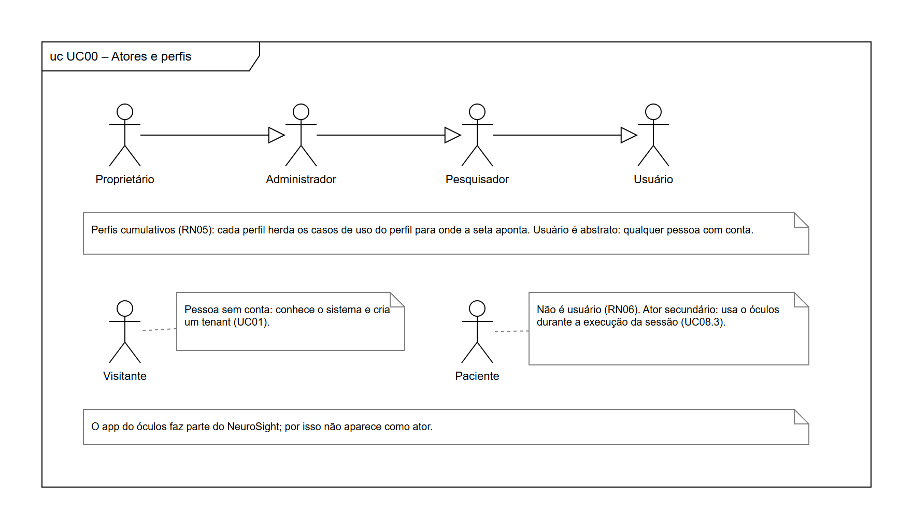

FONTE: Os autores (2026).

### UC01 – Acesso e conta

**FIGURA 5** - Diagrama de casos de uso UC01 – Acesso e conta.

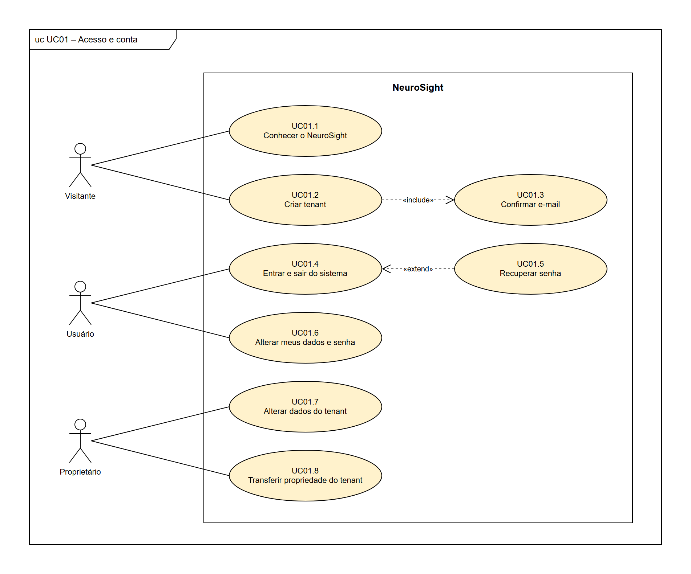

FONTE: Os autores (2026).

**TABELA 5** - Casos de uso do diagrama UC01 – Acesso e conta.

| Caso de uso | Ator | Relações | Requisitos |
|---|---|---|---|
| UC01.1 Conhecer o NeuroSight | Visitante | — | RF01 |
| UC01.2 Criar tenant | Visitante | inclui UC01.3 | RF02 |
| UC01.3 Confirmar e-mail | — | incluído por UC01.2 | RF03 |
| UC01.4 Entrar e sair do sistema | Usuário | estendido por UC01.5 | RF04 |
| UC01.5 Recuperar senha | — | estende UC01.4 (condição: o usuário esqueceu a senha; ponto de extensão: tela de entrada) | RF05 |
| UC01.6 Alterar meus dados e senha | Usuário | — | RF06 |
| UC01.7 Alterar dados do tenant | Proprietário | — | RF07 |
| UC01.8 Transferir propriedade do tenant | Proprietário | — | RF08 |

FONTE: Os autores (2026).

### UC02 – Usuários e permissões

**FIGURA 6** - Diagrama de casos de uso UC02 – Usuários e permissões.

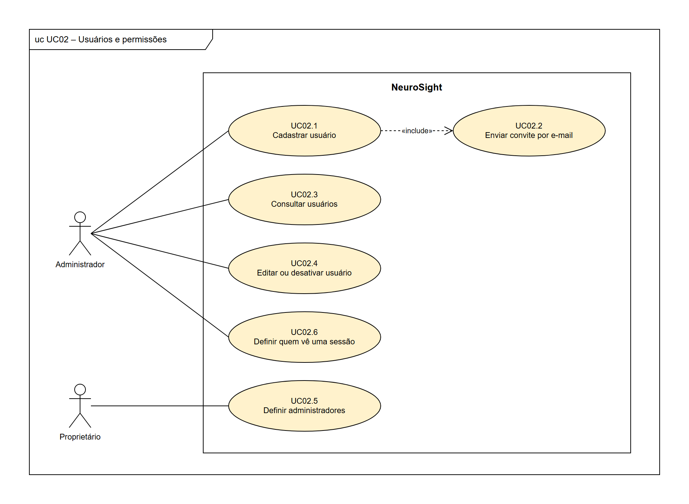

FONTE: Os autores (2026).

**TABELA 6** - Casos de uso do diagrama UC02 – Usuários e permissões.

| Caso de uso | Ator | Relações | Requisitos |
|---|---|---|---|
| UC02.1 Cadastrar usuário | Administrador | inclui UC02.2 | RF09 |
| UC02.2 Enviar convite por e-mail | — | incluído por UC02.1 | RF09 |
| UC02.3 Consultar usuários | Administrador | — | RF10 |
| UC02.4 Editar ou desativar usuário | Administrador | — | RF10 |
| UC02.5 Definir administradores | Proprietário | — | RF11 |
| UC02.6 Definir quem vê uma sessão | Administrador | — | RF12 |

FONTE: Os autores (2026).

### UC03 – Óculos

**FIGURA 7** - Diagrama de casos de uso UC03 – Óculos.

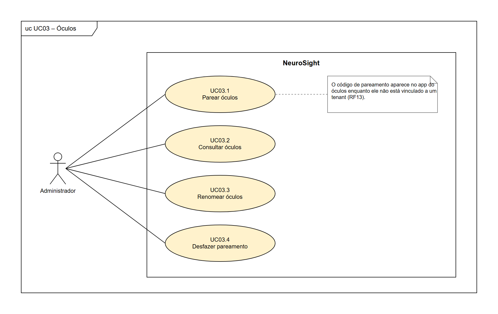

FONTE: Os autores (2026).

**TABELA 7** - Casos de uso do diagrama UC03 – Óculos.

| Caso de uso | Ator | Relações | Requisitos |
|---|---|---|---|
| UC03.1 Parear óculos | Administrador | — | RF13, RF14 |
| UC03.2 Consultar óculos | Administrador | — | RF15 |
| UC03.3 Renomear óculos | Administrador | — | RF16 |
| UC03.4 Desfazer pareamento | Administrador | — | RF16 |

FONTE: Os autores (2026).

### UC04 – Pacientes

**FIGURA 8** - Diagrama de casos de uso UC04 – Pacientes.

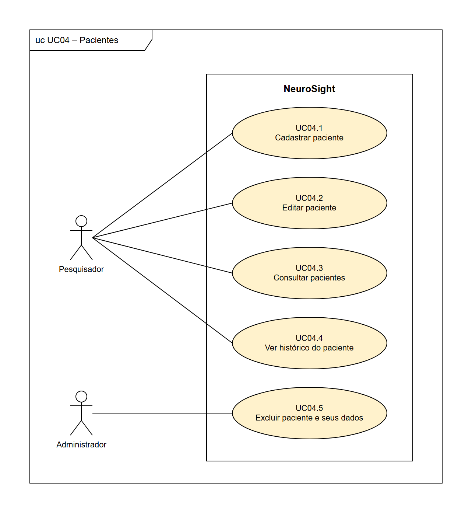

FONTE: Os autores (2026).

**TABELA 8** - Casos de uso do diagrama UC04 – Pacientes.

| Caso de uso | Ator | Relações | Requisitos |
|---|---|---|---|
| UC04.1 Cadastrar paciente | Pesquisador | — | RF17 |
| UC04.2 Editar paciente | Pesquisador | — | RF18 |
| UC04.3 Consultar pacientes | Pesquisador | — | RF19 |
| UC04.4 Ver histórico do paciente | Pesquisador | — | RF20 |
| UC04.5 Excluir paciente e seus dados | Administrador | — | RF21 |

FONTE: Os autores (2026).

### UC05 – Estímulos

**FIGURA 9** - Diagrama de casos de uso UC05 – Estímulos.

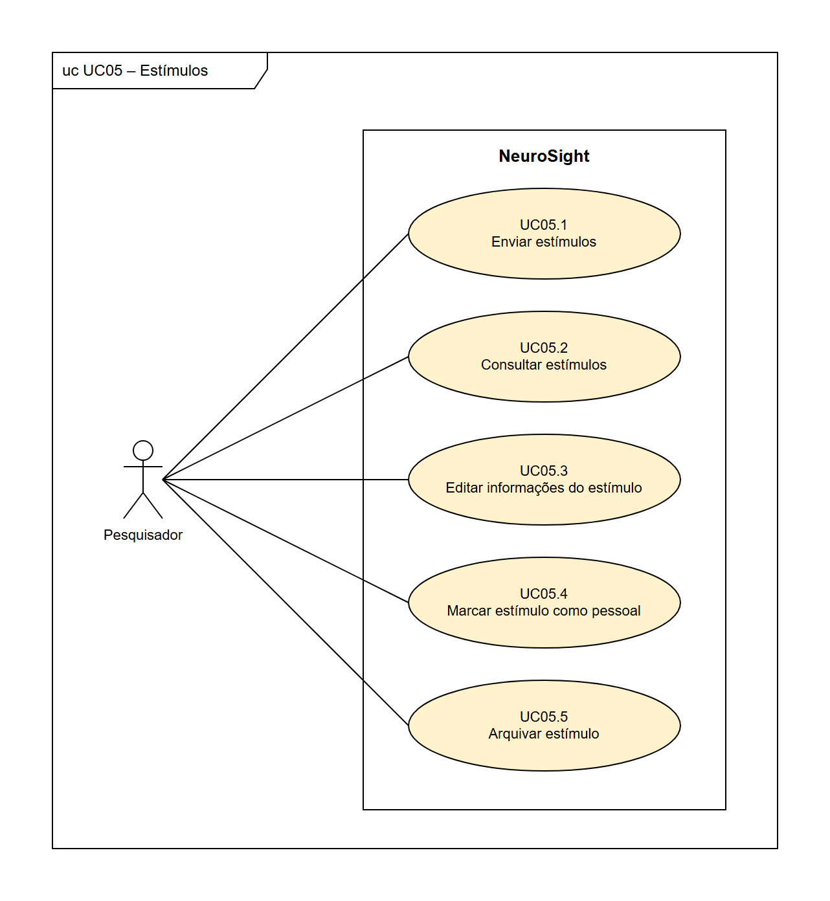

FONTE: Os autores (2026).

**TABELA 9** - Casos de uso do diagrama UC05 – Estímulos.

| Caso de uso | Ator | Relações | Requisitos |
|---|---|---|---|
| UC05.1 Enviar estímulos | Pesquisador | — | RF22 |
| UC05.2 Consultar estímulos | Pesquisador | — | RF23 |
| UC05.3 Editar informações do estímulo | Pesquisador | — | RF24 |
| UC05.4 Marcar estímulo como pessoal | Pesquisador | — | RF25 |
| UC05.5 Arquivar estímulo | Pesquisador | — | RF26 |

FONTE: Os autores (2026).

### UC06 – Modelos de sessão

**FIGURA 10** - Diagrama de casos de uso UC06 – Modelos de sessão.

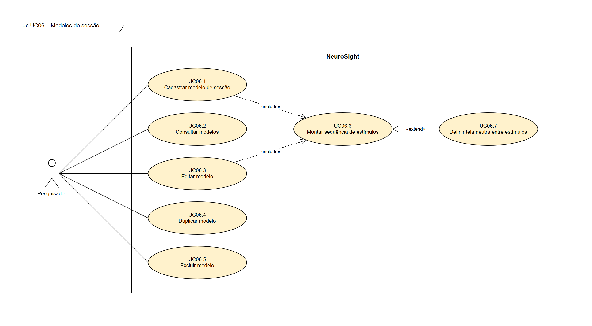

FONTE: Os autores (2026).

**TABELA 10** - Casos de uso do diagrama UC06 – Modelos de sessão.

| Caso de uso | Ator | Relações | Requisitos |
|---|---|---|---|
| UC06.1 Cadastrar modelo de sessão | Pesquisador | inclui UC06.6 | RF27 |
| UC06.2 Consultar modelos | Pesquisador | — | RF28 |
| UC06.3 Editar modelo | Pesquisador | inclui UC06.6 | RF28 |
| UC06.4 Duplicar modelo | Pesquisador | — | RF28 |
| UC06.5 Excluir modelo | Pesquisador | — | RF28 |
| UC06.6 Montar sequência de estímulos | — | incluído por UC06.1, UC06.3 e UC07.2; estendido por UC06.7 | RF27, RF31 |
| UC06.7 Definir tela neutra entre estímulos | — | estende UC06.6 (condição: o pesquisador opta por inserir uma tela neutra; ponto de extensão: montagem da sequência) | RF29 |

FONTE: Os autores (2026).

### UC07 – Sessões

**FIGURA 11** - Diagrama de casos de uso UC07 – Sessões.

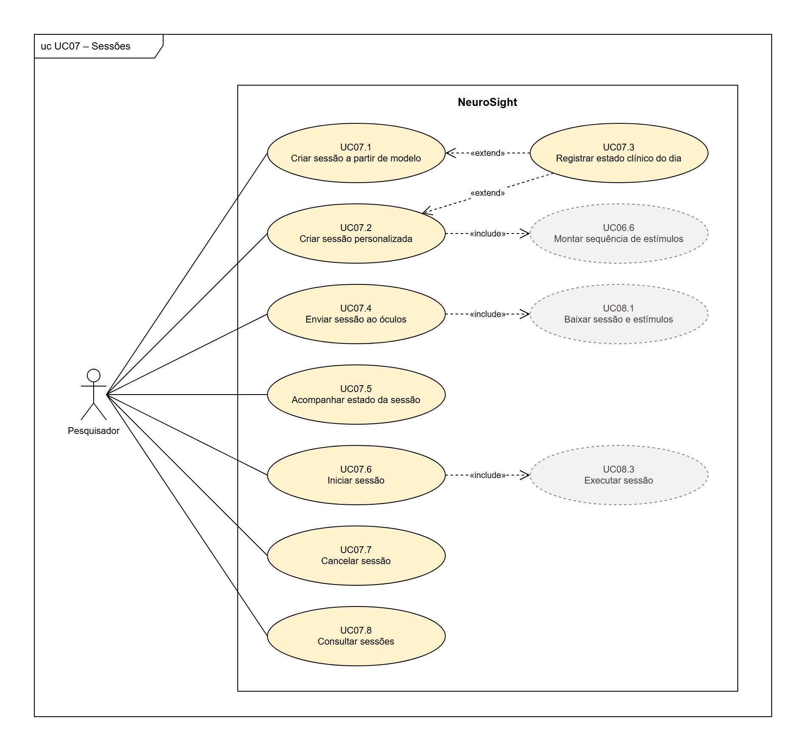

FONTE: Os autores (2026).

**TABELA 11** - Casos de uso do diagrama UC07 – Sessões.

| Caso de uso | Ator | Relações | Requisitos |
|---|---|---|---|
| UC07.1 Criar sessão a partir de modelo | Pesquisador | estendido por UC07.3 | RF30 |
| UC07.2 Criar sessão personalizada | Pesquisador | inclui UC06.6; estendido por UC07.3 | RF31 |
| UC07.3 Registrar estado clínico do dia | — | estende UC07.1 e UC07.2 (condição: o pesquisador opta por registrar o estado clínico do dia, que é opcional; ponto de extensão: antes de salvar a sessão) | RF32 |
| UC07.4 Enviar sessão ao óculos | Pesquisador | inclui UC08.1 | RF33 |
| UC07.5 Acompanhar estado da sessão | Pesquisador | — | RF34 |
| UC07.6 Iniciar sessão | Pesquisador | inclui UC08.3 | RF35 |
| UC07.7 Cancelar sessão | Pesquisador | — | RF36 |
| UC07.8 Consultar sessões | Pesquisador | — | RF37 |

FONTE: Os autores (2026).

### UC08 – Execução no óculos

**FIGURA 12** - Diagrama de casos de uso UC08 – Execução no óculos.

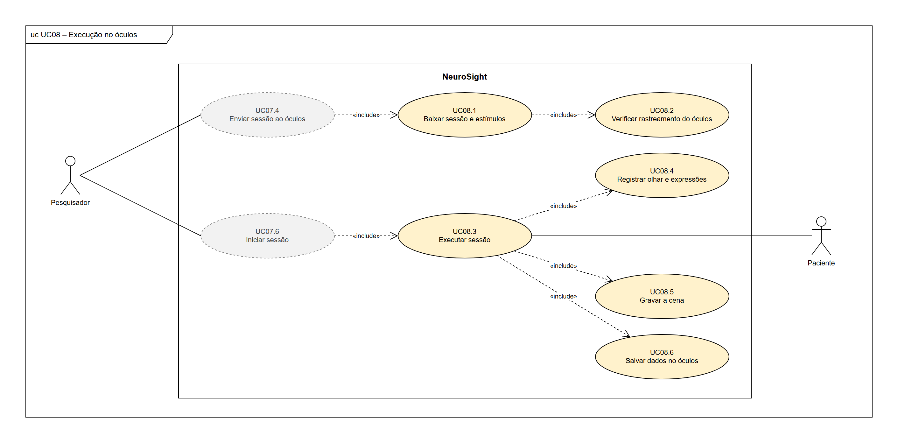

FONTE: Os autores (2026).

**TABELA 12** - Casos de uso do diagrama UC08 – Execução no óculos.

| Caso de uso | Ator | Relações | Requisitos |
|---|---|---|---|
| UC08.1 Baixar sessão e estímulos | — | incluído por UC07.4; inclui UC08.2 | RF38, RF40 |
| UC08.2 Verificar rastreamento do óculos | — | incluído por UC08.1 | RF39 |
| UC08.3 Executar sessão | Paciente (secundário) | incluído por UC07.6; inclui UC08.4, UC08.5, UC08.6 e UC09.1 | RF41, RF42 |
| UC08.4 Registrar olhar e expressões | — | incluído por UC08.3 | RF43, RF44, RF45 |
| UC08.5 Gravar a cena | — | incluído por UC08.3 | RF46 |
| UC08.6 Salvar dados no óculos | — | incluído por UC08.3 | RF47 |

FONTE: Os autores (2026).

### UC09 – Envio e processamento

**FIGURA 13** - Diagrama de casos de uso UC09 – Envio e processamento.

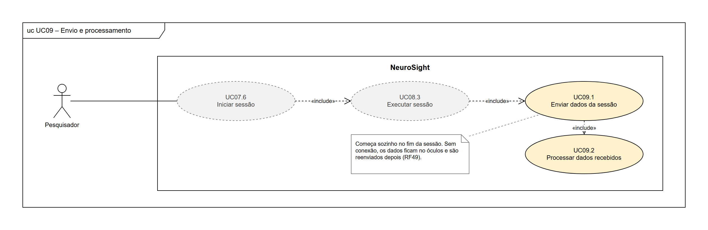

FONTE: Os autores (2026).

**TABELA 13** - Casos de uso do diagrama UC09 – Envio e processamento.

| Caso de uso | Ator | Relações | Requisitos |
|---|---|---|---|
| UC09.1 Enviar dados da sessão | — | incluído por UC08.3; inclui UC09.2 | RF48, RF49 |
| UC09.2 Processar dados recebidos | — | incluído por UC09.1 | RF50, RF51 |

FONTE: Os autores (2026).

### UC10 – Consulta e análise

**FIGURA 14** - Diagrama de casos de uso UC10 – Consulta e análise.

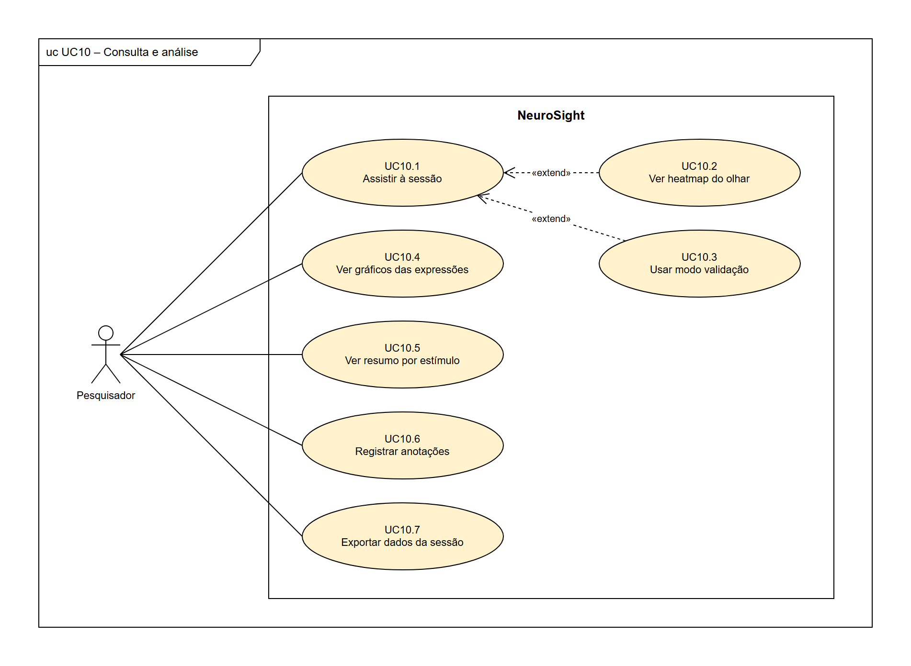

FONTE: Os autores (2026).

**TABELA 14** - Casos de uso do diagrama UC10 – Consulta e análise.

| Caso de uso | Ator | Relações | Requisitos |
|---|---|---|---|
| UC10.1 Assistir à sessão | Pesquisador | estendido por UC10.2 e UC10.3 | RF52 |
| UC10.2 Ver heatmap do olhar | — | estende UC10.1 (condição: o pesquisador ativa o heatmap; ponto de extensão: reprodução do vídeo) | RF53 |
| UC10.3 Usar modo validação | — | estende UC10.1 (condição: o pesquisador ativa o modo validação; ponto de extensão: reprodução do vídeo) | RF54 |
| UC10.4 Ver gráficos das expressões | Pesquisador | — | RF55 |
| UC10.5 Ver resumo por estímulo | Pesquisador | — | RF56 |
| UC10.6 Registrar anotações | Pesquisador | — | RF57 |
| UC10.7 Exportar dados da sessão | Pesquisador | — | RF58 |

FONTE: Os autores (2026).

### UC11 – Auditoria

**FIGURA 15** - Diagrama de casos de uso UC11 – Auditoria.

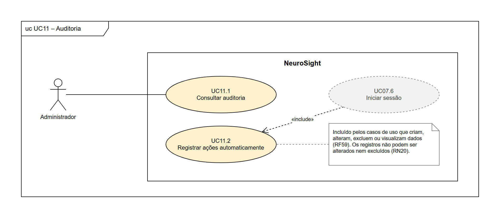

FONTE: Os autores (2026).

**TABELA 15** - Casos de uso do diagrama UC11 – Auditoria.

| Caso de uso | Ator | Relações | Requisitos |
|---|---|---|---|
| UC11.1 Consultar auditoria | Administrador | — | RF60 |
| UC11.2 Registrar ações automaticamente | — | incluído pelos casos de uso que criam, alteram, excluem ou visualizam dados (no diagrama, UC07.6 aparece como exemplo) | RF59 |

FONTE: Os autores (2026).

## APÊNDICE B – HISTÓRIAS DE USUÁRIO

Cada diagrama de casos de uso corresponde a um épico, e cada caso de uso tem uma história de usuário com o mesmo número (UC07.6 e HU07.6, por exemplo), no formato "sendo, quero, para", com critérios de aceitação. A prioridade de cada história é a maior entre as dos requisitos ligados a ela: são 35 histórias essenciais, 19 importantes e 6 desejáveis. As histórias dos casos de uso incluídos ou estendidos são escritas do ponto de vista do ator do caso base.

### E01 – Acesso e conta

#### HU01.1 – Conhecer o NeuroSight
**Sendo** visitante, **quero** conhecer o NeuroSight numa página de apresentação, **para** decidir se crio um tenant para o meu grupo.
*RF01 · Importante*
- A página explica o que o sistema faz e o que não faz (não faz diagnóstico).
- A página dá acesso ao autocadastro e ao login.

#### HU01.2 – Criar tenant
**Sendo** visitante, **quero** criar um tenant para a minha instituição ou grupo, **para** usar o sistema sem precisar de uma instalação própria.
*RF02 · Essencial*
- Informo o nome da instituição ou do grupo, meu nome, e-mail e senha.
- Ao concluir, sou o proprietário do tenant (RN03).
- O tenant começa vazio e isolado dos demais (RN01).

#### HU01.3 – Confirmar e-mail
**Sendo** visitante que criou um tenant, **quero** confirmar meu e-mail, **para** garantir que a conta é minha.
*RF03 · Importante*
- Recebo um link de confirmação, que expira depois de um prazo.
- Sem confirmar, não consigo entrar.

#### HU01.4 – Entrar e sair do sistema
**Sendo** usuário, **quero** entrar com e-mail e senha e sair quando terminar, **para** acessar os dados do meu tenant com segurança.
*RF04 · Essencial*
- Com credenciais erradas, a mensagem não diz se o erro está no e-mail ou na senha.
- Depois de entrar, vejo apenas dados do meu tenant (RN01).
- Cada entrada fica registrada na auditoria (RF59).

#### HU01.5 – Recuperar senha
**Sendo** usuário, **quero** recuperar minha senha por e-mail, **para** voltar a acessar o sistema se eu a esquecer.
*RF05 · Importante*
- Recebo um link de redefinição de uso único, com prazo.
- A mensagem exibida não revela se o e-mail tem conta.

#### HU01.6 – Alterar meus dados e senha
**Sendo** usuário, **quero** alterar meus dados e minha senha, **para** manter minha conta atualizada.
*RF06 · Desejável*
- Para trocar a senha, informo a senha atual.

#### HU01.7 – Alterar dados do tenant
**Sendo** proprietário, **quero** alterar os dados do tenant, **para** corrigir o nome da instituição ou do grupo.
*RF07 · Desejável*
- Só o proprietário vê essa opção.

#### HU01.8 – Transferir propriedade do tenant
**Sendo** proprietário, **quero** transferir a propriedade do tenant para um administrador, **para** que o grupo continue gerido se eu sair.
*RF08 · Desejável*
- Só um administrador do mesmo tenant pode receber a propriedade.
- Depois da transferência, passo a ser administrador, e o tenant continua com um único proprietário (RN03).

### E02 – Usuários e permissões

#### HU02.1 – Cadastrar usuário
**Sendo** administrador, **quero** cadastrar pessoas da equipe com nome, e-mail e perfil, **para** que elas usem o sistema.
*RF09 · Essencial*
- O e-mail não pode estar em uso por outro usuário (RN02).
- Só o proprietário pode cadastrar alguém como administrador (RN04).
- O cadastro fica registrado na auditoria.

#### HU02.2 – Enviar convite por e-mail
**Sendo** pessoa cadastrada por um administrador, **quero** receber um convite por e-mail para definir minha senha, **para** não depender de uma senha criada por outra pessoa.
*RF09 · Essencial*
- O link do convite é de uso único e expira.

#### HU02.3 – Consultar usuários
**Sendo** administrador, **quero** ver a lista de usuários do tenant, com perfil e situação, **para** saber quem tem acesso.
*RF10 · Essencial*
- A lista mostra nome, e-mail, perfil e se o usuário está ativo.

#### HU02.4 – Editar ou desativar usuário
**Sendo** administrador, **quero** editar ou desativar um usuário, **para** manter os acessos corretos quando alguém muda de função ou sai do grupo.
*RF10 · Essencial*
- Um usuário desativado não consegue entrar, mas o histórico dele é mantido.
- O proprietário não pode ser desativado.

#### HU02.5 – Definir administradores
**Sendo** proprietário, **quero** conceder e retirar o perfil de administrador, **para** decidir quem gerencia o tenant.
*RF11 · Essencial*
- Só o proprietário faz isso (RN04).
- A mudança fica registrada na auditoria.

#### HU02.6 – Definir quem vê uma sessão
**Sendo** administrador, **quero** definir quais pesquisadores podem ver cada sessão, **para** restringir o acesso a dados de saúde.
*RF12 · Essencial*
- Por padrão, veem a sessão quem a criou, os administradores e o proprietário (RN18).
- Liberar e retirar o acesso fica registrado na auditoria.

### E03 – Óculos

#### HU03.1 – Parear óculos
**Sendo** administrador, **quero** parear um óculos ao tenant digitando o código que aparece nele, **para** que o aparelho possa receber as sessões do grupo.
*RF13, RF14 · Essencial*
- O app mostra um código enquanto o óculos não está pareado (RF13); o código expira em poucos minutos.
- Ao parear, dou um nome ao aparelho, e ele recebe um acesso próprio (RNF04).

#### HU03.2 – Consultar óculos
**Sendo** administrador, **quero** ver os óculos do tenant com situação e último contato, **para** saber quais estão prontos para uso.
*RF15 · Importante*
- "Online" significa contato com o servidor nos últimos segundos.
- A lista mostra a sessão atual de cada óculos, se houver.

#### HU03.3 – Renomear óculos
**Sendo** administrador, **quero** renomear um óculos, **para** identificá-lo com facilidade (por exemplo, "Quest do laboratório 2").
*RF16 · Importante*
- O nome é único no tenant.

#### HU03.4 – Desfazer pareamento
**Sendo** administrador, **quero** desfazer o pareamento de um óculos, **para** cortar o acesso de um aparelho perdido ou que saiu do grupo.
*RF16 · Importante*
- O acesso do aparelho é revogado na hora, e o app volta a mostrar um código de pareamento.
- Sessões enviadas a ele e ainda não iniciadas voltam a ser rascunho.

### E04 – Pacientes

#### HU04.1 – Cadastrar paciente
**Sendo** pesquisador, **quero** cadastrar um paciente com código e dados clínicos mínimos, **para** vincular a ele as sessões.
*RF17 · Essencial*
- O código é obrigatório e único no tenant; o nome é opcional.
- Os demais campos são os do RF17: ano de nascimento, sexo, etiologia, data da lesão, diagnóstico atual, escore CRS-R e observações.

#### HU04.2 – Editar paciente
**Sendo** pesquisador, **quero** editar os dados de um paciente, **para** mantê-los atualizados (por exemplo, um novo diagnóstico ou escore CRS-R).
*RF18 · Essencial*
- A alteração fica registrada na auditoria.

#### HU04.3 – Consultar pacientes
**Sendo** pesquisador, **quero** listar os pacientes e buscá-los pelo código, **para** encontrar rapidamente quem vai participar da sessão.
*RF19 · Essencial*
- A busca encontra o paciente por parte do código.

#### HU04.4 – Ver histórico do paciente
**Sendo** pesquisador, **quero** ver o histórico de sessões de um paciente, **para** acompanhar os experimentos feitos com ele.
*RF20 · Essencial*
- Aparecem só as sessões que tenho permissão de ver (RN18).

#### HU04.5 – Excluir paciente e seus dados
**Sendo** administrador, **quero** excluir um paciente e os dados das suas sessões, **para** atender a um pedido de exclusão de dados.
*RF21 · Importante*
- O sistema pede confirmação antes de excluir.
- A exclusão fica registrada na auditoria, sem guardar os dados apagados.

### E05 – Estímulos

#### HU05.1 – Enviar estímulos
**Sendo** pesquisador, **quero** enviar imagens e vídeos para o acervo do tenant, **para** usá-los como estímulos nas sessões.
*RF22 · Essencial*
- São aceitos JPEG, PNG e MP4 (H.264) até o tamanho máximo configurado (RNF19).
- Arquivos em outro formato são recusados com uma mensagem clara.

#### HU05.2 – Consultar estímulos
**Sendo** pesquisador, **quero** listar, buscar e pré-visualizar os estímulos, **para** escolher o que vou usar.
*RF23 · Essencial*
- A busca considera nome e etiquetas.
- Imagens e vídeos podem ser vistos sem baixar o arquivo.

#### HU05.3 – Editar informações do estímulo
**Sendo** pesquisador, **quero** editar nome, descrição e etiquetas de um estímulo, **para** organizar o acervo.
*RF24 · Importante*
- O arquivo em si não pode ser trocado; para isso, envia-se um novo estímulo.

#### HU05.4 – Marcar estímulo como pessoal
**Sendo** pesquisador, **quero** marcar um estímulo como pessoal de um paciente (por exemplo, a foto de um familiar), **para** usá-lo só nas sessões dele.
*RF25 · Importante*
- O estímulo pessoal só aparece na montagem de sessões desse paciente (RN12).

#### HU05.5 – Arquivar estímulo
**Sendo** pesquisador, **quero** arquivar um estímulo, **para** tirá-lo das novas sessões sem perder o histórico.
*RF26 · Importante*
- Um estímulo já usado não pode ser excluído, só arquivado (RN13).
- Sessões antigas continuam mostrando o estímulo arquivado.

### E06 – Modelos de sessão

#### HU06.1 – Cadastrar modelo de sessão
**Sendo** pesquisador, **quero** cadastrar um modelo de sessão, **para** aplicar o mesmo protocolo a vários pacientes.
*RF27 · Essencial*
- O modelo tem nome e pelo menos um estímulo.

#### HU06.2 – Consultar modelos
**Sendo** pesquisador, **quero** consultar os modelos do tenant, **para** escolher qual aplicar.
*RF28 · Importante*
- A lista mostra o número de estímulos e a duração total de cada modelo.

#### HU06.3 – Editar modelo
**Sendo** pesquisador, **quero** editar um modelo, **para** ajustar o protocolo.
*RF28 · Importante*
- As sessões já criadas a partir dele não mudam (RN11).

#### HU06.4 – Duplicar modelo
**Sendo** pesquisador, **quero** duplicar um modelo, **para** criar uma variação sem montar tudo de novo.
*RF28 · Importante*
- A cópia recebe um nome novo e pode ser editada à parte.

#### HU06.5 – Excluir modelo
**Sendo** pesquisador, **quero** excluir um modelo, **para** manter só os protocolos em uso.
*RF28 · Importante*
- As sessões já criadas a partir dele não são afetadas (RN11).

#### HU06.6 – Montar sequência de estímulos
**Sendo** pesquisador, **quero** montar a sequência de estímulos, escolhendo a ordem e o tempo de exibição de cada um, **para** definir exatamente o que o paciente vai ver.
*RF27, RF31 · Essencial*
- Só entram estímulos do acervo que não estejam arquivados (RN09).
- Todo tempo de exibição é maior que zero (RN10), e a duração total aparece na tela.
- Um estímulo pessoal só entra em sessões do paciente dele (RN12).

#### HU06.7 – Definir tela neutra entre estímulos
**Sendo** pesquisador, **quero** inserir uma tela neutra entre os estímulos, com duração configurável, **para** ter uma linha de base das expressões.
*RF29 · Desejável*
- A duração da tela neutra entra na duração total da sessão.

### E07 – Sessões

#### HU07.1 – Criar sessão a partir de modelo
**Sendo** pesquisador, **quero** criar uma sessão para um paciente a partir de um modelo, podendo ajustá-la, **para** repetir um protocolo sem retrabalho.
*RF30 · Essencial*
- Toda sessão tem exatamente um paciente (RN07).
- Ajustar a sessão não altera o modelo (RN11).
- A sessão nasce como rascunho.

#### HU07.2 – Criar sessão personalizada
**Sendo** pesquisador, **quero** criar uma sessão personalizada, **para** montar na hora um protocolo específico para o paciente.
*RF31 · Essencial*
- A sequência é montada como em HU06.6.
- A sessão nasce como rascunho.

#### HU07.3 – Registrar estado clínico do dia
**Sendo** pesquisador, **quero** registrar na sessão o estado clínico do paciente no dia, **para** relacionar as respostas com o estado dele naquele momento.
*RF32 · Desejável*
- Os campos são opcionais: diagnóstico e escore CRS-R.

#### HU07.4 – Enviar sessão ao óculos
**Sendo** pesquisador, **quero** enviar a sessão a um óculos pareado, **para** que ele a baixe antes da coleta.
*RF33 · Essencial*
- Só aparecem óculos do mesmo tenant sem outra sessão pendente (RN14).
- Depois do envio, a sessão não pode ser editada (RN16).

#### HU07.5 – Acompanhar estado da sessão
**Sendo** pesquisador, **quero** acompanhar o estado da sessão e do óculos, **para** saber quando posso iniciar e quando os dados estão prontos.
*RF34 · Essencial*
- Os estados são: rascunho, enviada ao óculos, baixada, início solicitado, em execução, enviando, processando, concluída ou falha.
- A tela mostra se o óculos de destino está online.

#### HU07.6 – Iniciar sessão
**Sendo** pesquisador, **quero** iniciar a sessão por um botão no sistema web depois de colocar o óculos no paciente, **para** não precisar usar o controle.
*RF35 · Essencial*
- O botão só fica liberado com o óculos online e a sessão baixada (RN15).
- O óculos começa em até cerca de 2 s depois do clique (RNF13).
- Quem iniciou a sessão fica registrado na auditoria.

#### HU07.7 – Cancelar sessão
**Sendo** pesquisador, **quero** cancelar uma sessão antes do início, **para** corrigi-la ou desistir da coleta.
*RF36 · Importante*
- Depois do início não é possível cancelar nem interromper (RN16).
- Se a sessão já estava no óculos, ele a descarta.

#### HU07.8 – Consultar sessões
**Sendo** pesquisador, **quero** listar as sessões que posso ver, filtrando por paciente, estado e período, **para** encontrar uma coleta.
*RF37 · Essencial*
- Aparecem só as sessões que tenho permissão de ver (RN18).

### E08 – Execução no óculos

#### HU08.1 – Baixar sessão e estímulos
**Sendo** pesquisador, **quero** que o óculos baixe sozinho a sessão enviada a ele, com todos os estímulos, **para** que a exibição não dependa da rede.
*RF38, RF40 · Essencial*
- Enquanto espera, o óculos consulta o servidor a cada ~1 s.
- Ao terminar o download, avisa o servidor e mostra o código do paciente, o número de estímulos e a duração (RF40).
- O paciente aparece só pelo código (RN19).

#### HU08.2 – Verificar rastreamento do óculos
**Sendo** pesquisador, **quero** ser avisado se o rastreamento ocular ou facial do óculos não estiver ativo, **para** corrigir isso antes de colocar o óculos no paciente.
*RF39 · Importante*
- O aviso aparece no sistema web, junto ao estado do óculos.

#### HU08.3 – Executar sessão
**Sendo** pesquisador, **quero** que o óculos execute a sessão exatamente como configurada e termine sozinho, **para** que todos os pacientes passem pelo mesmo protocolo.
*RF41, RF42 · Essencial*
- O app começa ao receber o comando e confirma o início ao servidor (RF41).
- Exibe os estímulos na ordem e pelo tempo configurados (RN08) e termina sozinho, sem uso do controle (RNF22).
- Depois de iniciada, a sessão não depende da rede (RNF09) e não pode ser interrompida pelo sistema (RN16).

#### HU08.4 – Registrar olhar e expressões
**Sendo** pesquisador, **quero** que o olhar e as expressões faciais do paciente sejam registrados junto com o início e o fim de cada estímulo, **para** analisar as reações a cada um.
*RF43, RF44, RF45 · Essencial*
- O olhar é registrado a cada quadro (~72 a 90 Hz), com validade, confiança, ponto 3D e posições (u,v) (RNF14).
- As expressões baseadas no FACS são registradas com intensidade e validade.
- Tudo usa o mesmo relógio do óculos (RNF16), e nenhuma imagem do rosto é guardada (RNF06).

#### HU08.5 – Gravar a cena
**Sendo** pesquisador, **quero** que a cena exibida ao paciente seja gravada, **para** rever depois o que ele viu.
*RF46 · Essencial*
- A taxa, a resolução e a qualidade da captura são configuráveis (RNF15).

#### HU08.6 – Salvar dados no óculos
**Sendo** pesquisador, **quero** que os dados sejam salvos no óculos durante a sessão, **para** não perdê-los se o app fechar.
*RF47 · Essencial*
- Os dados são gravados em intervalos curtos (cerca de 5 s).

### E09 – Envio e processamento

#### HU09.1 – Enviar dados da sessão
**Sendo** pesquisador, **quero** que os dados e a gravação sejam enviados sozinhos ao servidor no fim da sessão, **para** não precisar transferir arquivos.
*RF48, RF49 · Essencial*
- O envio é feito em lotes, e os lotes que falharem são repetidos.
- Sem conexão, o óculos guarda a sessão e a reenvia depois (RF49).
- Os dados só saem do óculos depois que o servidor confirma o recebimento (RNF10), e reenviar um lote não duplica dados (RNF11).

#### HU09.2 – Processar dados recebidos
**Sendo** pesquisador, **quero** que o servidor monte o vídeo da sessão e associe tudo à sessão e ao paciente, **para** encontrar os dados prontos no sistema web.
*RF50, RF51 · Essencial*
- A montagem roda em segundo plano, com a sessão no estado "processando".
- Ao terminar, a sessão fica "concluída"; se der erro, fica "falha".

### E10 – Consulta e análise

#### HU10.1 – Assistir à sessão
**Sendo** pesquisador, **quero** abrir uma sessão concluída e assistir ao vídeo, **para** rever o que o paciente viu.
*RF52 · Essencial*
- Só abre a sessão quem tem permissão de vê-la (RN18).
- A visualização fica registrada na auditoria (RF59).

#### HU10.2 – Ver heatmap do olhar
**Sendo** pesquisador, **quero** ver o heatmap do olhar sobre o vídeo, ajustando a janela temporal, o raio e a opacidade, **para** identificar para onde o paciente olhou.
*RF53 · Essencial*
- Os ajustes valem durante a reprodução, sem recarregar o vídeo.

#### HU10.3 – Usar modo validação
**Sendo** pesquisador, **quero** ativar o modo validação, com o ponto do olhar desenhado sobre o vídeo, **para** conferir a qualidade do rastreamento.
*RF54 · Importante*
- O modo pode ser ligado e desligado durante a reprodução.

#### HU10.4 – Ver gráficos das expressões
**Sendo** pesquisador, **quero** ver as expressões faciais ao longo do tempo, com a marcação de cada estímulo, **para** relacionar reações e estímulos.
*RF55 · Essencial*
- Dá para escolher quais expressões aparecem no gráfico.

#### HU10.5 – Ver resumo por estímulo
**Sendo** pesquisador, **quero** um resumo por estímulo, com o tempo de olhar no estímulo, a porcentagem de amostras válidas e a intensidade média das expressões, **para** comparar as respostas entre estímulos.
*RF56 · Importante*
- O resumo usa os instantes reais de cada estímulo, registrados no óculos (RF43).

#### HU10.6 – Registrar anotações
**Sendo** pesquisador, **quero** registrar anotações na sessão, **para** guardar observações da coleta (por exemplo, "o paciente fechou os olhos" ou "o óculos foi retirado").
*RF57 · Importante*
- Anotações e dados descritivos podem ser editados; os dados coletados, não (RN17).

#### HU10.7 – Exportar dados da sessão
**Sendo** pesquisador, **quero** exportar os dados da sessão em JSON e CSV, **para** analisá-los em outras ferramentas.
*RF58 · Desejável*
- A exportação fica registrada na auditoria.

### E11 – Auditoria

#### HU11.1 – Consultar auditoria
**Sendo** administrador, **quero** consultar os registros de auditoria, filtrando por usuário, ação e período, **para** saber quem fez o quê e quando.
*RF60 · Essencial*
- Aparecem só os registros do meu tenant (RN01).

#### HU11.2 – Registrar ações automaticamente
**Sendo** administrador, **quero** que toda ação relevante seja registrada automaticamente, **para** responder por cada alteração e atender à LGPD.
*RF59 · Essencial*
- Cada registro guarda quem fez, quando, a ação e o registro afetado.
- Entram login, criação, edição, exclusão, envio e início de sessões, visualização de dados de sessão e mudanças de permissão.
- Os registros não podem ser alterados nem excluídos (RN20).

