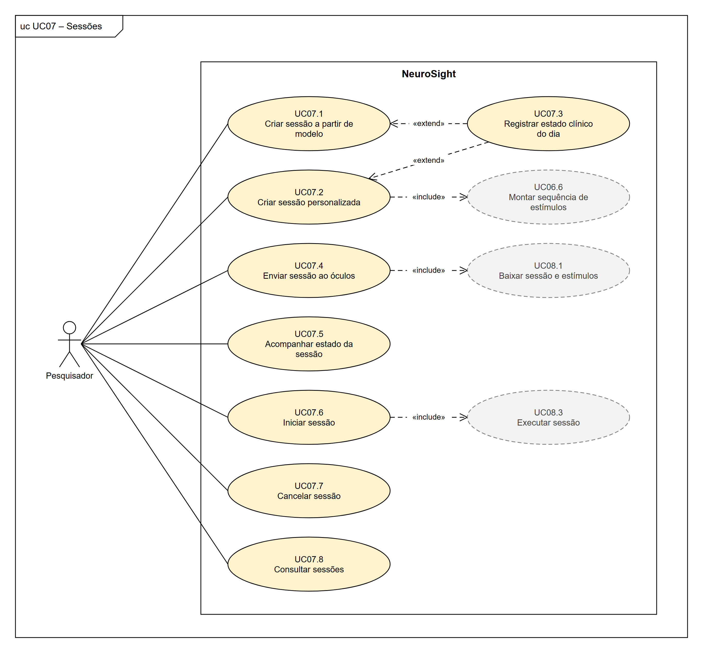

# III. Método e tecnologias

Versão de trabalho de 26/10/2026. Texto para passar ao modelo do TCC, escrito no formato da Seção III do exemplo (parágrafos corridos, uma figura de casos de uso e a tabela das tecnologias). Base: [Requisitos-NeuroSight.md](../Especificacao/Requisitos-NeuroSight.md), [Casos-de-uso-e-historias-NeuroSight.md](../Especificacao/Casos-de-uso-e-historias-NeuroSight.md), [Decisoes-tecnicas-NeuroSight.md](../Especificacao/Decisoes-tecnicas-NeuroSight.md) e o relatório final da IC.

## Como usar este arquivo

- **Citações:** aparecem como chaves entre colchetes, por exemplo [SCRUM]. Ao montar o artigo, troque cada chave pelo número da referência, na ordem em que ela aparece no texto, como no modelo ([1], [2]...). As referências estão no fim deste arquivo.
- **Notas de rodapé:** marcadas com ¹ e ². A numeração continua a das seções anteriores.
- **Figura e tabela:** esta é a primeira figura do artigo. A tabela das tecnologias é a Tabela 2, porque a Seção II tem a Tabela 1 (comparação com ferramentas semelhantes).
- **Trechos a completar:** estão entre colchetes e em maiúsculas.
- **Tempo verbal:** a modelagem (TCC1) está no passado, e o desenvolvimento (TCC2), no futuro.

---

## III. MÉTODO E TECNOLOGIAS

Para desenvolver este trabalho, estudou-se como são conduzidos os experimentos com pessoas com distúrbios da consciência e o que a literatura relata sobre o uso do rastreamento ocular, das expressões faciais e da realidade virtual nesse contexto, conforme apresentado na Seção II. Com base nesse estudo, em reuniões com o orientador¹ e na experiência com o protótipo descrito a seguir, foram levantados os requisitos do sistema: 60 requisitos funcionais, 20 regras de negócio e 26 requisitos não funcionais. Os requisitos funcionais foram classificados por prioridade (essencial, importante ou desejável) e organizados em onze grupos: acesso e conta, usuários e permissões, óculos, pacientes, estímulos, modelos de sessão, sessões, execução no óculos, envio e processamento dos dados, consulta e análise e, por fim, auditoria.

O ponto de partida técnico foi o sistema desenvolvido pelo autor em seu projeto de Iniciação Científica [IC], voltado ao estudo da recepção comunicacional. Esse sistema tem três partes: um aplicativo em Unreal Engine para o Meta Quest Pro, que registra o olhar e grava a cena exibida, com o olhar já alinhado ao vídeo; um serviço que recebe as sessões enviadas pelo próprio óculos e monta o vídeo; e uma plataforma web que reproduz cada sessão com mapa de calor. O alinhamento entre o olhar e o vídeo foi verificado em dispositivo real, em testes feitos pelo próprio autor, sem participantes externos [IC]. O NeuroSight reaproveita o aplicativo e a forma de gravação das sessões e acrescenta o que o protótipo não tinha: a coleta das expressões faciais, o cadastro de pacientes e de estímulos, a configuração e o início das sessões pelo sistema web, o isolamento dos dados entre grupos de pesquisa e o controle de acesso.

O modelo de processo escolhido para conduzir o trabalho foi o Scrum [SCRUM], adaptado ao trabalho individual: o autor acumula os papéis previstos no Scrum, e o orientador acompanha o andamento nas revisões. Cada *sprint* dura duas semanas. A reunião de planejamento abre a *sprint* e define quais itens do *backlog* serão feitos; ao final, a revisão com o orientador avalia o que foi produzido, e a retrospectiva registra o que deve mudar no processo. A reunião diária, que serve para alinhar uma equipe, perde o sentido com um único desenvolvedor e foi substituída pela atualização do quadro de tarefas. Complementarmente ao Scrum, adotou-se a abordagem Kanban [KANBAN] para organizar e acompanhar as tarefas, em um quadro do GitHub Projects [GITHUB].

O desenvolvimento do projeto foi dividido em duas etapas: modelagem, realizada na primeira parte do Trabalho de Conclusão de Curso (TCC1) e apresentada neste documento, e desenvolvimento, prevista para a segunda parte (TCC2). Na etapa de modelagem, houve a elicitação dos requisitos e a elaboração dos diagramas de casos de uso, das histórias de usuário, do diagrama de classes, do diagrama de estados da sessão, do diagrama lógico-relacional do banco de dados, dos diagramas de sequência dos seis fluxos principais, dos diagramas de processo de negócio do experimento, como é conduzido hoje e com o NeuroSight, do diagrama macro do fluxo de uma sessão, do diagrama de arquitetura e dos protótipos de tela: 14 do sistema web e 5 do aplicativo do óculos. A notação dos modelos foi a definida pela *Unified Modeling Language* (UML) [UML], com exceção dos processos de negócio, descritos em *Business Process Model and Notation* (BPMN) [BPMN]. Os diagramas foram feitos no draw.io [DRAWIO], e os protótipos, em HTML (*HyperText Markup Language*) e CSS (*Cascading Style Sheets*).

A Figura 1 apresenta, como exemplo, o diagrama de casos de uso das sessões, que reúne o fluxo principal do sistema: o pesquisador cria a sessão, a partir de um modelo ou de forma personalizada, envia-a ao óculos, acompanha o seu estado e a inicia. Ao todo, foram elaborados doze diagramas, com 60 casos de uso: um diagrama com os atores e um para cada grupo de requisitos. Os atores principais são os três perfis de usuário, que são cumulativos: o pesquisador, que cadastra pacientes, estímulos, modelos e sessões, inicia as sessões e analisa os dados; o administrador, que, além disso, gerencia os usuários, os óculos, a visibilidade das sessões e a auditoria; e o proprietário, que criou o *tenant* e define quem é administrador. Completam o modelo o visitante, que conhece o sistema e cria um *tenant*, e o paciente, ator secundário que usa o óculos durante a sessão, mas não acessa o sistema. A documentação completa está disponível on-line².

**FIGURA 1** - Exemplo de diagrama de casos de uso - Sessões.

FONTE: O autor (2026).

A documentação do sistema contempla, também, as histórias de usuário. Cada diagrama de casos de uso foi definido como um épico, que se desdobrou em um conjunto de histórias de usuário no formato \<SENDO\>\<QUERO\>\<PARA\> [COHN], uma para cada caso de uso, com critérios de aceitação e prioridade. Ao todo, são 60 histórias: 35 essenciais, 19 importantes e 6 desejáveis. Na etapa de desenvolvimento, elas formarão o *backlog* das *sprints*, na ordem de prioridade.

Na etapa de desenvolvimento, as tecnologias descritas a seguir serão empregadas para implementar as funcionalidades definidas na modelagem, conforme a arquitetura apresentada na Seção IV. A escolha seguiu dois critérios: reaproveitar o protótipo da IC e usar uma só linguagem no servidor e no sistema web. O aplicativo do óculos continuará em Unreal Engine, em C++, e passará a ler também as expressões faciais, leitura que ainda depende de uma prova de conceito, discutida na Seção IV. O servidor e o sistema web serão escritos em TypeScript, com NestJS no *backend* e Next.js no *frontend*. Como o Next.js é baseado em React, a mesma biblioteca da plataforma web da IC, o reprodutor com mapa de calor poderá ser reaproveitado. O banco de dados será o PostgreSQL, cujo recurso de *Row-Level Security* reforça o isolamento dos dados de cada grupo de pesquisa. A Tabela 2 detalha e descreve brevemente as tecnologias empregadas.

**TABELA 2** - Tecnologias utilizadas.

| Tecnologia | Utilização |
|---|---|
| Meta Quest Pro | Óculos de realidade virtual com rastreamento ocular e facial [META-MOVE] |
| Unreal Engine 5.5 | Desenvolvimento do aplicativo do óculos, em C++ [UNREAL] |
| OpenXR e Meta XR | Acesso ao rastreamento ocular e facial no Unreal [OPENXR], [META-UNREAL] |
| TypeScript | Linguagem do *backend* e do *frontend* [TYPESCRIPT] |
| NestJS | *Framework* de *backend* [NESTJS] |
| Prisma | Acesso ao banco de dados e migrações [PRISMA] |
| PostgreSQL | Banco de dados, com isolamento por *Row-Level Security* [POSTGRES] |
| Next.js | *Framework* de *frontend* [NEXTJS] |
| FFmpeg | Montagem do vídeo das sessões [FFMPEG] |
| Docker Compose | Implantação dos serviços no servidor [DOCKER] |
| Git e GitHub | Controle de versão e quadro Kanban [GIT], [GITHUB] |

FONTE: O autor (2026).

**Notas de rodapé**

¹ BRAWERMAN, A. Levantamento de requisitos do NeuroSight. Curitiba, 2026. Informação verbal – Reuniões de orientação.

² [LINK DA DOCUMENTAÇÃO COMPLETA]

---

## Referências citadas nesta seção

Na ordem em que aparecem no texto, no formato do modelo. A informação verbal fica só na nota de rodapé, como no exemplo.

- **[IC]** PEDRO, J. V. Z. *Desenvolvimento de um sistema de rastreamento ocular em realidade virtual para análise de atenção visual aplicada ao estudo da recepção comunicacional*. Relatório final de Iniciação Científica (Edital 2025) – Universidade Federal do Paraná, Curitiba, 2026. Orientador: Alessandro Brawerman. Disponível em: https://github.com/joaozanini/QuestPro-EyeTracking. Acesso em: 26 out. 2026.
- **[SCRUM]** SCHWABER, K.; SUTHERLAND, J. *The Scrum Guide*. [S.l.]: Scrum.org, 2020. E-book. Disponível em: https://scrumguides.org/docs/scrumguide/v2020/2020-Scrum-Guide-US.pdf. Acesso em: 26 out. 2026.
- **[KANBAN]** ANDERSON, D. J. *Kanban: successful evolutionary change for your technology business*. Sequim: Blue Hole Press, 2010.
- **[GITHUB]** GITHUB. *Planning and tracking with Projects*. 2026. Disponível em: https://docs.github.com/en/issues/planning-and-tracking-with-projects. Acesso em: 26 out. 2026.
- **[UML]** OBJECT MANAGEMENT GROUP. *OMG Unified Modeling Language (OMG UML)*: version 2.5.1. Needham: OMG, 2017. Disponível em: https://www.omg.org/spec/UML/2.5.1/. Acesso em: 26 out. 2026.
- **[BPMN]** OBJECT MANAGEMENT GROUP. *Business Process Model and Notation (BPMN)*: version 2.0.2. Needham: OMG, 2013. Disponível em: https://www.omg.org/spec/BPMN/2.0.2/. Acesso em: 26 out. 2026.
- **[DRAWIO]** JGRAPH. *draw.io*. 2026. Disponível em: https://www.drawio.com/. Acesso em: 26 out. 2026.
- **[COHN]** COHN, M. *User stories applied: for agile software development*. Boston: Addison-Wesley, 2004.
- **[META-MOVE]** META PLATFORMS. *Movement SDK for Unreal*. Meta Horizon OS Developers, 2026. Disponível em: https://developers.meta.com/vr/documentation/unreal/unreal-movement-overview/. Acesso em: 26 out. 2026.
- **[UNREAL]** EPIC GAMES. *Unreal Engine 5.5 documentation*. 2025. Disponível em: https://dev.epicgames.com/documentation/en-us/unreal-engine/unreal-engine-5-5-documentation. Acesso em: 26 out. 2026.
- **[OPENXR]** KHRONOS GROUP. *OpenXR registry*. 2026. Disponível em: https://registry.khronos.org/OpenXR/. Acesso em: 26 out. 2026.
- **[META-UNREAL]** META PLATFORMS. *Unreal integration: settings and tools*. Meta Horizon OS Developers, 2026. Disponível em: https://developers.meta.com/vr/documentation/unreal/. Acesso em: 26 out. 2026.
- **[TYPESCRIPT]** MICROSOFT. *TypeScript documentation*. 2026. Disponível em: https://www.typescriptlang.org/docs/. Acesso em: 26 out. 2026.
- **[NESTJS]** NESTJS. *NestJS documentation*. 2026. Disponível em: https://docs.nestjs.com/. Acesso em: 26 out. 2026.
- **[PRISMA]** PRISMA DATA. *Prisma documentation*. 2026. Disponível em: https://www.prisma.io/docs. Acesso em: 26 out. 2026.
- **[POSTGRES]** POSTGRESQL GLOBAL DEVELOPMENT GROUP. *PostgreSQL documentation: row security policies*. 2026. Disponível em: https://www.postgresql.org/docs/current/ddl-rowsecurity.html. Acesso em: 26 out. 2026.
- **[NEXTJS]** VERCEL. *Next.js documentation*. 2026. Disponível em: https://nextjs.org/docs. Acesso em: 26 out. 2026.
- **[FFMPEG]** FFMPEG. *FFmpeg documentation*. 2026. Disponível em: https://ffmpeg.org/documentation.html. Acesso em: 26 out. 2026.
- **[DOCKER]** DOCKER. *Docker Compose documentation*. 2026. Disponível em: https://docs.docker.com/compose/. Acesso em: 26 out. 2026.
- **[GIT]** GIT. *Git SCM*. 2026. Disponível em: https://git-scm.com/. Acesso em: 26 out. 2026.

Os endereços responderam em 26/10/2026. As páginas da Meta só abrem no navegador: confira o título de [META-MOVE] ao acessar.

## O que conferir antes de passar para o modelo

1. **Nota ¹:** o nome do orientador. Se for o mesmo da IC, fica "BRAWERMAN, A.".
2. **Nota ²:** o link da documentação completa, quando você decidir onde ela vai ficar.
3. **Revisões com o orientador:** o texto diz que o orientador acompanha o andamento nas revisões das *sprints*. Ajuste se a rotina de vocês for outra.
4. **Prova de conceito do rastreamento facial:** se ela levar a trocar o Unreal pelo Unity (plano B), mude o parágrafo das tecnologias e a Tabela 2.
5. **Figura 1:** a imagem saiu da página UC07 de [Casos-de-uso-NeuroSight.drawio](../Especificacao/Casos-de-uso-NeuroSight.drawio). Se mudar o diagrama, exporte a página de novo no draw.io.
6. **Numeração:** confira as figuras, as tabelas, as notas e as citações depois de juntar todas as seções.
