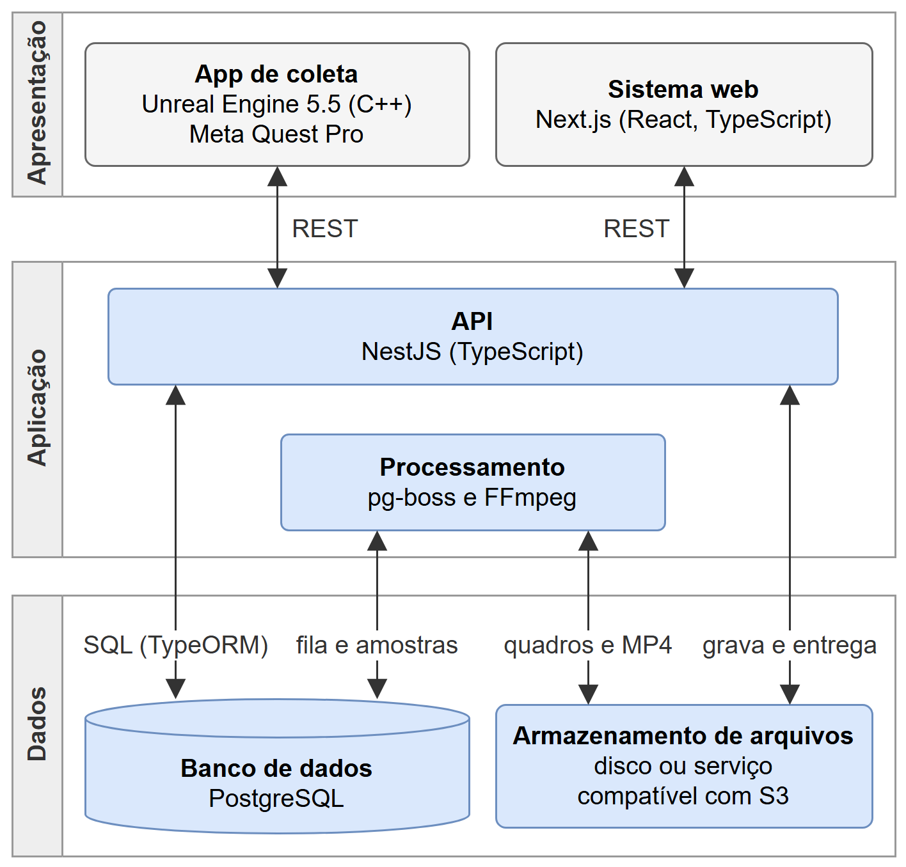
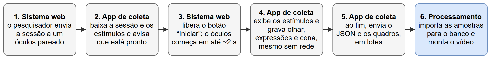

# III. Método, Tecnologias e Arquitetura

Versão de trabalho de 03/11/2026. Texto no formato da Seção III do modelo do artigo (`Referencias-e-modelos/TCC_Artigo_Modelo_2026.pdf`): parágrafo de abertura e as subseções A. Processo de Desenvolvimento, B. Tecnologias Utilizadas (Tabela 2), C. Arquitetura do Sistema (Figuras 1 e 2) e D. Regras de Negócio e Processamento dos Dados. Junta o que antes estava nas Seções III e IV.A. Em 05/11/2026, por observação do orientador, a Tabela 2 passou a vir logo abaixo do título da Subseção B, antes do parágrafo que a cita, e no LaTeX as tabelas estreitas usam a posição `[!htb]` (no lugar, se couber na coluna; senão, no alto da coluna seguinte), em vez de `[!t]`, que a fazia flutuar para a Subseção C. Os diagramas de modelagem não entram no artigo: estão na Especificação Técnica (`Especificacao-Tecnica/`). Base: [Requisitos-NeuroSight.md](../Especificacao/Requisitos-NeuroSight.md), [Casos-de-uso-e-historias-NeuroSight.md](../Especificacao/Casos-de-uso-e-historias-NeuroSight.md), [Decisoes-tecnicas-NeuroSight.md](../Especificacao/Decisoes-tecnicas-NeuroSight.md), [Arquitetura-NeuroSight.md](../Especificacao/Arquitetura-NeuroSight.md), [Diagramas-de-sequencia-NeuroSight.md](../Especificacao/Diagramas-de-sequencia-NeuroSight.md), [Modelo-logico-relacional-NeuroSight.md](../Especificacao/Modelo-logico-relacional-NeuroSight.md) e o relatório final da IC. Em 05/11/2026, a pedido do autor, as Figuras 1 e 2 foram refeitas: a Figura 1 ganhou o proxy reverso, a fila do pg-boss no banco e setas no sentido dos dados; a Figura 2 virou um fluxo numerado de 1 a 10, com os passos de "pronto", liberação do botão "Iniciar" e início na consulta seguinte, e passou à largura das duas colunas (ver o histórico em `Especificacao/Arquitetura-NeuroSight.md`). Em 10/11/2026, a pedido do autor, o Prisma foi trocado pelo TypeORM na Tabela 2, no texto da Subseção C e na lista de referências. No mesmo dia, também a pedido do autor, o artigo foi reduzido para caber em 8 páginas: o texto desta seção foi enxugado (de cerca de 2.900 para cerca de 2.400 palavras, sem tirar subseções, tabelas nem figuras), e a Figura 1 passou a ocupar uma coluna, sem a caixa do serviço de e-mail, que continua no texto como responsabilidade da API (ver o histórico em `Especificacao/Arquitetura-NeuroSight.md`). Saíram, entre outros pontos, a lista dos onze grupos de requisitos, o ator abstrato "usuário" e a generalização entre os atores, a sigla VPS, o formato dos quadros (JPEG) e do vídeo (H.264) e a menção ao draw.io; a referência [DRAWIO] deixou de ser citada no artigo. Em 12/11/2026, a pedido do autor, o artigo foi reduzido para 6 páginas, como o modelo de 2026 (a Resolução nº 01/25 do curso recomenda de 6 a 8): esta seção caiu de cerca de 2.400 para cerca de 1.730 palavras, sem tirar subseções nem figuras. A Figura 2 foi refeita como um fluxo horizontal de seis passos, em uma faixa de cerca de 2,3 cm de altura na largura das duas colunas (ver o histórico em `Especificacao/Arquitetura-NeuroSight.md`). A Tabela 2 perdeu as linhas TypeScript (que entrou nas linhas do NestJS e do Next.js), OpenXR e Meta XR (que entrou na do Unreal Engine), Docker Compose e Git e GitHub. Saíram também a menção ao GitHub Projects, a documentação em OpenAPI, a referência ao fluxo de autorização de dispositivos do OAuth 2.0 (o pareamento ficou em uma frase), a cópia de segurança diária, a estimativa de 300 MB por sessão, o modo de validação da análise e as funções de cada perfil, que estão na Especificação Técnica.

## Como usar este arquivo

- **Citações:** aparecem como chaves entre colchetes, por exemplo [SCRUM]. Ao montar o artigo, cada chave vira o número da referência, na ordem em que ela aparece no texto. As referências estão no fim deste arquivo; [EKMAN] e [LGPD] já são citadas na Introdução e mantêm o número de lá.
- **Notas de rodapé:** marcadas com ¹ e ², no bloco "Notas de rodapé" do fim do texto. O script de montagem as converte.
- **Figuras e tabela:** aqui ficam as Figuras 1 (arquitetura) e 2 (fluxo de uma sessão), as únicas do artigo, e a Tabela 2 (a Tabela 1 é a comparação da Seção II). As imagens vêm das duas páginas de [Arquitetura-NeuroSight.drawio](../Especificacao/Arquitetura-NeuroSight.drawio).
- **Tempo verbal:** a modelagem (TCC1) está no passado; a arquitetura, no presente, como proposta; o desenvolvimento (TCC2), no futuro.

---

## III. MÉTODO, TECNOLOGIAS E ARQUITETURA

Com base no estudo dos experimentos com pessoas com DoC, apresentado nas Seções I e II, em reuniões com o orientador¹ e na experiência com o protótipo descrito a seguir, foram levantados 60 requisitos funcionais, classificados por prioridade e organizados em onze grupos, 20 regras de negócio e 26 requisitos não funcionais.

### A. Processo de Desenvolvimento

O ponto de partida técnico foi o sistema desenvolvido por um dos autores na IC [IC]: um aplicativo em Unreal Engine para o Meta Quest Pro, que registra o olhar e grava a cena exibida, com o olhar alinhado ao vídeo; um serviço que recebe as sessões e monta o vídeo; e uma plataforma web que reproduz cada sessão com mapa de calor. O NeuroSight reaproveita o aplicativo e a forma de gravação e acrescenta a coleta das expressões faciais, os cadastros de pacientes e de estímulos, o início das sessões pelo sistema web, o isolamento dos dados entre grupos de pesquisa e o controle de acesso.

O modelo de processo escolhido foi o Scrum [SCRUM], adaptado a uma dupla: os autores dividem entre si os papéis, e o orientador acompanha o andamento nas revisões. Cada *sprint* dura duas semanas, com o planejamento no início e, ao final, a revisão com o orientador e a retrospectiva; no lugar da reunião diária, os autores acompanham o quadro de tarefas, organizado segundo o Kanban [KANBAN].

O projeto tem duas etapas: a modelagem, apresentada neste artigo, e o desenvolvimento, previsto para a segunda parte do Trabalho de Conclusão de Curso. Na modelagem, além dos requisitos, foram elaborados os diagramas de casos de uso, de classes, de estados da sessão e de sequência dos seis fluxos principais, as histórias de usuário, o modelo lógico do banco de dados, os processos de negócio do experimento, sem e com o NeuroSight, e 19 protótipos de tela. Os modelos seguem a *Unified Modeling Language* (UML) [UML], e os processos, a *Business Process Model and Notation* (BPMN) [BPMN]; estão na Especificação Técnica que acompanha este artigo, e os arquivos editáveis, on-line².

São 60 casos de uso, em doze diagramas: um com os atores e um para cada grupo de requisitos. Os atores são o visitante, que cadastra o seu grupo de pesquisa, e três perfis cumulativos, o pesquisador, o administrador e o proprietário; o paciente é ator secundário, pois usa o óculos, mas não acessa o sistema. Cada diagrama é um épico, desdobrado em uma história de usuário por caso de uso, no formato \<SENDO\>\<QUERO\>\<PARA\> [COHN], com critérios de aceitação e prioridade: 35 essenciais, 19 importantes e 6 desejáveis.

### B. Tecnologias Utilizadas

**TABELA 2** - Tecnologias utilizadas no sistema

| Tecnologia | Utilização |
|---|---|
| Meta Quest Pro | Óculos de realidade virtual com rastreamento ocular e facial [META-MOVE] |
| Unreal Engine 5.5 | Aplicativo do óculos, em C++, com os *plugins* OpenXR e Meta XR [UNREAL], [META-UNREAL] |
| NestJS | *Framework* de *backend*, em TypeScript [NESTJS] |
| TypeORM | Mapeamento objeto-relacional (ORM), acesso ao banco de dados e migrações [TYPEORM] |
| PostgreSQL | Banco de dados, com isolamento por *Row-Level Security* [POSTGRES] |
| Next.js | *Framework* de *frontend*, em TypeScript [NEXTJS] |
| FFmpeg | Montagem do vídeo das sessões [FFMPEG] |

FONTE: Os autores (2026)

A Tabela 2 lista as tecnologias do desenvolvimento, escolhidas para reaproveitar o protótipo da IC e usar uma só linguagem, o TypeScript, no servidor e no sistema web. Como o Next.js é baseado em React, a mesma biblioteca da plataforma web da IC, o reprodutor com mapa de calor poderá ser reaproveitado.

### C. Arquitetura do Sistema

A arquitetura do sistema, representada na Figura 1, tem três partes. O aplicativo de coleta, no Meta Quest Pro, baixa a sessão e os estímulos, apresenta-os ao paciente, coleta o olhar e as expressões faciais, captura os quadros da cena e envia os dados ao servidor. O sistema web é a interface dos pesquisadores e dos administradores, sem regras de negócio. O servidor reúne a interface de programação de aplicações (API, do inglês *Application Programming Interface*), o processamento das sessões, o banco de dados e os arquivos.

**FIGURA 1** - Arquitetura do NeuroSight

FONTE: Os autores (2026)

As regras de negócio ficam na API, também responsável pela autenticação, pelo isolamento entre os grupos de pesquisa, pela auditoria, pela entrega dos arquivos e pelo envio de e-mails, por um serviço externo. A API acessa o banco de dados por meio do TypeORM e guarda os arquivos no disco do servidor, atrás de uma interface que permite trocá-lo por um serviço compatível com o Amazon S3. O processamento das sessões roda em segundo plano, a partir de uma fila de tarefas mantida no próprio banco pela biblioteca pg-boss [PGBOSS].

Os componentes do servidor rodam em contêineres, orquestrados pelo Docker Compose, com um *proxy* reverso responsável pela conexão segura (HTTPS, do inglês *Hypertext Transfer Protocol Secure*). O sistema pode ser instalado em um servidor virtual privado contratado, de preferência no Brasil, ou em um servidor da instituição, conforme o protocolo de cada pesquisa, aprovado pelo Comitê de Ética em Pesquisa (CEP), já que o art. 13 da LGPD prevê que os dados de estudos em saúde pública sejam tratados dentro do órgão de pesquisa [LGPD].

Cada instituição ou grupo de pesquisa corresponde a um *tenant*, e uma única instalação atende a todos, com os dados em um banco único, em que toda tabela com dados de um *tenant* tem a coluna `tenant_id`. O isolamento tem duas camadas: a API filtra cada consulta pelo *tenant* do usuário, informado no *token* de acesso, e o PostgreSQL aplica em cada tabela uma política de *Row-Level Security* (RLS) [POSTGRES], que só devolve as linhas do *tenant* da transação em curso; assim, um filtro esquecido no código não expõe dados de outro grupo. Como a checagem de chaves estrangeiras não passa pelo RLS, as relações usam chaves compostas com o *tenant*, o que impede, por exemplo, que uma sessão aponte para o paciente de outro grupo. A API usa um papel do banco que não pode ignorar o RLS; outro, que pode, serve só antes de existir um *tenant* no contexto, como no autocadastro e no *login*. Os arquivos ficam em pastas por *tenant* e só são entregues pela API.

O sistema web e o aplicativo do óculos não se comunicam diretamente: ambos falam apenas com a API, por HTTPS, no estilo REST (*Representational State Transfer*). A Figura 2 resume o fluxo de uma sessão.

**FIGURA 2** - Fluxo de uma sessão no NeuroSight

FONTE: Os autores (2026)

Antes do primeiro uso, cada óculos é pareado ao *tenant* por um código curto, que um administrador digita no sistema web. Para executar uma sessão, o pesquisador a envia a um óculos pareado, cujo aplicativo consulta o servidor a cada segundo, aproximadamente, para receber a sessão e o comando de início. O aplicativo baixa os estímulos, verifica o rastreamento ocular e o facial e avisa que está pronto; só então o sistema web libera o botão "Iniciar", e, com o óculos já no paciente, a sessão começa na consulta seguinte, em até cerca de 2 segundos. Daí em diante, a execução não depende da rede: a sessão segue até o fim do tempo configurado, com os dados gravados no óculos. Optou-se por não espelhar no sistema web a imagem vista pelo paciente, apenas o estado da sessão; assim, a comunicação dispensa conexões permanentes, como as de WebSocket, e o óculos e o computador do pesquisador não precisam estar na mesma rede.

Toda chamada à API exige um *token*: um JSON Web Token (JWT) [JWT], que identifica o usuário, o *tenant* e o perfil, ou o *token* do óculos. As senhas são guardadas apenas como *hash*, e a API valida o *token* em cada requisição e usa o perfil para autorizar ou negar o acesso a cada rota, em um controle de acesso baseado em papéis.

### D. Regras de Negócio e Processamento dos Dados

As principais regras de negócio são descritas a seguir; as 20 regras estão na Especificação Técnica.

Toda sessão pertence a um paciente e é uma sequência de imagens e vídeos, cada um exibido pelo tempo definido; pode partir de um modelo reutilizável ou ser montada de forma personalizada, e alterar um modelo não altera as sessões já criadas. Um estímulo pessoal, como a foto de um familiar, só pode ser usado em sessões do seu paciente, e um estímulo já usado não pode ser excluído, apenas arquivado. Uma sessão só pode ser enviada a um óculos do mesmo *tenant*, e cada óculos tem no máximo uma sessão pendente. A sessão passa pelos estados rascunho, enviada ao óculos, baixada, início solicitado, em execução, enviando, processando e concluída, ou falha; depois do envio, só pode ser cancelada, o que a devolve a rascunho. Depois do início, não há interrupção pelo sistema: se for preciso retirar o óculos antes do fim, o pesquisador registra o ocorrido nas anotações.

Durante a sessão, o aplicativo registra, com o mesmo relógio do óculos, os eventos de estímulo, com o instante real de início e de fim de cada exibição; o olhar, a cada quadro de renderização, com a validade, a confiança, o ponto observado na cena e a posição na imagem gravada e no estímulo; e cerca de 70 expressões faciais baseadas no FACS [EKMAN], fornecidas pelo kit de desenvolvimento (SDK, do inglês *Software Development Kit*) da Meta [META-MOVE], cada uma com intensidade de 0 a 1 e validade. Esses dados formam um arquivo JSON (*JavaScript Object Notation*), gravado em intervalos curtos para não se perder se o aplicativo for fechado, e o aplicativo também captura quadros da cena exibida, usados para montar o vídeo.

Ao fim da sessão, o aplicativo envia o JSON e depois os quadros, em lotes; um lote que falha é reenviado, e um lote repetido não duplica dados. Sem conexão, os dados ficam no óculos, que só os apaga depois que o servidor confirma o recebimento. No servidor, o processamento importa os eventos e as amostras para tabelas do banco e monta o vídeo MP4 com o FFmpeg. O JSON original é guardado sem alterações, e os dados coletados não podem ser modificados: o pesquisador registra apenas anotações.

Com a sessão concluída, o sistema web reproduz o vídeo com o mapa de calor do olhar, exibe os gráficos das expressões faciais, com a marcação de cada estímulo, e calcula um resumo por estímulo, com o tempo de olhar, a porcentagem de amostras válidas e a intensidade média das expressões. Os dados de uma sessão só ficam visíveis para quem a criou, o proprietário, os administradores e os usuários autorizados. O sistema registra quem fez cada ação, quando e em qual registro, do *login* à exportação dos dados, e o papel usado pela API no banco não tem permissão para alterar nem excluir esses registros de auditoria.

Como os dados de saúde são dados pessoais sensíveis segundo a LGPD [LGPD], o sistema guarda apenas o necessário à pesquisa: o paciente é identificado por um código, e o nome, opcional, nunca chega ao óculos; o aplicativo não captura imagens do rosto, apenas os valores das expressões, e a gravação mostra somente o que o paciente viu. O consentimento, dado pelo representante legal do paciente, fica a cargo do protocolo de cada pesquisa, aprovado pelo CEP.

**Notas de rodapé**

¹ BRAWERMAN, A. Levantamento de requisitos do NeuroSight. Curitiba, 2026. Informação verbal – Reuniões de orientação.

² Disponível em: https://github.com/joaozanini/tcc1 (pasta Especificacao). Acesso em: 2 nov. 2026.

---

## Referências citadas nesta seção

Na ordem em que aparecem no texto, no formato do modelo. A informação verbal fica só na nota de rodapé, como no exemplo. [EKMAN] e [LGPD] são citadas antes, na Introdução, e mantêm o número de lá.

- **[IC]** PEDRO, J. V. Z. *Desenvolvimento de um sistema de rastreamento ocular em realidade virtual para análise de atenção visual aplicada ao estudo da recepção comunicacional*. Relatório final de Iniciação Científica (Edital 2025) – Universidade Federal do Paraná, Curitiba, 2026. Orientador: Alessandro Brawerman. Disponível em: https://github.com/joaozanini/QuestPro-EyeTracking. Acesso em: 26 out. 2026.
- **[SCRUM]** SCHWABER, K.; SUTHERLAND, J. *The Scrum Guide*. [S.l.]: Scrum.org, 2020. E-book. Disponível em: https://scrumguides.org/docs/scrumguide/v2020/2020-Scrum-Guide-US.pdf. Acesso em: 26 out. 2026.
- **[KANBAN]** ANDERSON, D. J. *Kanban: successful evolutionary change for your technology business*. Sequim: Blue Hole Press, 2010.
- **[GITHUB]** GITHUB. *Planning and tracking with Projects*. 2026. Disponível em: https://docs.github.com/en/issues/planning-and-tracking-with-projects. Acesso em: 26 out. 2026.
- **[UML]** OBJECT MANAGEMENT GROUP. *OMG Unified Modeling Language (OMG UML)*: version 2.5.1. Needham: OMG, 2017. Disponível em: https://www.omg.org/spec/UML/2.5.1/. Acesso em: 26 out. 2026.
- **[BPMN]** OBJECT MANAGEMENT GROUP. *Business Process Model and Notation (BPMN)*: version 2.0.2. Needham: OMG, 2013. Disponível em: https://www.omg.org/spec/BPMN/2.0.2/. Acesso em: 26 out. 2026.
- **[DRAWIO]** JGRAPH. *draw.io*. 2026. Disponível em: https://www.drawio.com/. Acesso em: 26 out. 2026.
- **[COHN]** COHN, M. *User stories applied: for agile software development*. Boston: Addison-Wesley, 2004.
- **[META-MOVE]** META PLATFORMS. *Movement SDK for Unreal*. Meta Horizon OS Developers, 2026. Disponível em: https://developers.meta.com/vr/documentation/unreal/unreal-movement-overview/. Acesso em: 26 out. 2026.
- **[UNREAL]** EPIC GAMES. *Unreal Engine 5.5 documentation*. 2025. Disponível em: https://dev.epicgames.com/documentation/en-us/unreal-engine/unreal-engine-5-5-documentation. Acesso em: 26 out. 2026.
- **[OPENXR]** KHRONOS GROUP. *OpenXR registry*. 2026. Disponível em: https://registry.khronos.org/OpenXR/. Acesso em: 26 out. 2026.
- **[META-UNREAL]** META PLATFORMS. *Unreal integration: settings and tools*. Meta Horizon OS Developers, 2026. Disponível em: https://developers.meta.com/vr/documentation/unreal/. Acesso em: 26 out. 2026.
- **[TYPESCRIPT]** MICROSOFT. *TypeScript documentation*. 2026. Disponível em: https://www.typescriptlang.org/docs/. Acesso em: 26 out. 2026.
- **[NESTJS]** NESTJS. *NestJS documentation*. 2026. Disponível em: https://docs.nestjs.com/. Acesso em: 26 out. 2026.
- **[TYPEORM]** TYPEORM. *TypeORM documentation*. 2026. Disponível em: https://typeorm.io/docs/getting-started. Acesso em: 26 out. 2026.
- **[POSTGRES]** POSTGRESQL GLOBAL DEVELOPMENT GROUP. *PostgreSQL documentation: row security policies*. 2026. Disponível em: https://www.postgresql.org/docs/current/ddl-rowsecurity.html. Acesso em: 26 out. 2026.
- **[NEXTJS]** VERCEL. *Next.js documentation*. 2026. Disponível em: https://nextjs.org/docs. Acesso em: 26 out. 2026.
- **[FFMPEG]** FFMPEG. *FFmpeg documentation*. 2026. Disponível em: https://ffmpeg.org/documentation.html. Acesso em: 26 out. 2026.
- **[DOCKER]** DOCKER. *Docker Compose documentation*. 2026. Disponível em: https://docs.docker.com/compose/. Acesso em: 26 out. 2026.
- **[GIT]** GIT. *Git SCM*. 2026. Disponível em: https://git-scm.com/. Acesso em: 26 out. 2026.
- **[PGBOSS]** PG-BOSS. *pg-boss: queueing jobs in Postgres from Node.js*. GitHub, 2026. Disponível em: https://github.com/timgit/pg-boss. Acesso em: 26 out. 2026.
- **[OPENAPI]** OPENAPI INITIATIVE. *OpenAPI Specification*: version 3.2.1. 2026. Disponível em: https://spec.openapis.org/oas/v3.2.1.html. Acesso em: 26 out. 2026.
- **[RFC8628]** DENNISS, W. *et al*. *OAuth 2.0 Device Authorization Grant*. RFC 8628. [S.l.]: IETF, 2019. Disponível em: https://www.rfc-editor.org/rfc/rfc8628. Acesso em: 26 out. 2026.
- **[JWT]** JONES, M.; BRADLEY, J.; SAKIMURA, N. *JSON Web Token (JWT)*. RFC 7519. [S.l.]: IETF, 2015. Disponível em: https://www.rfc-editor.org/rfc/rfc7519. Acesso em: 26 out. 2026.
- **[EKMAN]** EKMAN, P.; FRIESEN, W. V. *Facial Action Coding System: a technique for the measurement of facial movement*. Palo Alto: Consulting Psychologists Press, 1978. (Já citada no 1.1.)
- **[LGPD]** BRASIL. *Lei nº 13.709, de 14 de agosto de 2018*. Lei Geral de Proteção de Dados Pessoais (LGPD). Brasília, DF: Presidência da República, [2018]. Disponível em: https://www.planalto.gov.br/ccivil_03/_ato2015-2018/2018/lei/l13709compilado.htm. Acesso em: 26 out. 2026. (Já citada no 1.1; o endereço é o do texto compilado, com as alterações posteriores.)

Os endereços responderam em 26/10/2026. As páginas da Meta só abrem no navegador: confira o título de [META-MOVE] ao acessar. Desde 10/11/2026, [DRAWIO] não é mais citada no artigo; a entrada continua na lista porque a Contextualização da Especificação Técnica a cita e lê a referência deste arquivo (o script de montagem do artigo ignora as referências sem citação). Desde 12/11/2026, [TYPESCRIPT], [OPENXR], [DOCKER], [GIT], [GITHUB], [OPENAPI] e [RFC8628] também não são citadas no artigo (corte para 6 páginas); as entradas continuam aqui porque a Contextualização da Especificação Técnica cita [OPENAPI] e [RFC8628] e porque as demais podem voltar ao artigo.

## O que conferir antes de passar para o modelo

1. **Nota ²:** o repositório https://github.com/joaozanini/tcc1 só abre para a banca depois de ficar público.
2. **Prova de conceito do rastreamento facial:** se ela levar a trocar o Unreal pelo Unity (plano B), mude o parágrafo das tecnologias, a Tabela 2 e a Seção IV.
3. **Proxy reverso e fila de tarefas:** o texto não diz qual será o *proxy* (Caddy ou Nginx, em aberto no arquivo de decisões). Se o pg-boss sair, tire a citação [PGBOSS] e mantenha só "fila de tarefas".
4. **Número de expressões faciais:** "cerca de 70" depende da versão do SDK da Meta. Confirme na prova de conceito.
5. **Figuras 1 e 2:** se mudar um diagrama de [Arquitetura-NeuroSight.drawio](../Especificacao/Arquitetura-NeuroSight.drawio), exporte a página de novo (fator 3) e substitua o PNG em `figuras/`. A Figura 1 ocupa uma coluna (`\columnwidth` em `gerar-latex.pl` e a largura da coluna em `gerar-docx.ps1`): o diagrama tem 460 px de largura e é exportado com borda de 6 px, para o texto de 13 px sair com cerca de 7 pt; a Figura 2, desde 12/11/2026 uma faixa horizontal com seis passos, fica na largura das duas colunas: a página do diagrama tem 900 px de largura e também é exportada com borda de 6 px e recortada no conteúdo (2667 × 327 px no fator 3).
6. **Numeração:** confira as figuras, a tabela, as notas e as citações depois de montar o artigo.
7. **Tamanho do artigo:** desde 12/11/2026, o artigo tem de caber em 6 páginas, como o modelo de 2026, sem contar a capa, a folha de rosto e o termo de aprovação (páginas 4 a 9 do PDF, que fica com 9 páginas no total); a Resolução nº 01/25 do curso recomenda de 6 a 8. Em 12/11/2026, o PDF em LaTeX fechava a sexta página com cerca de 8 linhas de folga na última coluna, com o corpo das Seções I a IV com cerca de 3.570 palavras (eram cerca de 4.900 depois do corte de 10/11/2026, para 8 páginas, e cerca de 6.000 antes dele) e 43 referências (eram 52). A versão em Word tem a página mais estreita e fica com uma página a mais (10 no total). Depois de mexer no texto, gere o PDF e confira o número de páginas.
8. **Posição da Tabela 2:** ela só fica logo abaixo do título da Subseção B, como o orientador pediu, enquanto couber na coluna em que o título cai. Em 10/11/2026 cabia com duas linhas de folga: se o texto anterior à Subseção B crescer mais que isso, a tabela vai para o alto da coluna seguinte, e é preciso cortar linhas antes dela. Em 12/11/2026, com o texto mais curto, o título da Subseção B passou a cair na página 6 e a Tabela 2 foi para a página 7, porque o LaTeX não põe uma tabela antes de outra de número menor, e a Tabela 1, larga, só saía no alto da página 7. A Tabela 1 passou então a ser definida logo depois do parágrafo de abertura da Subseção II.D, e as duas tabelas ficaram na página 6, com a Tabela 2 logo abaixo do título da Subseção B.
