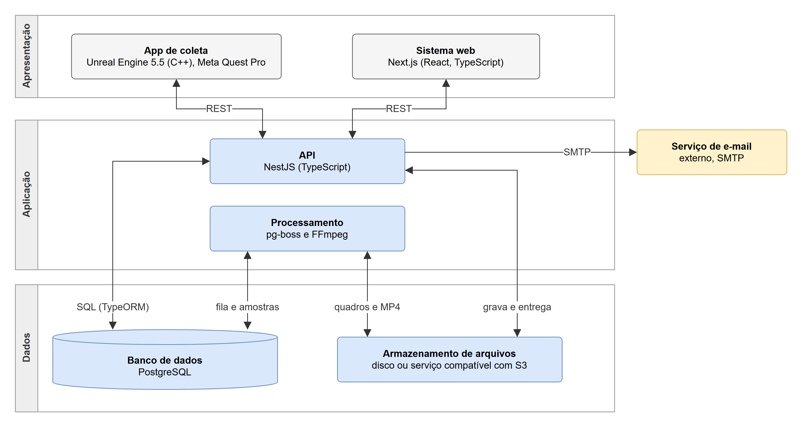
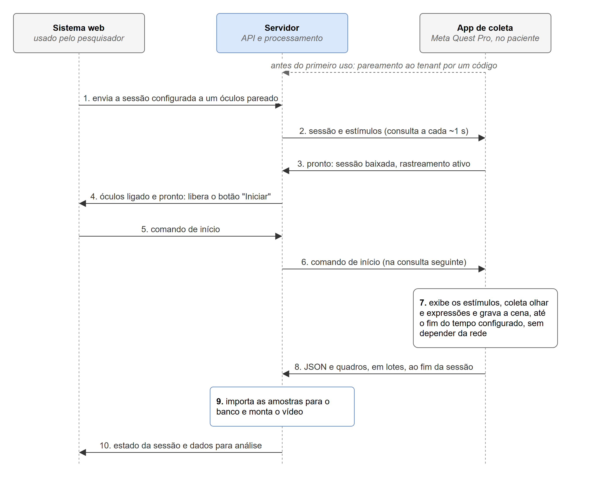

# III. Método, Tecnologias e Arquitetura

Versão de trabalho de 03/11/2026. Texto no formato da Seção III do modelo do artigo (`Referencias-e-modelos/TCC_Artigo_Modelo_2026.pdf`): parágrafo de abertura e as subseções A. Processo de Desenvolvimento, B. Tecnologias Utilizadas (Tabela 2), C. Arquitetura do Sistema (Figuras 1 e 2) e D. Regras de Negócio e Processamento dos Dados. Junta o que antes estava nas Seções III e IV.A. Em 05/11/2026, por observação do orientador, a Tabela 2 passou a vir logo abaixo do título da Subseção B, antes do parágrafo que a cita, e no LaTeX as tabelas estreitas usam a posição `[!htb]` (no lugar, se couber na coluna; senão, no alto da coluna seguinte), em vez de `[!t]`, que a fazia flutuar para a Subseção C. Os diagramas de modelagem não entram no artigo: estão na Especificação Técnica (`Especificacao-Tecnica/`). Base: [Requisitos-NeuroSight.md](../Especificacao/Requisitos-NeuroSight.md), [Casos-de-uso-e-historias-NeuroSight.md](../Especificacao/Casos-de-uso-e-historias-NeuroSight.md), [Decisoes-tecnicas-NeuroSight.md](../Especificacao/Decisoes-tecnicas-NeuroSight.md), [Arquitetura-NeuroSight.md](../Especificacao/Arquitetura-NeuroSight.md), [Diagramas-de-sequencia-NeuroSight.md](../Especificacao/Diagramas-de-sequencia-NeuroSight.md), [Modelo-logico-relacional-NeuroSight.md](../Especificacao/Modelo-logico-relacional-NeuroSight.md) e o relatório final da IC. Em 05/11/2026, a pedido do autor, as Figuras 1 e 2 foram refeitas: a Figura 1 ganhou o proxy reverso, a fila do pg-boss no banco e setas no sentido dos dados; a Figura 2 virou um fluxo numerado de 1 a 10, com os passos de "pronto", liberação do botão "Iniciar" e início na consulta seguinte, e passou à largura das duas colunas (ver o histórico em `Especificacao/Arquitetura-NeuroSight.md`). Em 10/11/2026, a pedido do autor, o Prisma foi trocado pelo TypeORM na Tabela 2, no texto da Subseção C e na lista de referências.

## Como usar este arquivo

- **Citações:** aparecem como chaves entre colchetes, por exemplo [SCRUM]. Ao montar o artigo, cada chave vira o número da referência, na ordem em que ela aparece no texto. As referências estão no fim deste arquivo; [EKMAN] e [LGPD] já são citadas na Introdução e mantêm o número de lá.
- **Notas de rodapé:** marcadas com ¹ e ², no bloco "Notas de rodapé" do fim do texto. O script de montagem as converte.
- **Figuras e tabela:** aqui ficam as Figuras 1 (arquitetura) e 2 (fluxo de uma sessão), as únicas do artigo, e a Tabela 2 (a Tabela 1 é a comparação da Seção II). As imagens vêm das duas páginas de [Arquitetura-NeuroSight.drawio](../Especificacao/Arquitetura-NeuroSight.drawio).
- **Tempo verbal:** a modelagem (TCC1) está no passado; a arquitetura, no presente, como proposta; o desenvolvimento (TCC2), no futuro.

---

## III. MÉTODO, TECNOLOGIAS E ARQUITETURA

Para desenvolver este trabalho, estudou-se como são conduzidos os experimentos com pessoas com distúrbios da consciência e o que a literatura relata sobre o uso do rastreamento ocular, das expressões faciais e da realidade virtual nesse contexto, conforme apresentado nas Seções I e II. Com base nesse estudo, em reuniões com o orientador¹ e na experiência com o protótipo descrito a seguir, foram levantados os requisitos do sistema: 60 requisitos funcionais, 20 regras de negócio e 26 requisitos não funcionais. Os requisitos funcionais foram classificados por prioridade (essencial, importante ou desejável) e organizados em onze grupos: acesso e conta, usuários e permissões, óculos, pacientes, estímulos, modelos de sessão, sessões, execução no óculos, envio e processamento dos dados, consulta e análise e, por fim, auditoria. A partir desse levantamento, definiu-se o desenvolvimento do NeuroSight como meio computacional para integrar as etapas desses experimentos, cuja concepção metodológica, tecnológica e arquitetural é detalhada a seguir.

### A. Processo de Desenvolvimento

O ponto de partida técnico foi o sistema desenvolvido por um dos autores em seu projeto de Iniciação Científica [IC], voltado ao estudo da recepção comunicacional. Esse sistema tem três partes: um aplicativo em Unreal Engine para o Meta Quest Pro, que registra o olhar e grava a cena exibida, com o olhar já alinhado ao vídeo; um serviço que recebe as sessões enviadas pelo próprio óculos e monta o vídeo; e uma plataforma web que reproduz cada sessão com mapa de calor. O alinhamento entre o olhar e o vídeo foi verificado em dispositivo real, em testes feitos pelo próprio autor do protótipo, sem participantes externos [IC]. O NeuroSight reaproveita o aplicativo e a forma de gravação das sessões e acrescenta o que o protótipo não tinha: a coleta das expressões faciais, o cadastro de pacientes e de estímulos, a configuração e o início das sessões pelo sistema web, o isolamento dos dados entre grupos de pesquisa e o controle de acesso.

O modelo de processo escolhido para conduzir o trabalho foi o Scrum [SCRUM], adaptado a uma equipe de dois integrantes: os autores dividem entre si os papéis previstos no Scrum, e o orientador acompanha o andamento nas revisões. Cada *sprint* dura duas semanas. A reunião de planejamento abre a *sprint* e define quais itens do *backlog* serão feitos; ao final, a revisão com o orientador avalia o que foi produzido, e a retrospectiva registra o que deve mudar no processo. Em vez da reunião diária, os dois autores se mantêm a par do andamento pela atualização do quadro de tarefas. Complementarmente ao Scrum, adotou-se a abordagem Kanban [KANBAN] para organizar e acompanhar as tarefas, em um quadro do GitHub Projects [GITHUB].

O projeto foi dividido em duas etapas: modelagem, realizada na primeira parte do Trabalho de Conclusão de Curso (TCC1) e apresentada neste artigo, e desenvolvimento, prevista para a segunda parte (TCC2). Na etapa de modelagem, houve a elicitação dos requisitos e a elaboração dos diagramas de casos de uso, das histórias de usuário, do diagrama de classes, do diagrama de estados da sessão, do diagrama lógico-relacional do banco de dados, dos diagramas de sequência dos seis fluxos principais, dos diagramas de processo de negócio do experimento, como é conduzido hoje e com o NeuroSight, do diagrama de arquitetura e dos protótipos de tela: 14 do sistema web e 5 do aplicativo do óculos. A notação dos modelos foi a definida pela *Unified Modeling Language* (UML) [UML], com exceção dos processos de negócio, descritos em *Business Process Model and Notation* (BPMN) [BPMN]. Os diagramas foram feitos no draw.io [DRAWIO], e os protótipos, em HTML (*HyperText Markup Language*) e CSS (*Cascading Style Sheets*). Todos esses artefatos estão reunidos na Especificação Técnica que acompanha este artigo, no template do curso, e os arquivos editáveis dos diagramas e dos protótipos estão disponíveis on-line².

Ao todo, foram elaborados doze diagramas de casos de uso, com 60 casos de uso: um diagrama com os atores e um para cada grupo de requisitos. Os atores são o visitante, que conhece o sistema e cria um *tenant*; o usuário, ator abstrato que representa qualquer pessoa com conta; o pesquisador, que cadastra pacientes, estímulos, modelos e sessões e envia, inicia e analisa as sessões; o administrador, que tem também os casos de uso do pesquisador e, além deles, gerencia os usuários, os óculos, a visibilidade das sessões e a auditoria; e o proprietário, que criou o *tenant*, define quem é administrador e tem todos os casos de uso do administrador. A generalização entre os atores representa esses perfis cumulativos. O paciente é ator secundário: usa o óculos durante a sessão, mas não acessa o sistema. O aplicativo do óculos faz parte do NeuroSight e, por isso, não aparece como ator.

A documentação do sistema contempla, também, as histórias de usuário. Cada diagrama de casos de uso foi definido como um épico, que se desdobrou em um conjunto de histórias de usuário no formato \<SENDO\>\<QUERO\>\<PARA\> [COHN], uma para cada caso de uso, com critérios de aceitação e prioridade. Ao todo, são 60 histórias: 35 essenciais, 19 importantes e 6 desejáveis. Na etapa de desenvolvimento, elas formarão o *backlog* das *sprints*, na ordem de prioridade.

### B. Tecnologias Utilizadas

**TABELA 2** - Tecnologias utilizadas no sistema

| Tecnologia | Utilização |
|---|---|
| Meta Quest Pro | Óculos de realidade virtual com rastreamento ocular e facial [META-MOVE] |
| Unreal Engine 5.5 | Desenvolvimento do aplicativo do óculos, em C++ [UNREAL] |
| OpenXR e Meta XR | Acesso ao rastreamento ocular e facial no Unreal [OPENXR], [META-UNREAL] |
| TypeScript | Linguagem do *backend* e do *frontend* [TYPESCRIPT] |
| NestJS | *Framework* de *backend* [NESTJS] |
| TypeORM | Mapeamento objeto-relacional (ORM), acesso ao banco de dados e migrações [TYPEORM] |
| PostgreSQL | Banco de dados, com isolamento por *Row-Level Security* [POSTGRES] |
| Next.js | *Framework* de *frontend* [NEXTJS] |
| FFmpeg | Montagem do vídeo das sessões [FFMPEG] |
| Docker Compose | Implantação dos serviços no servidor [DOCKER] |
| Git e GitHub | Controle de versão e quadro Kanban [GIT], [GITHUB] |

FONTE: Os autores (2026)

A Tabela 2 lista as tecnologias que serão empregadas, na etapa de desenvolvimento, para implementar as funcionalidades definidas na modelagem, conforme a arquitetura apresentada na Subseção C. A escolha seguiu dois critérios: reaproveitar o protótipo da IC e usar uma só linguagem no servidor e no sistema web. O aplicativo do óculos continuará em Unreal Engine, em C++, e passará a ler também as expressões faciais, leitura que ainda depende de uma prova de conceito, discutida na Seção IV. O servidor e o sistema web serão escritos em TypeScript, com NestJS no *backend* e Next.js no *frontend*. Como o Next.js é baseado em React, a mesma biblioteca da plataforma web da IC, o reprodutor com mapa de calor poderá ser reaproveitado. O banco de dados será o PostgreSQL, cujo recurso de *Row-Level Security* reforça o isolamento dos dados de cada grupo de pesquisa.

### C. Arquitetura do Sistema

A arquitetura geral do sistema é representada pela Figura 1. Conforme apresentado na Tabela 2, ela se baseia em tecnologias atuais e amplamente utilizadas, como Unreal Engine, NestJS, Next.js e PostgreSQL. O sistema tem três partes: o aplicativo de coleta, executado no Meta Quest Pro; o sistema web, acessado pelo navegador; e o servidor, que reúne a interface de programação de aplicações (API, do inglês *Application Programming Interface*), o banco de dados, os arquivos e o processamento das sessões.

**FIGURA 1** - Arquitetura do NeuroSight

FONTE: Os autores (2026)

Na Figura 1, observa-se o aplicativo de coleta, desenvolvido a partir do protótipo da IC, que baixa a sessão e os estímulos, apresenta os estímulos ao paciente, coleta o olhar e as expressões faciais, captura os quadros da cena e envia os dados ao servidor. O sistema web é a interface dos pesquisadores e dos administradores e não contém regras de negócio. Essas regras ficam na API, que também é responsável pela autenticação, pelo isolamento entre os grupos de pesquisa, pelo registro de auditoria e pela entrega dos arquivos. A API acessa o banco de dados por meio do TypeORM e guarda os arquivos (estímulos, dados brutos das sessões, quadros e vídeos) no disco do servidor, atrás de uma interface que permite trocar o disco por um serviço de armazenamento compatível com o Amazon S3 sem alterar o restante do sistema. O processamento é executado em segundo plano, a partir de uma fila de tarefas mantida no próprio banco pela biblioteca pg-boss [PGBOSS]: ele importa as amostras de cada sessão para o banco e monta o vídeo com o FFmpeg. Por fim, um serviço externo de e-mail envia as mensagens de confirmação de cadastro, de convite e de redefinição de senha.

Os componentes do servidor rodam em contêineres, orquestrados pelo Docker Compose, com um *proxy* reverso responsável pela conexão segura (HTTPS, do inglês *Hypertext Transfer Protocol Secure*). Assim, o sistema pode ser instalado em um servidor virtual privado (VPS, do inglês *Virtual Private Server*) contratado, de preferência hospedado no Brasil, ou em um servidor da própria instituição de pesquisa. A escolha cabe ao protocolo de cada pesquisa, aprovado pelo Comitê de Ética em Pesquisa (CEP), já que o art. 13 da LGPD prevê que os dados de estudos em saúde pública sejam tratados dentro do órgão de pesquisa [LGPD]. O banco de dados e os arquivos terão cópia de segurança diária. Não há comunicação direta entre o sistema web e o óculos: as duas partes falam apenas com a API, como detalhado a seguir.

Cada instituição ou grupo de pesquisa cadastrado no NeuroSight corresponde a um *tenant*, e uma única instalação atende a todos. Os dados ficam em um banco único, em que toda tabela com dados de um *tenant* tem a coluna `tenant_id`. O isolamento é feito em duas camadas. Na primeira, a API filtra cada consulta pelo *tenant* do usuário, informado no *token* de acesso. Na segunda, o PostgreSQL aplica em cada tabela uma política de *Row-Level Security* (RLS) [POSTGRES], que só devolve as linhas do *tenant* definido para a transação em curso. Assim, um filtro esquecido no código não expõe dados de outro grupo. Como a checagem de chaves estrangeiras não passa pelo RLS, as relações entre as tabelas usam chaves compostas com o *tenant*, o que impede, por exemplo, que uma sessão aponte para o paciente de outro grupo. A API acessa o banco com um papel que não pode ignorar o RLS; um segundo papel, que pode, é usado apenas nas operações feitas antes de existir um *tenant* no contexto, como o autocadastro, o *login* e o pareamento dos óculos. Os arquivos também são separados em pastas por *tenant* e só são entregues pela API, depois da checagem de permissão.

O sistema web e o aplicativo do óculos se comunicam apenas com a API, por HTTPS, no estilo REST (*Representational State Transfer*). A API será documentada em OpenAPI [OPENAPI], que serve de contrato entre o servidor e o aplicativo. A Figura 2 resume o fluxo de uma sessão, com os passos numerados na ordem em que ocorrem.

**FIGURA 2** - Fluxo de uma sessão no NeuroSight

FONTE: Os autores (2026)

Antes do primeiro uso, cada óculos é pareado ao *tenant*. O aplicativo pede ao servidor um código curto, que exibe na tela, e recebe também um segredo. Um administrador digita o código no sistema web e, a partir daí, o segredo passa a valer como *token* de acesso do aparelho, que pode ser revogado a qualquer momento. O mecanismo simplifica o fluxo de autorização de dispositivos do OAuth 2.0 [RFC8628] e dispensa digitar senhas no óculos.

Para executar uma sessão, o pesquisador a configura no sistema web e a envia a um óculos pareado. Enquanto aguarda, o aplicativo consulta o servidor a cada segundo, aproximadamente. Essa mesma consulta indica que o aparelho está ligado, entrega a sessão e transmite o comando de início. Ao receber a sessão, o aplicativo baixa os estímulos que ainda não tem, verifica se o rastreamento ocular e o facial estão ativos e avisa o servidor de que está pronto; só então o sistema web libera o botão "Iniciar". Com o óculos já posicionado no paciente, o pesquisador clica em "Iniciar", e o aplicativo começa a sessão na consulta seguinte, em até cerca de 2 segundos. Daí em diante, a execução não depende da rede: a sessão segue até o fim do tempo configurado, sem interrupção, e os dados são gravados no próprio óculos.

Optou-se por não espelhar no sistema web a imagem vista pelo paciente: o pesquisador acompanha o estado da sessão e analisa os dados depois que ela termina. Com isso, a comunicação dispensa conexões permanentes, como as de WebSocket, e o óculos e o computador do pesquisador não precisam estar na mesma rede, bastando acesso à internet. Em contrapartida, o óculos precisa estar conectado no momento do início.

Para o controle de acesso, toda comunicação usa HTTPS, e toda chamada à API exige um *token*: um JSON Web Token (JWT) [JWT], que identifica o usuário, o *tenant* e o perfil, ou o *token* próprio de cada óculos. As senhas são guardadas apenas na forma de *hash*. A API valida o *token* em cada requisição e usa o perfil nele contido para autorizar ou negar o acesso a cada rota, o que implementa um controle de acesso baseado em papéis. Os perfis são cumulativos: o administrador pode tudo o que o pesquisador pode, e o proprietário, tudo o que o administrador pode.

### D. Regras de Negócio e Processamento dos Dados

Além das funcionalidades de cadastro e de consulta, o sistema implementa um conjunto de regras de negócio que garantem a consistência das sessões e dos dados coletados e automatizam o processamento. As principais são descritas a seguir; a lista completa, com as 20 regras, está na Especificação Técnica.

Toda sessão pertence a exatamente um paciente e é um fluxo de imagens e vídeos exibidos em sequência, cada um pelo tempo definido na configuração; a sessão pode ser criada a partir de um modelo reutilizável ou montada de forma personalizada, e alterar um modelo não altera as sessões já criadas a partir dele. Um estímulo pessoal, como a foto de um familiar, só pode ser usado em sessões do paciente ao qual pertence, e um estímulo já usado em alguma sessão não pode ser excluído, apenas arquivado. Uma sessão só pode ser enviada a um óculos pareado ao mesmo *tenant*, e cada óculos tem no máximo uma sessão pendente por vez. Ao longo do processo, a sessão passa pelos estados rascunho, enviada ao óculos, baixada, início solicitado, em execução, enviando, processando e concluída, ou falha, que o sistema web exibe ao pesquisador. Depois do envio ao óculos, a sessão não pode mais ser editada; para mudá-la, é preciso cancelá-la, o que a devolve a rascunho. O botão "Iniciar" só fica liberado quando o óculos de destino está ligado e já baixou a sessão e, depois do início, a sessão sempre vai até o fim do tempo configurado: não há interrupção pelo sistema. Se for preciso retirar o óculos do paciente antes do fim, o pesquisador registra o ocorrido nas anotações da sessão.

Durante a sessão, o aplicativo registra três tipos de dado, todos marcados pelo mesmo relógio do óculos. O primeiro são os eventos de estímulo, com o instante real em que cada estímulo começou e terminou de ser exibido, que pode diferir do tempo configurado, por exemplo, enquanto um vídeo carrega. O segundo é o olhar, amostrado a cada quadro de renderização, com a validade, a confiança, o ponto observado na cena e a sua posição tanto na imagem gravada quanto no próprio estímulo. O terceiro são as expressões faciais: cerca de 70 expressões baseadas no FACS [EKMAN], fornecidas pelo kit de desenvolvimento (SDK, do inglês *Software Development Kit*) da Meta [META-MOVE], cada uma com intensidade de 0 a 1 e indicação de validade. Esses dados formam um arquivo JSON (*JavaScript Object Notation*), gravado em intervalos curtos para não se perderem caso o aplicativo seja fechado. Como na IC, o aplicativo também captura quadros da cena exibida ao paciente, em JPEG, que servem para montar o vídeo da sessão.

Ao fim da sessão, o aplicativo envia primeiro o JSON e depois os quadros, em lotes. Um lote que falha é reenviado, e um lote repetido não duplica dados. Sem conexão, os dados ficam guardados no óculos, que tenta o envio de novo mais tarde, e só são apagados do aparelho depois que o servidor confirma o recebimento. No servidor, o processamento importa os eventos e as amostras do JSON para tabelas do banco, o que facilita os gráficos e o resumo por estímulo, e monta o vídeo MP4, em H.264, com o FFmpeg. O JSON original é guardado sem alterações, e os dados coletados não podem ser modificados: o pesquisador registra apenas anotações e dados descritivos da sessão. Na IC, cada minuto de gravação, a cerca de 22 quadros por segundo, gerou aproximadamente 88 MB [IC]. Com base nessa medição, estima-se que uma sessão de 5 minutos, com quadros de 1024 × 1024 pixels capturados a 15 quadros por segundo, gere cerca de 300 MB, valor que será medido no NeuroSight.

Com a sessão concluída, o sistema web reproduz o vídeo com o mapa de calor do olhar, cuja janela temporal, raio e opacidade o pesquisador ajusta durante a reprodução; oferece um modo de validação, com o ponto do olhar desenhado sobre o vídeo; exibe os gráficos das expressões faciais ao longo do tempo, com a marcação de cada estímulo; e calcula um resumo por estímulo, com o tempo de olhar dentro do estímulo, a porcentagem de amostras válidas e a intensidade média das expressões, a partir dos instantes reais registrados no óculos. Os dados de uma sessão só ficam visíveis para quem a criou, para o proprietário, para os administradores e para os usuários que um administrador autorizar. O sistema registra automaticamente quem fez cada ação, quando e em qual registro, abrangendo *login*, criação, edição e exclusão de dados, envio e início de sessões, visualização e exportação dos dados de uma sessão e mudanças de permissão. Os registros de auditoria não podem ser alterados nem excluídos, restrição garantida no próprio banco, pois o papel usado pela API não tem permissão para isso.

Os dados de saúde são dados pessoais sensíveis segundo a LGPD [LGPD], e o sistema foi modelado para guardar apenas o necessário à pesquisa. O paciente é identificado por um código; o nome é opcional e nunca chega ao óculos, que exibe só o código. O aplicativo não captura imagens do rosto do paciente, apenas os valores das expressões, e a gravação mostra somente o que o paciente viu. O consentimento para a participação, dado pelo representante legal do paciente, fica a cargo do protocolo de cada pesquisa, aprovado pelo CEP, e não é tratado pelo sistema.

**Notas de rodapé**

¹ BRAWERMAN, A. Levantamento de requisitos do NeuroSight. Curitiba, 2026. Informação verbal – Reuniões de orientação.

² Disponível em: https://github.com/joaozanini/tcc1 (pasta Especificacao). Acesso em: 2 nov. 2026.

---

## Referências citadas nesta seção

Na ordem em que aparecem no texto, no formato do modelo. A informação verbal fica só na nota de rodapé, como no exemplo. [EKMAN] e [LGPD] são citadas antes, na Introdução, e mantêm o número de lá.

- **[IC]** PEDRO, J. V. Z. *Desenvolvimento de um sistema de rastreamento ocular em realidade virtual para análise de atenção visual aplicada ao estudo da recepção comunicacional*. Relatório final de Iniciação Científica (Edital 2025) – Universidade Federal do Paraná, Curitiba, 2026. Orientador: Alessandro Brawerman. Disponível em: https://github.com/joaozanini/QuestPro-EyeTracking. Acesso em: 26 out. 2026.
- **[SCRUM]** SCHWABER, K.; SUTHERLAND, J. *The Scrum Guide*. [S.l.]: Scrum.org, 2020. E-book. Disponível em: https://scrumguides.org/docs/scrumguide/v2020/2020-Scrum-Guide-US.pdf. Acesso em: 26 out. 2026.
- **[KANBAN]** ANDERSON, D. J. *Kanban: successful evolutionary change for your technology business*. Sequim: Blue Hole Press, 2010.
- **[GITHUB]** GITHUB. *Planning and tracking with Projects*. 2026. Disponível em: https://docs.github.com/en/issues/planning-and-tracking-with-projects. Acesso em: 26 out. 2026.
- **[UML]** OBJECT MANAGEMENT GROUP. *OMG Unified Modeling Language (OMG UML)*: version 2.5.1. Needham: OMG, 2017. Disponível em: https://www.omg.org/spec/UML/2.5.1/. Acesso em: 26 out. 2026.
- **[BPMN]** OBJECT MANAGEMENT GROUP. *Business Process Model and Notation (BPMN)*: version 2.0.2. Needham: OMG, 2013. Disponível em: https://www.omg.org/spec/BPMN/2.0.2/. Acesso em: 26 out. 2026.
- **[DRAWIO]** JGRAPH. *draw.io*. 2026. Disponível em: https://www.drawio.com/. Acesso em: 26 out. 2026.
- **[COHN]** COHN, M. *User stories applied: for agile software development*. Boston: Addison-Wesley, 2004.
- **[META-MOVE]** META PLATFORMS. *Movement SDK for Unreal*. Meta Horizon OS Developers, 2026. Disponível em: https://developers.meta.com/vr/documentation/unreal/unreal-movement-overview/. Acesso em: 26 out. 2026.
- **[UNREAL]** EPIC GAMES. *Unreal Engine 5.5 documentation*. 2025. Disponível em: https://dev.epicgames.com/documentation/en-us/unreal-engine/unreal-engine-5-5-documentation. Acesso em: 26 out. 2026.
- **[OPENXR]** KHRONOS GROUP. *OpenXR registry*. 2026. Disponível em: https://registry.khronos.org/OpenXR/. Acesso em: 26 out. 2026.
- **[META-UNREAL]** META PLATFORMS. *Unreal integration: settings and tools*. Meta Horizon OS Developers, 2026. Disponível em: https://developers.meta.com/vr/documentation/unreal/. Acesso em: 26 out. 2026.
- **[TYPESCRIPT]** MICROSOFT. *TypeScript documentation*. 2026. Disponível em: https://www.typescriptlang.org/docs/. Acesso em: 26 out. 2026.
- **[NESTJS]** NESTJS. *NestJS documentation*. 2026. Disponível em: https://docs.nestjs.com/. Acesso em: 26 out. 2026.
- **[TYPEORM]** TYPEORM. *TypeORM documentation*. 2026. Disponível em: https://typeorm.io/docs/getting-started. Acesso em: 26 out. 2026.
- **[POSTGRES]** POSTGRESQL GLOBAL DEVELOPMENT GROUP. *PostgreSQL documentation: row security policies*. 2026. Disponível em: https://www.postgresql.org/docs/current/ddl-rowsecurity.html. Acesso em: 26 out. 2026.
- **[NEXTJS]** VERCEL. *Next.js documentation*. 2026. Disponível em: https://nextjs.org/docs. Acesso em: 26 out. 2026.
- **[FFMPEG]** FFMPEG. *FFmpeg documentation*. 2026. Disponível em: https://ffmpeg.org/documentation.html. Acesso em: 26 out. 2026.
- **[DOCKER]** DOCKER. *Docker Compose documentation*. 2026. Disponível em: https://docs.docker.com/compose/. Acesso em: 26 out. 2026.
- **[GIT]** GIT. *Git SCM*. 2026. Disponível em: https://git-scm.com/. Acesso em: 26 out. 2026.
- **[PGBOSS]** PG-BOSS. *pg-boss: queueing jobs in Postgres from Node.js*. GitHub, 2026. Disponível em: https://github.com/timgit/pg-boss. Acesso em: 26 out. 2026.
- **[OPENAPI]** OPENAPI INITIATIVE. *OpenAPI Specification*: version 3.2.1. 2026. Disponível em: https://spec.openapis.org/oas/v3.2.1.html. Acesso em: 26 out. 2026.
- **[RFC8628]** DENNISS, W. *et al*. *OAuth 2.0 Device Authorization Grant*. RFC 8628. [S.l.]: IETF, 2019. Disponível em: https://www.rfc-editor.org/rfc/rfc8628. Acesso em: 26 out. 2026.
- **[JWT]** JONES, M.; BRADLEY, J.; SAKIMURA, N. *JSON Web Token (JWT)*. RFC 7519. [S.l.]: IETF, 2015. Disponível em: https://www.rfc-editor.org/rfc/rfc7519. Acesso em: 26 out. 2026.
- **[EKMAN]** EKMAN, P.; FRIESEN, W. V. *Facial Action Coding System: a technique for the measurement of facial movement*. Palo Alto: Consulting Psychologists Press, 1978. (Já citada no 1.1.)
- **[LGPD]** BRASIL. *Lei nº 13.709, de 14 de agosto de 2018*. Lei Geral de Proteção de Dados Pessoais (LGPD). Brasília, DF: Presidência da República, [2018]. Disponível em: https://www.planalto.gov.br/ccivil_03/_ato2015-2018/2018/lei/l13709compilado.htm. Acesso em: 26 out. 2026. (Já citada no 1.1; o endereço é o do texto compilado, com as alterações posteriores.)

Os endereços responderam em 26/10/2026. As páginas da Meta só abrem no navegador: confira o título de [META-MOVE] ao acessar.

## O que conferir antes de passar para o modelo

1. **Nota ²:** o repositório https://github.com/joaozanini/tcc1 só abre para a banca depois de ficar público.
2. **Prova de conceito do rastreamento facial:** se ela levar a trocar o Unreal pelo Unity (plano B), mude o parágrafo das tecnologias, a Tabela 2 e a Seção IV.
3. **Proxy reverso e fila de tarefas:** o texto não diz qual será o *proxy* (Caddy ou Nginx, em aberto no arquivo de decisões). Se o pg-boss sair, tire a citação [PGBOSS] e mantenha só "fila de tarefas".
4. **Número de expressões faciais:** "cerca de 70" depende da versão do SDK da Meta. Confirme na prova de conceito.
5. **Figuras 1 e 2:** se mudar um diagrama de [Arquitetura-NeuroSight.drawio](../Especificacao/Arquitetura-NeuroSight.drawio), exporte a página de novo (fator 3) e substitua o PNG em `figuras/`.
6. **Numeração:** confira as figuras, a tabela, as notas e as citações depois de montar o artigo.
