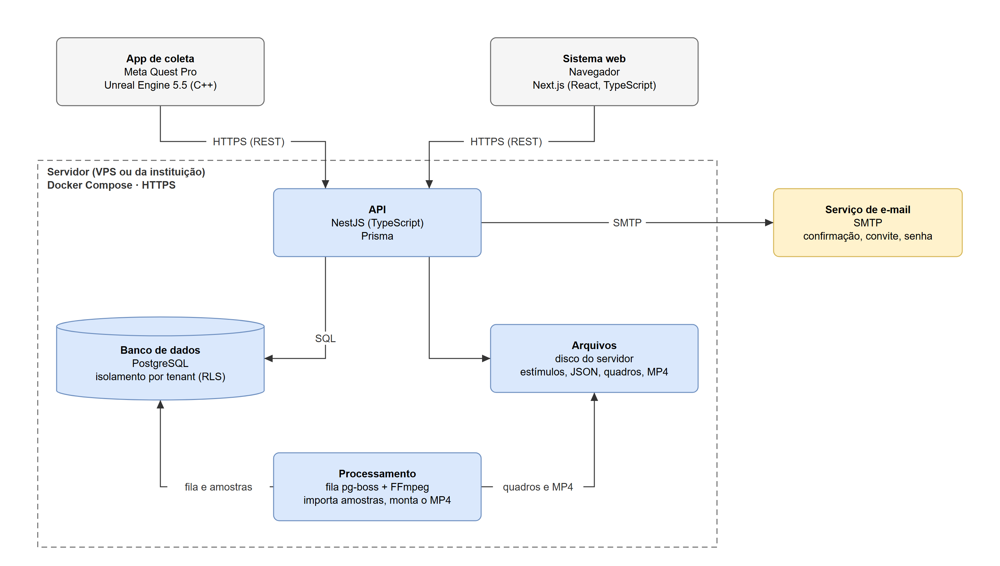
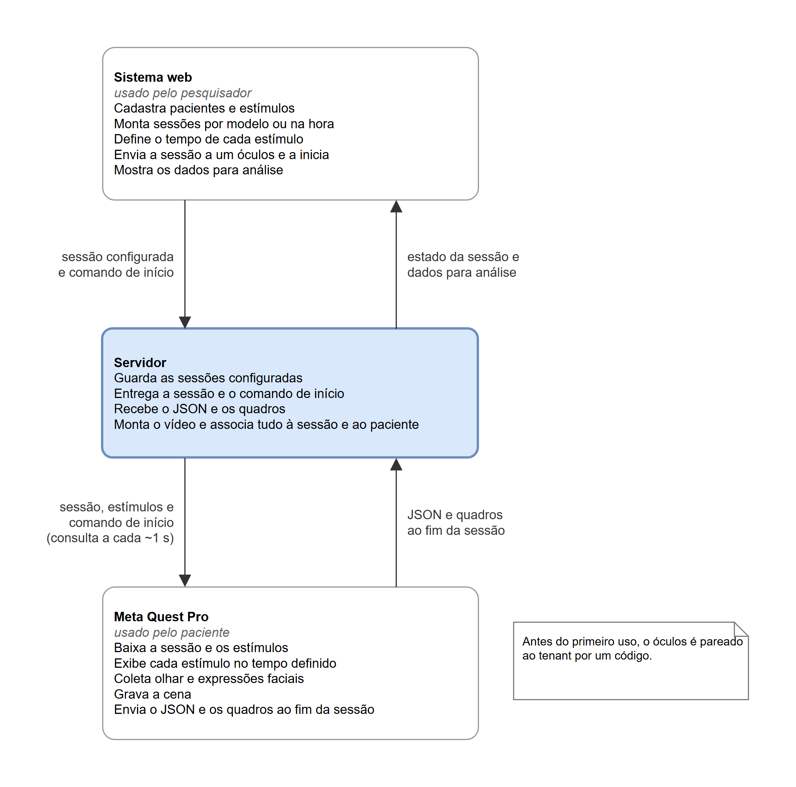

# IV. Resultados (abertura) e IV.A Arquitetura do Sistema

Versão de trabalho de 26/10/2026. Continua o texto da [Seção III](III-Metodo-e-tecnologias.md) e segue o formato da Seção IV.A do exemplo: parágrafo de abertura, figura da arquitetura, descrição dos componentes e subseções numeradas com título na linha do texto, como em "1) Integração com o SIGA:" no exemplo. Base: [Arquitetura-NeuroSight.md](../Especificacao/Arquitetura-NeuroSight.md), [Diagramas-de-sequencia-NeuroSight.md](../Especificacao/Diagramas-de-sequencia-NeuroSight.md), [Modelo-logico-relacional-NeuroSight.md](../Especificacao/Modelo-logico-relacional-NeuroSight.md) e [Requisitos-NeuroSight.md](../Especificacao/Requisitos-NeuroSight.md).

## Como usar este arquivo

- **Convenções:** as mesmas da Seção III. As citações aparecem como chaves entre colchetes, e as referências novas estão no fim do arquivo.
- **Chaves repetidas:** [IC], [POSTGRES] e [META-MOVE] já aparecem na Seção III e mantêm o número que receberem lá. [EKMAN] e [LGPD] são obras do 1.1 que devem ser citadas antes, na Seção II.
- **Figuras:** continuam a numeração da Seção III, que tem as Figuras 1 e 2. Aqui ficam as Figuras 3 e 4.
- **Tempo verbal:** a arquitetura está descrita no presente, como proposta. O que depende do desenvolvimento está no futuro.

---

## IV. RESULTADOS

Esta seção apresenta o resultado da etapa de modelagem: a arquitetura proposta para o NeuroSight, com os seus componentes, a comunicação entre eles, os dados coletados em cada sessão e os mecanismos de segurança. A apresentação do sistema implementado e das suas funcionalidades será feita na etapa de desenvolvimento (TCC2); os protótipos das telas, que antecipam essa apresentação, fazem parte da documentação completa.

### A. Arquitetura do Sistema

A arquitetura geral do sistema é representada pela Figura 3. Conforme apresentado na Tabela 2, ela se baseia em tecnologias atuais e amplamente utilizadas, como Unreal Engine, NestJS, Next.js e PostgreSQL. O sistema tem três partes: o aplicativo de coleta, executado no Meta Quest Pro; o sistema web, acessado pelo navegador; e o servidor, que reúne a interface de programação de aplicações (API, do inglês *Application Programming Interface*), o banco de dados, os arquivos e o processamento das sessões.

**FIGURA 3** - Arquitetura do NeuroSight.

FONTE: O autor (2026).

Na Figura 3, observa-se o aplicativo de coleta, desenvolvido a partir do protótipo da IC, que baixa a sessão e os estímulos, apresenta os estímulos ao paciente, coleta o olhar e as expressões faciais, captura os quadros da cena e envia os dados ao servidor. O sistema web é a interface dos pesquisadores e dos administradores e não contém regras de negócio. Essas regras ficam na API, que também é responsável pela autenticação, pelo isolamento entre os grupos de pesquisa, pelo registro de auditoria e pela entrega dos arquivos. A API acessa o banco de dados por meio do Prisma e guarda os arquivos (estímulos, dados brutos das sessões, quadros e vídeos) no disco do servidor, atrás de uma interface que permite trocar o disco por um serviço de armazenamento compatível com o Amazon S3 sem alterar o restante do sistema. O processamento é executado em segundo plano, a partir de uma fila de tarefas mantida no próprio banco pela biblioteca pg-boss [PGBOSS]: ele importa as amostras de cada sessão para o banco e monta o vídeo com o FFmpeg. Por fim, um serviço externo de e-mail envia as mensagens de confirmação de cadastro, de convite e de redefinição de senha.

Os componentes do servidor rodam em contêineres, orquestrados pelo Docker Compose, com um *proxy* reverso responsável pela conexão segura (HTTPS, do inglês *Hypertext Transfer Protocol Secure*). Assim, o sistema pode ser instalado em um servidor virtual privado (VPS, do inglês *Virtual Private Server*) contratado, de preferência hospedado no Brasil, ou em um servidor da própria instituição de pesquisa. A escolha cabe ao protocolo de cada pesquisa, aprovado pelo CEP, já que o art. 13 da LGPD prevê que os dados de estudos em saúde pública sejam tratados dentro do órgão de pesquisa [LGPD]. O banco de dados e os arquivos terão cópia de segurança diária. Não há comunicação direta entre o sistema web e o óculos: as duas partes falam apenas com a API, como detalhado a seguir.

*1) Multi-tenant:* Cada instituição ou grupo de pesquisa cadastrado no NeuroSight corresponde a um *tenant*, e uma única instalação atende a todos. Os dados ficam em um banco único, em que toda tabela com dados de um *tenant* tem a coluna `tenant_id`. O isolamento é feito em duas camadas. Na primeira, a API filtra cada consulta pelo *tenant* do usuário, informado no *token* de acesso. Na segunda, o PostgreSQL aplica em cada tabela uma política de *Row-Level Security* (RLS) [POSTGRES], que só devolve as linhas do *tenant* definido para a transação em curso. Assim, um filtro esquecido no código não expõe dados de outro grupo. Como a checagem de chaves estrangeiras não passa pelo RLS, as relações entre as tabelas usam chaves compostas com o *tenant*, o que impede, por exemplo, que uma sessão aponte para o paciente de outro grupo. A API acessa o banco com um papel que não pode ignorar o RLS; um segundo papel, que pode, é usado apenas nas operações feitas antes de existir um *tenant* no contexto, como o autocadastro, o *login* e o pareamento dos óculos. Os arquivos também são separados em pastas por *tenant* e só são entregues pela API, depois da checagem de permissão.

*2) Comunicação entre sistema web, servidor e óculos:* O sistema web e o aplicativo do óculos se comunicam apenas com a API, por HTTPS, no estilo REST (*Representational State Transfer*). A API será documentada em OpenAPI [OPENAPI], que serve de contrato entre o servidor e o aplicativo. A Figura 4 resume o fluxo de uma sessão.

**FIGURA 4** - Fluxo de uma sessão no NeuroSight.

FONTE: O autor (2026).

Antes do primeiro uso, cada óculos é pareado ao *tenant*. O aplicativo pede ao servidor um código curto, que exibe na tela, e recebe também um segredo. Um administrador digita o código no sistema web e, a partir daí, o segredo passa a valer como *token* de acesso do aparelho, que pode ser revogado a qualquer momento. O mecanismo simplifica o fluxo de autorização de dispositivos do OAuth 2.0 [RFC8628] e dispensa digitar senhas no óculos.

Para executar uma sessão, o pesquisador a configura no sistema web e a envia a um óculos pareado. Enquanto aguarda, o aplicativo consulta o servidor a cada segundo, aproximadamente. Essa mesma consulta indica que o aparelho está ligado, entrega a sessão e transmite o comando de início. Ao receber a sessão, o aplicativo baixa os estímulos que ainda não tem, verifica se o rastreamento ocular e o facial estão ativos e avisa o servidor de que está pronto; só então o sistema web libera o botão "Iniciar". Com o óculos já posicionado no paciente, o pesquisador clica em "Iniciar", e o aplicativo começa a sessão na consulta seguinte, em até cerca de 2 segundos. Daí em diante, a execução não depende da rede: a sessão segue até o fim do tempo configurado, sem interrupção, e os dados são gravados no próprio óculos. Ao longo do processo, a sessão passa pelos estados rascunho, enviada ao óculos, baixada, início solicitado, em execução, enviando, processando e concluída, ou falha, que o sistema web exibe ao pesquisador.

Optou-se por não espelhar no sistema web a imagem vista pelo paciente: o pesquisador acompanha o estado da sessão e analisa os dados depois que ela termina. Com isso, a comunicação dispensa conexões permanentes, como as de WebSocket, e o óculos e o computador do pesquisador não precisam estar na mesma rede, bastando acesso à internet. Em contrapartida, o óculos precisa estar conectado no momento do início.

*3) Dados coletados e gravação:* Durante a sessão, o aplicativo registra três tipos de dado, todos marcados pelo mesmo relógio do óculos. O primeiro são os eventos de estímulo, com o instante real em que cada estímulo começou e terminou de ser exibido, que pode diferir do tempo configurado, por exemplo, enquanto um vídeo carrega. O segundo é o olhar, amostrado a cada quadro de renderização, com a validade, a confiança, o ponto observado na cena e a sua posição tanto na imagem gravada quanto no próprio estímulo. O terceiro são as expressões faciais: cerca de 70 expressões baseadas no FACS [EKMAN], fornecidas pelo kit de desenvolvimento (SDK, do inglês *Software Development Kit*) da Meta [META-MOVE], cada uma com intensidade de 0 a 1 e indicação de validade. Esses dados formam um arquivo JSON (*JavaScript Object Notation*), gravado em intervalos curtos para não se perderem caso o aplicativo seja fechado. Como na IC, o aplicativo também captura quadros da cena exibida ao paciente, em JPEG, que servem para montar o vídeo da sessão.

Ao fim da sessão, o aplicativo envia primeiro o JSON e depois os quadros, em lotes. Um lote que falha é reenviado, e um lote repetido não duplica dados. Sem conexão, os dados ficam guardados no óculos, que tenta o envio de novo mais tarde, e só são apagados do aparelho depois que o servidor confirma o recebimento. No servidor, o processamento importa os eventos e as amostras do JSON para tabelas do banco, o que facilita os gráficos e o resumo por estímulo, e monta o vídeo MP4, em H.264, com o FFmpeg. O JSON original é guardado sem alterações, e os dados coletados não podem ser modificados: o pesquisador registra apenas anotações e dados descritivos da sessão. Na IC, cada minuto de gravação, a cerca de 22 quadros por segundo, gerou aproximadamente 88 MB [IC]. Com base nessa medição, estima-se que uma sessão de 5 minutos, com quadros de 1024 × 1024 pixels capturados a 15 quadros por segundo, gere cerca de 300 MB, valor que será medido no NeuroSight.

*4) Segurança e auditoria:* Toda comunicação usa HTTPS, e toda chamada à API exige um *token*: um JSON Web Token (JWT) [JWT], que identifica o usuário, o *tenant* e o perfil, ou o *token* próprio de cada óculos. As senhas são guardadas apenas na forma de *hash*. Os perfis são cumulativos: o administrador pode tudo o que o pesquisador pode, e o proprietário, tudo o que o administrador pode. Os dados de uma sessão só ficam visíveis para quem a criou, para o proprietário, para os administradores e para os usuários que um administrador autorizar. O sistema registra automaticamente quem fez cada ação, quando e em qual registro, abrangendo *login*, criação, edição e exclusão de dados, envio e início de sessões, visualização e exportação dos dados de uma sessão e mudanças de permissão. Os registros de auditoria não podem ser alterados nem excluídos, restrição garantida no próprio banco, pois o papel usado pela API não tem permissão para isso.

Os dados de saúde são dados pessoais sensíveis segundo a LGPD [LGPD], e o sistema foi modelado para guardar apenas o necessário à pesquisa. O paciente é identificado por um código; o nome é opcional e nunca chega ao óculos, que exibe só o código. O aplicativo não captura imagens do rosto do paciente, apenas os valores das expressões, e a gravação mostra somente o que o paciente viu. O consentimento para a participação fica a cargo do protocolo de cada pesquisa, discutido na Seção II, e não é tratado pelo sistema.

*5) Riscos e limitações:* Três pontos da arquitetura ainda dependem de verificação. O primeiro é a leitura das expressões faciais no Unreal Engine. O protótipo da IC lê apenas o olhar, pelo padrão OpenXR, e as opções de rastreamento da Meta, que fornecem as expressões, exigem outra integração do motor, incompatível com a usada no protótipo [IC]. Por isso, a primeira tarefa do desenvolvimento será uma prova de conceito que leia o olhar e as expressões ao mesmo tempo e meça a taxa de amostragem obtida com a captura de quadros ativa, que na IC ficou em 22 Hz [IC]. Se a prova de conceito falhar, a alternativa é desenvolver o aplicativo em Unity, em que o olhar e as expressões vêm do mesmo SDK. O segundo ponto é o equipamento: o Meta Quest Pro saiu de linha em janeiro de 2025 [HAYDEN]. O grupo de pesquisa dispõe do aparelho usado na IC, mas a reposição, em caso de defeito, seria difícil. O terceiro é a dependência de internet no momento do início, já que o comando sai do sistema web e chega ao óculos pelo servidor; por isso, a rede do local da coleta precisa ser testada antes dos experimentos.

---

## Referências novas nesta seção

Na ordem em que aparecem no texto, no formato do modelo. [IC], [POSTGRES] e [META-MOVE] estão na lista da Seção III.

- **[PGBOSS]** PG-BOSS. *pg-boss: queueing jobs in Postgres from Node.js*. GitHub, 2026. Disponível em: https://github.com/timgit/pg-boss. Acesso em: 26 out. 2026.
- **[OPENAPI]** OPENAPI INITIATIVE. *OpenAPI Specification*: version 3.2.1. 2026. Disponível em: https://spec.openapis.org/oas/v3.2.1.html. Acesso em: 26 out. 2026.
- **[RFC8628]** DENNISS, W. *et al*. *OAuth 2.0 Device Authorization Grant*. RFC 8628. [S.l.]: IETF, 2019. Disponível em: https://www.rfc-editor.org/rfc/rfc8628. Acesso em: 26 out. 2026.
- **[EKMAN]** EKMAN, P.; FRIESEN, W. V. *Facial Action Coding System: a technique for the measurement of facial movement*. Palo Alto: Consulting Psychologists Press, 1978. (Já citada no 1.1.)
- **[JWT]** JONES, M.; BRADLEY, J.; SAKIMURA, N. *JSON Web Token (JWT)*. RFC 7519. [S.l.]: IETF, 2015. Disponível em: https://www.rfc-editor.org/rfc/rfc7519. Acesso em: 26 out. 2026.
- **[LGPD]** BRASIL. *Lei nº 13.709, de 14 de agosto de 2018*. Lei Geral de Proteção de Dados Pessoais (LGPD). Brasília, DF: Presidência da República, [2018]. Disponível em: https://www.planalto.gov.br/ccivil_03/_ato2015-2018/2018/lei/l13709compilado.htm. Acesso em: 26 out. 2026. (Já citada no 1.1; o endereço é o do texto compilado, com as alterações posteriores.)
- **[HAYDEN]** HAYDEN, S. Meta officially discontinues Quest Pro, its first (and most expensive) mixed reality headset. *Road to VR*, 6 jan. 2025. Disponível em: https://roadtovr.com/meta-discontinues-quest-pro/. Acesso em: 26 out. 2026.

Os endereços responderam em 26/10/2026.

## O que conferir antes de passar para o modelo

1. **Proxy reverso:** o texto não diz qual será. O arquivo de decisões ainda deixa Caddy ou Nginx em aberto.
2. **Fila de tarefas:** o pg-boss está como opcional no arquivo de decisões. Se ele sair, tire a citação [PGBOSS] e mantenha só "fila de tarefas".
3. **Número de expressões faciais:** "cerca de 70" depende da versão do SDK da Meta. Confirme na prova de conceito.
4. **Consentimento:** o texto remete à Seção II. Confira se a II.D trata do consentimento pelo responsável legal, como previsto no checklist.
5. **Figuras 3 e 4:** saíram das duas páginas de [Arquitetura-NeuroSight.drawio](../Especificacao/Arquitetura-NeuroSight.drawio). Se mudar um diagrama, exporte a página de novo no draw.io.
6. **Tamanho:** o texto tem cerca de 1.700 palavras. Se o limite de páginas apertar, os candidatos a corte são o parágrafo dos estados da sessão (o diagrama de classes já os lista) e os detalhes de envio na subseção 3.
